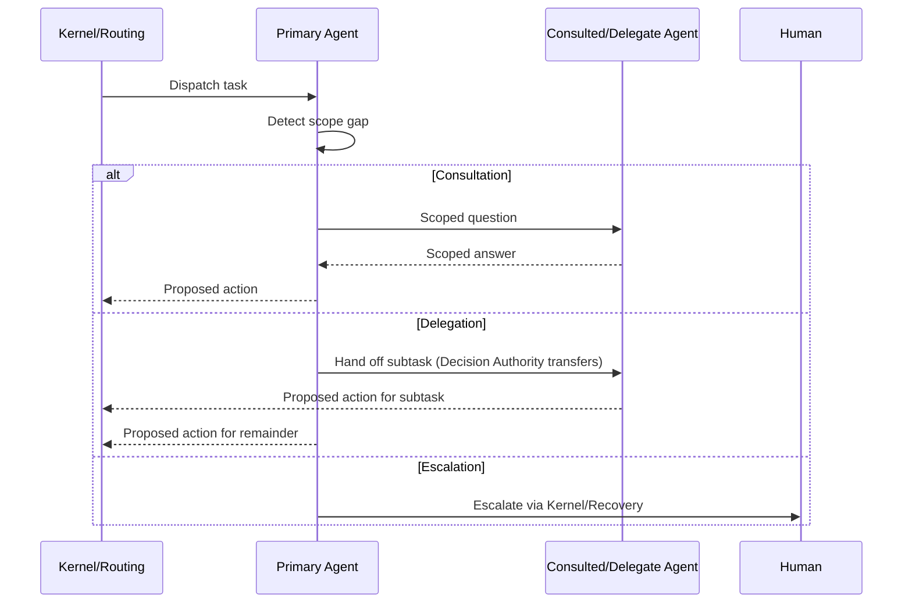
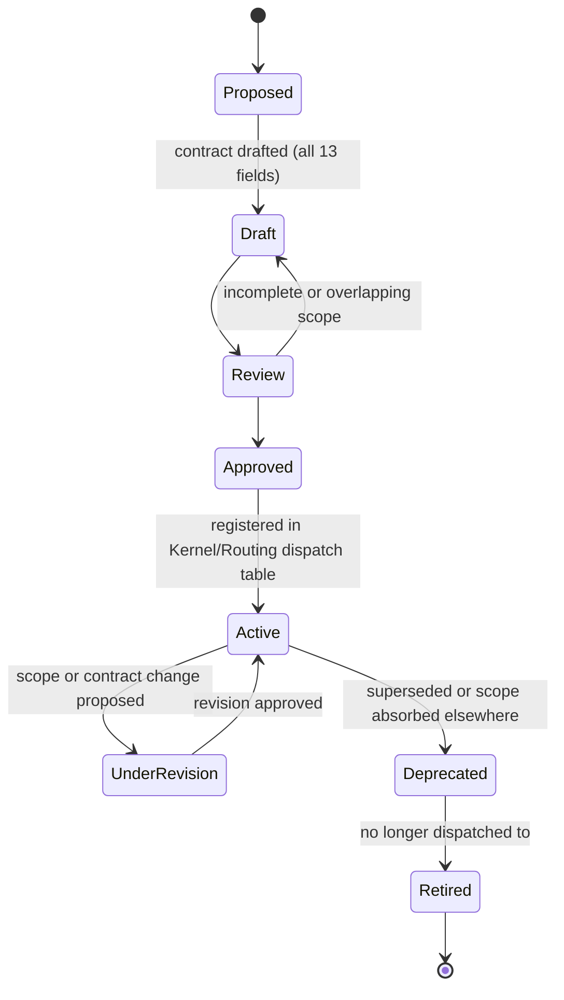
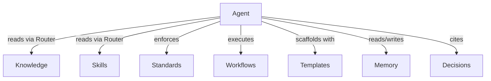
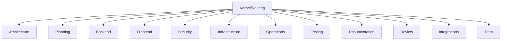

# Agents
## Phase 3: Capability Framework

> Continues from the approved [Kernel](../kernel/README.md). This is the framework every future capability agent inherits — it does not define any individual agent (no Backend agent, no Security agent yet exists).

Status: Approved

Contract origin: [foundation/architecture.md#agents-capability-agents](../foundation/architecture.md#agents-capability-agents).

---

## The Agent Contract

Every capability agent — whenever one is created — must fill in all thirteen fields below before it can move past `Draft` in its lifecycle. This is the interface; individual agents are implementations of it.

| Field | Meaning |
|---|---|
| Purpose | One sentence: what domain this agent owns. |
| Responsibilities | What it does within that domain. |
| Inputs | What it accepts (always: a routed task + a Kernel/Loading-resolved context bundle). |
| Outputs | What it produces (always: a proposed action, returned to Kernel/Validation). |
| Consumers | Who dispatches to it (always: Kernel/Routing) and who may consult it (other agents). |
| Dependencies | Which other agents it routinely needs (informs the collaboration graph). |
| Knowledge Sources | Which `knowledge/` categories it's scoped to read. |
| Skills Used | Which `skills/` entries it applies. |
| Standards Enforced | Which `standards/` entries it must validate its output against. |
| Workflows Used | Which `workflows/` it operates under, if any. |
| Templates Used | Which `templates/` it scaffolds with. |
| Decision Authority | What it may decide unilaterally vs. what requires escalation (see below). |
| Escalation Rules | Exactly when it must stop and hand off — to another agent or to a human. |

No agent contract is valid without an explicit **Decision Authority** boundary. An agent that can silently expand its own authority defeats the scope-boundary principle this framework exists to enforce.

---

## Scope Boundaries & Context Ownership

Every agent must be able to answer three questions about itself, and the answers are part of its contract:

- **What it owns** — the domain it has Decision Authority over (e.g., the Backend agent owns `mcp-server/` conventions).
- **What it can access** — everything reachable through the [Router](../router/README.md), same as any other consumer. An agent has no private shortcut into another module.
- **What it should never load** — another agent's Decision-Authority domain, and any Knowledge/Skill/Standard category outside its declared Knowledge Sources / Skills Used, even if technically reachable. Loading it "just to check" is the context-inflation failure mode Phase 0 exists to prevent, scoped down to agent level.

An agent never knows everything by design — see Collaboration below for what happens when a task needs knowledge the agent doesn't own.

---

## Collaboration Model

An agent facing a task partially or fully outside its scope has exactly three moves, chosen by the size and ownership of the gap:

| Move | When | Who ends up responsible |
|---|---|---|
| **Consultation** | The agent needs a scoped fact/answer from another domain but the task itself stays in-scope. | The consulting agent — it keeps ownership and Decision Authority. |
| **Delegation** | A clean, self-contained subtask falls entirely in another agent's domain. | The delegate agent — full Decision Authority transfers for that subtask. |
| **Escalation** | No agent has Decision Authority over the gap, sources conflict, or the gap is safety/security-relevant. | A human, via [Kernel/Recovery](../kernel/recovery/README.md). |

An agent must never silently guess across a scope boundary — that is a Recovery-level conflict (see [kernel/recovery](../kernel/recovery/README.md)), not a judgment call the agent gets to make alone.

---

## Context Budget

Agents inherit [Kernel/Loading](../kernel/loading/README.md)'s tiering, scoped further:

- **Maximum recommended context** — one domain index (the agent's own) plus the specific addressed units the current task requires. An agent requesting a second domain's full index is a signal it should have delegated or consulted instead of expanding its own load.
- **Incremental loading** — an agent starts with the minimum addressed units the Router returned; it requests more only when [Kernel's stop-loading decision](../kernel/README.md#when-to-stop-loading-context) determines the task isn't yet answerable.
- **Lazy loading** — nothing outside the current task's addressed units is fetched, even if "likely to be needed later this session."
- **Dependency loading** — if an addressed Skill declares a Knowledge dependency, that dependency loads next, same as the Kernel-level rule, just evaluated within the agent's own domain first before crossing into Consultation/Delegation.

---

## Agent Lifecycle

## Agent Dependency Graph (per instance)

## Capability Hierarchy (known future domains)

Flat by design — no agent is a parent of another; all sit as peers under Kernel/Routing's dispatch table, collaborating laterally per the model above.

None of these are instantiated yet — this list is the anticipated domain set from the [vision](../foundation/vision.md), not a commitment to build all twelve immediately. Each is created only when a real task needs it.

---

## Governance

- **Creating a new agent** — draft the full 13-field contract, verify against the Registry below that no existing `Active` agent already claims the proposed Decision-Authority domain (overlapping scopes are rejected at Review, not resolved later by convention), then move through the lifecycle states above.
- **Deprecating an agent** — mark `Deprecated` in the Registry; Kernel/Routing stops dispatching to it; anything that named it directly gets a migration note pointing to its successor.
- **Versioning** — a Decision-Authority or scope change is a breaking (major) change and requires a full Review pass; adding a Knowledge Source, Skill, or Standard to an existing contract without changing its scope is additive (minor) and does not require re-approval. Full semantic versioning mechanics are governed project-wide by [Phase 15 Governance](../governance/README.md).

## Registry

No agents have been created yet — this framework defines the contract they'll be created against. The Registry becomes the [Router](../router/README.md)'s source for capability-detection once the first agent reaches `Active`.

| Agent | Domain | Status | Contract |
|---|---|---|---|
| — | — | — | — |
