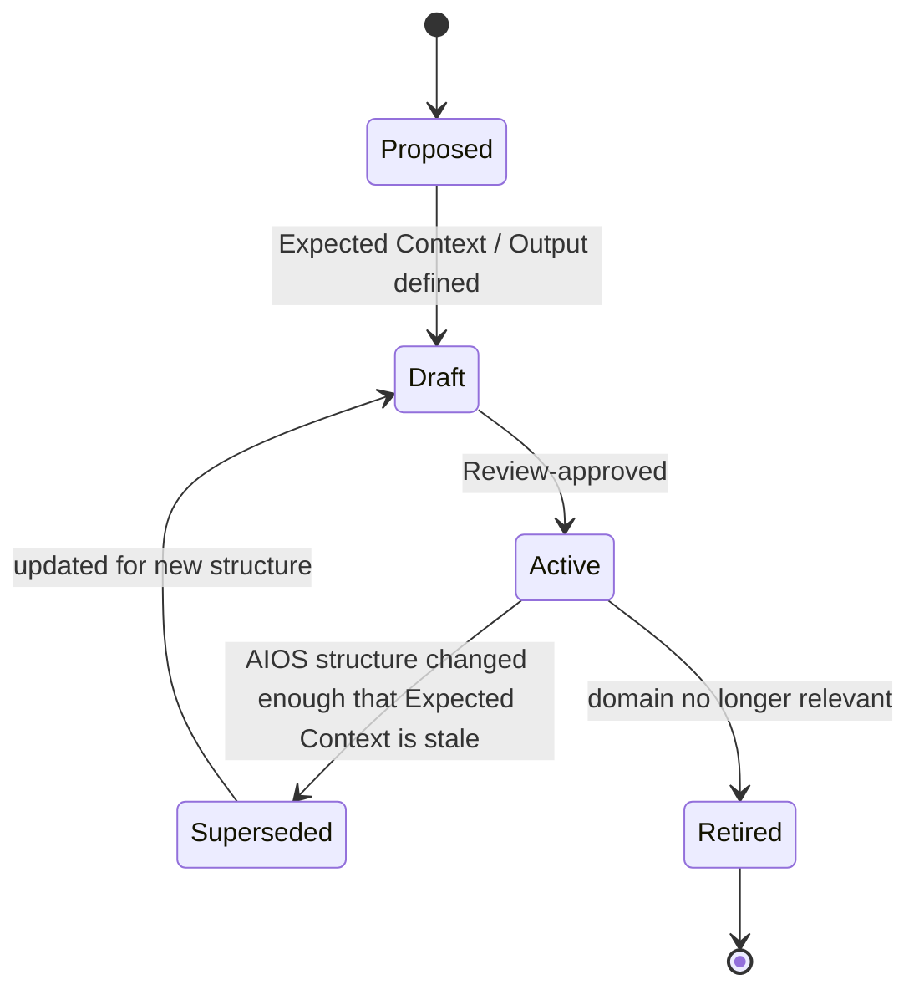
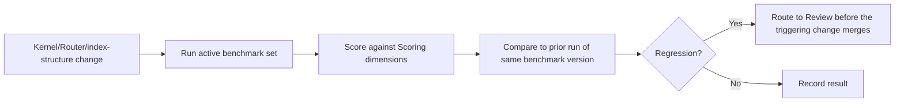

# Evaluation
## Phase 14: Evaluation Framework

> New top-level meta-module, added additively alongside [Review](../review/README.md) and [Governance](../governance/README.md) (see [Architecture: Expansion Strategy](../foundation/architecture.md#expansion-strategy)). Where Review judges a single asset before acceptance, Evaluation judges the AIOS as a whole, continuously, against the [Success Metrics](../foundation/vision.md#success-metrics) Phase 0 defined.

Status: Approved

---

## Evaluation Categories

| Category | Question it answers | Source metric (Phase 0) |
|---|---|---|
| Task Success | Did the AI complete the benchmark task correctly? | — |
| Context Efficiency | How much of the total corpus did it cost? | Context efficiency |
| Architecture Consistency | Did the output respect module boundaries? | Consistency |
| Maintainability | Would a human find the output easy to review/change later? | — |
| Knowledge Discovery | Did the Router find the right units, not just any units? | Knowledge freshness (indirectly) |
| Routing Accuracy | Did Kernel/Routing pick the right Agent(s)? | Consistency |
| Template Reuse | Was an applicable Template used instead of freehand output? | Onboarding cost (indirectly) |
| Skill Reuse | Was an applicable Skill used instead of reinvented procedure? | — |
| Blueprint Effectiveness | Did a matching Blueprint reduce discovery cost, measurably? | Context efficiency |

Each category maps back to a [Phase 0 Success Metric](../foundation/vision.md#success-metrics) so Evaluation is never scoring something the Vision didn't ask for.

---

## Benchmark Tasks

Chosen to exercise the full path — Kernel → Router → Agent → module discovery → output — across representative domains:

| Benchmark | Exercises |
|---|---|
| Implement API | [Router's own worked example](../router/README.md#worked-routing-examples); Backend Agent |
| Create Scanner | Security + Integration knowledge, Infrastructure Agent |
| Fix Bug | Minimal-context path — should resolve to the *fewest* addresses of any benchmark |
| Review PR | [Review Framework](../review/README.md) end-to-end |
| Deploy Service | [Router's Kubernetes example](../router/README.md#worked-routing-examples); Infrastructure Agent |
| Create Dashboard | Frontend Agent, `web/` platform knowledge |
| Create Notification | Cross-agent collaboration (Backend + Frontend/Bot) |
| Threat Modeling | Security Agent, Guardrails/Policy consultation |

## Benchmark Contract

| Field | Meaning |
|---|---|
| Objective | What correct completion looks like, in one sentence. |
| Expected Inputs | The task prompt and starting repo state. |
| Expected Context | The address list a correctly-routed session should fetch — the benchmark's own "answer key" for Context Efficiency and Routing Accuracy. |
| Expected Output | The artifact shape a correct run produces. |
| Success Criteria | Objective pass conditions. |
| Failure Criteria | Objective fail conditions — including "fetched more than Expected Context without justification." |
| Scoring | How the six dimensions below combine into a result. |

---

## Scoring

| Dimension | Measured as |
|---|---|
| Accuracy | Output matches Expected Output's shape and content correctness. |
| Completeness | Output satisfies the full Objective, not a partial slice. |
| Consistency | Same benchmark, run twice (or by two different vendor adapters), produces the same governing answer — directly testing Phase 0's Consistency metric. |
| Token Usage | Actual fetched context size vs. Expected Context — large deviations without a documented reason are penalized regardless of whether the task still succeeded. |
| Reasoning Quality | Declared-vs-inferred distinction honored (per [Kernel/Behavior](../kernel/behavior/README.md)); escalations happened when they should have. |
| Maintainability | A human reviewer's Review-framework score (see [Review](../review/README.md)) on the produced asset, where applicable. |

A benchmark's overall result is `Pass` only if Accuracy and Completeness pass and no Failure Criterion triggered — Token Usage and Reasoning Quality affect a secondary efficiency/quality score, not pass/fail, since a correct-but-inefficient run is a different problem than an incorrect one.

## Benchmark Lifecycle

---

## Regression Testing

- **When it runs** — after any change to Kernel, Router, or a module's category index structure (not after every single unit addition, which would make Evaluation itself a bottleneck disproportionate to a one-line Knowledge edit).
- **How improvement is measured** — a benchmark's Token Usage and Reasoning Quality scores are compared run-over-run for the same benchmark version; Accuracy/Completeness are pass/fail and don't have a "degree" to trend, but a benchmark flipping from Pass to Fail after a structural change is the headline regression signal.
- **How results compare** — against the immediately preceding run of the same benchmark version, not against an absolute historical baseline, since the corpus is expected to grow (more addressable units) even as per-task efficiency should hold flat per [Architecture: Scalability Strategy](../foundation/architecture.md#scalability-strategy-100--200--500-documents).

## Evaluation Pipeline

## Scoring Dashboard

Not a specific tool (binding to one would repeat the vendor-lock-in mistake Phase 0 warns against) — conceptually, a per-benchmark table of `{version, last run, Pass/Fail, Token Usage delta, Reasoning Quality delta}`, consulted at the [Governance](../governance/README.md) RFC review point for any change that touches Kernel or Router.

---

## Index

No benchmark results exist yet — no Agents or Workflows are instantiated to run them against.

| Benchmark | Version | Last Run | Result |
|---|---|---|---|
| Implement API | — | — | not yet run |
| Create Scanner | — | — | not yet run |
| Fix Bug | — | — | not yet run |
| Review PR | — | — | not yet run |
| Deploy Service | — | — | not yet run |
| Create Dashboard | — | — | not yet run |
| Create Notification | — | — | not yet run |
| Threat Modeling | — | — | not yet run |
