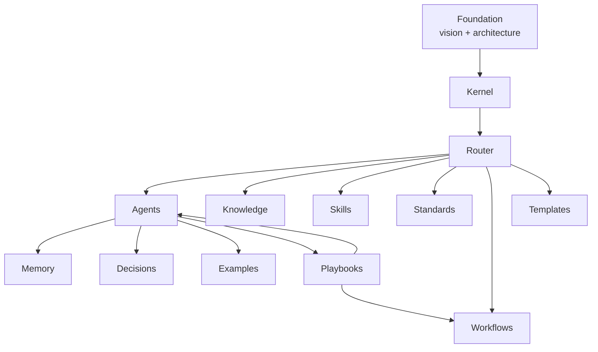
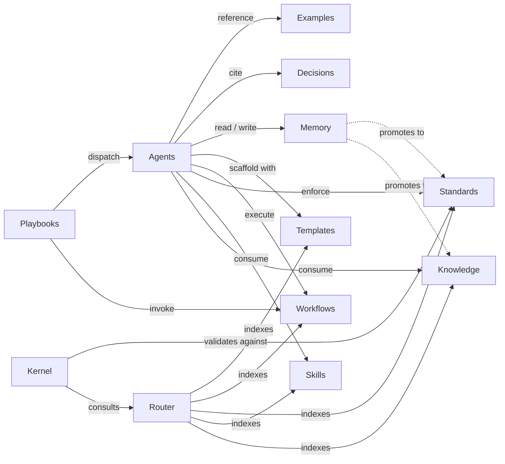
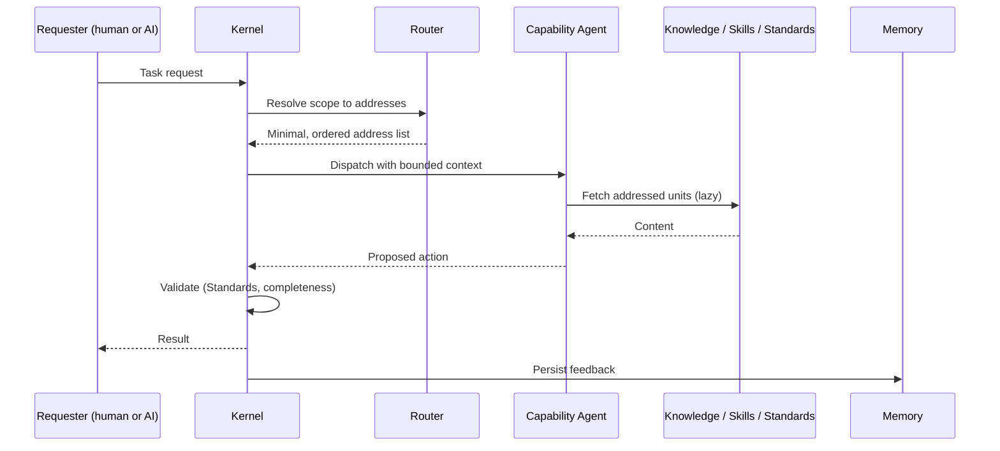
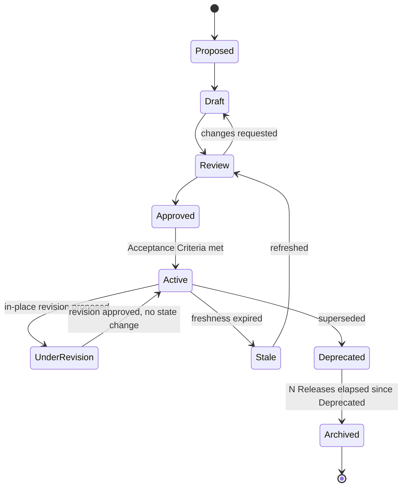
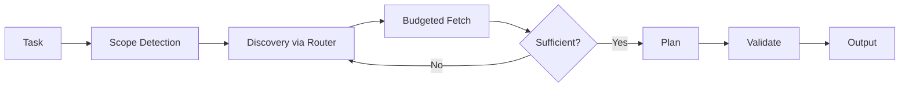

# Guardrail Hub — AIOS Architecture
## Phase 1: AI Operating System Architecture

> Continues from [Phase 0 — Vision & Principles](vision.md). Assumes Phase 0 is approved. This document defines the AIOS itself, not the Guardrail Hub application.

Status: Approved

---

## Overview

Phase 0 established the philosophy: a kernel that is always resident, an address space that maps tasks to knowledge without loading it, domain knowledge that is scoped and addressable, a policy layer consulted before action, and vendor adapters at the edge. This document turns that philosophy into a modular structure: twelve independent modules under `.ai/`, their contracts, their dependencies, and how they interact at runtime.

Every module below is designed to satisfy the same seven properties, so no module is a special case:

- **High cohesion** — a module owns one kind of thing (facts, or execution know-how, or rules, or process, or scaffolds) and nothing else.
- **Low coupling** — modules depend on each other through narrow, declared contracts (an index, an address, a reference), never by reaching into each other's internals.
- **Minimal context** — a module is never loaded in full "just in case"; only the addressed unit is fetched.
- **Lazy loading** — nothing loads until the Router resolves it as required for the current task.
- **Modular evolution** — a new module, or a new entry within a module, is additive. Nothing upstream has to change.
- **Versionability** — every unit carries enough metadata to know when it was true and whether it still is.
- **Reviewability** — every unit is small enough that a human can review a change to it in isolation.

---

## The `.ai` Directory Design

```
.ai/
├── README.md                 # Top-level index — the only file every session loads
├── foundation/                # The constitution: philosophy + this architecture (Phase 0-1)
│   ├── vision.md
│   └── architecture.md
├── kernel/                    # Always-resident runtime behavior (Phase 2)
│   ├── README.md
│   ├── boot/
│   ├── behavior/
│   ├── routing/
│   ├── loading/
│   ├── guardrails/
│   ├── lifecycle/
│   ├── validation/
│   └── recovery/
├── router/                    # Context Router — address space (Phase 10)
├── agents/                    # Capability Agent Framework (Phase 3)
├── knowledge/                 # Knowledge System — what is true (Phase 4)
├── skills/                    # Skill System — how to execute (Phase 5)
├── standards/                 # Standards Framework — mandatory rules (Phase 6)
├── workflows/                 # Workflow Framework — how work progresses (Phase 7)
├── templates/                 # Template Framework — reusable scaffolds (Phase 8)
├── memory/                    # Memory Framework — cross-session feedback (Phase 9)
├── decisions/                 # Decision Records — why the product was built this way
├── examples/                  # Worked, concrete illustrations
└── playbooks/                 # End-to-end request → workflow bindings (Phase 11 = Blueprints)
```

Each top-level module directory is the *address*, not the content. Only `foundation/` and `kernel/` are expected to be read in most sessions (they are small and near-constitutional); every other module is read only when the Router resolves a task into it.

---

## Module Hierarchy



---

## Module Contracts

Each module is described the same way: Purpose, Responsibility, Inputs, Outputs, Dependencies, Consumers, Owner, Lifecycle. Full internal design for modules whose phase hasn't run yet is intentionally deferred — only the contract is fixed now, so later phases have a stable interface to build against.

### Kernel
- **Purpose** — the orchestration substrate every AI assistant session boots into.
- **Responsibility** — startup sequence, context budgeting, dispatch to capability, validation gates, safety enforcement, failure recovery.
- **Inputs** — the incoming task, repository state, prior Memory feedback.
- **Outputs** — a bounded execution plan and a validated response.
- **Dependencies** — Router (discovery), Standards (validation rules), the Policy layer (safety).
- **Consumers** — every AI assistant, via a thin vendor adapter.
- **Owner** — AIOS architecture maintainers.
- **Lifecycle** — near-immutable. Changes require governance review (Phase 15).
- **Spec status** — defined in [kernel/README.md](../kernel/README.md) (this phase).

### Router
- **Purpose** — the address space: maps a task/domain to the *locations* of relevant knowledge, without loading it.
- **Responsibility** — task classification, capability detection, knowledge discovery, dependency/priority/lazy loading order, routing cache.
- **Inputs** — task description and scope handed down by the Kernel.
- **Outputs** — an ordered list of addresses into Knowledge/Skills/Standards/Workflows/Templates.
- **Dependencies** — the index each of those modules publishes about itself.
- **Consumers** — Kernel, Agents.
- **Owner** — AIOS architecture maintainers.
- **Lifecycle** — grows additively as domains register. Full design deferred to Phase 10.

### Agents (Capability Agents)
- **Purpose** — domain-scoped executors (Backend, Frontend, Security, Infrastructure, …) that act within a bounded scope.
- **Responsibility** — consume routed Knowledge/Skills/Standards/Workflows/Templates for their domain; escalate rather than reach outside their scope.
- **Inputs** — a routed task plus the minimal context bundle the Router resolved.
- **Outputs** — a proposed action or change within the agent's domain boundary.
- **Dependencies** — Knowledge, Skills, Standards, Workflows, Templates, Memory.
- **Consumers** — Kernel (dispatches to them), other Agents (collaboration/escalation).
- **Owner** — the human owner of that domain (e.g., backend lead owns the Backend agent contract).
- **Lifecycle** — additive; new agents register without touching the Kernel. Full design deferred to Phase 3.

### Knowledge
- **Purpose** — reusable factual project intelligence: what is true, not what to do.
- **Responsibility** — hold small, independently addressable, traceable units with owner and freshness metadata.
- **Inputs** — real system state, human-curated facts, promoted Memory entries.
- **Outputs** — retrievable knowledge units.
- **Dependencies** — none structurally (a leaf module); may cite Decisions as a source.
- **Consumers** — Agents, Router (indexes it), Skills (cite it).
- **Owner** — the domain owner the knowledge describes.
- **Lifecycle** — versioned and staleness-tracked. Full design deferred to Phase 4.

### Skills
- **Purpose** — reusable execution know-how (Python, Docker, testing, …): how to do, not what is true.
- **Responsibility** — define prerequisites, procedure, and which Standards a skill enforces when applied.
- **Inputs** — a task requiring a specific execution capability.
- **Outputs** — procedural guidance an Agent applies.
- **Dependencies** — Knowledge (concepts it assumes), Standards (rules it enforces).
- **Consumers** — Agents.
- **Owner** — the domain owner. **Lifecycle** — composable and inheritable. Full design deferred to Phase 5.

### Standards
- **Purpose** — mandatory rules every assistant must follow (naming, architecture, security, …).
- **Responsibility** — define non-negotiable rules, documented exceptions, and act as a validation gate.
- **Inputs** — governance decisions.
- **Outputs** — pass/fail validation criteria consumed by the Kernel's validation gate.
- **Dependencies** — none (foundational); scoped by category.
- **Consumers** — Kernel, Agents, Skills, Workflows.
- **Owner** — architecture/governance owners. **Lifecycle** — versioned and reviewed. Full design deferred to Phase 6.

### Workflows
- **Purpose** — how work progresses: states, triggers, actors for repeatable processes (feature dev, bug fix, PR review, …).
- **Responsibility** — sequence Agents, Knowledge, Skills, Standards, Templates into a process with success/failure criteria.
- **Inputs** — a triggered task type.
- **Outputs** — a stateful process instance.
- **Dependencies** — Agents, Knowledge, Skills, Standards, Templates.
- **Consumers** — Agents, Playbooks.
- **Owner** — process owners. **Lifecycle** — composable and versioned. Full design deferred to Phase 7.

### Templates
- **Purpose** — reusable structural scaffolds (API, service, ADR, Dockerfile, …) that reduce hallucination by constraining output shape.
- **Responsibility** — define inputs, customization points, and validation rules for the artifact it scaffolds.
- **Inputs** — a generation request of a known shape.
- **Outputs** — a scaffolded artifact.
- **Dependencies** — Standards (validation), Skills (fill-in logic).
- **Consumers** — Agents, Workflows.
- **Owner** — the domain owner. **Lifecycle** — versioned; deprecated templates are replaced, not silently deleted. Full design deferred to Phase 8.

### Memory
- **Purpose** — the system's feedback loop: durable, cross-session-useful intelligence captured from real sessions.
- **Responsibility** — persist corrections and confirmed judgment calls; explicitly exclude ephemeral task state.
- **Inputs** — session outcomes, human corrections and confirmations.
- **Outputs** — retrievable memory entries, some of which get promoted into Knowledge or Standards.
- **Dependencies** — none structurally.
- **Consumers** — Router, Knowledge, Kernel.
- **Owner** — captured automatically, reviewed by a human. **Lifecycle** — retention and pruning policy. Full design deferred to Phase 9.

### Decisions (Decision Records)
- **Purpose** — the durable record of *why* a non-obvious choice was made about the Guardrail Hub product (not about the AIOS itself — that's Phase 15 Governance).
- **Responsibility** — capture context, options considered, decision, and consequences.
- **Inputs** — a human or agent decision moment.
- **Outputs** — an immutable-once-accepted record.
- **Dependencies** — none.
- **Consumers** — Agents, Knowledge (may cite a decision as its source).
- **Owner** — whoever made the decision. **Lifecycle** — append-only; superseded, never deleted.

### Examples
- **Purpose** — worked, concrete illustrations of applying Knowledge/Skills/Standards correctly — show, not tell.
- **Responsibility** — stay grounded in real, current repository code.
- **Inputs** — a completed, correct task.
- **Outputs** — a citable example.
- **Dependencies** — Knowledge, Skills, Standards, Templates.
- **Consumers** — Agents, Skills (link to it as illustration).
- **Owner** — the domain owner. **Lifecycle** — pruned once it no longer matches current code.

### Playbooks
- **Purpose** — the practical entry point: binds a recognizable request ("create API," "fix bug") directly to the right Workflow + Agent + resources, hiding the underlying orchestration from the requester.
- **Responsibility** — bind a request shape to a Workflow with pre-resolved context.
- **Inputs** — a developer or AI request in natural language.
- **Outputs** — an invoked workflow with context already attached.
- **Dependencies** — Workflows, Agents, Knowledge, Skills, Standards, Templates.
- **Consumers** — any AI assistant session, human developers.
- **Owner** — process owners. **Lifecycle** — additive; formalized further as the Blueprint system in Phase 11.

---

## Dependency Graph



## Interaction Diagram



## Lifecycle (per knowledge unit, in any module)

Amended by [Decision 0001](../decisions/0001-aios-bootstrap-roadmap.md), which added `Archived` as a terminal state and an in-place `UnderRevision` loop within `Active` — both generalized from patterns Agents and Knowledge had already introduced independently for their own modules. Every module's own "Lifecycle" section still just links back to this one diagram rather than restating it.



Guardrails is the one documented exception: no `Stale` state, and every change — including what would elsewhere be Patch-level — requires a full RFC rather than following this diagram's informal `Draft`/`Review` path. See [guardrails/README.md](../guardrails/README.md#lifecycle).

The `Approved → Active` transition is guarded by **Acceptance Criteria** (introduced by [RFC-0001](../governance/rfcs/0001-acceptance-criteria.md)): passing Review (`Approved`) establishes *quality*; meeting the unit-type's Acceptance Criteria establishes *readiness to be runtime*. Both are required to reach `Active`. The criteria are per-type and live in each module's contract; see [governance/README.md](../governance/README.md#acceptance).

## Context Flow (per task)



---

## Scalability Strategy: 100+ / 200+ / 500+ Documents

The architecture scales by keeping the *always-loaded* surface constant while the *addressable* surface grows without bound:

- **Partitioning.** Every module is partitioned by domain (e.g., `knowledge/security/`, `knowledge/infrastructure/`). The Router's index is itself domain-partitioned — at 500+ documents it is a two-level lookup (domain → unit), never a flat list a session has to scan.
- **Budget ceilings per tier.** Tier 0 (`foundation/` + `kernel/`) is the only tier loaded on every session and is capped small by convention (it stays "near-immutable" per Phase 0). Tier 1 (a domain's index) is loaded only when a task touches that domain. Tier 2 (individual Knowledge/Skill/Standard/Workflow/Template units) is loaded one address at a time. Growth in total corpus size does not grow Tier 0 or the per-task fetch count — it only grows the address space the Router can reach into.
- **Federation-readiness.** Because Router resolution is a lookup by address, not a scan, the same model extends unmodified in principle to knowledge that later lives in another repository or service (e.g., if the mobile app or a bot becomes its own repo).
- **Deliberate pruning.** A module that stops being retrieved, or is superseded, moves to `Deprecated` in the lifecycle state machine above rather than accumulating silently.

## Expansion Strategy

A new domain (e.g., Kubernetes, a new bot platform) is added by registering new addressable units inside existing modules (`knowledge/kubernetes/`, `skills/kubernetes/`, …) and letting the Router index pick them up. No existing module's contract changes, and `foundation/` and `kernel/` are untouched — this is the "additive evolution" principle from Phase 0 made concrete.

---

## Trade-offs and Recommendations

- **Discoverability over completeness-in-one-shot** — a cross-cutting task may take several Router hops; in exchange, the common case costs a fraction of the corpus. Recommendation: keep per-hop cost visible (log what was fetched) so multi-hop tasks stay diagnosable, once the Kernel's validation/observability design (Phase 2) is in place.
- **Twelve independent modules over a single "docs" folder** — more directories to navigate, but each module can evolve, version, and be owned independently. Recommendation: do not create a 13th top-level module without first checking whether it's actually a new *category within* an existing module (most future needs are).
- **Contracts fixed now, content deferred** — Phases 3–9 will fill in Agents, Knowledge, Skills, Standards, Workflows, Templates, Memory in detail. Recommendation: treat every module's contract in this document as the interface those phases must honor; if a later phase needs to change a contract here, that's a signal to revisit this document explicitly rather than drift silently.

---

## Addendum: Meta-Modules (Phases 12–15)

This document originally fixed twelve modules (Kernel, Router, Agents, Knowledge, Skills, Standards, Workflows, Templates, Memory, Decisions, Examples, Playbooks). Phases 12–15 introduced four more, added under the Expansion Strategy above rather than by editing the twelve original contracts:

| Addition | Location | Nature |
|---|---|---|
| Bootstrap | [foundation/bootstrap.md](bootstrap.md) | Not a new top-level module — a foundational document alongside `vision.md`/this document, since it governs first-contact onboarding rather than a runtime concern. |
| Review | [review/README.md](../review/README.md) | New top-level meta-module — judges individual assets before acceptance. |
| Evaluation | [evaluation/README.md](../evaluation/README.md) | New top-level meta-module — judges the AIOS as a whole, continuously. |
| Governance | [governance/README.md](../governance/README.md) | New top-level meta-module — versioning, RFC process, deprecation for the AIOS itself. |

These three meta-modules are distinguished from the original twelve by what they govern: the original twelve serve product tasks (an Agent doing backend work consumes Knowledge, Skills, etc.); Review, Evaluation, and Governance serve the AIOS's own quality and evolution. Every module — original or meta — still follows the same seven properties from the Overview above, and every phase from 4 onward already pointed to Review as "the Review gate" before Review itself was specified, confirming the dependency was anticipated correctly at Phase 1 even though the module didn't exist yet.
