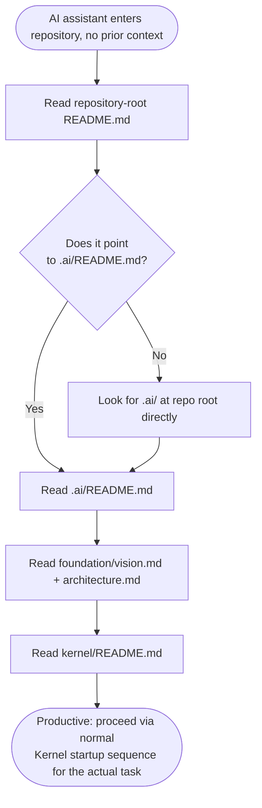
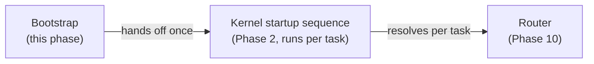
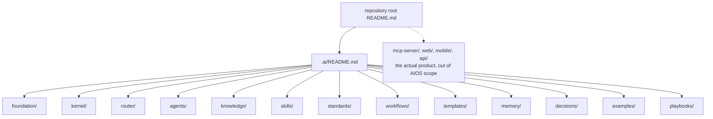

# Repository Bootstrap
## Phase 12: Onboarding Framework

> Continues from the approved AIOS Foundation. Distinct from [Kernel/Boot](../kernel/boot/README.md): Kernel/Boot is the cold-start sequence for a session that already knows the AIOS exists and how to use it. This phase is for the *first* session ever — an assistant, of any vendor, that has never seen this repository before and has to discover the AIOS itself, unassisted, from nothing but the checkout on disk.

Status: Approved

---

## The Problem This Phase Solves

Every other phase assumes an AI assistant already knows to start at `.ai/README.md`. Something has to make that first hop true without a human having to tell every new tool by hand. Bootstrap is that something: a small, predictable discovery path that works whether the assistant opens `README.md` at the repo root, is pointed at a random file, or is asked a question with no context at all.

## Startup Sequence (first contact)

This path costs the same small, fixed set of documents regardless of repository size — the same Tier 0 budget the Kernel enforces every session (see [Kernel: Context Budget](../kernel/README.md#context-budget--loading-strategy)). Bootstrap doesn't get a separate, larger budget just because it's the first session; if anything, it's the strictest case, since nothing about the task is known yet to justify loading more.

## Project Discovery

The repository-root `README.md` is the outermost entry point — the one document guaranteed to be read by any tool, human or AI, that opens the repository. Its job for AIOS purposes is one link: point to `.ai/README.md`. It does not restate AIOS content (that would create the exact duplicated-truth problem Phase 0 forbids).

## Architecture Discovery

Handled by `.ai/README.md`'s Module Index table (already in place — see [`.ai/README.md`](../README.md#module-index)): every module, its purpose, and its status (Specified vs. Stub) in one scan, with links out. An assistant doesn't need to open every module to know the shape of the system; the index table alone answers "what exists and roughly where."

## Knowledge, Agent, and Routing Discovery

Not resolved during Bootstrap at all — Bootstrap ends once the assistant has read Tier 0 (Foundation + Kernel) and knows the Module Index exists. Actual Knowledge/Agent/Routing discovery for a specific task is [Kernel/Routing](../kernel/routing/README.md) and the [Router](../router/README.md)'s job, invoked normally once a real task arrives. This is a deliberate boundary: Bootstrap answers "how does this repository work," not "what do I do about task X" — conflating the two would mean re-discovering the whole system on every task instead of once per assistant.

## Becoming Productive Within Minutes

Bootstrap is complete in five documents: root `README.md` → `.ai/README.md` → `foundation/vision.md` → `foundation/architecture.md` → `kernel/README.md`. All five are short by the design constraints already in force (Tier 0 is kept small "by convention," per [Kernel](../kernel/README.md#context-budget--loading-strategy)). An assistant that has read these five knows: why the AIOS exists, how it's structured, what module owns what, and how a session is supposed to behave — enough to handle its first real task through the normal Kernel/Router path, without having read a single Knowledge, Skill, Standard, Workflow, or Template unit yet.

## Boot Documents, Entry Points, Indexes, Navigation

| Role | Document | Why this one |
|---|---|---|
| Outermost entry point | repository-root `README.md` | Guaranteed first read by any tool. |
| AIOS entry point | [`.ai/README.md`](../README.md) | Tier 0 index; the only file every session loads in full. |
| Constitution | [`foundation/vision.md`](vision.md), [`foundation/architecture.md`](architecture.md) | Why + how the system is structured. |
| Runtime contract | [`kernel/README.md`](../kernel/README.md) | How a session is supposed to behave from here on. |
| Navigation | The Module Index table in `.ai/README.md` | One-hop map to every other module, without preloading any of them. |

## Repository Discovery Diagram (whole system, for orientation only)

This diagram is for a human or a new assistant to orient itself once; it is not something Bootstrap or any session loads as content — it exists here, in prose-and-diagram form, precisely so no module has to encode "here is the whole tree" as machine-loaded context.

## Relationship to Kernel/Boot

Bootstrap runs once per assistant's first encounter with the repository (or once per vendor adapter's first integration). [Kernel/Boot](../kernel/boot/README.md) runs every session thereafter. An assistant that has already completed Bootstrap skips straight to Kernel/Boot — Bootstrap is not repeated per session, since its output (knowing the five documents above and the module map) doesn't change session to session, only when the AIOS itself changes shape.
