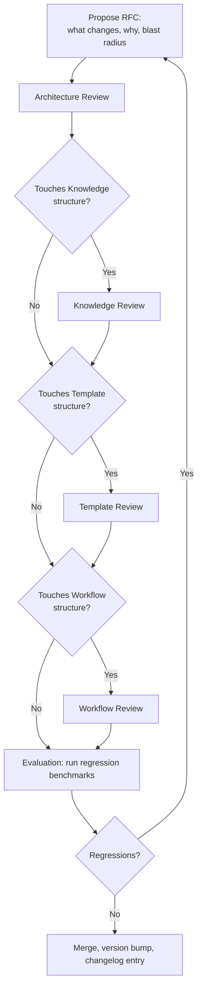

# Governance
## Phase 15: Governance Framework

> New top-level meta-module, closing the set added alongside [Review](../review/README.md) and [Evaluation](../evaluation/README.md). Every prior phase deferred its own versioning, deprecation, and RFC mechanics here with a forward-reference — this phase makes those mechanics concrete so the deferrals resolve to something real.

Status: Approved

---

## Versioning

Every addressable unit, in every module, versions the same way (already stated per-module; this is the one canonical definition they all point back to):

- **Major** — a change that breaks a declared contract field (a Standard's Mandatory Rule loosens, a Workflow's state order changes, an Agent's Decision Authority shifts, a Skill's Prerequisite chain changes incompatibly).
- **Minor** — an additive change (a new Extension Point, a new Related Standard, a widened Scope that doesn't remove anything).
- **Patch** — a clarification that changes no behavior (wording, an added Example).

The Kernel and Router (near-immutable per [Architecture](../foundation/architecture.md)) follow the same scheme but require a full RFC (below) even for Minor changes, since their consumers are every module rather than a scoped few.

## Ownership & Contribution Model

Every unit already names an Owner in its own contract (Knowledge, Skills, Standards, Workflows, Templates, Agents, Blueprints, Decisions all have this field). Governance adds one rule on top: only the named Owner — or [Review](../review/README.md), acting on the Owner's behalf for mechanical checks — may move a unit to `Active`. A contributor who isn't the Owner may propose a change (Draft), but Approval authority stays with Ownership, matching Phase 0's "human authority is final" principle scoped down to module level.

---

## RFC Process

Required for: any Kernel or Router change (any severity), any Major change to another module, and any new top-level module (as this very phase and Phase 13/14 were).

- **Architecture Review** checks the RFC against [foundation/architecture.md](../foundation/architecture.md)'s module contracts and dependency graph — does this change keep every module's boundary intact?
- **Knowledge / Template / Workflow Review** are conditional passes, invoked only when the RFC touches that module's *structural* rules (its category set, its contract fields) — not for every RFC, since most RFCs touch one module.
- **Evaluation** (Phase 14) runs the regression benchmark set before merge, not after — a Kernel/Router RFC that regresses a benchmark returns to Propose rather than merging with a known regression.

## Architecture, Knowledge, Template, and Workflow Review — What Each Checks

| Review | Checks |
|---|---|
| Architecture Review | Module boundaries, dependency graph, Tier 0 budget still small |
| Knowledge Review | Category structure, granularity rules, staleness-detection mechanism still valid |
| Template Review | Customization Point contract, inheritance/composition rules still valid |
| Workflow Review | State machine order, Review Point placement, nesting rules still valid |

These are RFC-level structural reviews — distinct from the per-asset [Review Framework](../review/README.md) pass every individual unit already goes through regardless of RFC status.

---

## Migration & Deprecation

A Major version bump on any module ships with a migration note: what changed, what breaks, and what the replacement path is — the same pattern already established per-module (e.g., [Standards: Deprecation](../standards/README.md#deprecation), [Templates: Evolution & Obsolescence](../templates/README.md#evolution--obsolescence)). Governance's role is only to guarantee every module actually follows that pattern consistently, via the RFC gate above — it does not introduce a second, separate migration mechanism.

Deprecated units are never deleted outright; they move to `Deprecated` in their module's lifecycle state machine (every module already defines this state) and are excluded from Router resolution going forward, exactly as [Router: Fallback Strategy](../router/README.md#fallback-strategy) already assumes.

## Quality Control

Enforced at two points, not a third new one: [Review](../review/README.md) for every individual asset, and the RFC process above for structural/Kernel/Router changes. Governance does not add a third quality gate — it coordinates the two that already exist so a structural change can't bypass asset-level Review, and an asset-level change can't bypass RFC when it's actually structural in disguise (e.g., "just editing one Knowledge unit" that happens to change the category schema).

---

## Changelog, Release Notes, Migration Guides

- **Changelog** — one entry per merged RFC or per-unit version bump, minimally: unit/module, old version → new version, one-line reason. Lives alongside whichever module changed (not centralized into one giant file, which would itself violate the minimal-context principle for anyone trying to find what changed in one module).
- **Release Notes** — a rollup of Changelog entries at whatever cadence the human governance owners choose (this framework doesn't mandate a cadence — that's an operational decision, not an architectural one).
- **Migration Guides** — required for every Major bump (see Migration above); optional for Minor/Patch.

## Semantic Versioning, Applied

`MAJOR.MINOR.PATCH` per unit, per the definitions above. A module's own version (e.g., "the Standards Framework is v1.2.0") is independent of any single Standard's version within it — the framework version tracks changes to the *contract* (this document), individual unit versions track changes to *content*.

---

## How the AIOS Evolves Without Breaking Compatibility

Three mechanisms already established across every phase, restated here as the single governance answer:

1. **Additive by default** (Phase 0's "additive evolution" principle) — new domains, new units, new Extension/Customization Points never require existing consumers to change.
2. **Breaking changes are RFC-gated and versioned** — nothing Major merges without Architecture Review + regression Evaluation passing.
3. **Deprecation, not deletion** — a consumer referencing a superseded unit gets a migration path, not a silent break.

## Lifecycle

This document itself follows [Architecture: per-unit lifecycle](../foundation/architecture.md#lifecycle-per-knowledge-unit-in-any-module). Changing Governance's own RFC process is, unsurprisingly, required to go through the RFC process it defines.
