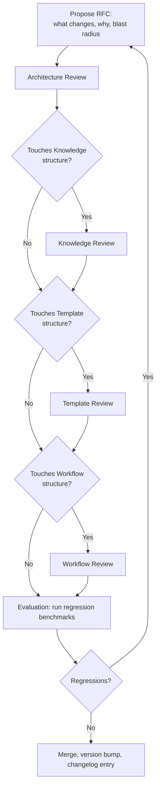
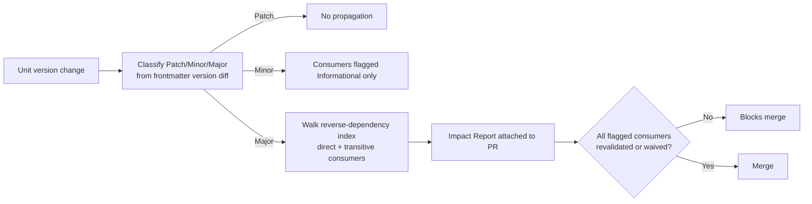

# Governance
## Phase 15: Governance Framework

> New top-level meta-module, closing the set added alongside [Review](../review/README.md) and [Evaluation](../evaluation/README.md). Every prior phase deferred its own versioning, deprecation, and RFC mechanics here with a forward-reference — this phase makes those mechanics concrete so the deferrals resolve to something real.

Status: Approved

---

## Versioning

Every addressable unit, in every module, versions the same way (already stated per-module; this is the one canonical definition they all point back to):

- **Major** — a change that breaks a declared contract field (a Standard's Mandatory Rule loosens, a Workflow's state order changes, an Agent's Decision Authority shifts, a Skill's Prerequisite chain changes incompatibly).
- **Minor** — an additive change (a new Extension Point, a new Related Standard, a widened Scope that doesn't remove anything).
- **Patch** — a clarification that changes no behavior (wording, an added Example).

The Kernel, Router, and — per [Decision 0001](../decisions/0001-aios-bootstrap-roadmap.md) — **Guardrails** (near-immutable per [Architecture](../foundation/architecture.md) and per [guardrails/README.md](../guardrails/README.md)) follow the same scheme but require a full RFC (below) even for Minor or Patch changes, since their consumers are every module/every Agent dispatch rather than a scoped few. Guardrails additionally never has a `Stale` lifecycle state — a guardrail does not go quietly out of date; it is only ever changed through this same explicit RFC gate.

## Ownership & Contribution Model

Every unit already names an Owner in its own contract (Knowledge, Skills, Standards, Workflows, Templates, Agents, Blueprints, Decisions all have this field). Governance adds one rule on top: only the named Owner — or [Review](../review/README.md), acting on the Owner's behalf for mechanical checks — may move a unit to `Active`. A contributor who isn't the Owner may propose a change (Draft), but Approval authority stays with Ownership, matching Phase 0's "human authority is final" principle scoped down to module level.

That rule governs the lifecycle of *AIOS units*. The same principle applied to *product-code* changes — who may modify architecture, and under what bound — is [Change Governance](#change-governance) below.

---

## Change Governance

Introduced by [RFC-0003](rfcs/0003-change-governance.md); specified in full in [change-authority.md](change-authority.md). It closes the question the rest of this framework left open: the AIOS could say whether a change was *correct* ([Standards](../standards/README.md)) and which correct option was *preferred* ([decision-policy](../standards/core/decision-policy.md)), but not whether the Agent proposing it was *authorized* to make it — leaving an Agent's technical capability as the effective limit on its authority.

Seven concepts, each binding to something that already exists rather than standing alone:

| Concept | What it adds | Binds to |
|---|---|---|
| **Repository Owner Authority** | Delegation table: Repository Owner → Module Owner → Capability Agent, each with an explicit bound | [Ownership & Contribution Model](#ownership--contribution-model); `aios validate` H2 (no overlapping Agent authority) |
| **Architecture Change Classification** | An authority requirement per level — L1–L3 Agent-authorized, L4/L5 Owner-ratified | [decision-policy](../standards/core/decision-policy.md) D1, referenced not restated |
| **Architecture Impact Analysis** | Classification + blast radius + reversibility for a *product-code* change, required at L3+ | Distinct from [Impact Analysis](#impact-analysis), which walks *unit* version dependencies |
| **Branch Contract** | The unit of authorization: intent, allowed paths, classification ceiling, budget, who signed, expiry | The Agent's `decision_authority` glob |
| **Scope Budget** | Declared tripwires (paths, level, new directories, contract changes, dependencies) | [backend-layering](../standards/architecture/backend-layering.md) R1 for the new-role case |
| **Scope Drift Detection** | Diff-vs-contract comparison; drift returns to the Authority Check rather than failing | The [maintenance plan](../architecture/maintenance/architecture-maintenance-plan.md)'s 🔴/🟡/👤 tiering |
| **Escalation Policy** | One consolidated list of when to escalate, to whom, and with what payload | [decision-policy](../standards/core/decision-policy.md) D2 + each Agent's Escalation Rules |

The **Authority Check** gate consumes them, separating *can I technically perform this change* from *am I authorized to perform this change* — capability is never evidence of authority.

**Workflow impact: none to the state machine.** The [Workflow framework](../workflows/README.md#workflow-state-machine)'s order is unchanged; Change Governance specialises the `Design` state into Impact Analysis → Authority Check, leaving Implementation, Validation, and Review with their existing owners. This framework's other gates — RFC, Impact Analysis, Acceptance, Review — are likewise unchanged; Change Governance names when an Agent must reach for them, and adds no third quality gate (see [Quality Control](#quality-control)).

### Confidence-Based Decision Making

Introduced by [RFC-0004](rfcs/0004-confidence-policy.md); specified in [confidence-policy.md](confidence-policy.md). Where Change Governance asks *am I authorized*, this asks **do I understand this well enough to act without checking** — the second, independent pass over the same [Authority Check](change-authority.md#authority-check).

Four bands, recognised by description rather than by any numeric threshold: **High** proceeds; **Medium** proceeds with its assumptions written down; **Low** asks once, batched and decidable; **Very Low** recommends a planning discussion instead of opening an implementation. Five factors move the band — ambiguity, architectural impact, repository conventions, missing information, implementation risk — and the **weakest factor sets it rather than an average**, so one unknown in a high-impact area is not diluted by four things that were never in doubt.

It targets two failure modes at once, because optimising against either alone produces the other: clarification requested for what the repository already answers, and fluent implementations of the wrong thing. Two rules carry most of that weight — uncertainty removable by *reading* `intelligence/` or the code is unread context, not low confidence; and architectural impact caps the band, so L4/L5 never reads High however familiar the pattern feels.

**Nothing in the Kernel changes.** [Kernel](../kernel/README.md#when-to-stop-loading-context) and [Recovery](../kernel/recovery/README.md) already decide clarification-vs-assumption in binary and stay authoritative; the bands sit inside that binary and supply the *payload* it leaves open. [G5](../guardrails/core.md) already makes labelling an inference mandatory, which is what keeps the Medium band honest — this policy specifies the content of the label, never the obligation. [Review](../review/README.md)'s 12-dimension checklist is likewise untouched: confidence is an input to existing dimensions, and calibration evidence accumulates through [Memory](../memory/README.md)'s existing Session → Persistent path rather than a new metrics apparatus.

### Improvement Discovery

Introduced by [RFC-0005](rfcs/0005-improvement-discovery.md); specified in [improvement-discovery.md](improvement-discovery.md), with records in [`discoveries/`](discoveries/README.md). It closes a gap the two rules above left open: [Scope Budget](change-authority.md#scope-budget) sets bundled incidental refactors to zero and [decision-policy](../standards/core/decision-policy.md) names the opportunistic refactor an anti-pattern, but neither said where a discovery should *go*. Without a fourth exit, insight found at the moment the code is best understood is implemented anyway, forgotten, or written into a chat that ends.

**Execution Commitment** is the governing idea: an approved plan is a commitment, and discovering a better solution does not retroactively change what was authorized. Three questions can override it — is the discovery required for **correctness**, for **safety**, or for **architecture integrity**? Each routes to a mechanism that already exists ([Validation](../kernel/validation/README.md), [guardrails/core.md](../guardrails/core.md), [decision-policy](../standards/core/decision-policy.md)). If none applies, the discovery is recorded and implementation continues. Five [stopping criteria](improvement-discovery.md#stopping-criteria) suspend work, and they re-enter the **existing** `Implementation → Authority Check` drift path — no new gate, no new state.

**It is not a backlog, structurally rather than by assertion:** a record carries no assignee, no priority, no effort estimate, no due date, and no `Open`/`Done`. Its lifecycle mirrors [Memory](../memory/README.md)'s — `Recorded → Promoted | Superseded | Declined` — so an entry left at `Recorded` is a fact that stays true, not a ticket going stale, and `Declined` carries its reason so the same discovery is not re-argued yearly.

For **Review**, implementation quality and discovery quality are evaluated independently: an implementation is *not* incomplete for having declined a discovered improvement — judging it so would re-create through review pressure the very scope creep the Scope Budget forbids. The [12-dimension checklist](../review/README.md#what-every-review-evaluates) is untouched. The value beneath all of it lives in [engineering-philosophy](../knowledge/concept/engineering-philosophy.md) P9, and the intended long-run output is [decision-policy](../standards/core/decision-policy.md) D3 evidence assembling itself — several records converging on one component is how a ratified L4 should be reached.

---

## RFC Process

Required for: any Kernel, Router, or Guardrails change (any severity), any Major change to another module's *framework/contract* (its category set, its contract fields — a structural change), and any new top-level module (as this very phase and Phase 13/14 were). A Major version bump on a single *unit* within an already-approved module (one Standard, one Knowledge entry) does **not** require a full RFC — it requires [Impact Analysis](#impact-analysis) instead, a lighter, more frequent gate defined below. Conflating the two would make routine unit evolution as expensive as a structural change, which is disproportionate to its blast radius.

- **Architecture Review** checks the RFC against [foundation/architecture.md](../foundation/architecture.md)'s module contracts and dependency graph — does this change keep every module's boundary intact?
- **Knowledge / Template / Workflow Review** are conditional passes, invoked only when the RFC touches that module's *structural* rules (its category set, its contract fields) — not for every RFC, since most RFCs touch one module.
- **Evaluation** (Phase 14) runs the regression benchmark set before merge, not after — a Kernel/Router RFC that regresses a benchmark returns to Propose rather than merging with a known regression.

## Architecture, Knowledge, Template, and Workflow Review — What Each Checks

| Review | Checks |
|---|---|
| Architecture Review | Module boundaries, dependency graph, Tier 0 budget still small |
| Knowledge Review | Category structure, granularity rules, staleness-detection mechanism still valid |
| Template Review | Customization Point contract, inheritance/composition rules still valid |
| Workflow Review | State machine order, Review Point placement, nesting rules still valid |

These are RFC-level structural reviews — distinct from the per-asset [Review Framework](../review/README.md) pass every individual unit already goes through regardless of RFC status.

---

## Acceptance

Introduced by [RFC-0001](rfcs/0001-acceptance-criteria.md). A gate on the `Approved → Active` transition ([foundation/architecture.md](../foundation/architecture.md#lifecycle-per-knowledge-unit-in-any-module)), separating three distinct guarantees that were previously conflated:

| Layer | Establishes | Checked by | When |
|---|---|---|---|
| **Validation** | Correctness (schema, `id`=path, links resolve) | Automation (`aios`) | Continuously / at authoring |
| **Review** | Quality (the [12-dimension checklist](../review/README.md#what-every-review-evaluates)) | Review + module Owner | `Review` state → `Approved` |
| **Acceptance** | **Readiness** to be depended on at runtime (per-type criteria) | module Owner | `Approved` → `Active` |

Acceptance answers a question neither of the others does: *a unit can be correct and well-written yet not ready to be runtime* — e.g. a Standard whose `applies_to` globs match nothing real, or an Agent whose enforced Standards aren't themselves `Active` yet. Acceptance Criteria are **per unit type** and live in each module's own contract (e.g. [standards/README.md](../standards/README.md#acceptance-criteria), [agents/README.md](../agents/README.md#acceptance-criteria), [guardrails/README.md](../guardrails/README.md#acceptance-criteria)); other module types add theirs when they author their first real unit.

Acceptance never weakens Review: it cannot waive a Review `Blocking` finding, and it runs *after* `Approved`, not instead of it. It is a readiness gate, orthogonal to quality — consistent with this framework's rule that no gate bypasses another.

---

## Impact Analysis

A third gate, distinct from both [Review](../review/README.md) (asset quality, every unit) and the RFC process above (structural/Kernel/Router/Guardrails changes only) — added by [Decision 0001](../decisions/0001-aios-bootstrap-roadmap.md) to close the gap between them: an ordinary unit's Major version bump previously triggered neither gate, meaning the highest-blast-radius everyday change went unchecked.

Propagation rules:

| Change | Direct consumers | Transitive consumers |
|---|---|---|
| Patch | None | None |
| Minor | Flagged `Informational` (non-blocking) | None |
| Major | Flagged `NeedsRevalidation` (blocks merge until resolved or Owner-waived) | Yes — walked through the full `depends_on` chain |
| Guardrail change (any severity) | Every `Active` Agent flagged `NeedsRevalidation` | N/A — every Agent passes through the Kernel/Guardrails checkpoint |
| Any change where a Playbook is a consumer | Always `NeedsRevalidation`, even on Minor | A Playbook's value is a pre-resolved binding; a stale cache is worse than a slow lookup, so it never gets the Minor free pass ordinary consumers get |

This is entirely mechanical — reverse-dependency computation and version-diff classification are Automation's job, not an AI's judgment call, per the frozen operating principle "Automation is responsible for determinism." Only the *waiver* of a flagged consumer requires a human — the Owner of the consumer, mirroring how [Review](../review/README.md#review-ownership--responsibilities) already routes Major-severity waivers.

---

## Migration & Deprecation

A Major version bump on any module ships with a migration note: what changed, what breaks, and what the replacement path is — the same pattern already established per-module (e.g., [Standards: Deprecation](../standards/README.md#deprecation), [Templates: Evolution & Obsolescence](../templates/README.md#evolution--obsolescence)). Governance's role is only to guarantee every module actually follows that pattern consistently, via the RFC gate above — it does not introduce a second, separate migration mechanism.

Deprecated units are never deleted outright; they move to `Deprecated` in their module's lifecycle state machine (every module already defines this state) and are excluded from Router resolution going forward, exactly as [Router: Fallback Strategy](../router/README.md#fallback-strategy) already assumes.

Per [Decision 0001](../decisions/0001-aios-bootstrap-roadmap.md), the unified lifecycle adds one terminal state after `Deprecated`: **`Archived`**. A unit past a defined number of [Releases](#release-management) since it entered `Deprecated` is physically relocated (e.g., `standards/security/_archive/`) by the Index generator — not just flagged. This exists because `Deprecated` alone only removes a unit from *resolution*; over years of accumulation, Deprecated units left in place would still inflate directory listings and the cost of regenerating a Category Index, even though the Router never resolves to them. Archival keeps that cost bounded by the *active* corpus, not the all-time-cumulative one.

## Quality Control

Enforced at two points, not a third new one: [Review](../review/README.md) for every individual asset, and the RFC process above for structural/Kernel/Router changes. Governance does not add a third quality gate — it coordinates the two that already exist so a structural change can't bypass asset-level Review, and an asset-level change can't bypass RFC when it's actually structural in disguise (e.g., "just editing one Knowledge unit" that happens to change the category schema).

---

## Changelog, Release Notes, Migration Guides

- **Changelog** — one entry per merged RFC or per-unit version bump, minimally: unit/module, old version → new version, one-line reason. Lives alongside whichever module changed (not centralized into one giant file, which would itself violate the minimal-context principle for anyone trying to find what changed in one module). Instantiated in M4: per-module `CHANGELOG.md` files (e.g. [guardrails/CHANGELOG.md](../guardrails/CHANGELOG.md), [standards/CHANGELOG.md](../standards/CHANGELOG.md), [agents/CHANGELOG.md](../agents/CHANGELOG.md)) for unit changes; **an [RFC record](rfcs/README.md) is itself the changelog entry** for a Constitution-tier/governance change (no separate governance changelog).
- **Release Notes** — a rollup of Changelog entries, cut at each [AIOS Release](#release-management) rather than on a calendar cadence.
- **Migration Guides** — required for every Major bump (see Migration above); optional for Minor/Patch.

## Semantic Versioning, Applied

`MAJOR.MINOR.PATCH` per unit, per the definitions above. A module's own version (e.g., "the Standards Framework is v1.2.0") is independent of any single Standard's version within it — the framework version tracks changes to the *contract* (this document), individual unit versions track changes to *content*.

---

## Release Management

Added by [Decision 0001](../decisions/0001-aios-bootstrap-roadmap.md) to answer a question per-unit versioning alone doesn't: is there ever a version for `.ai/` as a whole, and how do units stay in sync with what they depend on without bumping in lockstep?

- **An AIOS Release is a tag cut only when a Constitution-tier RFC merges** (Kernel, Router, Guardrails, or Foundation) — never on a calendar cadence, and never for ordinary additive unit growth (adding a Standard or Knowledge unit is, per "Additive by default" below, not release-worthy on its own). This keeps Release meaningful: it marks the only kind of change large enough to risk breaking a vendor adapter's assumptions about the AIOS.
- **No lockstep version bumping.** Units keep independent versions (unchanged from above). Instead, each unit's frontmatter carries `validated_against: {producer_id}@{version}` for every unit it `depends_on` — recording which version of its dependency it was last checked against. [Impact Analysis](#impact-analysis) is the mechanism that checks this field still matches the dependency's current version; a mismatch is exactly what a Major-bump `NeedsRevalidation` flag means in practice.
- **Vendor adapters may pin to a Release** (e.g., "this Cursor adapter is compatible with AIOS Release 3.x") without needing to track individual unit versions — Release is the one version number meant to be externally referenced; unit versions are meant to be referenced only by other units.

---

## How the AIOS Evolves Without Breaking Compatibility

Four mechanisms already established across every phase, restated here as the single governance answer:

1. **Additive by default** (Phase 0's "additive evolution" principle) — new domains, new units, new Extension/Customization Points never require existing consumers to change.
2. **Structural breaking changes are RFC-gated and versioned** — nothing touching Kernel/Router/Guardrails or a module's contract merges without Architecture Review + regression Evaluation passing.
3. **Unit-level breaking changes are Impact-Analysis-gated** — a Major bump on an ordinary Standard/Knowledge/Agent unit can't merge while a direct or transitive consumer is left unrevalidated and unwaived (see [Impact Analysis](#impact-analysis)).
4. **Deprecation, then Archival, not deletion** — a consumer referencing a superseded unit gets a migration path, not a silent break; the superseded unit itself is only physically removed from the active tree once it's old enough to Archive.

## Lifecycle

This document itself follows [Architecture: per-unit lifecycle](../foundation/architecture.md#lifecycle-per-knowledge-unit-in-any-module). Changing Governance's own RFC process is, unsurprisingly, required to go through the RFC process it defines.
