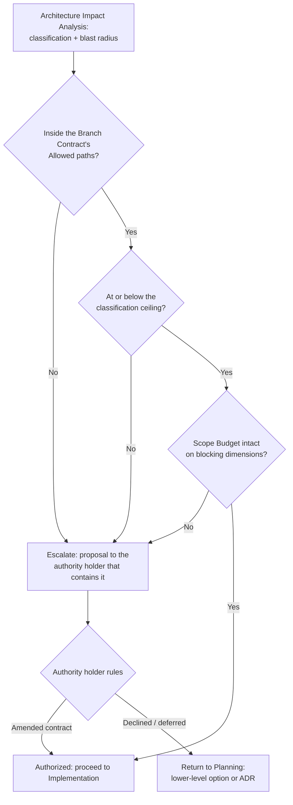
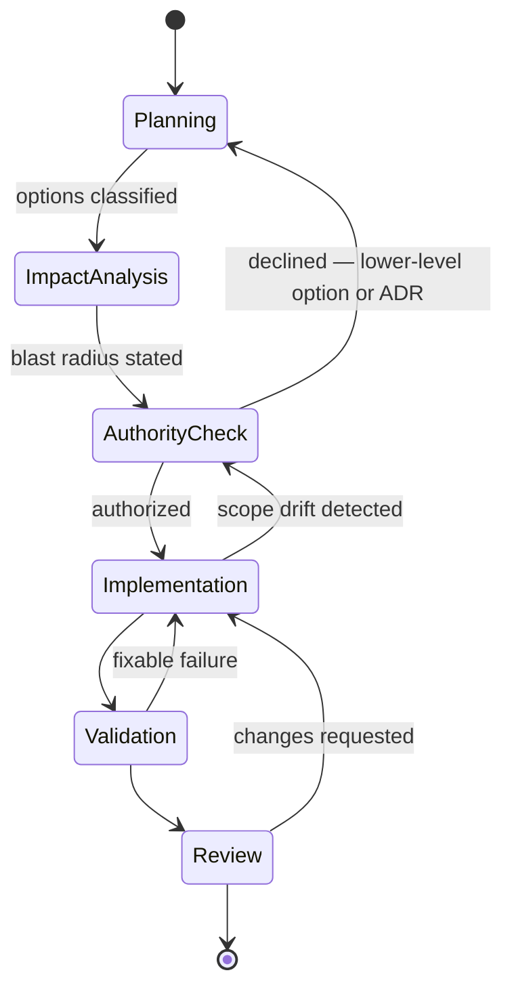

# Change Governance

> Part of the [Governance framework](README.md). Where [Standards](../standards/README.md) establish what is *correct* and [decision-policy](../standards/core/decision-policy.md) establishes which correct option is *preferred*, this capability establishes who is *authorized* to make the change at all. Status `Review`, pending the Owner's approval of [RFC-0003](rfcs/0003-change-governance.md).

## The Distinction This Exists For

An AI Agent evaluating an option answers two questions, and conflating them is the failure this capability prevents:

| Question | Answered by | Failure mode when it is the only question asked |
|---|---|---|
| **Can I technically perform this change?** | Capability — the Agent's skills, the codebase's tractability | Confident, competent, unauthorized architecture change |
| **Am I authorized to perform this change?** | This document — classification, Branch Contract, Scope Budget | — |

Capability is never evidence of authority. An Agent fully able to introduce a new layer, replace a persistence strategy, or restructure a package still holds no authority to do so unless the change classifies inside its delegated band. The correct outcome in that case is a proposal, not a diff — and a proposal is a *successful* outcome, not a refusal.

## Repository Owner Authority

Authority originates with the **Repository Owner** and is delegated downward in bounded amounts. Nothing acquires authority by inference, seniority of reasoning, or urgency.

| Holder | Holds | Bound |
|---|---|---|
| **Repository Owner** | Final authority over every architectural change; sole authority to ratify L4/L5 ([classification](#architecture-change-classification)), to approve an RFC, and to waive a flagged consumer | Unbounded within this repository; delegates explicitly, never implicitly |
| **Module Owner** | Authority to move a unit in their module to `Active` ([Ownership & Contribution Model](README.md#ownership--contribution-model)), and to sign the [Authority Check](#authority-check) for changes confined to their module | Their module only; cannot ratify an L4/L5 that changes a ratified contract |
| **Capability Agent** | Authority to implement L1–L3 inside its declared `decision_authority` glob (e.g. Backend Agent → `mcp-server/**`) | The glob, the classification ceiling, and its own Escalation Rules |
| **Reviewer / Review Framework** | Authority to block, never to authorize | Mechanical checks on the Owner's behalf |

Two Agents may not hold overlapping `decision_authority` — already mechanically enforced by `aios validate` check H2, which is the machine-readable half of this table. Delegation is therefore partitioned, not layered: a path has exactly one authorized Agent.

**Human authority is final** ([foundation/vision.md](../foundation/vision.md#4-principles-that-must-never-be-violated)). This capability adds no new human role; it makes explicit which existing role an escalation lands on.

## Architecture Change Classification

Classification is **not redefined here**. [decision-policy](../standards/core/decision-policy.md) D1 already ranks a change L1 Preserve → L2 Extend → L3 Refactor locally → L4 Evolve → L5 Redesign. Change Governance binds each level to an authority requirement:

| Level | Authorized by | Required artifact before implementation |
|---|---|---|
| **L1** Preserve | Owning Agent, unilateral | Branch Contract |
| **L2** Extend | Owning Agent, unilateral | Branch Contract |
| **L3** Refactor locally | Owning Agent, unilateral; the diff names the boundary it stayed inside | Branch Contract + declared boundary |
| **L4** Evolve | **Repository Owner** (or Module Owner where the contract is wholly inside their module) | Branch Contract + Architecture Impact Analysis + ADR |
| **L5** Redesign | **Repository Owner** | Branch Contract + Architecture Impact Analysis + ADR + [RFC](README.md#rfc-process) where Kernel, Router, Guardrails, or a module's framework is touched |

Where classification is genuinely ambiguous between two levels, the higher level's authority applies until the Owner rules otherwise — ambiguity resolves toward asking, because the cost of an unnecessary question is a message and the cost of an unauthorized L4 is a migration.

## Architecture Impact Analysis

Distinct from [Impact Analysis](README.md#impact-analysis) in the Governance framework, and the two are easy to confuse:

| | [Impact Analysis](README.md#impact-analysis) (existing) | **Architecture Impact Analysis** (this) |
|---|---|---|
| Subject | An AIOS *unit's* version change | A proposed change to *product code* |
| Mechanism | Reverse-dependency walk over `depends_on`, version-diff classification | Analysis of the code the change touches |
| Output | Consumers flagged `Informational` / `NeedsRevalidation` | A classification level + blast radius + reversibility |
| Runs | On every unit version bump | Before implementation, at L3 and above |

Neither replaces the other; a change that edits a Standard *and* the code it governs runs both. Architecture Impact Analysis is required at L3+ and optional (a sentence) at L1/L2 — the point is proportionality, not paperwork.

What it states:

1. **Boundaries touched** — which layers, packages, runtime boundaries, and public contracts the change reaches ([backend-layering](../standards/architecture/backend-layering.md) R4, [service-package-design](../standards/architecture/service-package-design.md), [runtime-boundary](../standards/architecture/runtime-boundary.md)).
2. **Blast radius** — enumerated call sites and consumers, present-tense, per [decision-policy](../standards/core/decision-policy.md) D3.
3. **Classification** — the resulting level, with the lower level that was considered and why it does not hold.
4. **Reversibility** — whether the change can be reverted by reverting the commit, or whether it leaves migrated data, renamed public contracts, or deployed processes behind. Irreversible changes classify no lower than L4 regardless of diff size.
5. **Standards implicated** — which Mandatory Rules the change is checked against at Validation.

An Architecture Impact Analysis that cannot state (2) concretely is itself the finding: the change is not yet understood well enough to be authorized.

## Branch Contract

The unit of authorization. Before implementation begins, the change declares what it is allowed to become; the Authority Check approves *that declaration*, and everything downstream is measured against it.

| Field | Meaning |
|---|---|
| **Intent** | One sentence: what this branch delivers. |
| **Allowed paths** | Path globs the branch may modify. Defaults to the owning Agent's `decision_authority`; narrower is normal, wider requires the Owner. |
| **Classification ceiling** | The maximum level authorized (L1–L5). A ceiling, not a target. |
| **Scope Budget** | See below. |
| **Authorized by** | The role that signed the Authority Check, and when. |
| **Expiry** | The point at which the authorization is re-checked rather than assumed — merge, or a stated horizon for a long-lived branch. Approval in one context does not carry to the next ([guardrails/core.md](../guardrails/core.md) G4 applies the same rule to destructive actions). |

A Branch Contract is cheap by design — for an L1 fix it is two lines in the PR description. Its value is that Scope Drift Detection has something concrete to compare against, and that "what was I authorized to do here?" has an answer that predates the diff.

## Scope Budget

The quantities a branch may consume, declared in its Branch Contract. Budgets are **stated per branch rather than fixed globally** — a scanner integration legitimately adds files a bugfix does not. What matters is that the number is declared before the work, not justified after it.

| Dimension | Typical default | Exceeding it means |
|---|---|---|
| Paths outside Allowed paths | 0 | Authority Check re-run — the change left its delegated territory |
| Classification level | The declared ceiling | Re-classification and, at L4/L5, Owner ratification |
| New top-level directories under a governed root | 0 | A new architectural role — L4 by [backend-layering](../standards/architecture/backend-layering.md) R1, never an ad-hoc folder |
| Ratified contract changes (public API, Standard rule, runtime boundary) | 0 | L4 minimum |
| New runtime dependencies | 0 | Owner review — a dependency is a long-lived commitment, not an implementation detail |
| Incidental refactors bundled with the primary change | 0 | The [opportunistic refactor](../standards/core/decision-policy.md#anti-patterns) anti-pattern; record it as an [Improvement Discovery](improvement-discovery.md) and continue, or split the branch |

A budget is a *tripwire*, not a quota to spend. Coming in under budget needs no justification; crossing one is a signal to re-check authority, and crossing one knowingly and silently is the drift this capability is built to catch.

## Scope Drift Detection

Drift is the gap between the Branch Contract and what the branch actually became. It is detected by comparison, not by suspicion, and most of it is mechanical:

| Signal | Check | Tier |
|---|---|---|
| Files outside Allowed paths | `git diff --name-only <base>..HEAD` vs the contract's globs | 🔴 Blocking |
| New top-level directory under a governed root | Directory allowlist, the same check [backend-layering](../standards/architecture/backend-layering.md) R1 already specifies | 🔴 Blocking |
| New runtime dependency | Diff of the dependency manifests | 🔴 Blocking |
| Classification exceeded | Re-run Architecture Impact Analysis on the actual diff; compare to the ceiling | 👤 Review |
| Bundled incidental refactor | Diff size against Intent | 🟡 Warning |

Tiers follow the [architecture maintenance plan](../architecture/maintenance/architecture-maintenance-plan.md)'s honest-classification convention (🔴 Blocking · 🟡 Warning · 👤 Review); the three blocking rows are statically decidable and are the natural first `aios` additions when this capability moves past `Review` — 🔨 to build, unimplemented today, and declared so rather than assumed.

**Detected drift returns the branch to the [Authority Check](#authority-check), not to failure.** Drift usually means the work revealed something the plan could not see, which is information, not misconduct. What is not acceptable is drift that reaches Review undeclared — that is the [silent level upgrade](../standards/core/decision-policy.md#anti-patterns) arriving through a different door.

## Escalation Policy

Escalation is the mechanism by which an Agent converts *capability it has* into *authority it lacks*. It is a normal, expected transition.

**Escalate when** — the union of [decision-policy](../standards/core/decision-policy.md) D2 and each Agent's own Escalation Rules, restated here as one list:

- The classification is L4 or L5.
- The change reaches outside the Agent's `decision_authority` glob.
- The Branch Contract's Scope Budget is exceeded on any blocking dimension.
- A Mandatory Rule of any Standard would have to be violated or loosened to proceed.
- A security control, a Guardrail, or the canonical vocabulary ([Decision 0008](../decisions/0008-domain-ubiquitous-language.md)) is implicated.
- Two Standards conflict and neither is more specific ([standards/README.md](../standards/README.md#conflict-resolution)).
- Required knowledge is absent and the gap is safety- or security-relevant.

**Escalate to** — the lowest holder in the [authority table](#repository-owner-authority) whose bound contains the change: another Agent (delegation across a `decision_authority` boundary), the Module Owner (change confined to one module), or the Repository Owner (a ratified contract changes). [Kernel/Recovery](../kernel/recovery/README.md) handles the missing-knowledge and conflict cases, as it already does.

**Escalate with** — the Architecture Impact Analysis, the proposed Branch Contract amendment, and the lower-level options that were rejected with reasons. An escalation carrying only a request is incomplete; the point is to give the authority holder a decidable proposal.

**Meanwhile** — work that remains inside the authorized scope continues. An escalation pauses the escalated change, not the branch, unless the remainder depends on the ruling.

## Authority Check

The gate itself. It runs after Architecture Impact Analysis and before any implementation, and asks three questions in order:

A passed Authority Check is recorded in the Branch Contract's *Authorized by* field. An Agent that cannot identify who authorized a change it is about to make has its answer.

## Where This Sits in the Workflow

This **refines the existing [Workflow state machine](../workflows/README.md#workflow-state-machine); it does not reorder it.** The framework's fixed order is `Planning → Design → Implementation → Validation → Review → Approval → Completion`; Change Governance specialises the `Design` state into two named gates — Impact Analysis, then Authority Check — and leaves every other state, and the order itself, untouched. Removing or reordering a state would be a breaking change to that framework requiring its own RFC ([workflows/README.md](../workflows/README.md#collaboration-reuse-evolution)); nothing here does that.

The other three states keep their existing owners: **Implementation** is the Capability Agent's ([agents/README.md](../agents/README.md)), **Validation** is [Kernel/Validation](../kernel/validation/README.md)'s six checks, **Review** is the [Review Framework](../review/README.md)'s 12-dimension pass. Change Governance adds no gate at any of them.

## How Each Role Applies This

- **Planner** — produces the Architecture Impact Analysis and the proposed Branch Contract as part of the plan, not after it. A plan whose classification exceeds the available authority delivers a proposal, per [decision-policy](../standards/core/decision-policy.md) D4.
- **Capability Agent** — implements within the Branch Contract; re-enters the Authority Check on drift rather than widening the contract unilaterally, per [decision-policy](../standards/core/decision-policy.md) D5.
- **Module Owner** — signs the Authority Check for changes confined to their module; escalates ratified-contract changes to the Repository Owner.
- **Repository Owner** — rules on L4/L5, amends or declines Branch Contracts, and is the only holder who may widen a Scope Budget.

## Relationship to the Rest of Governance

| Existing mechanism | Relationship |
|---|---|
| [RFC process](README.md#rfc-process) | Unchanged. L5 changes touching Kernel/Router/Guardrails/module frameworks still route through it; this capability names *when* an Agent must reach for it. |
| [Impact Analysis](README.md#impact-analysis) | Unchanged, and distinct — unit versions vs. product code (see [above](#architecture-impact-analysis)). |
| [Acceptance](README.md#acceptance) | Unchanged. Authority governs whether a change may be made; Acceptance governs whether a finished unit is ready to be depended on. |
| [Ownership & Contribution Model](README.md#ownership--contribution-model) | Extended, not replaced — the same Owner-holds-approval rule, applied to product-code changes rather than only to unit lifecycle transitions. |
| [Review Framework](../review/README.md) | Unchanged. Review still blocks on quality; it does not grant authority. |
| [decision-policy](../standards/core/decision-policy.md) | Supplies the classification; this capability supplies the authority bound on each level. Neither restates the other. |

## Lifecycle

Follows [Architecture: per-unit lifecycle](../foundation/architecture.md#lifecycle-per-knowledge-unit-in-any-module). Changing this document is itself an L4 change to a ratified governance contract, and takes the route it describes.
