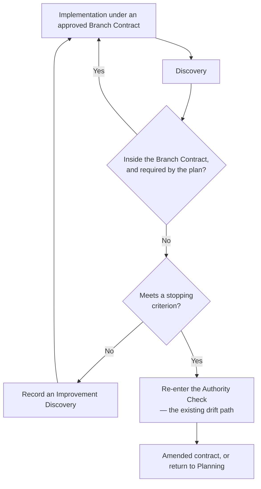
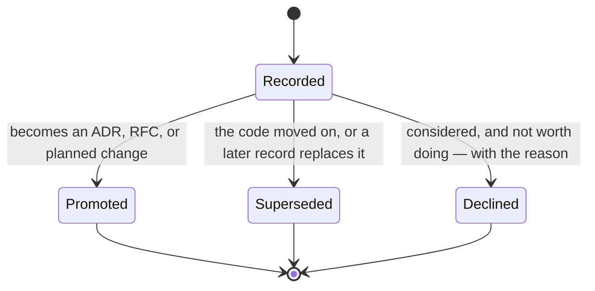

# Improvement Discovery

> Part of the [Governance framework](README.md). Implementation is when the codebase is understood best, so it is when the most valuable observations arrive — and the worst moment to act on them. This capability gives that insight somewhere to go that is neither the diff nor the void. Status `Review`, pending [RFC-0005](rfcs/0005-improvement-discovery.md).

## The Gap This Closes

[change-authority](change-authority.md#scope-budget)'s Scope Budget already sets *incidental refactors bundled with the primary change* to zero, and [decision-policy](../standards/core/decision-policy.md) names the *opportunistic refactor* as an anti-pattern. Both were correct and both were incomplete: they told an Agent not to act on a discovery without saying where the discovery should go. An insight with nowhere to go takes one of three exits, and all three are losses:

| Exit | What is lost |
|---|---|
| Implemented anyway | Scope discipline — an unreviewed change ships inside one described as something else |
| Forgotten | The insight, permanently. Nobody will be this deep in this code again soon |
| Written in the chat | The insight, on a delay. The session ends and the observation ends with it |

Recording is the fourth exit, and it is the cheapest of the four.

## What This Is Not

Not a backlog, not a task tracker, not a parallel planning system. The distinction is structural, not a matter of intent — a Discovery record carries **no assignee, no priority, no estimate of effort, no due date, and no open/in-progress/done state**. Those fields are what make a list into work, and their absence is the design.

What a record does carry is what a future engineer needs to re-derive the judgment: what was seen, why it mattered, why it was not done then. It preserves *engineering knowledge*. Whether to act on it is a separate engineering decision, made later, by the ordinary route ([decision-policy](../standards/core/decision-policy.md) for classification, [change-authority](change-authority.md) for authorization) — and "never" is a legitimate outcome that costs the project nothing, because the record was cheap.

## Execution Commitment

**An approved plan is a commitment, and discovering a better solution does not invalidate it.** The plan was authorized against a stated scope ([Branch Contract](change-authority.md#branch-contract)), a stated classification, and a stated [confidence band](confidence-policy.md). A discovery changes what the Agent knows; it does not retroactively change what was authorized.

This is the disposition [engineering-philosophy](../knowledge/concept/engineering-philosophy.md) P9 states as a value — disciplined execution over continuous optimization — applied at the one moment it is hardest to hold. The reasoning is that a plan re-opened on every improvement never closes, and that a change which grows during implementation is the one no reviewer can evaluate, because the thing delivered is no longer the thing described.

Three questions decide whether a discovery overrides the commitment. Each routes to a mechanism that already exists; none is a new rule:

| Question | Overrides when | Governed by |
|---|---|---|
| **Required for correctness?** | The current plan produces a wrong result without it | [Kernel/Validation](../kernel/validation/README.md); the Standards addressed for the task |
| **Required for safety?** | A security control, secret, or posture claim is implicated | [guardrails/core.md](../guardrails/core.md) — G1–G5 are Tier G and were never subject to scope in the first place |
| **Required for architecture integrity?** | Proceeding would leave a ratified contract or boundary violated | [decision-policy](../standards/core/decision-policy.md), [backend-layering](../standards/architecture/backend-layering.md) R4, [domain-layer](../standards/architecture/domain-layer.md) D3 |

**If none apply, the discovery is recorded and implementation continues.** "It would be better this way" is not one of the three, and recognising that is the whole discipline.

## Scope Check

The check that runs at the moment of discovery. It is deliberately small — a discovery interrupts work already in flight, and a heavyweight gate here would be paid for by Agents quietly skipping it.

The right-hand branch **adds no new gate**: [change-authority](change-authority.md#authority-check) already routes `Implementation → Authority Check` when scope drift is detected, and a stopping-criterion discovery is that same transition reached by a different observation. The left-hand branch is the new part, and it is one file write.

### Stopping Criteria

Implementation is suspended only when the discovery:

- **invalidates the approved plan** — the plan's premise is false, so finishing it produces something nobody wanted;
- **violates an existing Standard** — continuing means shipping a known violation, which [Validation](../kernel/validation/README.md) blocks anyway, later and more expensively;
- **exceeds the authority the branch holds** — outside the Agent's `decision_authority` or above its classification ceiling ([change-authority](change-authority.md#architecture-change-classification));
- **requires a higher architecture level** — the task cannot be completed at its declared level, an L4/L5 revealed mid-flight rather than at Planning;
- **creates unacceptable technical risk** — proceeding leaves the repository worse than not proceeding, typically through irreversibility ([Architecture Impact Analysis](change-authority.md#architecture-impact-analysis)).

Anything else: record, and continue. Suspension is the exception, and a suspension that turns out to have been avoidable costs more than the discovery was worth — the branch is now half-done and unreviewable.

## How Confidence Shapes the Record

[confidence-policy](confidence-policy.md)'s bands decide **what to record**, not whether to record. Recording is cheap at every band; overstating what was understood is not.

| Band in the discovery | Record | Why |
|---|---|---|
| **High** | The observation and a concrete recommendation | The analysis holds; a future reader can act on it directly |
| **Medium** | The recommendation with its assumption labelled | [G5](../guardrails/core.md) applies to a record exactly as it applies to a diff |
| **Low** | The **observation only** — the symptom, the files, why it looked wrong | A recommendation the Agent is unsure of is the most expensive thing to record: a future reader inherits it as analysis already done |
| **Very Low** | The question | "Why does this path exist?" is a legitimate and useful record |

The band demotes the *claim*, never the entry. A recorded question is worth more than an unrecorded insight and far more than a confident wrong recommendation.

Confidence also decides whether to investigate further **now**: a short look that would move Low to High is usually worth it while the context is loaded, provided it stays inside reading — investigation means reading, never editing. The moment it becomes an edit it is scope creep with a research label.

## The Record

Lives in [`governance/discoveries/`](discoveries/README.md), following the [`rfcs/`](rfcs/README.md) precedent: an append-only record series with a hand-maintained index, inside the module that governs it. Named `NNNN-short-slug.md`.

| Field | Content |
|---|---|
| **Title** | One line, stating the observation — not the fix |
| **Discovery context** | The task under way when it surfaced, and the Branch Contract it was working under |
| **Affected components** | Files, packages, or boundaries — concrete enough to relocate without a search |
| **Why it was discovered** | What in the work exposed it. Often the most durable field: the path in is what a future engineer cannot reconstruct |
| **Why it is outside current scope** | Which of the three Execution Commitment questions it failed, or which Scope Budget line it would have crossed |
| **Estimated impact** | What is worse today because of it, and what would improve. Impact on the codebase — deliberately not effort, which would make this an estimate and this a backlog |
| **Classification** | The [decision-policy](../standards/core/decision-policy.md) D1 level the change would be, if made (L1–L5) |
| **Suggested route** | The vehicle the classification implies — ordinary task, ADR, RFC, or *leave it*. Distinct from Classification: one is how much the change moves, the other is how it would have to be authorized. *Leave it* is a real and common answer |
| **Suggested follow-up** | What the next person should do first — usually read something, not build something |
| **Related Branch Contract** | The authorization under which the discovery was made, so the record's scope reasoning stays checkable |
| **Related ADR / RFC** | Where one exists, or where this record later becomes one |
| **Confidence** | The band, per the table above — sets how much of the record is claim and how much is observation |

### Lifecycle

Mirrors [Memory](../memory/README.md)'s, deliberately, because a discovery is session feedback of exactly the kind that module exists to make durable — and pointedly **not** a work-item lifecycle:

There is no `Open` and no `Done`. A record that sits at `Recorded` indefinitely is not a stale ticket — it is a fact about the repository that remains true, and it costs nothing to leave true. `Declined` is a first-class outcome and carries its reason, which makes it the most valuable state in the diagram: it stops the same discovery being re-derived and re-argued every year.

## How Each Role Reads This

- **Planner** — a record is an input at Planning, not an obligation. Reading `discoveries/` for the area about to be touched is how the mechanism repays its cost; a record may be promoted into the plan, and often the honest move is to leave it recorded.
- **Coding Agent** — runs the Scope Check at discovery, records, continues. Recording is not a licence to have looked: [decision-policy](../standards/core/decision-policy.md) D5 still holds, and a record is not a substitute for staying inside the Branch Contract — it is what makes staying inside it bearable.
- **Reviewer** — see below.
- **Governance** — watches the aggregate, not the count. Several records converging on one component is [decision-policy](../standards/core/decision-policy.md) D3 evidence assembling itself, and is the intended path from *repeated observation* to *ratified L4*. That is this capability's real output: an ADR grounded in accumulated present-tense evidence rather than one session's impression.

## Review

Review evaluates **two independent things**, and conflating them is the failure this section exists to prevent:

| | Asks | Failure |
|---|---|---|
| **Implementation quality** | Did the delivered change do what it was authorized to do, well? | Judged against work nobody authorized |
| **Discovery quality** | Was what was seen preserved usefully? | Valuable insight lost silently, which is invisible at review time by nature |

**An implementation is not incomplete because it did not implement a discovered improvement.** A change that stayed inside its Branch Contract while recording three discoveries is a *well-executed* change, and reviewing it as deficient would re-create through review pressure exactly the scope creep the Scope Budget forbids.

What a reviewer checks instead: that discoveries visible in the diff's vicinity were recorded rather than dropped; that each record's claim matches its declared confidence; and that no record is doing the work of a `TODO` left in the code. Missing preservation is a `Minor` or `Suggestion` on the existing scale — it is a lost opportunity, not a defect in what shipped. The one case that reaches higher is a discovery meeting a **stopping criterion** that was recorded and worked past rather than escalated: that is a Standards or authority finding under the existing dimensions, and it was already Blocking before this document existed.

No thirteenth [Review dimension](../review/README.md#what-every-review-evaluates) is added — the checklist is RFC-gated and nothing here needs it. Discovery quality is read through the existing Knowledge Reuse and Maintainability dimensions.

## Relationship to the Rest of Governance

| Mechanism | Relationship |
|---|---|
| [decision-policy](../standards/core/decision-policy.md) | Decides whether the change belongs to the current implementation, and classifies it if recorded. Unchanged. |
| [change-authority](change-authority.md) | Decides whether the Agent is authorized. The Scope Budget's *incidental refactors: 0* line is what makes recording necessary; this is its release valve, not its exception. Reuses the existing drift path — no new gate, no new state. |
| [confidence-policy](confidence-policy.md) | Shapes what the record claims, and whether a short read is worth doing before writing it. |
| [engineering-philosophy](../knowledge/concept/engineering-philosophy.md) | P9 supplies the *why* — disciplined execution over continuous optimization. Stated there as a value, referenced here as a mechanism, not restated. |
| [Memory](../memory/README.md) | Supplies the lifecycle shape (Recorded → Promoted/Superseded, never Open/Done). Distinct in content: Memory holds corrections about *how to work here*; a Discovery holds an observation about *the code itself*. |
| [Decisions](../decisions/README.md) | Where a promoted record lands when it becomes an L4 change. A Discovery is pre-decision evidence; an ADR is the decision. |
| [Review](../review/README.md) | Consumes both qualities through existing dimensions; checklist untouched. |

## Lifecycle

Follows [Architecture: per-unit lifecycle](../foundation/architecture.md#lifecycle-per-knowledge-unit-in-any-module).
