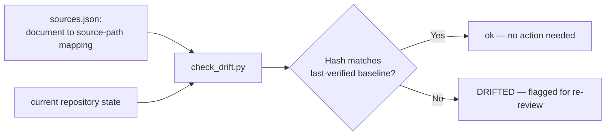

# Maintenance Strategy

## Purpose
Define how `.ai/intelligence/` stays accurate as the Guardrail Hub codebase changes, without requiring a full rewrite of all twelve documents every time something changes.

## Scope
The maintenance process for this module only. Not a general CI/CD strategy for the product (see [deployment-map.md](deployment-map.md) for the product's own — currently nonexistent — CI/CD).

## AI Usage Guidance
Run the drift checker (below) before trusting an intelligence document on a task where accuracy matters, if meaningful time has passed since its `Last Updated` date or if you suspect the area it covers has changed. If it reports drift, re-verify that specific document against current source before relying on it — don't silently trust a stale claim, and don't re-verify all twelve out of caution when only one is flagged.

## Main Content

### The Core Problem

Every document in this module is a snapshot: true as of commit `10bd79b`, arrived at by a human/AI reading source files and making judgment calls (most importantly, "is this implemented or just described in the README"). Code changes; snapshots don't, unless something updates them. The two failure modes to avoid are the same ones Phase 0 of the AIOS names generally: **staleness** (a document says something that's no longer true) and **wasted effort** (re-verifying all twelve documents when only one thing changed).

### Why Full Automation Isn't Attempted Here

An AI or script *could* regenerate `technology-stack.md` fully mechanically (it's just reading `pyproject.toml`/`package.json`). It cannot mechanically regenerate `system-overview.md` or `security-map.md`, because their value is precisely the judgment call — "the README describes a Tool Gateway; there is no code for it" — that requires reasoning about intent vs. implementation, not just diffing files. Rather than mechanically regenerating some documents and manually maintaining others (an inconsistent split that's hard to reason about), every document here is maintained the same way: **a script detects that something *might* have changed; a human or AI re-reviews and rewrites only the flagged document.**

### The Drift-Detection Mechanism

`.ai/intelligence/scripts/sources.json` maps each document to the repository paths it was written from. `.ai/intelligence/scripts/check_drift.py` hashes those paths and compares against the hash recorded the last time each document was verified.



**Run it:**
```bash
cd .ai/intelligence/scripts
python check_drift.py                      # report which documents have drifted
python check_drift.py --update              # after re-reviewing ALL flagged docs, record new baselines
python check_drift.py --update api-map.md   # record a new baseline for just one document
```

The script hashes file contents for file sources and recursive-listing-plus-content for directory sources, so it catches additions, removals, and edits alike — not just "the file's mtime changed" (which git operations can trigger spuriously).

**Deliberate exclusion**: `project-map.md` tracks `mcp-server/`, `web/`, `mobile/`, `api/`, `docs/` but not `.ai/` or `.claude/`, even though the document mentions them. `.ai/` changes constantly as AIOS framework work continues, unrelated to the product-repository structure this module exists to describe — tracking it would produce constant false-positive drift unrelated to anything this module's readers care about. If `.ai/`'s own structure needs drift tracking, that belongs to [`.ai/governance/README.md`](../governance/README.md)'s RFC/Evaluation process, not this script.

### When to Run It

- Before relying on an intelligence document for a task where being wrong matters (adding auth, changing the DB schema, touching deployment).
- After a PR that touches `mcp-server/app/`, `web/`, `docker-compose.yml`, or dependency manifests — even informally, since there's no CI to wire this into yet (see [deployment-map.md](deployment-map.md): no CI/CD exists in this repo today).
- Periodically as part of a broader repository check-in, if one exists.

Once the product repository gains CI (currently absent — see [deployment-map.md](deployment-map.md)), running `check_drift.py` as a non-blocking CI step (report only, don't fail the build) is the natural next step — not implemented now because there's no pipeline to add it to yet, and adding a CI pipeline is out of scope for this task.

### The Update Procedure (once drift is flagged)

1. Run `python check_drift.py` — note which documents are flagged.
2. For each flagged document, re-read its declared `sources` (in `sources.json`) and its `Main Content` section, and update only what changed. Most drift will be localized — a new endpoint added, a dependency bumped — not a full rewrite.
3. Update the document's `Last Updated` line with the new date and the current commit short-hash.
4. If the change affects a claim in another document (e.g., a new auth implementation would affect both `security-map.md` and `api-map.md`), check that document's `Related Documents` section for what else might need a matching update — this is the same cross-reference discipline the rest of `.ai/` already follows (see [`.ai/foundation/architecture.md`](../foundation/architecture.md)'s Design Principles).
5. Run `python check_drift.py --update <document>.md` for each document you just re-verified, to record its new baseline. Do not run a bare `--update` (all documents) unless you actually re-reviewed all of them — that would silently accept stale content as a new baseline.

### Adding a New Document or Extending Scope

If the repository grows a new area this module should cover (e.g., a `mobile/` app once one exists), add a new document following the same section template (Purpose, Scope, AI Usage Guidance, Main Content, Related Documents, Last Updated), add its entry to `sources.json`, and add it to the index table in [README.md](README.md). This is additive — it does not require touching the other eleven documents, consistent with [`.ai/foundation/architecture.md`](../foundation/architecture.md#design-principles)'s modular-evolution principle.

### Relationship to the AIOS Review/Governance Framework

This module's maintenance is scoped to itself and doesn't currently invoke [`.ai/review/`](../review/README.md) or [`.ai/governance/`](../governance/README.md) formally — those frameworks govern AIOS process modules (Knowledge, Skills, Standards, etc.) that don't have content yet. If/when this module's documents are treated as inputs to those frameworks (e.g., a Review pass checking a Knowledge unit's claims against `intelligence/`'s facts), that's an extension to wire up at that time, not before there's a concrete need for it.

## Related Documents
[README.md](README.md) · [`.ai/governance/README.md`](../governance/README.md) · [`.ai/memory/README.md`](../memory/README.md)

## Last Updated
2026-07-03 — initial version, alongside the rest of this module.
