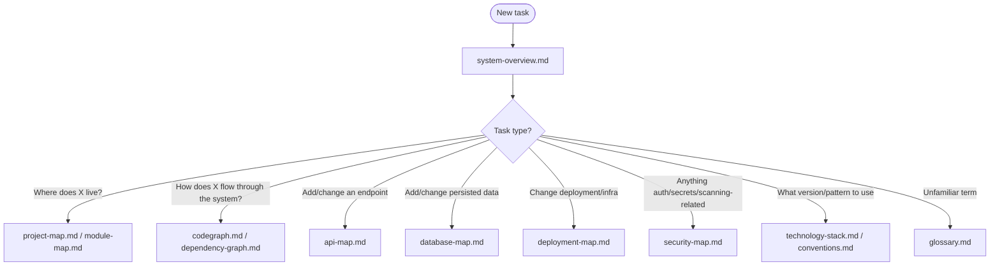

# Intelligence
## Project Intelligence Module

Concrete, current-state facts about the Guardrail Hub *product repository* — its structure, code, dependencies, APIs, data, deployment, and security posture — written for AI assistants to consume with minimal context cost. Distinct from the rest of `.ai/`, which governs the AIOS itself (see [Relationship to the AIOS](#relationship-to-the-aios) below).

Status: Active — populated from a direct inspection of the repository at commit `10bd79b` (branch `main`).

---

## Purpose
Answer "what does this codebase actually look like right now" without an AI assistant having to re-derive it by reading the whole tree every session — the same minimal-context goal the rest of `.ai/` pursues, applied to concrete repository facts instead of AIOS process.

## Scope
The product repository: `mcp-server/`, `web/`, `mobile/`, `api/`, `docs/`, and their supporting infrastructure (Docker, config). Not the AIOS itself, and not a substitute for reading actual source code when implementing a change — these documents describe architecture and relationships, never implementation detail (see each document's own Scope section).

## AI Usage Guidance
Start at [system-overview.md](system-overview.md) for orientation, then follow the table below to the specific document a task needs. Load only what the task requires — these documents are independently addressable, same as any other AIOS knowledge. **Every document here distinguishes "implemented" from "planned/aspirational."** The root [`README.md`](../../README.md) describes a larger target product than what currently exists in code; these documents exist specifically to prevent that gap from causing hallucinated assumptions.

## Main Content

### Document Index

| Document | Answers |
|---|---|
| [system-overview.md](system-overview.md) | What is Guardrail Hub, and what's actually built vs. planned? |
| [project-map.md](project-map.md) | What does every directory in the repo contain? |
| [module-map.md](module-map.md) | What does each code module own, and is it implemented or empty? |
| [codegraph.md](codegraph.md) | What are the entry points, major classes, and execution paths? |
| [dependency-graph.md](dependency-graph.md) | What depends on what, internally and externally? |
| [api-map.md](api-map.md) | What endpoints exist, and what do they require? |
| [database-map.md](database-map.md) | What data is persisted, and how? |
| [deployment-map.md](deployment-map.md) | How does this run — containers, CI/CD, monitoring, logging? |
| [security-map.md](security-map.md) | What is Guardrail Hub's own security posture, honestly? |
| [technology-stack.md](technology-stack.md) | What frameworks/languages/versions are in use? |
| [conventions.md](conventions.md) | What coding patterns should new code follow? |
| [glossary.md](glossary.md) | What does this term mean in this codebase? |

### Recommended Reading Order by Task Type

### Relationship to the AIOS

The rest of `.ai/` (`kernel/`, `router/`, `knowledge/`, `agents/`, etc.) defines *how AI assistants should behave* in this repository — process, contracts, discovery mechanics (see [`.ai/README.md`](../README.md)). This `intelligence/` module is different in kind: it's concrete *content* about the current state of the actual product, not a process framework.

It sits closest to [`knowledge/`](../knowledge/README.md) conceptually — both hold "what is true" rather than "what to do" — but uses a fixed, task-oriented document set (this file list) rather than the per-category addressable-unit pattern [`knowledge/README.md`](../knowledge/README.md) defines for future conceptual Knowledge units. The two are complementary, not competing: `intelligence/` answers "what does this repository currently look like," and `knowledge/`'s future categories will answer narrower conceptual questions once units are authored there. Neither redesigns the other.

## Related Documents
[`.ai/README.md`](../README.md) · [`.ai/knowledge/README.md`](../knowledge/README.md) · [`.ai/foundation/architecture.md`](../foundation/architecture.md) · [MAINTENANCE.md](MAINTENANCE.md)

## Last Updated
2026-07-03 — verified against commit `10bd79b`.
