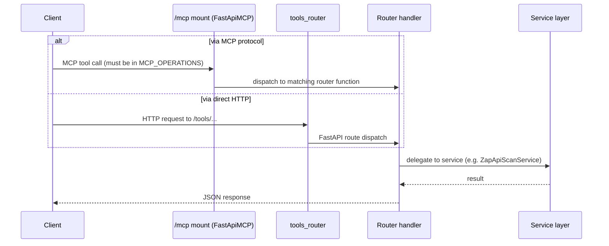

# API Map

## Purpose
List every HTTP/MCP endpoint that currently exists, who owns it, and what it requires — so an AI assistant can find or extend the right endpoint without guessing at a route that doesn't exist.

## Scope
`mcp-server/` HTTP and MCP-exposed endpoints only. `web/` has no API routes of its own (it's a static marketing site — see [module-map.md](module-map.md)).

## AI Usage Guidance
This is the authoritative endpoint list — do not assume an endpoint exists because the root README's target architecture implies it (e.g., there is no project/token/runner-management API yet). Every endpoint below currently has **no authentication enforced**; see [security-map.md](security-map.md) before treating any endpoint as access-controlled.

## Main Content

### API Groups

| Group | Prefix | Router file | MCP-exposed? |
|---|---|---|---|
| Public | — / `/health*` / `/tools/history/*` / `/workers*` | `app/routers/public/` | No |
| MCP Tools | `/tools/zap/*` | `app/routers/mcp/owasp_zap_router.py` | Yes (partially — one operation) |
| Internal | `/internal/*` (planned) | `app/routers/internal/token_router.py` | No — file is empty, not wired up |

### Endpoints

| Method & Path | Router | Purpose | MCP operation ID | Auth required |
|---|---|---|---|---|
| `GET /` | `main.py` | Root/liveness + live worker-registry counts | — | None |
| `GET /health` | `public/health_router.py` | Basic health | — | None |
| `GET /health/live` | `public/health_router.py` | Liveness probe (used by Docker Compose healthcheck) | — | None |
| `GET /health/ready` | `public/health_router.py` | Readiness probe | — | None |
| `POST /tools/zap/scan_api` | `mcp/owasp_zap_router.py` | Queue a ZAP API scan (`status=QUEUED`; does not wait for a worker) | `zap_scan_api` | None enforced |
| `GET /tools/history/get-result` | `public/history_router.py` | Fetch a specific scan result | `get_result` | None enforced |
| `GET /tools/history/ids/{batch_type}` | `public/history_router.py` | List operation IDs by batch type | `list_ids_by_type` | None enforced |
| `GET /tools/history/list` | `public/history_router.py` | List operations | `list_operations` | None enforced |
| `POST /workers/register` | `public/zap_worker_router.py` | ZAP worker self-registration (called by the worker container at startup) | — (not MCP-exposed) | None enforced |
| `POST /workers/heartbeat` | `public/zap_worker_router.py` | ZAP worker heartbeat; 404 if unknown (worker should re-register) | — (not MCP-exposed) | None enforced |
| `GET /workers` | `public/zap_worker_router.py` | List every registered worker (observability) | — (not MCP-exposed) | None enforced |
| `POST /workers/{worker_id}/drain` | `public/zap_worker_router.py` | Begin graceful maintenance (Active → Draining) | — (not MCP-exposed) | None enforced |
| `DELETE /workers/{worker_id}` | `public/zap_worker_router.py` | Hard-remove a worker (manual/scale-down cleanup); fails its in-flight operation, if any | — (not MCP-exposed) | None enforced |
| `/mcp` (mount) | `main.py` (`FastApiMCP`) | MCP protocol entry point | exposes `MCP_OPERATIONS` whitelist | None enforced |

`/workers/*` is deliberately excluded from `MCP_OPERATIONS` (`app/routers/endpoints.py`) — it's infrastructure plumbing called by ZAP worker containers, not a tool an LLM client should invoke.

Schemas exist for website scan and interactive scan (`app/schemas/tools/owasp_zap/website_scan.py`, `interactive_website_scan.py`) but **no router currently exposes them** — only the API-batch-scan path (`zap_scan_api`) is wired into `endpoints.py`.

### Request Flow

Both entry paths (MCP and direct HTTP) converge on the same router handler functions — there is no MCP-specific business logic, only a whitelist (`MCP_OPERATIONS` in `app/routers/endpoints.py`) controlling which of the direct-HTTP-capable operations are also reachable via MCP.

### Service Ownership

| Endpoint group | Owning service |
|---|---|
| `/tools/zap/*` | `ZapApiScanService` (`app/services/tools/owasp_zap/api_scanner.py`) — queues only; `OwaspZapDispatcher` (`app/services/tools/owasp_zap/dispatcher.py`) later assigns and runs it |
| `/tools/history/*` | `HistoryService` (`app/services/public/history_service.py`) |
| `/workers/*` | `OwaspZapWorkerRegistry` (`app/integrations/owasp_zap/registry.py`), via the process-wide singleton in `app/integrations/owasp_zap/runtime.py` |
| `/health*` | None — handled directly in the router, no service layer |

### Authentication Requirements

None of the endpoints above enforce authentication today. The `Settings.AuthMixin` (`app/core/config/_auth.py`) defines JWT-related configuration (`token_authority`, `token_algorithm`, `internal_token_secret`, etc.) and Pydantic schemas exist for token verification (`TokenVerifyRequest`/`TokenVerifyResponse` in `app/schemas/internal/token_request.py`), but:

- `app/routers/internal/token_router.py` is a 0-byte file — no token issuance/verification handlers exist.
- No FastAPI `Depends()`-based auth dependency was found anywhere under `app/` (`mcp-server/dependencies/` is empty).
- `pyjwt` is a declared dependency with zero call sites.

Treat every endpoint in this document as **open** until `security-map.md`'s auth gap is closed. Do not write code that assumes a bearer token is validated anywhere in the current request path.

## Related Documents
[codegraph.md](codegraph.md) · [security-map.md](security-map.md) · [database-map.md](database-map.md)

## Last Updated
2026-07-10 — updated for the ZAP Worker Pool refactor (added `/workers/*`).
