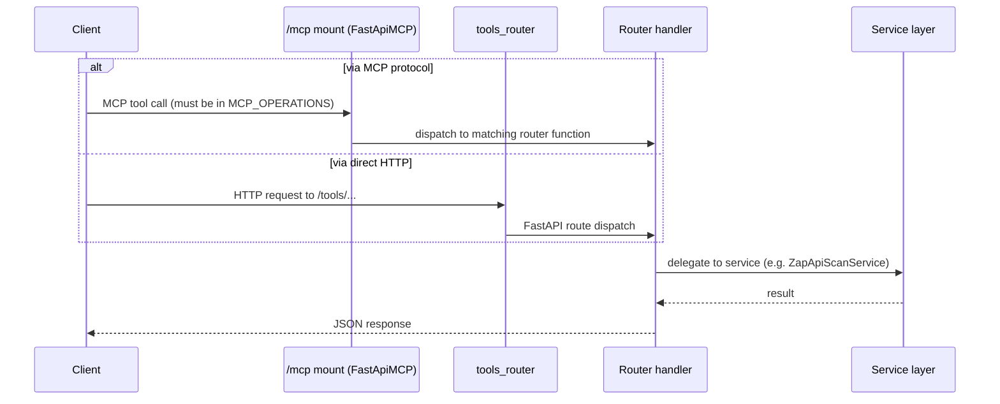

# API Map

## Purpose
List every HTTP/MCP endpoint that currently exists, who owns it, and what it requires — so an AI assistant can find or extend the right endpoint without guessing at a route that doesn't exist.

## Scope
`mcp-server/` HTTP and MCP-exposed endpoints only. `web/` has no API routes of its own (it's a static marketing site — see [module-map.md](module-map.md)).

## AI Usage Guidance
This is the authoritative endpoint list — do not assume an endpoint exists because the root README's target architecture implies it (e.g., there is no project/token/runner-management API yet). Every endpoint below currently has **no authentication enforced**; see [security-map.md](security-map.md) before treating any endpoint as access-controlled.

## Main Content

### API Groups

| Group | Prefix | Router file | MCP-exposed? |
|---|---|---|---|
| Public | — / `/health*` / `/tools/history/*` / `/workers*` / `/zap-workers*` / `/jmeter-workers*` | `app/routers/public/` | No — except the three `/tools/history/*` reads, which are MCP tools |
| MCP Tools | `/tools/zap/*` | `app/routers/mcp/owasp_zap_router.py` | Yes — 3 of 5 (two are unimplemented stubs) |
| MCP Tools | `/tools/jmeter/*` | `app/routers/mcp/jmeter_router.py` | Yes (both operations) |
| Internal | `/internal/*` (planned) | `app/routers/internal/token_router.py` | No — file is empty, not wired up |

### Endpoints

| Method & Path | Router | Purpose | MCP operation ID | Auth required |
|---|---|---|---|---|
| `GET /` | `main.py` | Root/liveness + live worker-registry counts | — | None |
| `GET /health` | `public/health_router.py` | Basic health | — | None |
| `GET /health/live` | `public/health_router.py` | Liveness probe (used by the Compose healthcheck) | — | None |
| `GET /health/ready` | `public/health_router.py` | Readiness probe | — | None |
| `POST /tools/zap/scan_api` | `mcp/owasp_zap_router.py` | Queue a ZAP API scan (`status=QUEUED`; does not wait for a worker) | `zap_scan_api` | None enforced |
| `POST /tools/zap/scan_api_scenario` | `mcp/owasp_zap_router.py` | Queue a multi-step authenticated scenario scan | `zap_scan_api_scenario` | None enforced |
| `POST /tools/zap/scan_api_suite` | `mcp/owasp_zap_router.py` | Queue a fan-out suite scan across an application's categories | `zap_scan_api_suite` | None enforced |
| `POST /tools/zap/scan_web_application` | `mcp/owasp_zap_router.py` | **Intentionally not implemented** — returns an error; browser-automation architecture undecided. Route exists, deliberately **not** in `MCP_OPERATIONS` | — (not MCP-exposed) | None enforced |
| `POST /tools/zap/scan_interactive_web_session` | `mcp/owasp_zap_router.py` | **Intentionally not implemented** — see above | — (not MCP-exposed) | None enforced |
| `POST /tools/jmeter/run_test` | `mcp/jmeter_router.py` | Queue a JMeter load test (`status=QUEUED`). Runs to completion, parses the JTL and persists `summary`/`metrics` plus artifact links | `run_jmeter` | None enforced |
| `POST /tools/jmeter/analyze_result` | `mcp/jmeter_router.py` | Interpret a completed JMeter result, read-only, from the persisted record alone. 404 for an unknown operation or one belonging to another tool | `analyze_jmeter_result` | None enforced |
| `GET /tools/history/get-result` | `public/history_router.py` | Fetch one operation's full record (`?operation_id=`) | `get_result` | None enforced |
| `GET /tools/history/ids/{batch_type}` | `public/history_router.py` | List operation IDs by batch type | `list_ids_by_type` | None enforced |
| `GET /tools/history/list` | `public/history_router.py` | List operations (result field excluded) | `list_operations` | None enforced |
| `GET /workers` | `public/worker_directory_router.py` | **Cross-engine**: every registered worker from every engine, each tagged `worker_type` (`zap`/`jmeter`) plus a computed `available`. Read-only; sorted by `worker_type`, `hostname`, `worker_id`. **Was ZAP-only until 2026-08-01** — ZAP's own list moved to `GET /zap-workers` | — (not MCP-exposed) | None enforced |
| `GET /zap-workers` | `public/zap_worker_router.py` | List registered ZAP workers, ZAP-shaped. The canonical prefix, mirroring `/jmeter-workers` | — (not MCP-exposed) | None enforced |
| `POST /zap-workers/register`, `POST /workers/register` | `public/zap_worker_router.py` | ZAP worker self-registration. **Both prefixes serve the same handler** — the legacy `/workers/*` write paths are what running worker sidecars call | — (not MCP-exposed) | None enforced |
| `POST /zap-workers/heartbeat`, `POST /workers/heartbeat` | `public/zap_worker_router.py` | ZAP worker heartbeat; 404 if unknown (worker should re-register) | — (not MCP-exposed) | None enforced |
| `POST /zap-workers/{id}/drain`, `POST /workers/{id}/drain` | `public/zap_worker_router.py` | Begin graceful maintenance (Active → Draining) | — (not MCP-exposed) | None enforced |
| `DELETE /zap-workers/{id}`, `DELETE /workers/{id}` | `public/zap_worker_router.py` | Hard-remove a ZAP worker; fails its in-flight operation, if any | — (not MCP-exposed) | None enforced |
| `POST /jmeter-workers/register` | `public/jmeter_worker_router.py` | JMeter worker self-registration | — (not MCP-exposed) | None enforced |
| `POST /jmeter-workers/heartbeat` | `public/jmeter_worker_router.py` | JMeter worker heartbeat; 404 if unknown | — (not MCP-exposed) | None enforced |
| `GET /jmeter-workers` | `public/jmeter_worker_router.py` | List registered JMeter workers | — (not MCP-exposed) | None enforced |
| `POST /jmeter-workers/{id}/drain` | `public/jmeter_worker_router.py` | Begin graceful maintenance (Active → Draining) | — (not MCP-exposed) | None enforced |
| `DELETE /jmeter-workers/{id}` | `public/jmeter_worker_router.py` | Hard-remove a JMeter worker; fails its in-flight operation, if any | — (not MCP-exposed) | None enforced |
| `/public/**` (mount) | `main.py` (`StaticFiles`) | Serves generated reports and run packages from `./public` | — | None |
| `/mcp` (mount) | `main.py` (`FastApiMCP`) | MCP protocol entry point | exposes the `MCP_OPERATIONS` whitelist | None enforced |

**8 of the 26 routes are MCP tools.** The whitelist in `app/routers/endpoints.py` is the authority; a route having an `operation_id` is *not* enough. Two ZAP routes carry an `operation_id` and are deliberately excluded because they are unimplemented stubs.

`/workers/*` and `/jmeter-workers/*` are deliberately excluded from `MCP_OPERATIONS` (`app/routers/endpoints.py`) — infrastructure plumbing called by worker containers, not tools an LLM client should invoke. The two pools have separate path prefixes so a worker cannot cross-register into the wrong engine's registry even by misconfiguration.

Website-scan and interactive-scan schemas exist (`app/schemas/tools/owasp_zap/website_scan.py`, `interactive_website_scan.py`) and their routes exist, but the handlers intentionally raise — the browser-automation architecture is undecided. They are kept out of `MCP_OPERATIONS` so an LLM client is never offered a tool that cannot work.

### Request Flow

Both entry paths (MCP and direct HTTP) converge on the same router handler functions — there is no MCP-specific business logic, only a whitelist (`MCP_OPERATIONS` in `app/routers/endpoints.py`) controlling which of the direct-HTTP-capable operations are also reachable via MCP.

### Service Ownership

| Endpoint group | Owning service |
|---|---|
| `/tools/zap/*` | `ZapApiScanService` (`app/services/tools/owasp_zap/api_scanner.py`) — queues only; `OwaspZapDispatcher` (`app/services/tools/owasp_zap/worker/dispatcher.py`) later assigns and runs it |
| `/tools/history/*` | `HistoryService` (`app/services/public/history_service.py`) |
| `/workers/*` | `OwaspZapWorkerRegistry` (`app/integrations/owasp_zap/registry.py`), via the process-wide singleton in `app/integrations/owasp_zap/runtime.py` |
| `/health*` | None — handled directly in the router, no service layer |

### Authentication Requirements

None of the endpoints above enforce authentication today. The `Settings.AuthMixin` (`app/core/config/_auth.py`) defines JWT-related configuration (`token_authority`, `token_algorithm`, `internal_token_secret`, etc.) and Pydantic schemas exist for token verification (`TokenVerifyRequest`/`TokenVerifyResponse` in `app/schemas/internal/token_request.py`), but:

- `app/routers/internal/token_router.py` is a 0-byte file — no token issuance/verification handlers exist.
- No FastAPI `Depends()`-based auth dependency was found anywhere under `app/` (`mcp-server/dependencies/` is empty).
- `pyjwt` is a declared dependency with zero call sites.

Treat every endpoint in this document as **open** until `security-map.md`'s auth gap is closed. Do not write code that assumes a bearer token is validated anywhere in the current request path.

## Related Documents
[codegraph.md](codegraph.md) · [security-map.md](security-map.md) · [database-map.md](database-map.md)

## Last Updated
2026-07-10 — updated for the ZAP Worker Pool refactor (added `/workers/*`).
