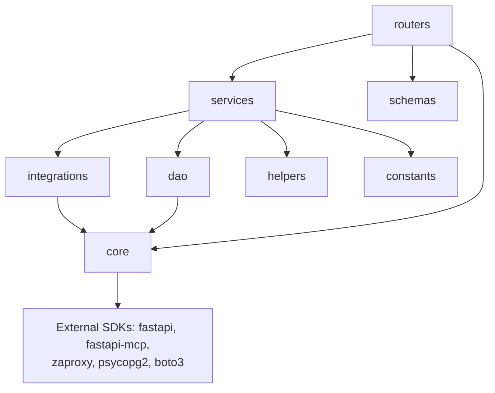
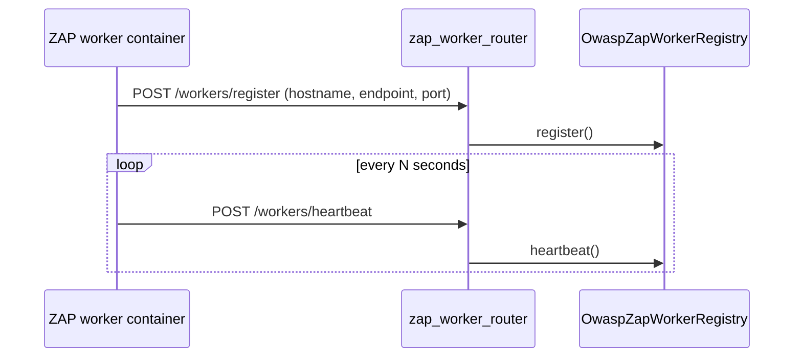
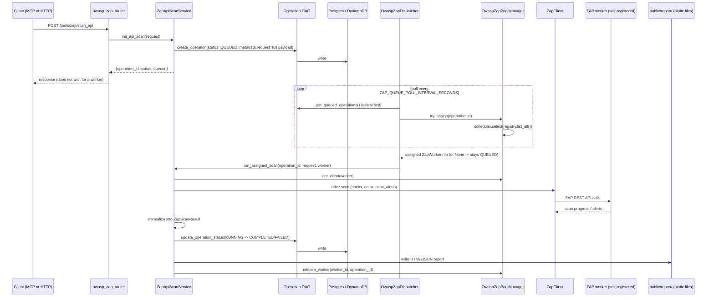

# Code Graph

## Purpose
Give an AI assistant the architectural shape of the code — entry points, major classes, how they call each other, and the execution path of the one fully-working feature — without documenting every function.

## Scope
Architectural relationships only. Does not enumerate every function or file (see [module-map.md](module-map.md) for directory-level ownership). Not a substitute for reading the actual source when implementing a change.

## AI Usage Guidance
Use this to understand how a request travels through the system before modifying any layer in that path. Only one execution path (ZAP API scan) is fully built end-to-end — treat it as the reference pattern for how a new tool integration should be structured.

## Main Content

### Entry Points

| Entry point | File | Starts |
|---|---|---|
| Backend process | `mcp-server/app/main.py` | `uvicorn app.main:app` (per `docker/fastapi/Dockerfile` CMD) — builds the FastAPI app, mounts routers, mounts `/mcp` |
| Frontend process | `web/app/(marketing)/page.tsx` via `web/app/layout.tsx` | `next dev` / `next start` (per `web/package.json` scripts) |
| MCP protocol entry | `/mcp` mount in `app/main.py` (`FastApiMCP`) | Exposes the whitelist in `MCP_OPERATIONS` (`app/routers/endpoints.py`) as MCP tools |

### Major Classes / Modules

| Class | File | Role |
|---|---|---|
| `Settings` | `app/core/config/__init__.py` | Composes `AppMixin, AuthMixin, DatabaseMixin, SecurityMixin, ServerMixin, ZapMixin, BaseSettings` — single source of runtime config, read from `.env` |
| `MCPLogger` | `app/core/mcp_logger.py` | The app's only logging mechanism; every layer below logs through it |
| `PostgresDAO` / DynamoDB equivalent | `app/dao/postgres/postgres_dao.py`, `app/dao/dynamodb/dynamodb_dao.py` | Low-level connection wrappers |
| Operation DAO (Postgres & DynamoDB variants) | `app/dao/postgres/operation_dao.py`, `app/dao/dynamodb/operation_dao.py`, common surface in `app/dao/base.py` | Persistence for scan `OperationRecord`s; provider selected at runtime by `DATABASE_PROVIDER` |
| `ZapClient` | `app/integrations/owasp_zap/client.py` | Wraps the `zaproxy` SDK's `ZAPv2` client; always bound to an explicit worker `endpoint`, never a prefix-derived default |
| `OwaspZapWorkerRegistry` | `app/integrations/owasp_zap/registry.py` | Single source of truth for the pool: self-registered workers, their endpoint, busy/idle (derived from `op_id`), and maintenance lifecycle (Active/Draining/Offline) |
| `RoundRobinScheduler` (`WorkerScheduler` protocol) | `app/integrations/owasp_zap/scheduler.py` | Picks which idle worker runs the next operation; isolated so the strategy can be swapped |
| `OwaspZapPoolManager` | `app/integrations/owasp_zap/pool.py` | Ties Registry + Scheduler together for the dispatcher: `try_assign`, cached `get_client` per worker endpoint, `release_worker` |
| `app/integrations/owasp_zap/runtime.py` | — | Process-wide singletons (`registry`, `scheduler`, `pool_manager`) shared by the worker router, the scan service, and the dispatcher — mirrors the `settings` module-singleton pattern |
| `OwaspZapDispatcher` | `app/services/tools/owasp_zap/worker/dispatcher.py` | Background loops: polls the Operations table for `QUEUED` rows and assigns them via the Pool Manager; sweeps the Registry for heartbeat timeouts and fails orphaned operations |
| `ZapApiScanService` | `app/services/tools/owasp_zap/api_scanner.py` | `init_api_scan` persists a `QUEUED` operation only; `run_assigned_scan`/`zap_scan_worker`/`zap_full_scan_worker` execute once the dispatcher has assigned a worker |
| `HistoryService` | `app/services/public/history_service.py` | Reads persisted `OperationRecord`s for the history endpoints |

### Package Relationships

Dependency direction is one-way: `routers → services → integrations/dao → core`. Nothing in `core/` imports from `services/` or `routers/` (see [dependency-graph.md](dependency-graph.md) for the full internal/external breakdown).

### Service Interactions & Data Flow — ZAP API Scan (the one complete path)

The scan request path and the worker registration/dispatch path are now
decoupled — a request never blocks waiting for a worker; it persists a
`QUEUED` operation and returns immediately.

### Important Execution Paths

1. **ZAP API scan** (above) — the only path with a working integration client, worker self-registration, a persisted queue, and report generation. Use this as the template for any new scanner integration (Semgrep, Gitleaks, etc. are all unimplemented — see [system-overview.md](system-overview.md)).
2. **Worker heartbeat sweep** — `OwaspZapDispatcher`'s second background loop calls `registry.sweep_expired(timeout)` on a timer; any worker whose heartbeat is stale is marked Offline, and if it was executing an operation, that operation is marked `FAILED` (no automatic retry).
3. **History retrieval** — `GET /tools/history/*` → `history_router.py` → `HistoryService` → Operation DAO → Postgres/DynamoDB. Read-only, no external integration.
4. **Health check** — `GET /health`, `/health/live`, `/health/ready` → `health_router.py`, no dependencies beyond process liveness. Used by the Docker Compose healthcheck.
5. **MCP tool invocation** — an MCP client calls through the `/mcp` mount; `FastApiMCP` maps it to one of the whitelisted operations in `MCP_OPERATIONS` (`app/routers/endpoints.py`), which resolve to the same router functions as the direct HTTP paths above. `/workers/*` is deliberately **not** in this whitelist — worker registration is infrastructure plumbing, not an LLM-facing tool.

### What Has No Execution Path Yet

`app/client/`, `app/policies/`, `app/prompts/`, `app/runner/`, `app/security/` are empty — there is no code graph to draw for "Tool Gateway," "Policy Enforcement," or "Runner" concepts named in the root README. Token issuance/verification (`app/routers/internal/token_router.py`) is schema-only, with no handler logic. See [security-map.md](security-map.md) for the implications.

## Related Documents
[module-map.md](module-map.md) · [dependency-graph.md](dependency-graph.md) · [api-map.md](api-map.md) · [database-map.md](database-map.md)

## Last Updated
2026-07-10 — updated for the ZAP Worker Pool refactor (self-registering workers, persisted queue, dispatcher).
