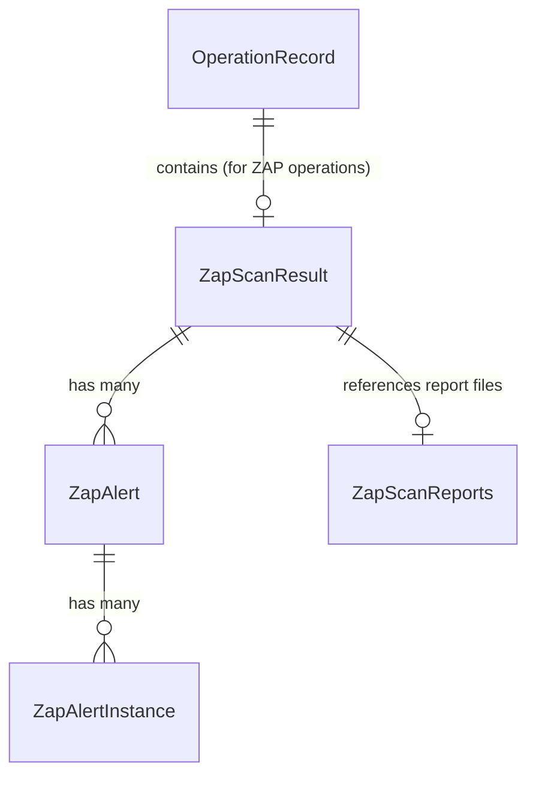
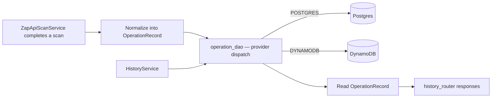

# Database Map

## Purpose
Document the persisted data model, its ownership, and how data flows into and out of storage.

## Scope
`mcp-server/`'s persistence layer only. There is no database in `web/` (no Prisma, no ORM, no data layer — see [dependency-graph.md](dependency-graph.md)).

## AI Usage Guidance
There is no ORM in this codebase — do not introduce SQLAlchemy models or a migration framework without checking with the team first; the existing pattern is a hand-written DAO layer over raw `psycopg2`/`boto3`. Extend that pattern rather than introducing a second persistence style.

## Main Content

### Storage Backends

Persistence is **pluggable**, selected at runtime by the `DATABASE_PROVIDER` setting (`NONE` / `POSTGRES` / `DYNAMODB`), defined in `app/core/config/_database.py`:

| Provider | Backing service | Driver |
|---|---|---|
| `POSTGRES` | `postgres:16-alpine` (Docker Compose, `postgres`/`local-db` profile) | `psycopg2-binary`, raw SQL |
| `DYNAMODB` | AWS DynamoDB or local DynamoDB (`DYNAMODB_ENDPOINT_URL`) | `boto3` |
| `NONE` | No persistence | — |

No SQLAlchemy or other ORM is used — DAOs issue queries/calls directly.

### Main Entities

| Entity | Represented by | Where |
|---|---|---|
| Operation (a scan run/result record) | `OperationRecord` (Pydantic) | `app/schemas/internal/operation.py` |
| ZAP scan result (nested within an Operation) | `ZapScanResult`, `ZapScanSummary`, `ZapAlert`, `ZapAlertInstance`, `ZapTlsResult`, `ZapScanReports` | `app/schemas/tools/owasp_zap/scan_result.py` |

This is currently a single-entity data model — there are no separate User, Project, or Token tables/records anywhere in the codebase, despite the root README describing project/token/runner management as product features. Those would be new entities, not extensions of `OperationRecord`.

### Relationships

`OperationRecord` is generic (keyed by `BatchType`, see `app/constants/batch.py`) — it is not ZAP-specific in structure, but ZAP is the only tool that currently populates it.

### Repository (DAO) Ownership

| DAO | File | Backend |
|---|---|---|
| `base.py` | `app/dao/base.py` | Defines the common interface both backends implement |
| Postgres connection wrapper | `app/dao/postgres/postgres_dao.py` (`PostgresDAO`) | Postgres |
| Postgres operation DAO | `app/dao/postgres/operation_dao.py` | Postgres |
| DynamoDB connection wrapper | `app/dao/dynamodb/dynamodb_dao.py` | DynamoDB |
| DynamoDB operation DAO | `app/dao/dynamodb/operation_dao.py` | DynamoDB |
| Provider-agnostic entry point | `app/dao/operation_dao.py` | Dispatches to the configured provider |

### High-Level Data Flow

Writes happen once, at the end of a scan (`ZapApiScanService`). Reads happen through `HistoryService`, backing the `/tools/history/*` endpoints (see [api-map.md](api-map.md)). There is no update or delete path currently implemented — records are write-once, read-many.

### Schema Migrations

No migration tooling (Alembic, Prisma Migrate, etc.) was found. Postgres schema setup, if any, is not present in the repository as SQL files — treat the Postgres schema as undocumented/implicit until DDL is located or written.

## Related Documents
[api-map.md](api-map.md) · [codegraph.md](codegraph.md) · [deployment-map.md](deployment-map.md)

## Last Updated
2026-07-03 — verified against commit `10bd79b`.
