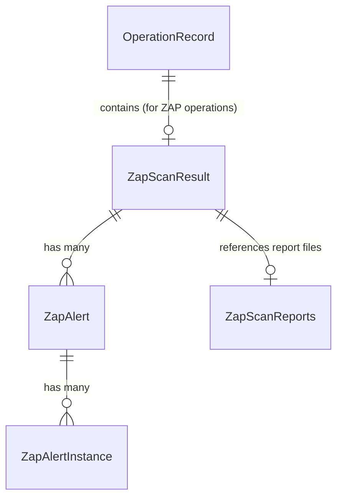
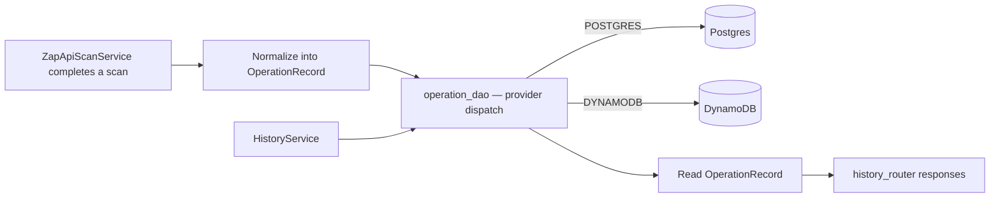

# Database Map

## Purpose
Document the persisted data model, its ownership, and how data flows into and out of storage.

## Scope
`mcp-server/`'s persistence layer only. There is no database in `web/` (no Prisma, no ORM, no data layer — see [dependency-graph.md](dependency-graph.md)).

## AI Usage Guidance
There is no ORM in this codebase — do not introduce SQLAlchemy models or a migration framework (Alembic, etc.) without checking with the team first; the existing pattern is a hand-written DAO layer over raw `psycopg2`/`boto3`, now with a minimal hand-written SQL migration runner (`app/dao/postgres/migration_runner.py`) for the Postgres backend only. Extend that pattern rather than introducing a second persistence style.

`OperationRecord.status = QUEUED` **is** the ZAP worker pool's work queue — there is no separate in-memory queue table or structure. See `architecture/zap-worker-pool/README.md` at the repo root.

## Main Content

### Storage Backends

Persistence is **pluggable**, selected at runtime by the `DATABASE_PROVIDER` setting (`NONE` / `POSTGRES` / `DYNAMODB`), defined in `app/core/config/_database.py`:

| Provider | Backing service | Driver |
|---|---|---|
| `POSTGRES` | `postgres:16-alpine` (Docker Compose, `postgres`/`local-db` profile) | `psycopg2-binary`, raw SQL |
| `DYNAMODB` | AWS DynamoDB or local DynamoDB (`DYNAMODB_ENDPOINT_URL`) | `boto3` |
| `NONE` | No persistence | — |

No SQLAlchemy or other ORM is used — DAOs issue queries/calls directly.

### Main Entities

| Entity | Represented by | Where |
|---|---|---|
| Operation (a scan run/result record) | `OperationRecord` (Pydantic) | `app/schemas/internal/operation.py` |
| ZAP scan result (nested within an Operation) | `ZapScanResult`, `ZapScanSummary`, `ZapAlert`, `ZapAlertInstance`, `ZapTlsResult`, `ZapScanReports` | `app/schemas/tools/owasp_zap/scan_result.py` |

This is currently a single-entity data model — there are no separate User, Project, or Token tables/records anywhere in the codebase, despite the root README describing project/token/runner management as product features. Those would be new entities, not extensions of `OperationRecord`.

### Relationships

`OperationRecord` is generic (keyed by `BatchType`, see `app/constants/batch.py`) — it is not ZAP-specific in structure, but ZAP is the only tool that currently populates it.

### Repository (DAO) Ownership

| DAO | File | Backend |
|---|---|---|
| `base.py` | `app/dao/base.py` | Defines the common interface both backends implement |
| Postgres connection wrapper | `app/dao/postgres/postgres_dao.py` (`PostgresDAO`) | Postgres |
| Postgres operation DAO | `app/dao/postgres/operation_dao.py` | Postgres |
| DynamoDB connection wrapper | `app/dao/dynamodb/dynamodb_dao.py` | DynamoDB |
| DynamoDB operation DAO | `app/dao/dynamodb/operation_dao.py` | DynamoDB |
| Provider-agnostic entry point | `app/dao/operation_dao.py` | Dispatches to the configured provider |

### High-Level Data Flow

A write also happens at operation *creation* now (`status=QUEUED`, with the full scan request under `metadata["request"]`), and again at every status transition (`QUEUED → RUNNING → COMPLETED/FAILED`) as the ZAP Pool Manager's dispatcher picks it up and runs it — not just once at the end. Reads happen through `HistoryService` (`/tools/history/*`, see [api-map.md](api-map.md)) and through the dispatcher's own `get_queued_operations()` poll. There is still no update path for arbitrary fields, and no delete path — only status/result/error transitions.

### Schema Migrations

A minimal, dependency-free SQL migration runner exists for the Postgres backend: `app/dao/postgres/migration_runner.py` applies the versioned `.sql` files under `app/dao/postgres/migrations/` (tracked in a hand-written `schema_migrations` table — not Alembic/Prisma Migrate, consistent with the no-ORM rule above) and is invoked by `PostgresOperationDAO.initialize_schema()` during the app's startup sequence (`app/core/startup.py`), before the server accepts requests. A migration failure aborts startup with a non-zero exit code.

Current migrations:

| File | Adds |
|---|---|
| `0001_create_operations_table.sql` | The `operations` table (unchanged shape from the original hand-documented DDL) |
| `0002_add_operations_queue_index.sql` | `idx_operations_status_created_at` — supports `get_queued_operations()`'s `WHERE status = 'queued' ORDER BY created_at ASC` |

DynamoDB has no migration concept; `DynamoDBOperationDAO.initialize_schema()` verifies the table exists (`.table.load()`) and, only when `DYNAMODB_ENDPOINT_URL` is set (local/emulator mode), auto-creates it — against real AWS a missing table raises rather than being created by the app.

## Related Documents
[api-map.md](api-map.md) · [codegraph.md](codegraph.md) · [deployment-map.md](deployment-map.md)

## Last Updated
2026-07-10 — updated for the ZAP Worker Pool refactor (persisted queue, Postgres migration runner).
