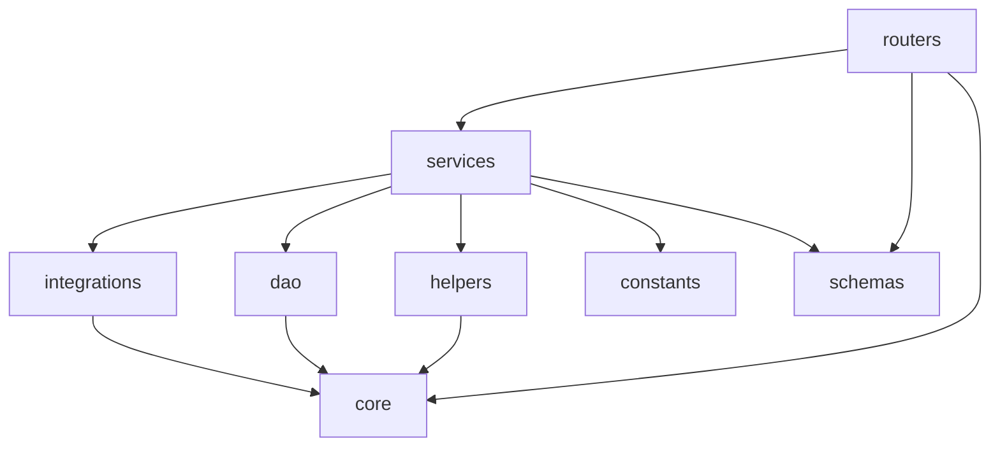
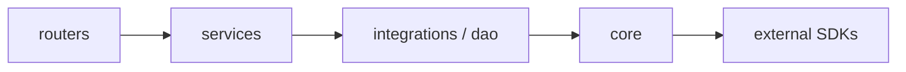

# Dependency Graph

> **2026-07-10 — Hardening Sync ([ADR-0005](../decisions/0005-architecture-hardening-refactor.md)).** The `core → utils` import inversion is resolved: `core/mcp_logger` now imports `app.core.logger_utils` (the `utils/` role was removed), so `core/` is genuinely the lowest layer as stated below. New service units `ZapWorkerService` and `HealthService` keep the worker/health routers free of DAO/registry calls (`routers → services → integrations|dao`).

## Purpose
Document what depends on what — internal module dependencies, external packages, shared libraries, and any circular-dependency risk — so a change in one place can be evaluated for blast radius before it's made.

## Scope
Package- and module-level dependencies for `mcp-server/` and `web/`. Class-level call relationships are in [codegraph.md](codegraph.md).

## AI Usage Guidance
Check this before adding a new dependency (is something similar already in use?) or before changing a low-level module (`core/config`, `dao/base.py`) — those sit at the bottom of the dependency direction and are depended on by everything above them.

## Main Content

### Internal Module Dependencies (`mcp-server/app/`)

Direction is strictly downward: `routers → services → {integrations, dao, helpers, constants} → core`. `core/` (config, logging, exceptions) has no dependency on any layer above it — it is the lowest, most shared layer, consistent with the multi-mixin `Settings` design in `app/core/config/__init__.py`.

### External Dependencies

**`mcp-server/` (from `pyproject.toml`)**

| Package | Used for | Notes |
|---|---|---|
| `fastapi` (≥0.136.3) | Web framework | Core |
| `fastapi-mcp` (≥0.4.0) | MCP protocol exposure | Mounts `/mcp` in `main.py` |
| `uvicorn` | ASGI server | Runs the app |
| `pydantic-settings` | Config loading | Backs `Settings` |
| `psycopg2-binary` | Postgres driver | Used directly by DAO layer (no ORM) |
| `boto3` | AWS SDK | DynamoDB DAO backend |
| `pyjwt` | JWT | **Declared but unused** — no code imports it; auth is not implemented (see [security-map.md](security-map.md)) |
| `bcrypt` | Password hashing | Declared; no code currently calls it |
| `zaproxy` | ZAP Python SDK | Wrapped by `ZapClient` |

**`web/` (from `package.json`)**

| Package | Used for |
|---|---|
| `next` (^15.3.4), `react`/`react-dom` (^19.1.0) | Framework |
| Radix UI primitives | Underlying shadcn/ui components |
| `class-variance-authority`, `clsx`, `tailwind-merge` | Styling utilities for component variants |
| `gsap` + `@gsap/react` | Scroll/animation effects |
| `lucide-react` | Icons |
| `next-themes` | Theme switching |
| `tailwindcss` (dev) | Styling |

Notably absent from `web/`: any HTTP client (`axios`, `swr`, `react-query`) or ORM (`prisma`) — confirming `web/` does not yet talk to `mcp-server` or a database (see [api-map.md](api-map.md)).

### Shared Libraries

There is no separate shared-library package between `mcp-server/` and `web/` — they are independent applications with no code sharing today (no monorepo tooling like Turborepo/Nx detected; each has its own dependency manager: `uv`/`pyproject.toml` for the backend, `bun`/`package.json` for the frontend). Within `mcp-server/`, `app/core/` functions as the de facto shared internal library (config, logging, exceptions) that every other layer depends on.

### Circular Dependency Risks

| Risk | Assessment |
|---|---|
| `Settings` mixin composition (`AppMixin, AuthMixin, DatabaseMixin, SecurityMixin, ServerMixin, ZapMixin, BaseSettings`) | Not circular, but MRO (method resolution order) complexity grows with each mixin added — a new mixin that overrides a field defined in an earlier one could silently shadow it. Worth checking mixin order when adding a new settings category. |
| DAO layer (`postgres/` vs `dynamodb/` implementations) | No circular risk — both implement a common surface from `app/dao/base.py` and are selected exclusively at runtime via `DATABASE_PROVIDER`, never both loaded into the same call path. |
| `routers → services → integrations/dao → core` | Strictly one-directional as observed; no back-references from `core/` or `dao/` into `services/` or `routers/` were found. |

No circular imports were found in the current codebase — the risk table above is about structural patterns worth watching as the codebase grows, not existing problems.

### Dependency Direction Summary

Lower layers must never import from higher layers. When in doubt about which layer new code belongs in, match it to the existing ZAP path (see [codegraph.md](codegraph.md#service-interactions--data-flow--zap-api-scan-the-one-complete-path)).

## Related Documents
[codegraph.md](codegraph.md) · [module-map.md](module-map.md) · [technology-stack.md](technology-stack.md)

## Last Updated
2026-07-03 — verified against commit `10bd79b`.
