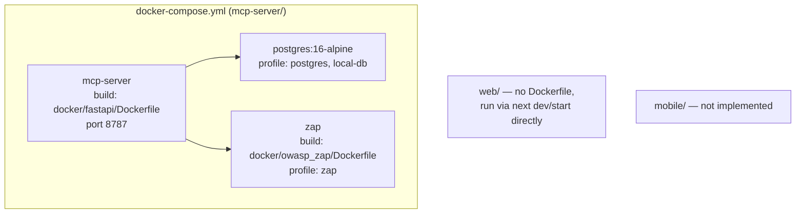

# Deployment Map

## Purpose
Document how the system runs today — containers, orchestration, CI/CD, monitoring, logging — and what's absent.

## Scope
Deployment and operational tooling for `mcp-server/` and `web/`. Does not cover application-level architecture (see [codegraph.md](codegraph.md)).

## AI Usage Guidance
Do not assume Kubernetes manifests, CI pipelines, or monitoring infrastructure exist — none were found in the repository. If a task requires any of these, they need to be created from scratch, not modified.

## Main Content

### Applications & Containers

| Service | Definition | Ports | Volumes | Profile | Always runs? |
|---|---|---|---|---|---|
| `mcp-server` | `docker-compose.yml`, build `docker/fastapi/Dockerfile` | `${MCP_SERVER_PORT:-8787}:8787` | `./app`, `./config`, `./data`, `./logs`, `./public` | default | Yes |
| `postgres` | `postgres:16-alpine` | `${POSTGRES_PORT:-5432}:5432` | `postgres-data:/var/lib/postgresql/data` | `postgres`, `local-db` | Only with profile |
| `zap` | build `docker/owasp_zap/Dockerfile` | 8080/8090 (container-internal only, not host-mapped) | `./data/zap:/zap/wrk`, `./reports/zap:/zap/reports` | `zap` | Only with profile |

Network: single bridge network `app-network`. Named volume: `postgres-data`.

### Dockerfiles

| File | Base | Builds |
|---|---|---|
| `mcp-server/docker/fastapi/Dockerfile` | `python:3.12-slim` | Installs `uv`, runs `uv sync --frozen --no-dev` against `pyproject.toml`/`uv.lock`, copies `app/` + `config/`, creates `data/logs/reports` dirs, exposes 8787, runs `uvicorn app.main:app --reload` |
| `mcp-server/docker/owasp_zap/Dockerfile` | `zaproxy/zap-stable` | Creates `/zap/sessions` owned by uid/gid 1000 |

**No Dockerfile exists for `web/`** — it is not containerized; it runs via `next dev`/`next start` directly. No Dockerfile exists at the repository root either.

### Kubernetes / Helm

None. No manifests, no Helm charts anywhere in the repository. The root README mentions Kubernetes only as a future scaling consideration for ZAP workloads (self-hosted runners, queue-based jobs) — this is aspirational, not implemented.

### CI/CD

None. No `.github/workflows/`, no `Jenkinsfile`, no `.gitlab-ci.yml`, no other CI config anywhere in the repository. There is currently no automated build, test, or deploy pipeline — and, notably, no automated security scanning of Guardrail Hub's own code despite that being the product's purpose (see [security-map.md](security-map.md)).

### Monitoring

None. No Prometheus, Grafana, or other observability tooling/config found. The root README's "Runtime Monitoring" scanning mode (Falco/WAF/SIEM sources) is described as a target capability, not something implemented against Guardrail Hub's own deployment.

### Logging

| Aspect | Implementation |
|---|---|
| Mechanism | `MCPLogger` (`app/core/mcp_logger.py`) — the app's only logging path, no structured/centralized log shipping |
| Output | File-based, written to `mcp-server/logs/` (observed: `OWASP ZAP_*.log`, `OwaspZapPool_*.log`, `PostgresDAO_*.log`, `PostgresOperationDAO_*.log`) |
| Configuration | `LOG_LEVEL`, `LOG_FORMAT`, `LOG_FILE_PATH` (`.env.example`) |
| Aggregation/shipping | None — logs stay local to the container/host filesystem; no ELK/Loki/CloudWatch integration found |

### Environments

Only a local/dev environment is evidenced (Docker Compose with `${VAR:-default}` fallbacks, `.env`/`.env.example`). No staging or production environment configuration (e.g., separate compose files, environment-specific `.env` templates) was found.

## Related Documents
[technology-stack.md](technology-stack.md) · [security-map.md](security-map.md) · [system-overview.md](system-overview.md)

## Last Updated
2026-07-03 — verified against commit `10bd79b`.
