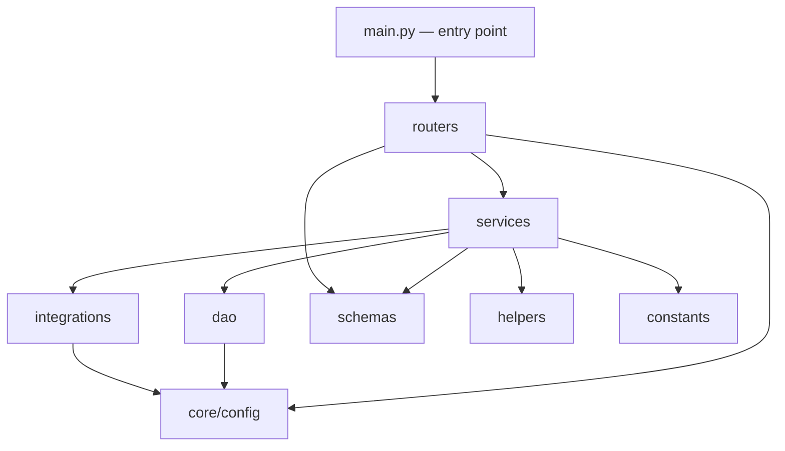
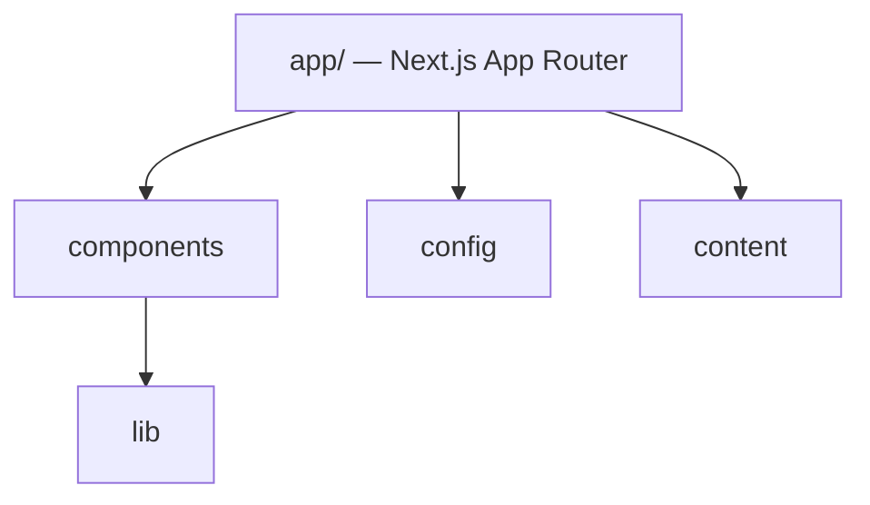

# Module Map

> **2026-07-10 — Architecture Hardening Sync ([ADR-0005](../decisions/0005-architecture-hardening-refactor.md)).** Baseline `10bd79b` predates both the ChatOps subsystem and this refactor. Corrections: (1) the roles `app/prompts/` and `app/utils/` were **removed** — `LoggerUtils` now lives at `app/core/logger_utils.py` (fixing a `core → utils` inversion). (2) Empty scaffold dirs (`app/client`, `app/policies`, `app/runner`, `app/security`, `app/integrations/jmeter`, `app/services/internal`, `app/services/tools/jmeter`, `app/schemas/public`, `app/schemas/tools/{playwright,selenium}`) and 0-byte stubs (`routers/internal/token_router.py`, `routers/mcp/{playwrights,selenium}_router.py`, `schemas/internal/audit_request.py`) were **deleted**. (3) New units: `services/tools/owasp_zap/worker_service.py` (`ZapWorkerService`) and `services/public/health_service.py` (`HealthService`); the worker + health routers are now thin HTTP adapters. (4) The ChatOps subsystem (`core/events`, `core/ports`, `integrations/chat/slack`, `services/{notification,platform,operations,evaluations}`) is live; `MCPLogger` is now the **sole** logger (stdlib `logging` removed from the ZAP client and both scanners).

>
> **2026-07-11 — Operation Progress Notification framework.** The notification context gained a platform-agnostic progress framework (UX only; scan execution unchanged). New units: `services/notification/operation_progress.py` (`OperationProgress` + `LifecyclePhase` — the generic, tool-neutral progress model), `services/notification/throttle.py` (`ProgressThrottle` — stage-change / 10% / 30s gate), `services/notification/renderer.py` (`OperationNotificationRenderer` — per-phase UX text), and `services/notification/operation_notifier.py` (`OperationNotifier` — capability-aware handler picking message-update vs. new-message fallback). `core/ports/notification_channel.py` now declares `ChannelCapabilities` (supports_message_update/threads/buttons/progress) + a `MessageRef` and `update()`; `NotificationService` exposes `capabilities()`/`update()`; the Slack adapter implements `chat.update` and declares full capabilities. `OperationService` publishes an additive, opt-in `operation.progress` event (`report_progress`). Wired via `bootstrap.build_operation_notification_flow`. Dispatcher and tool/scanner code contain no notification code.
>
> **2026-07-11 — Scan lifecycle wired into the notification pipeline.** The OWASP ZAP scan path now emits lifecycle + progress through `OperationService` instead of writing status straight to the DAO. `ZapApiScanService` and `OwaspZapDispatcher` take an injected `OperationService`; their RUNNING/COMPLETED/FAILED transitions (and the QUEUED create) go through it (identical persisted fields), and the scanner calls `report_progress()` at coarse milestones (initializing / spider / active scan / report generation). The two mid-scan `ascan_scan_id` result writes remain direct DAO writes (bookkeeping, not transitions). `build_operation_notification_flow_from_settings` assembles exactly one pipeline (one bus, one `OperationService`, one `OperationNotifier` subscribed only when Slack is enabled); `startup.run_startup_sequence` builds it once and injects the shared `OperationService` into `build_zap_dispatcher`. The scanner/dispatcher remain transport-agnostic (no Slack/NotificationService/OperationNotifier imports). Chain: Scanner → OperationService → event bus → OperationNotifier → NotificationService → Slack.
>
> **2026-07-11 — Notification presentation refactor (UX only).** The notification layer now renders professional *status cards* rather than log lines. `operation_progress.py` gained a tool-agnostic `ScanFindings` value object and presentation fields on `OperationProgress` (title, target, reference, findings, next_action, failed_phase, debug). `renderer.py` was rewritten around the information hierarchy (title/target/status first, then progress/elapsed, then findings/report/next-action), humanises stage wording (e.g. spider -> "Discovering attack surface", active scan -> "Security testing"), shows a short `Operation #XXXX` reference instead of the UUID, and isolates all Level-4 infrastructure (operation id, worker, container) behind Debug Mode. `operation_notifier.py` resolves a friendly title from `batch_type` (composition-supplied `OPERATION_TITLES`), derives the short reference, remembers title/target across the single edited message, and passes optional presentation payload keys through; it gained a `debug` flag. `SETTINGS.notification_debug` (default false) drives Debug Mode. No change to scan execution, dispatcher, OperationService transitions, event bus, routing, or transports — pure presentation.
> **2026-07-20 — Services package-design refactor** (per [services-architecture-plan.md](../architecture/evidence/services-architecture-plan.md); architecture-only, behavior preserved). (1) Service packages gained public-API façades (`__init__.py`): `services/notification` exports only `NotificationService`/`Notification`/`UnknownChannelError`; `operations` exports `OperationService` + `EVENT_OPERATION_*`; `platform` exports `PlatformReporter`/`report_startup`/`report_shutdown`; `evaluations` exports `EvaluationService`/`ScanRunner`; `public` exports `HealthService`/`HistoryService`. The composition root (`bootstrap.py`) deep-imports internals by design (Composition Root Exception); other application modules import package roots only. `services/tools/owasp_zap` deliberately has **no** eager façade (lazy-import discipline around the zaproxy-dependent scanner). (2) `services/notification` internals moved to responsibility subpackages: `models/` (notification, operation_progress), `rendering/` (renderer), `policy/` (throttle), `subscribers/` (event_subscriber), `dispatch/` (operation_notifier); only `notification_service.py` remains at the root. (3) ZAP execution engine consolidated: `handlers/` → `execution/handlers/`, `worker/dispatcher.py` → `execution/dispatcher.py`, `worker/worker_service.py` → package root; `worker/` removed. `evaluations/zap_scan_runner.py` → `services/tools/owasp_zap/sync_runner.py`. `suite/openapi.py` re-export shim deleted (consumers import `schemas/tools/owasp_zap/openapi_spec` directly). (4) `app/core/exception.py` (previously a 0-byte file) now defines transport-agnostic domain errors (`InvalidScanRequestError`, `ScanSubmissionError`); the three ZAP submit services raise these instead of `fastapi.HTTPException`, and `owasp_zap_router` maps them at the boundary (validation errors now surface as HTTP 400 instead of being re-wrapped into 500 by the router's catch-all).

> **2026-07-20 — Domain layer introduced** ([Decision 0007](../decisions/0007-domain-layer-justification.md) justification, [Decision 0008](../decisions/0008-domain-ubiquitous-language.md) vocabulary). New innermost role `app/domain/` with two capabilities: `domain/findings/` (`Severity`, `Finding`, `Confidence`, `FindingIdentity`, `FindingSummary`, `deduplicate`) and `domain/lifecycle/` (`OperationPhase`). Domain imports nothing from the rest of `app` and no framework/transport types; every other layer may depend on it, never the reverse. **Duplication removed:** severity had six competing definitions (two with conflicting `total` semantics, one unable to represent CRITICAL) and the operation lifecycle had two — now one canonical owner each. `OperationStatus` (formerly in `schemas/tools/owasp_zap/common.py`) and `LifecyclePhase` (formerly in the notification package) are both replaced by `domain.lifecycle.OperationPhase`; `ScanFindings` is replaced by `domain.findings.FindingSummary`, whose severity-keyed mapping shape makes new severities additive. The ambiguous term `total` is retired from domain vocabulary in favour of `finding_count` (all findings) and `vulnerability_count` (excludes informational). Tool wire formats (`ZapAlert`, `ZapScanSummary`) intentionally remain per-tool and map into the domain at each adapter boundary.

> **2026-07-20 — Package semantics pass.** Two narrow changes so every package name states a responsibility rather than a Python construct. (1) `services/notification/models/` dissolved: `Notification` → `services/notification/message/` (what gets delivered), `OperationProgress` → `services/notification/rendering/` (the render model, whose whole purpose is to be rendered). The name `models/` became actively misleading once `app/domain/` landed, because "model" now denotes a *domain* model and neither of these is one. The notification façade is unchanged, so no external consumer moved. (2) The empty `schemas/tools/jmeter/` scaffold directory was removed (ADR-0005's no-empty-scaffold rule). Every other package was reviewed and deliberately left unchanged — see [package-semantics-review.md](../architecture/evidence/package-semantics-review.md).

## Purpose
Describe the internal modules of `mcp-server/app/` and `web/`, what each owns, and whether it's implemented or an empty placeholder.

## Scope
Code-level module boundaries within the two implemented applications. Directory-level structure (including empty top-level folders) is covered in [project-map.md](project-map.md); class-level relationships and execution paths are covered in [codegraph.md](codegraph.md).

## AI Usage Guidance
Before adding code to any module below marked **Empty**, check whether the surrounding modules imply a convention (see [conventions.md](conventions.md)) rather than inventing a new pattern. Modules marked **Implemented** should be extended following their existing pattern, not restructured.

## Main Content

### `mcp-server/app/` Module Boundaries

| Module | Status | Owns |
|---|---|---|
| `app/main.py` | Implemented | FastAPI app construction, CORS wiring, router mounting, MCP mount (`FastApiMCP`) |
| `app/routers/public/` | Implemented | `health_router.py`, `history_router.py`, `zap_worker_router.py` — endpoints with no MCP exposure. `zap_worker_router.py` backs `POST /workers/register`, `POST /workers/heartbeat`, `POST /workers/{id}/drain`, `DELETE /workers/{id}`, `GET /workers` — mounted directly on the app, same as `health_router` |
| `app/routers/mcp/` | Partial | `owasp_zap_router.py` implemented and wired; `playwrights_router.py`, `selenium_router.py` exist as files but are **not wired into `endpoints.py`** |
| `app/routers/internal/` | Empty (stub) | `token_router.py` is a 0-byte file — internal token issuance/verification is unimplemented |
| `app/routers/endpoints.py` | Implemented | Central router registry; defines `tools_router` and the MCP-exposed operation whitelist (`MCP_OPERATIONS`) |
| `app/core/config/` | Implemented | Settings composed via mixins (`_app`, `_auth`, `_database`, `_security`, `_server`, `tools/_zap`) into one `Settings` class, backed by `pydantic_settings.BaseSettings` reading `.env`. `tools/_zap.py` no longer has a worker-name/prefix/count field — only deployment-wide timeouts and worker-registry heartbeat/poll intervals |
| `app/core/exception.py`, `app/core/mcp_logger.py` | Implemented | Custom exception handling; `MCPLogger` — the app's only logging mechanism |
| `app/core/startup.py` | Implemented | `run_startup_sequence()` — Database Ready → Run Migrations → Verify required tables → Initialize services (start the ZAP dispatcher), called from `main.py`'s lifespan *before* the defensive reporting try/except so a schema failure aborts boot with a non-zero exit |
| `app/dao/` | Implemented | Data-access layer: `base.py` (interface, now with `get_queued_operations()` and `initialize_schema()`), `postgres/` and `dynamodb/` implementations, selected at runtime by `DATABASE_PROVIDER`. `app/dao/postgres/migrations/` holds versioned `.sql` files applied by `app/dao/postgres/migration_runner.py` |
| `app/integrations/owasp_zap/` | Implemented | `client.py` (`ZapClient`, always bound to an explicit worker `endpoint`), `registry.py` (`OwaspZapWorkerRegistry` — the Worker Registry), `scheduler.py` (`WorkerScheduler` protocol + `RoundRobinScheduler`), `pool.py` (`OwaspZapPoolManager` — assignment + client cache), `runtime.py` (process-wide registry/scheduler/pool-manager singletons), `configurator.py` |
| `app/integrations/jmeter/` | Implemented | `registry.py` (`JMeterWorkerRegistry`), `scheduler.py` (`JMeterWorkerScheduler` protocol + `RoundRobinJMeterWorkerScheduler`), `pool.py` (`JMeterWorkerPoolManager`), `worker_client.py` (`JMeterWorkerClient` — server→worker transport), `runtime.py` (process singletons), `worker.py` (`JMeterWorker` — agent-side assignment + run host), `process.py` (`JMeterProcessRunner` — the JMeter subprocess: launch, timeout, cancel, cleanup). Still a skeleton: `parser.py` (`JMeterParser`, Phase 4) — see [architecture/jmeter-engine/](../../architecture/jmeter-engine/README.md) |
| `app/schemas/internal/` | Implemented | `token_request.py`, `operation.py` — Pydantic models, some for the unimplemented token router |
| `app/schemas/tools/owasp_zap/` | Implemented | 6 files: request/response models for website scan, API batch scan, interactive scan, common types, scan results |
| `app/schemas/tools/playwright/`, `app/schemas/tools/selenium/` | Empty | Reserved, no schemas defined |
| `app/services/tools/owasp_zap/` | Implemented | Root: the application services — `api_scanner.py` (`ZapApiScanService` — `init_api_scan` only queues; `run_assigned_scan`/`zap_scan_worker`/`zap_full_scan_worker` execute once assigned), `scan_api_scenario.py`, `scan_api_suite.py`, `worker_service.py` (`ZapWorkerService` — registration/heartbeat/removal), `sync_runner.py` (`ZapScanRunner` — synchronous runner injected into `EvaluationService`). Subpackages (internal): `execution/` (operation-type/strategy enums, handler contract, registry, `dispatcher.py` — `OwaspZapDispatcher` queue-poll + heartbeat-sweep loops, `handlers/` — per-tool adapters), `scenario/` (workflow engine), `suite/` (fan-out/fan-in engine). The former 0-byte stubs `scan_web_application.py` / `scan_interactive_web_session.py` were deleted 2026-07-20 (completing ADR-0005's stub cleanup); the matching router endpoints remain intentionally not-implemented |
| `app/services/tools/jmeter/` | Partial | One service per MCP tool: `run_jmeter_test_service.py` (`JMeterTestService.init_run_jmeter_test` — submission, **implemented**) and `analyze_jmeter_result_service.py` (`JMeterAnalyzer` — skeleton). `jmeter_worker_service.py` (`JMeterWorkerService` — registration/heartbeat/drain/remove, **implemented**). Internal `execution/`: `dispatcher.py` (`JMeterDispatcher` — queue + heartbeat-sweep loops, lane `jmeter_test`) and `runtime.py` (`JMeterRuntime` — the Generate→Validate→Execute→Parse→Persist orchestrator; Parse is a Phase-4 no-op), both **implemented**. Internal `plan/`: `generator.py` (`JMeterPlanGenerator`) and `validator.py` (`JMeterPlanValidator` — the Guardrail G4 enforcement point). No operation registry — JMeter has one operation type |
| `app/runtime/` | Implemented (1 boundary) | **Not a backend layer.** Holds independently deployed processes, carved out of [backend-layering](../standards/architecture/backend-layering.md) 1.2.0's scope and governed by [runtime-boundary](../standards/architecture/runtime-boundary.md) 1.0.0 ([ADR-0012](../decisions/0012-runtime-boundary.md)). A component qualifies only with its own image, own lifecycle, own interface and local execution — otherwise it is application code and takes an R1 role |
| `app/runtime/jmeter/main.py` | Implemented | The **worker** container's ASGI app — a second deployable, exposing only `/assignments*` and a liveness probe, endpoints inline (they are not the mcp-server's HTTP surface). Must not import `dao/`, `services/`, `routers/` or `bootstrap` (RB3) — enforced by `aios arch`, by the Dockerfile's selective COPY (35 files, not 143), and by `tests/integrations/jmeter/test_jmeter_worker_isolation.py`. **ZAP has no equivalent: ZAP ships a daemon, JMeter ships a CLI** |
| `app/services/internal/` | Empty | Unimplemented |
| `app/services/public/history_service.py` | Implemented | `HistoryService` — backs the history endpoints |
| `app/helpers/tools/owasp_zap_helpers.py` | Implemented | ZAP-specific helper functions |
| `app/constants/` | Implemented | `batch.py` (`BatchType` enum), `paths.py` (`ReportPaths`) |
| `app/client/`, `app/policies/`, `app/prompts/`, `app/runner/`, `app/security/` | **Empty** | All exist as directories with zero files — these correspond to concepts named in the root README ("Tool Gateway", "Policy Enforcement", "Runner") that have not been built |

### `web/` Module Boundaries

| Module | Status | Owns |
|---|---|---|
| `web/app/(marketing)/` | Implemented | The only route group — landing page (`page.tsx`) and its `layout.tsx` |
| `web/components/layout/` | Implemented | Site-wide chrome: header, footer, announcement bar, logo, skip-link |
| `web/components/sections/` | Implemented | Marketing page sections (hero, features, pricing, FAQ, te