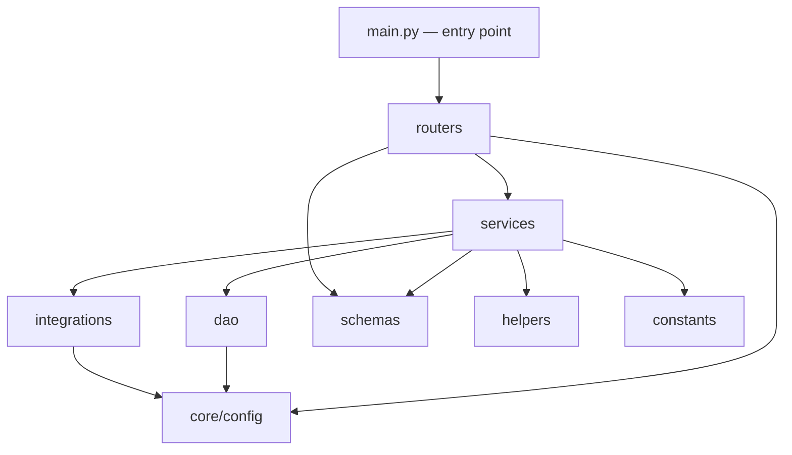
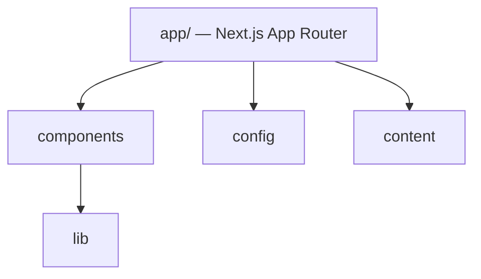

# Module Map

## Purpose
Describe the internal modules of `mcp-server/app/` and `web/`, what each owns, and whether it's implemented or an empty placeholder.

## Scope
Code-level module boundaries within the two implemented applications. Directory-level structure (including empty top-level folders) is covered in [project-map.md](project-map.md); class-level relationships and execution paths are covered in [codegraph.md](codegraph.md).

## AI Usage Guidance
Before adding code to any module below marked **Empty**, check whether the surrounding modules imply a convention (see [conventions.md](conventions.md)) rather than inventing a new pattern. Modules marked **Implemented** should be extended following their existing pattern, not restructured.

## Main Content

### `mcp-server/app/` Module Boundaries

| Module | Status | Owns |
|---|---|---|
| `app/main.py` | Implemented | FastAPI app construction, CORS wiring, router mounting, MCP mount (`FastApiMCP`) |
| `app/routers/public/` | Implemented | `health_router.py`, `history_router.py` — endpoints with no MCP exposure |
| `app/routers/mcp/` | Partial | `owasp_zap_router.py` implemented and wired; `playwrights_router.py`, `selenium_router.py` exist as files but are **not wired into `endpoints.py`** |
| `app/routers/internal/` | Empty (stub) | `token_router.py` is a 0-byte file — internal token issuance/verification is unimplemented |
| `app/routers/endpoints.py` | Implemented | Central router registry; defines `tools_router` and the MCP-exposed operation whitelist (`MCP_OPERATIONS`) |
| `app/core/config/` | Implemented | Settings composed via mixins (`_app`, `_auth`, `_database`, `_security`, `_server`, `tools/_zap`) into one `Settings` class, backed by `pydantic_settings.BaseSettings` reading `.env` |
| `app/core/exception.py`, `app/core/mcp_logger.py` | Implemented | Custom exception handling; `MCPLogger` — the app's only logging mechanism |
| `app/dao/` | Implemented | Data-access layer: `base.py` (interface), `postgres/` and `dynamodb/` implementations, selected at runtime by `DATABASE_PROVIDER` |
| `app/integrations/owasp_zap/` | Implemented | `client.py` (`ZapClient`, wraps the `zaproxy` SDK), `pool.py` (`OwaspZapPool`, thread-safe container-slot pool), `configurator.py` |
| `app/integrations/jmeter/` | Empty | No files — planned integration, unimplemented |
| `app/schemas/internal/` | Implemented | `token_request.py`, `operation.py` — Pydantic models, some for the unimplemented token router |
| `app/schemas/tools/owasp_zap/` | Implemented | 6 files: request/response models for website scan, API batch scan, interactive scan, common types, scan results |
| `app/schemas/tools/playwright/`, `app/schemas/tools/selenium/` | Empty | Reserved, no schemas defined |
| `app/services/tools/owasp_zap/` | Implemented | `api_scanner.py` (`ZapApiScanService`), `interactive_scanner.py`, `web_scanner.py` |
| `app/services/tools/jmeter/`, `app/services/internal/` | Empty | Unimplemented |
| `app/services/public/history_service.py` | Implemented | `HistoryService` — backs the history endpoints |
| `app/helpers/tools/owasp_zap_helpers.py` | Implemented | ZAP-specific helper functions |
| `app/constants/` | Implemented | `batch.py` (`BatchType` enum), `paths.py` (`ReportPaths`) |
| `app/client/`, `app/policies/`, `app/prompts/`, `app/runner/`, `app/security/` | **Empty** | All exist as directories with zero files — these correspond to concepts named in the root README ("Tool Gateway", "Policy Enforcement", "Runner") that have not been built |

### `web/` Module Boundaries

| Module | Status | Owns |
|---|---|---|
| `web/app/(marketing)/` | Implemented | The only route group — landing page (`page.tsx`) and its `layout.tsx` |
| `web/components/layout/` | Implemented | Site-wide chrome: header, footer, announcement bar, logo, skip-link |
| `web/components/sections/` | Implemented | Marketing page sections (hero, features, pricing, FAQ, testimonials, etc.) — one component per landing-page section |
| `web/components/shared/` | Implemented | Reusable non-primitive components (animated number, command menu, theme provider/toggle, marquee, etc.) |
| `web/components/ui/` | Implemented | shadcn/ui primitives (button, card, dialog, tabs, table, etc.) — generated/vendored, not hand-rolled |
| `web/lib/gsap/` | Implemented | Animation setup and hooks for GSAP-driven scroll reveals |
| `web/lib/hooks/` | Implemented | `use-local-storage`, `use-media-query`, `use-mounted` |
| `web/hooks/` | Unused | Root-level folder contains only `.gitkeep`; real hooks live in `lib/hooks/` instead — do not add files here without first checking whether `lib/hooks/` is the intended convention |
| `web/config/`, `web/content/` | Implemented | `site.ts` — site metadata and marketing copy |
| `web/types/` | Empty | Reserved |

No dashboard, auth, or data-fetching modules exist in `web/` yet, and no API client code targets `mcp-server` — see [api-map.md](api-map.md) for the integration gap this implies.

## Related Documents
[project-map.md](project-map.md) · [codegraph.md](codegraph.md) · [dependency-graph.md](dependency-graph.md) · [conventions.md](conventions.md)

## Last Updated
2026-07-03 — verified against commit `10bd79b`.
