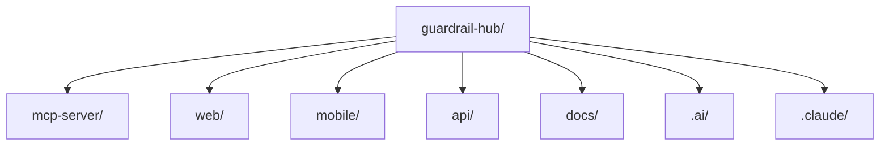

# Project Map

## Purpose
Map every top-level and second-level directory in the repository to its purpose and implementation status, so an AI assistant can find the right place to work without scanning the whole tree.

## Scope
Directory structure only — for what's inside each directory architecturally, see [module-map.md](module-map.md); for individual files, see [codegraph.md](codegraph.md).

## AI Usage Guidance
Use this to answer "where does X live" or "is Y already built." Directories marked **Empty** contain no files — do not assume conventions for them beyond what's stated in the root [`README.md`](../../README.md)'s aspirational layout, and treat any code written into them as greenfield.

## Main Content

### Top Level

| Directory | Status | Purpose |
|---|---|---|
| `mcp-server/` | **Implemented** | Python/FastAPI backend; the only functionally complete part of the system |
| `web/` | **Scaffolded** | Next.js frontend; currently a marketing landing page, no product features |
| `mobile/` | **Empty scaffold** | `android/` and `apple/` subfolders, both completely empty |
| `api/` | **Empty, reserved** | No files |
| `docs/` | **Empty, reserved** | No files |
| `.ai/` | **Active** | AIOS knowledge system for AI assistants — see [`.ai/README.md`](../README.md) |
| `.claude/` | **Config only** | `settings.local.json`, Claude Code permission allowlist |

### `mcp-server/` — Second Level

| Directory | Status | Purpose |
|---|---|---|
| `app/` | Implemented | Application code — see [module-map.md](module-map.md) |
| `config/` | Empty | Reserved for `tool-policy.json`, `allowed-tools.json` (referenced by settings, not yet created) |
| `dependencies/` | Empty | Reserved for FastAPI `Depends()`-based middleware (e.g. auth) — not yet implemented |
| `audit/` | Empty | Reserved for audit-log output — audit settings exist (`AUDIT_*` env vars) but no dedicated implementation |
| `batch_jobs/` | Empty | Reserved, unimplemented |
| `data/` | Partial | `data/zap/` — ZAP working-directory mount point (empty at rest, populated at scan time) |
| `docker/` | Implemented | `fastapi/Dockerfile`, `owasp_zap/Dockerfile` |
| `tests/` | Empty | No test files exist yet — no testing convention established |
| `logs/` | Runtime artifacts | Populated log files from local runs (`MCPLogger` output) |
| `reports/` | Partial | `reports/zap/` — mount target for ZAP report generation (empty at rest) |
| `public/` | Implemented, has data | `public/report/owasp-zap/detail-report/` contains real scan report artifacts (HTML+JSON pairs) served statically |
| `docs/` | Empty | Reserved |
| `.vscode/` | Config only | `mcp.json`, `settings.json` |

### `web/` — Second Level

| Directory | Status | Purpose |
|---|---|---|
| `app/` | Implemented (marketing only) | Next.js App Router — one route group `(marketing)/` |
| `components/` | Implemented (marketing only) | `layout/`, `sections/`, `shared/`, `ui/` (shadcn/ui primitives) |
| `lib/` | Implemented | `gsap/` animation helpers, `hooks/`, `screens.ts`, `utils.ts` |
| `hooks/` | Empty (unused) | Contains only `.gitkeep`; real hooks live under `lib/hooks/` instead |
| `config/`, `content/` | Implemented | `site.ts` config/content for the marketing site |
| `types/` | Empty | Reserved |
| `public/` | Static assets | Standard Next.js public assets |

### `mobile/`

| Directory | Status |
|---|---|
| `android/` | Empty — zero files |
| `apple/` | Empty — zero files |

## Related Documents
[system-overview.md](system-overview.md) · [module-map.md](module-map.md) · [technology-stack.md](technology-stack.md)

## Last Updated
2026-07-03 — verified against commit `10bd79b`.
