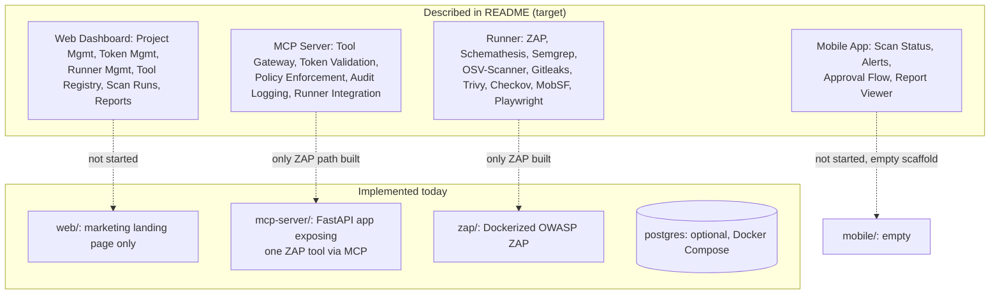
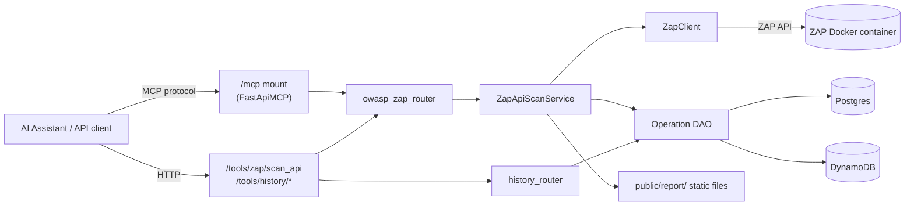

# System Overview

## Purpose
Give an AI assistant a one-page mental model of what Guardrail Hub is, what it's for, and — critically — what actually exists in code today versus what the product vision describes but hasn't been built yet.

## Scope
The Guardrail Hub product (`mcp-server/`, `web/`, `mobile/`, `api/`, `docs/`). Does not cover the AIOS itself (`.ai/foundation/`, `.ai/kernel/`, etc.) — see [`.ai/foundation/vision.md`](../foundation/vision.md) for that.

## AI Usage Guidance
Read this document first, before any other `intelligence/` document, when a task requires understanding what Guardrail Hub *is*. Do not assume anything described here as "Planned" exists in code — check [module-map.md](module-map.md) or [codegraph.md](codegraph.md) before writing code that depends on it. This document is a summary; it intentionally omits detail that lives in the more specific maps below.

## Main Content

### What Guardrail Hub Is

A developer-focused security testing and QA orchestration platform. Per the root [`README.md`](../../README.md), the intent is to connect multiple security/testing tools (DAST, SAST, dependency scanning, secret scanning, container scanning, IaC scanning, mobile scanning, E2E testing) behind one workflow, exposed through a web dashboard, a mobile app, and an MCP server that lets AI assistants invoke scans as tools. It is explicitly positioned as an orchestration platform, not a wrapper around a single scanner.

### Target vs. Current State

The root README describes a target architecture that is substantially larger than what exists in code today. This gap matters for any AI working in this repo — treating README-described components as "already there" will produce code that references nothing:

| Capability | README describes | Currently in code |
|---|---|---|
| Web dashboard (projects, scans, findings, reports) | Yes | No — `web/` is a marketing/landing page only, no data-fetching or dashboard routes ([module-map.md](module-map.md)) |
| Mobile app | Yes | No — `mobile/android/` and `mobile/apple/` are empty directories |
| MCP tool gateway with token validation, policy enforcement, audit logging | Yes | Partially — MCP mount exists and exposes one operation; token validation, policy enforcement, and audit logging are config/schema scaffolding only, not implemented ([security-map.md](security-map.md)) |
| OWASP ZAP scanning (web DAST, API scan) | Yes | Yes — the one fully working end-to-end path: schema → router → service → integration client → Docker container → real generated reports |
| Semgrep, Gitleaks, Trivy, Checkov, MobSF, OSV-Scanner, Schemathesis, Playwright, Selenium, JMeter | Yes | No — zero implementation for any of these; Playwright/Selenium have empty router stubs only |
| Postgres / DynamoDB persistence | Yes | Yes — a working DAO layer supports both, selected via `DATABASE_PROVIDER` |
| CI/CD pipeline | Implied | No — no `.github/workflows/`, no CI config anywhere in the repo |
| Kubernetes deployment | Mentioned as future scaling need | No — only a local Docker Compose setup exists |

### Current Architecture (as built)

See [codegraph.md](codegraph.md) for the detailed request-flow diagram and [api-map.md](api-map.md) for the full endpoint list.

### Repository Layout at a Glance

| Directory | Status |
|---|---|
| `mcp-server/` | Actively implemented — the only functioning part of the system |
| `web/` | Scaffolded, marketing page only — no product features |
| `mobile/` | Empty scaffold |
| `api/`, `docs/` | Empty, reserved |
| `.ai/` | The AIOS knowledge system for AI assistants (not the product) — see [`.ai/README.md`](../README.md) |

See [project-map.md](project-map.md) for the full directory breakdown.

## Related Documents
[project-map.md](project-map.md) · [module-map.md](module-map.md) · [codegraph.md](codegraph.md) · [technology-stack.md](technology-stack.md) · [`.ai/foundation/vision.md`](../foundation/vision.md)

## Last Updated
2026-07-03 — verified against commit `10bd79b` (HEAD, branch `main`).
