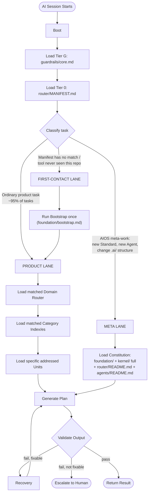
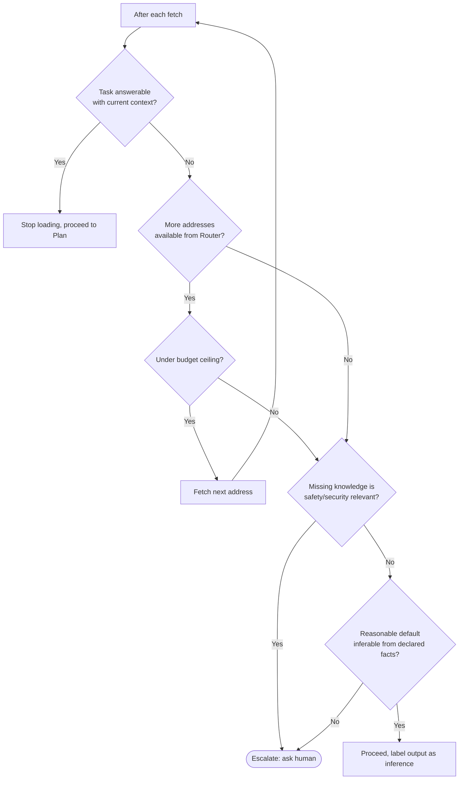
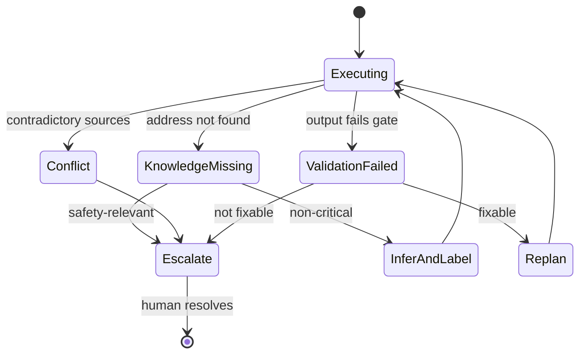

# AI Kernel
## Phase 2: Kernel Specification

> Continues from the approved [AIOS Architecture](../foundation/architecture.md). Every AI assistant session starts here procedurally, via [Boot](boot/README.md) — but per the [Context Budget & Loading Strategy](#context-budget--loading-strategy) below, this document is read *in full* only during Bootstrap/first-contact ([foundation/bootstrap.md](../foundation/bootstrap.md)) or when the task itself is AIOS meta-work. An already-bootstrapped session handling an ordinary product task loads only Tier G and Tier 0, never this file's full text — see [Decision 0001](../decisions/0001-aios-bootstrap-roadmap.md) for why this replaced the original "every session loads this in full" model.

Status: Approved

---

## Purpose

The Kernel is the operating system of the AIOS. It does not know facts about Guardrail Hub (that's Knowledge) and it does not know how to execute a task (that's Skills) — it knows how a session should *behave*: how to boot, how much to load, when to stop loading, when to validate, when to recover, and when to hand control back to a human.

## The Eight Kernel Modules

| Module | Answers |
|---|---|
| [Boot](boot/README.md) | How does a session cold-start? |
| [Behavior](behavior/README.md) | How does the AI reason, layer by layer? |
| [Routing](routing/README.md) | Which capability/Agent should handle this task? |
| [Loading](loading/README.md) | How much context, in what order, under what budget? |
| [Guardrails](guardrails/README.md) | What is the AI never allowed to do? |
| [Lifecycle](lifecycle/README.md) | How does a session begin, run, and end cleanly? |
| [Validation](validation/README.md) | Is the output allowed to ship? |
| [Recovery](recovery/README.md) | What happens when something's missing, conflicting, or wrong? |

Each is independently addressable (its own directory, its own README) so a session — or a future automated Kernel implementation — can load only the sub-module it needs, consistent with the minimal-context principle. In practice Boot, Behavior, and Guardrails are read every session (they're small); Routing, Loading, Validation, and Recovery are consulted at their trigger point in the sequence below.

A note on naming: **Kernel/Routing** (this module) decides *which capability/Agent* handles a task. The top-level **[Router](../router/README.md)** module decides *which knowledge addresses* that Agent should fetch. They are deliberately separate concerns — capability dispatch vs. knowledge discovery — consulted at different points in the startup sequence.

---

## Startup Sequence

Every session enters through one of three lanes, determined immediately after Tier G + Tier 0 load — not through one linear chain that always touches Foundation, full Kernel detail, Router's algorithm description, and Agents' framework doc regardless of task:

The Product Lane never touches `foundation/`, this document's full text beyond what Bootstrap already covered, `router/README.md`, or `agents/README.md` — those four are Constitution-tier, reserved for the Meta Lane. This is the two-lane model adopted in [Decision 0001](../decisions/0001-aios-bootstrap-roadmap.md); it replaces the single linear chain this diagram previously described, which forced every task through the full Foundation→Kernel→Router→Agents chain regardless of task type.

---

## Context Budget & Loading Strategy

Supersedes the original Tier 0 definition in [Architecture: Scalability Strategy](../foundation/architecture.md#scalability-strategy-100--200--500-documents), which named `foundation/` + `kernel/` as the always-loaded tier. [Decision 0001](../decisions/0001-aios-bootstrap-roadmap.md) replaced that with the tiering below, because the original definition made every session pay Constitution-sized cost regardless of task:

- **Tier G — Guardrail core.** `guardrails/core.md`. Always loaded, every session, no exceptions — kept small by contract (a bounded core rule set; domain-scoped guardrails are Tier 1/2, loaded like Standards).
- **Tier 0 — Router Manifest.** `router/MANIFEST.md`. Always loaded, every session. A static lookup table (task-pattern → Domain), not prose — this is the actual "small, always-loaded" surface; it replaces `foundation/` + `kernel/` in that role.
- **Tier 1 — Domain Router + Category Index.** `<domain>/ROUTER.md` for the matched Domain, then the specific Category Index/es it names. Two hops, loaded only once Tier 0 classifies the task.
- **Tier 2 — Addressed units.** Individual Knowledge/Skill/Standard/Workflow/Template/Agent entries named by the Category Index. Loaded one address at a time, narrowest first.
- **Tier 3 — Task-local.** Anything fetched purely for this task (file contents, command output). Never persisted; if it's worth keeping across sessions, it goes through Memory's feedback path instead.
- **Constitution (not a numbered tier — Meta Lane / Bootstrap only).** `foundation/`, this document in full, `router/README.md`, `agents/README.md` (framework). Loaded only when the task is AIOS meta-work, or once during Bootstrap/first-contact. Never loaded for an ordinary product task.

**Priority loading**: within Tier 2, addresses a Category Index marks as required for the detected task type are fetched before addresses marked as merely related. **Dependency loading**: if a fetched unit declares a dependency on another unit (via its `depends_on` metadata), that dependency is fetched next, not deferred. **Lazy loading**: nothing beyond Tier G/0 is fetched speculatively — a unit is loaded because a specific step in the sequence above asked for it by address.

Full algorithmic detail (Router materialization, fallback ordering, missing-knowledge strategy) is deferred to the [Router](../router/README.md) and [Loading](loading/README.md) specs — this section fixes the budget contract they must honor.

---

## Kernel ↔ Module Communication

- **Agents** — the Kernel dispatches a task to exactly one primary Agent (via Kernel/Routing) and receives back a proposed action, never raw unvalidated output.
- **Knowledge / Skills / Standards / Templates** — the Kernel never reads these directly. It asks the top-level Router for addresses, and Loading fetches them on the Kernel's behalf. This keeps the Kernel itself small and stable even as those modules grow to hundreds of entries.
- **Memory** — written to at the end of every session (Lifecycle's termination step), read from at Boot to check for standing corrections relevant to the detected domain.
- **Guardrails / Policy** — consulted by Validation before any output ships, and by Kernel/Routing before dispatch (an Agent is never dispatched into a capability the policy layer forbids).

---

## Validation Gate

Before Kernel returns a result, [Validation](validation/README.md) checks:

| Check | Verified against |
|---|---|
| Architecture | `foundation/architecture.md` module boundaries — did the Agent stay in its scope? |
| Naming | Standards |
| Standards | Standards (the specific rules addressed for this task) |
| Workflow | Workflows (were required states/checkpoints honored?) |
| Security | Guardrails / Policy |
| Completeness | The original task — does the output actually answer it? |

A failed check that is fixable within the current context re-enters the Plan step (see sequence diagram). A failed check that isn't — missing knowledge, a policy conflict, an ambiguous requirement — goes to [Recovery](recovery/README.md), which decides whether to infer-and-label or escalate to a human.

---

## When to Stop Loading Context

This is the Kernel's answer to "when is clarification required vs. when is an assumption acceptable": safety- or security-relevant gaps always escalate (Phase 0's "Human authority is final" principle); everything else may proceed if — and only if — the assumption is traceably labeled as inference rather than presented as fact (Phase 0's "Traceability over confidence").

---

## Failure Recovery & Fallback

Full detail (per-failure-type handling, degraded-mode behavior) is deferred to [Recovery](recovery/README.md).

---

## Extension Points

Vendor adapters (Claude Code, Cursor, Copilot, …) may hook additional steps at Boot (e.g., loading a tool-specific config) or render Validation results in their native format, but may not skip a step in the startup sequence or weaken the Validation gate — that would violate the model-agnosticism and single-source-of-truth principles from Phase 0. New capability domains (Phase 3) register into Kernel/Routing's dispatch table without the Kernel core changing.

## Consumers

Every AI assistant session, through its vendor adapter, is a consumer of the Kernel. No other module bypasses it.
