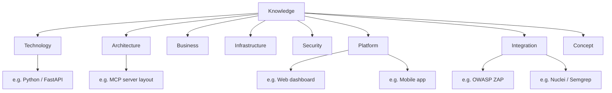
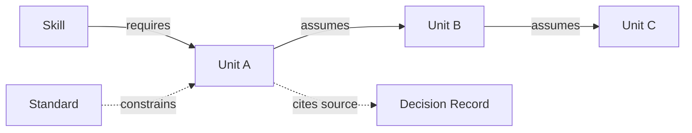

# Knowledge
## Phase 4: Knowledge System

> Continues from the approved [Capability Framework](../agents/README.md). Knowledge is reusable project intelligence — what AI needs to know, never what AI should do (that's [Skills](../skills/README.md)) and never what AI must do (that's [Standards](../standards/README.md)).

Status: Approved

Contract origin: [foundation/architecture.md#knowledge](../foundation/architecture.md#knowledge).

---

## Knowledge Document Contract

Every knowledge unit, whenever one is authored, defines:

| Field | Meaning |
|---|---|
| Purpose | The one fact or fact-cluster this unit exists to state. |
| Scope | What it covers and, explicitly, what it does not. |
| Dependencies | Other Knowledge units it assumes as already true. |
| Consumers | Which Agents/Skills read it. |
| Update Frequency | How often this fact is expected to change (`static`, `periodic`, `volatile`) — sets its staleness check interval. |
| Owner | The person/role who can attest this is still true. |
| Related Standards | Standards this fact informs or is constrained by. |
| Related Skills | Skills that assume this Knowledge as a prerequisite. |
| Related Workflows | Workflows where this Knowledge is typically consulted. |

A unit missing any field is not `Active` — see Lifecycle below.

---

## Categories

```
knowledge/
├── technology/       # languages, frameworks, libraries in use
├── architecture/      # how Guardrail Hub's own systems are structured
├── business/          # product goals, users, constraints, non-technical facts
├── infrastructure/    # deployment targets, environments, cloud/on-prem facts
├── security/           # threat model facts, compliance facts, posture facts
├── platform/            # MCP server, dashboard, mobile — platform-specific facts
├── integration/         # third-party services, external APIs, scanners (ZAP, Nuclei, Semgrep)
└── concept/              # cross-cutting ideas that don't belong to one category (e.g., "what a Guardrail is")
```

Category is the first level of the Router's index partition described in [Architecture: Scalability Strategy](../foundation/architecture.md#scalability-strategy-100--200--500-documents) — at 500+ units, a task resolves to a category first, then to a unit within it, never a flat scan.

## Knowledge Hierarchy



---

## Granularity

- **Split** a unit when it's cited for two unrelated reasons by different consumers — that's a sign two facts are sharing one address and will drift out of sync with each other under independent edit pressure.
- **Merge** two units when they're never cited independently — always fetched together, always edited together. Independent addressability that's never exercised is pure overhead.
- **Avoid duplication** by checking the category index before authoring: if a proposed unit's Purpose overlaps an existing unit's Scope by more than a sentence, extend the existing unit instead of forking a near-duplicate. This is a Review-time check (see [Review Framework](../review/README.md)), not an honor system.

---

## Indexing & Discovery

Each category directory publishes its own index (a table of unit → one-line Purpose → Owner → freshness) that the [Router](../router/README.md) reads to resolve a task to addresses — the Router never scans unit content to decide relevance, only the index. Routing is therefore two hops: task → category (via Kernel/Routing's capability detection) → unit (via the category's index).

**Staleness detection** compares a unit's `Update Frequency` against the time since its Owner last confirmed it. A `static` unit goes stale only if the code it describes changed (detected by an Agent noticing a mismatch during real work, not by polling); a `volatile` unit goes stale on a short fixed interval and is flagged for the Owner to re-confirm at the next [Review](../review/README.md) pass.

## Knowledge Graph (dependency shape)



Dependency chains are meant to stay shallow (2–3 hops). A unit requiring a long chain to make sense is a signal it should be split or that a missing intermediate concept needs its own unit.

---

## Quality

| Dimension | Mechanism |
|---|---|
| Freshness | `Update Frequency` field + staleness detection above. |
| Accuracy | Owner attestation at authoring and at every Review pass. |
| Review | Every new or edited unit passes through [Review Framework](../review/README.md) before `Active`. |
| Ownership | Exactly one Owner per unit — never unowned, never co-owned (co-ownership is how facts silently stop being anyone's responsibility). |

## Lifecycle

Follows the general unit lifecycle from [Architecture](../foundation/architecture.md#lifecycle-per-knowledge-unit-in-any-module): `Proposed → Draft → Review → Approved → Active → Stale → Deprecated`. A knowledge unit additionally cannot leave `Draft` without all nine contract fields populated.

---

## Index

No knowledge units exist yet in this module's per-category addressable-unit form. Categories above are reserved addresses, ready for the first unit.

| Category | Units | Status |
|---|---|---|
| technology | 0 | — |
| architecture | 0 | — |
| business | 0 | — |
| infrastructure | 0 | — |
| security | 0 | — |
| platform | 0 | — |
| integration | 0 | — |
| concept | 0 | — |

**Concrete facts about the current Guardrail Hub repository already exist**, but live in [`.ai/intelligence/`](../intelligence/README.md) rather than here — that module uses a fixed, task-oriented document set (system overview, API map, database map, security map, etc.) instead of this module's per-category addressable-unit pattern. See [intelligence/README.md#relationship-to-the-aios](../intelligence/README.md#relationship-to-the-aios) for how the two are meant to coexist without duplicating each other. When the first true Knowledge unit is authored here, check `intelligence/` first — a Knowledge unit that just restates an `intelligence/` fact in the addressable-unit format would be exactly the duplication [Granularity](#granularity) above warns against; author a Knowledge unit here only when it needs something `intelligence/`'s document-level granularity can't give it (independent versioning, per-fact ownership, Router-level addressing at a narrower grain).
