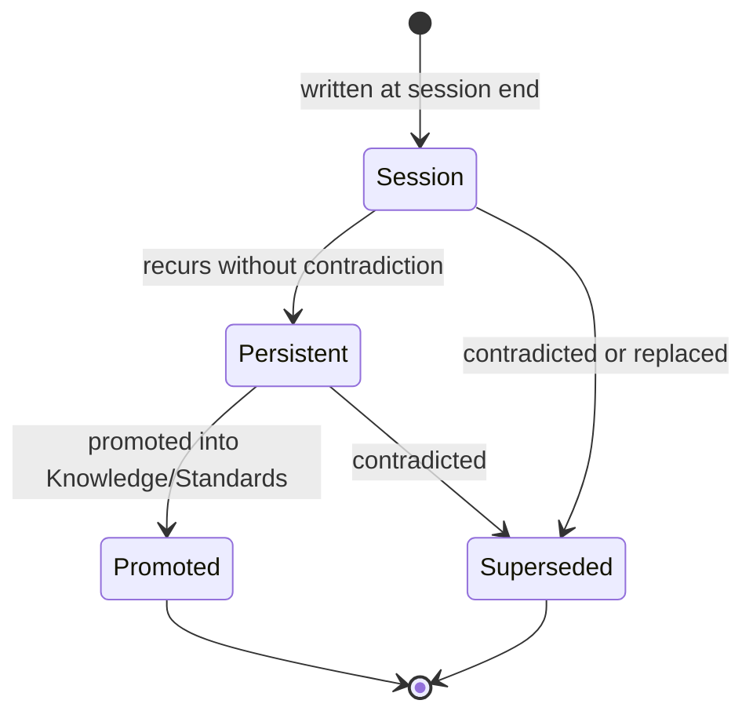

# Memory
## Phase 9: Memory Framework

> Continues from the approved AIOS Foundation. Memory preserves long-term project intelligence fed back from real sessions — it is explicitly not a dumping ground for everything a session touched.

Status: Approved

Contract origin: [foundation/architecture.md#memory](../foundation/architecture.md#memory).

---

## Memory Categories

| Category | Purpose | Owner | Retention | Consumers | Update Trigger | Invalidation Strategy |
|---|---|---|---|---|---|---|
| **Persistent** | Corrections/confirmations proven stable across many sessions — candidates for promotion into Knowledge/Standards. | Human review | Indefinite, until promoted or explicitly revoked | Router, Knowledge, Standards | A Session Memory entry recurs ≥ N times without contradiction | Revoked when the promoted Knowledge/Standard supersedes it, or when contradicted once |
| **Session** | A single session's corrections/confirmations, not yet proven stable. | Kernel (automatic) | Until reviewed (Persistent-promotion check) or superseded | Kernel/Boot (next session) | End of session ([Kernel/Lifecycle](../kernel/lifecycle/README.md)) | Superseded by a later Session Memory entry on the same topic |
| **Task** | Ephemeral, single-task working state (file contents fetched, command output). | The task itself | Session only — never written to disk memory | None beyond the current task | N/A | Discarded at task completion, always |
| **Generated Artifact** | Pointers to what an AI produced (not the artifact itself, which lives in the repo) — for traceability of which session produced what. | Kernel (automatic) | Same as the artifact's own lifecycle | [Review Framework](../review/README.md), [Decisions](../decisions/README.md) | Artifact created/modified | Removed when the artifact is deleted from the repo |
| **Decision** | A pointer from Memory into a [Decision Record](../decisions/README.md) — not a duplicate of it. | Whoever made the decision | Indefinite (mirrors the Decision Record's append-only lifecycle) | Agents, Knowledge | A Decision Record is created | Never invalidated, only superseded (mirrors Decisions) |
| **Project** | Standing facts about current initiatives, deadlines, ownership — changes fast, decays fast. | Human, confirmed each time it's used | Short, explicit expiry (e.g., "until Q3 release") | Agents, Playbooks | Human states it | Expires on its own stated date, or when contradicted by observed repo state |

---

## Frontmatter
Memory entries are captured automatically by the Kernel, not hand-authored as units, so they don't carry the full [unit schema](../schema/README.md) while in `Session`/`Persistent` state. A Persistent entry adopts the schema only at the moment it is **Promoted** into a Knowledge or Standard unit — at which point it becomes a normal schema-validated unit in that module. Noted here so the schema-reference expectation resolves explicitly for this module.

## What Should Be Stored

Corrections ("no, don't do X, because Y"), confirmations of a non-obvious choice ("yes, that approach was right"), and standing project facts that shape decisions but aren't derivable from code (deadlines, ownership, initiative context) — always with the *why*, never just the *what*.

## What Should Never Be Stored

- Anything derivable by reading the current repo state (code, git log, file structure) — Memory is for what the repo *can't* tell a future session.
- Task-local working state (Task category exists specifically to name this and exclude it from persistence).
- Raw session transcripts or summaries "just in case" — if it wasn't surprising or load-bearing enough to justify Persistent/Session/Project, it's not Memory.
- Anything that duplicates a Knowledge, Standard, or Decision unit that already states it — Memory feeds those modules, it doesn't compete with them once promoted.

---

## Memory Lifecycle

## Synchronization & Pruning

- **Synchronization** — Session Memory is written once, at session end, by Kernel/Lifecycle; there is no mid-session partial write, keeping the write path simple and race-free.
- **Pruning** — Session entries that never recur across a defined review window are pruned (they were session-specific, not durable). Persistent entries are pruned only when Promoted or Superseded — never on a timer, since a rarely-triggered correction is still a correction.
- **Migration** — when a Persistent entry is Promoted, the Knowledge/Standard unit it becomes cites the Memory entry as its origin (mirroring how Knowledge units may cite Decisions), and the Memory entry moves to `Promoted`, read-only from then on.
- **Indexing** — Memory is indexed by topic/domain, the same partitioning the [Router](../router/README.md) uses elsewhere, so Kernel/Boot's "check for standing corrections relevant to this domain" step (see [kernel/boot](../kernel/boot/README.md)) is a targeted lookup, not a scan of all Memory ever written.

---

## Lifecycle (as a module)

Memory entries don't follow the generic `Proposed → Draft → Review → Approved` unit lifecycle used elsewhere — they're captured automatically by the Kernel, not authored. Their governance is the state machine above; human Review only enters at the Session → Persistent and Persistent → Promoted transitions, where a human confirms the correction is real and worth making durable.

## Index

No memory entries exist yet — this framework defines the categories and transitions Kernel/Lifecycle will write into once sessions begin producing feedback.

| Category | Entries | Status |
|---|---|---|
| persistent | 0 | — |
| session | 0 | — |
| task | n/a | never persisted |
| generated artifact | 0 | — |
| decision | 0 | — |
| project | 0 | — |
