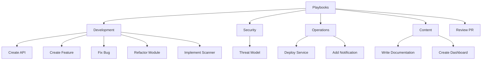
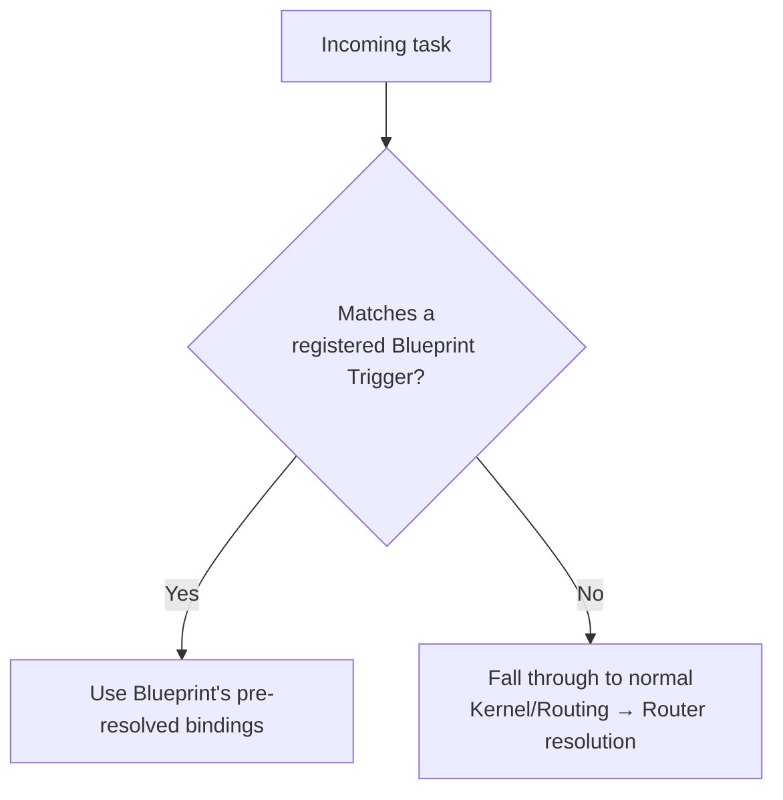

# Playbooks
## Phase 11: Blueprint System

> Formalizes the [Phase 1 Playbooks contract](../foundation/architecture.md#playbooks). From this phase on, a unit in this module is called a **Blueprint** — "Playbooks" names the module/directory; "Blueprint" names the reusable artifact it holds, matching the terminology in the approved phase roadmap.

Status: Approved

---

## What a Blueprint Is

A reusable, pre-resolved binding from a recognizable request ("create API," "fix bug," "review PR") straight to the Workflow + Agent + Knowledge/Skills/Standards/Templates it needs — so a requester doesn't have to reason through Kernel → Router → Agent → module discovery from scratch every time the same *shape* of request comes in. A Blueprint doesn't do anything a manual Kernel/Router resolution couldn't do; it just remembers the answer for a recurring shape.

## Blueprint Contract

> **Frontmatter (machine half):** every Blueprint unit also carries frontmatter validated against [schema/base.schema.json](../schema/base.schema.json). A Blueprint-specific extension schema is authored when this module gets its first real unit, per [schema/README.md](../schema/README.md).

| Field | Meaning |
|---|---|
| Purpose | The request shape this Blueprint answers. |
| Trigger | The phrasing/intent pattern that matches this Blueprint. |
| Capability Agent | The primary Agent this Blueprint dispatches to. |
| Required Knowledge | Pre-resolved Knowledge addresses (still fetched lazily by Kernel/Loading — pre-*resolved*, not pre-*loaded*). |
| Required Skills | Pre-resolved Skill addresses. |
| Required Standards | Pre-resolved Standards addresses. |
| Required Workflow | The Workflow this Blueprint runs. |
| Required Templates | Pre-resolved Template addresses. |
| Expected Outputs | What a successful run produces. |
| Validation Rules | Blueprint-specific checks, layered on top of Kernel/Validation's standard gate. |
| Completion Criteria | When the Blueprint's invocation is done. |

A Blueprint is, structurally, a cached Router resolution plus a named Trigger — see [Router: Routing Cache](../router/README.md#routing-cache). The difference is that a Blueprint is human-curated and versioned deliberately, while the routing cache is populated automatically and invalidates on module change.

---

## Blueprint Hierarchy

These twelve are the anticipated set from the phase roadmap's background section — named here as illustration of shape, not implemented. Each becomes a real Blueprint only once its underlying Workflow (Phase 7 scope, not yet authored) and Agent (Phase 3 scope, not yet instantiated) exist to bind to.

## Inheritance & Composition

- **Inheritance** — a specific Blueprint (e.g., "Create FastAPI Endpoint") may inherit a general one (e.g., "Create API") and override only the Required Skills/Templates that differ, the same additive-override pattern used by [Standards inheritance](../standards/README.md#inheritance-model).
- **Composition** — a Blueprint may nest another Blueprint as a step, exactly as a [Workflow may nest another Workflow](../workflows/README.md#branching-rollback-retries-parallelism-nesting) — e.g., "Create Feature" composes "Create API" + "Write Documentation."

## Discovery

A Blueprint is matched by Trigger before Kernel/Routing's general capability detection runs — if a request's phrasing matches a registered Blueprint's Trigger, the Blueprint's pre-resolved bindings are used directly (skipping redundant Router discovery for that request); if no Trigger matches, control falls through to the normal Kernel → Router path described in [kernel/README.md](../kernel/README.md#startup-sequence).

## Validation

A Blueprint's own Validation Rules run in addition to, never instead of, [Kernel/Validation](../kernel/validation/README.md)'s standard six-check gate. A Blueprint that tried to skip a check would be indistinguishable from a policy bypass — not permitted regardless of how well-established the Blueprint is.

## Versioning

Same major/minor pattern as other modules: adding a nested step or a Related-priority resource is additive; changing the Required Workflow or Capability Agent is breaking, since it changes what the Blueprint actually does when triggered.

## Lifecycle

Follows [Architecture: per-unit lifecycle](../foundation/architecture.md#lifecycle-per-knowledge-unit-in-any-module): `Proposed → Draft → Review → Approved → Active → Deprecated`.

---

## Index

No Blueprints exist yet — the twelve names above are anticipated shapes, not registered entries.

| Blueprint | Trigger shape | Status |
|---|---|---|
| — | — | — |
