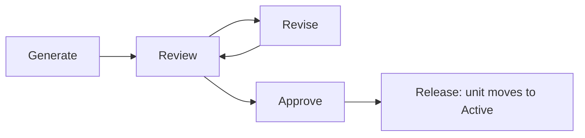
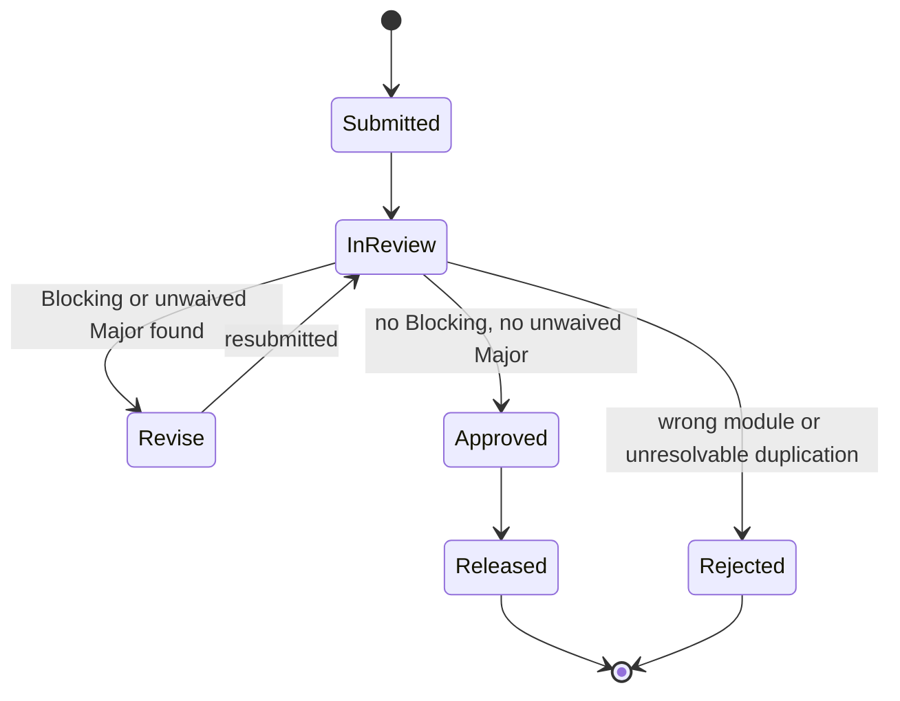
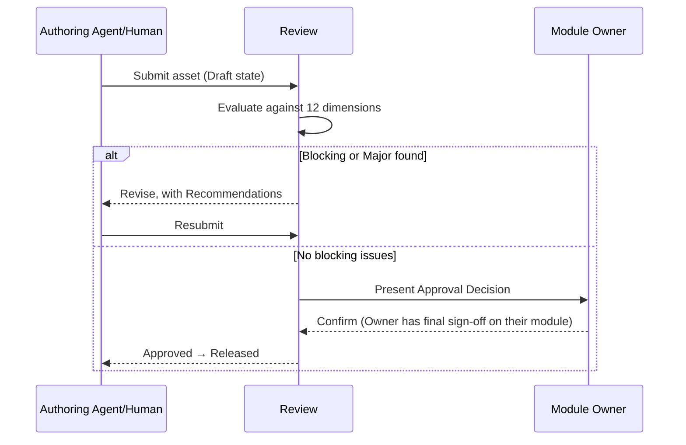

# Review
## Phase 13: Review Framework

> New top-level module, added additively per [Architecture: Expansion Strategy](../foundation/architecture.md#expansion-strategy) — Phase 1 fixed twelve product-facing modules; Review, [Evaluation](../evaluation/README.md), and [Governance](../governance/README.md) are meta-modules governing the AIOS's own quality and evolution rather than serving product tasks directly. Every phase from 4 onward has referenced this module as its Review gate; this phase defines what that gate actually does.

Status: Approved

---

## Scope

Every AI-generated *asset* passes through Review before acceptance: a new or edited unit in Knowledge, Skills, Standards, Workflows, Templates, Memory promotions, Decisions, Examples, or Playbooks — and, at the product level, code an Agent proposes. Review is the single mechanism [Kernel/Validation](../kernel/validation/README.md) and every module's own "Lifecycle" section point to when they say "goes to Review."

## What Every Review Evaluates

| Dimension | Checked against |
|---|---|
| Architecture | [foundation/architecture.md](../foundation/architecture.md) module boundaries — is this asset in the right module? |
| Naming | [Standards: core/](../standards/README.md) |
| Folder Structure | [Standards: architecture/](../standards/README.md) |
| Standards Compliance | The specific Standards the asset's own contract declares (Related/Enforced Standards fields) |
| Workflow Compliance | Were the originating Workflow's Review Points honored? |
| Knowledge Reuse | Does this duplicate an existing Knowledge unit instead of extending it? (see [Knowledge: Granularity](../knowledge/README.md#granularity)) |
| Skill Reuse | Same check, for Skills (see [Skills: Duplicate Prevention](../skills/README.md#how-duplicate-skills-are-prevented)) |
| Template Usage | Was an applicable existing Template used rather than freehand structure? |
| Blueprint Usage | Was an applicable existing Blueprint used rather than re-resolving from scratch? |
| Context Efficiency | Does this asset, once Active, keep the Router's address lists short — or does it force wider fetches than necessary? |
| Maintainability | Is the asset small and independently addressable, per [Architecture: Design Principles](../foundation/architecture.md#overview)? |
| Scalability | Does this asset's structure hold at 100+/200+/500+ siblings in its category (see [Architecture: Scalability Strategy](../foundation/architecture.md#scalability-strategy-100--200--500-documents))? |

---

## Severity Levels

| Level | Meaning | Effect |
|---|---|---|
| **Blocking** | Violates a Mandatory Standard, breaks a module contract, or introduces a duplicate. | Cannot reach `Approved`. Must be fixed. |
| **Major** | Correct but poorly scoped — wrong granularity, missing required contract field, weak Anti-pattern/Example. | Must be fixed or explicitly waived by the module Owner before `Approved`. |
| **Minor** | Stylistic or consistency issue that doesn't affect correctness. | Logged; does not block `Approved`, tracked for a follow-up pass. |
| **Suggestion** | Optional improvement. | Logged only. |

## Review Outputs

Every Review pass produces:

1. **Review Summary** — one paragraph, what was reviewed and the outcome.
2. **Risk Analysis** — what happens if this asset ships with its current issues, if any.
3. **Violations** — each finding, with severity, dimension (from the table above), and location.
4. **Recommendations** — concrete fix per Violation.
5. **Approval Decision** — `Approved`, `Revise` (Major/Blocking present), or `Rejected` (fundamentally wrong module/duplication that can't be fixed by editing).

---

## Review Workflow

## Review State Machine

## Approval Workflow

---

## Review Ownership & Responsibilities

Review itself doesn't own quality judgment for a domain — it runs the checklist and routes the outcome to the asset's declared **Owner** (per that module's contract, e.g., [Knowledge's Owner field](../knowledge/README.md#knowledge-document-contract)), who makes the final Approval call for Major-severity waivers. Blocking issues are never waivable by anyone — that's what makes them Blocking rather than Major.

## Review Automation

The 12-dimension checklist is designed to be mechanically checkable wherever possible: Naming/Folder/Standards Compliance are direct rule lookups (see [Standards: AI Enforcement](../standards/README.md#ai-enforcement)); Knowledge/Skill/Template/Blueprint Reuse are index-overlap checks (see each module's Granularity/Duplication sections); Architecture and Context Efficiency require comparing the asset against `foundation/architecture.md` and the Router's address-list behavior, which is judgment-assisted rather than fully mechanical. Full automation tooling is an implementation concern deferred past this specification, consistent with Phase 0's non-goal of prescribing specific technology.

## Review Governance

Review's own checklist (the 12 dimensions and 4 severity levels above) changes only through the same [Governance](../governance/README.md) RFC process that governs the rest of the AIOS — Review cannot silently loosen its own bar.

## Lifecycle

Follows [Architecture: per-unit lifecycle](../foundation/architecture.md#lifecycle-per-knowledge-unit-in-any-module) for changes to this framework document itself. Individual review *passes* follow the state machine above, which is a process instance, not a unit lifecycle.
