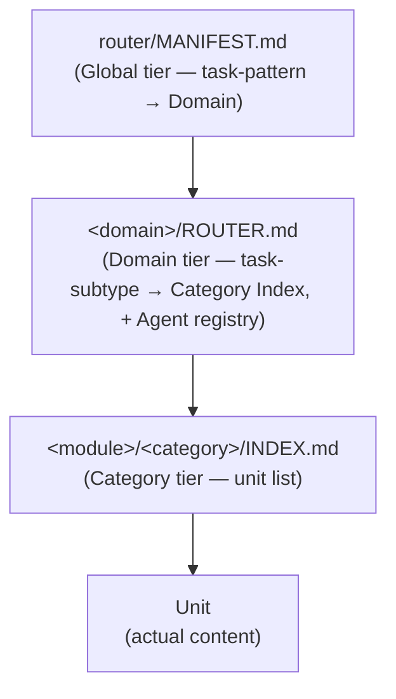
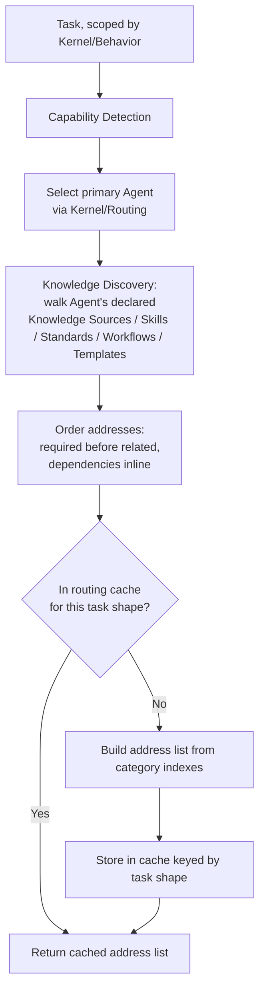
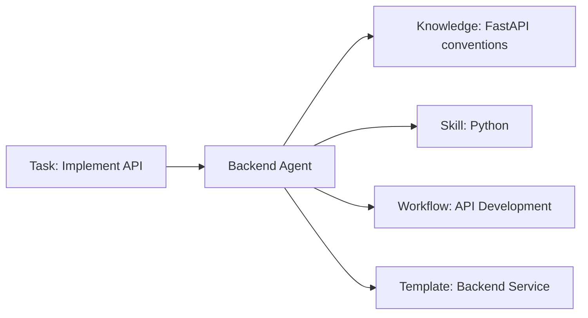
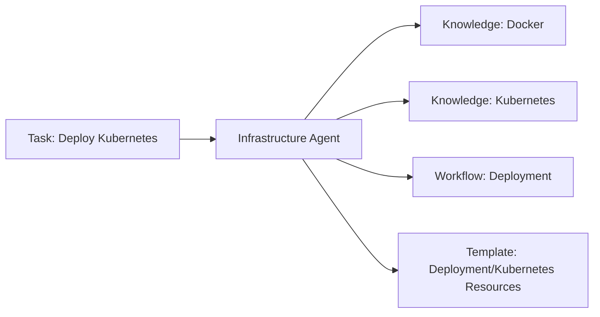
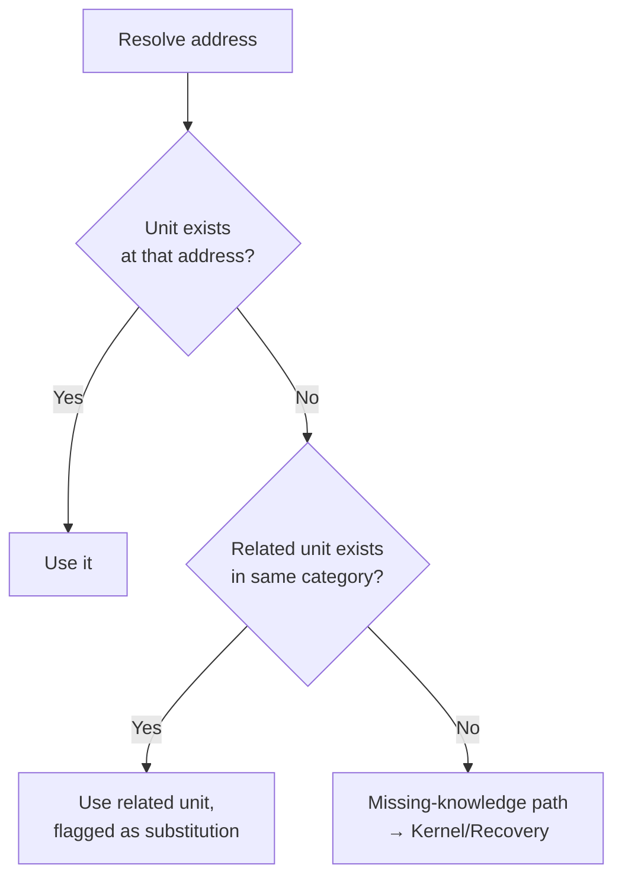
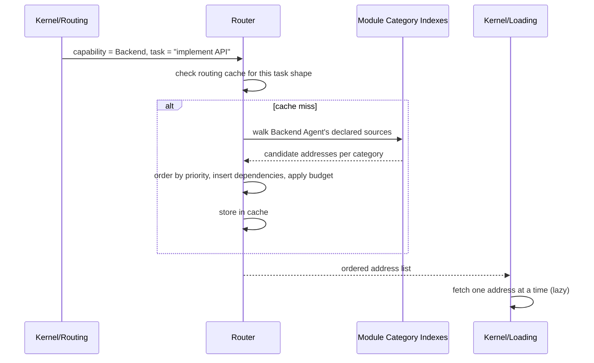

# Router
## Phase 10: Context Router

> The heart of the AIOS. Every other module (Agents, Knowledge, Skills, Standards, Workflows, Templates) is inert without the Router deciding what gets loaded and what doesn't. This phase makes the [Phase 1 contract](../foundation/architecture.md#router) concrete.

Status: Approved

---

## What the Router Decides

For a given task, the Router produces exactly one thing: an ordered list of addresses (category → unit, per module) that [Kernel/Loading](../kernel/loading/README.md) will fetch. It never fetches content itself, and it never decides *what to do* with the content — that's the dispatched [Agent](../agents/README.md)'s job.

## The Router Is a Materialized Artifact, Not a Runtime Algorithm

Per [Decision 0001](../decisions/0001-aios-bootstrap-roadmap.md): no software in this repository executes the algorithm below. For a Claude Code/Cursor/Gemini-CLI-class consumer, "the Router" is not code that runs on their behalf — it is a set of static, versioned files an AI reads directly:

Each file is bounded in size (soft ceiling, ~150 lines); a file that would exceed it splits along its next natural partition and registers one line in its parent, keeping every hop cheap regardless of total corpus size — see [Decision 0001](../decisions/0001-aios-bootstrap-roadmap.md) and [Architecture: Scalability Strategy](../foundation/architecture.md#scalability-strategy-100--200--500-documents). The "algorithm" below describes how these files are *authored and regenerated* — by a human, or by [Automation tooling](../governance/README.md) of the kind `.ai/intelligence/scripts/check_drift.py` already precedents in this repo — when a Domain, Agent, or unit is registered or changed. It is not re-executed by an AI reasoning through it every session; an AI consuming the Router simply reads the one file its position in the hierarchy points to next.

## Routing Algorithm

> Describes how the materialized files above are built and regenerated — not a sequence re-run by an AI per task.

- **Capability detection** reuses [Kernel/Routing](../kernel/routing/README.md)'s dispatch decision — the Router doesn't redetect capability, it consumes the Agent selection already made.
- **Knowledge discovery** walks the selected Agent's contract (its declared Knowledge Sources, Skills Used, Standards Enforced, Workflows Used, Templates Used from the [Agent Contract](../agents/README.md#the-agent-contract)) and resolves each against that module's category index — never a full-module scan.
- **Dependency loading** — if a resolved unit's own contract declares a dependency (a Skill's Prerequisite, a Knowledge unit's Dependencies field), that dependency is inserted into the address list immediately after it, not appended at the end.
- **Priority loading** — addresses the Agent's contract marks as directly required for the detected task type sort before addresses that are merely related (e.g., Related Standards on a Knowledge unit are related, not required, unless the task is specifically about compliance).
- **Context budget** — the address list is capped at the ceiling [Kernel/Loading](../kernel/loading/README.md) enforces; if discovery produces more candidates than the budget allows, the Router keeps required-priority addresses and drops related-priority ones, never the reverse.
- **Lazy loading** — the Router resolves addresses; it does not pre-fetch them. Fetching happens only when Kernel/Loading actually calls for the next address in the sequence.

---

## Worked Routing Examples

**Implement API**

**Deploy Kubernetes**

In both cases the address list is short (4–5 entries) regardless of how large `knowledge/`, `skills/`, `templates/` grow overall — that's the scalability property this phase exists to guarantee.

---

## Routing Cache

The "cache" is not an in-memory structure computed per session — it **is** `router/MANIFEST.md`, every `<domain>/ROUTER.md`, and every `<module>/<category>/INDEX.md`, persisted in the repository. Keyed by **task shape** (Domain + the specific categories a Domain Router names), not by literal task text — two differently-worded "implement an API endpoint" requests resolve to the same MANIFEST/ROUTER entries. These files store *address lists*, never fetched content, so reading them still respects lazy loading downstream (Tier 2 units are fetched only when named). Invalidation means **regenerating the affected file** — an `INDEX.md` regenerates when a unit is added/removed/changed in its category (via an Index generator script, part of the Automation tooling [Decision 0001](../decisions/0001-aios-bootstrap-roadmap.md) schedules for Roadmap M2); a `<domain>/ROUTER.md` changes only when that Domain's Agent registry or category set changes; `router/MANIFEST.md` changes only when a Domain itself is added or removed — the rarest event of the three.

## Fallback Strategy

## Missing Knowledge Strategy

A missing address is not silently skipped — it's handed to [Kernel/Recovery](../kernel/recovery/README.md) with the specific address that failed to resolve, so Recovery's existing missing-knowledge decision (safety-relevant → escalate; otherwise → infer-and-label) applies uniformly. The Router's only job here is to report *what* is missing precisely, not to decide what happens next.

## Unknown Request Handling

If Kernel/Routing cannot detect a capability at all (the task doesn't map to any registered Agent), the Router has nothing to resolve against and returns an empty address list with a reason code (`no-capability-match`). This is itself a Recovery case — treated as safety-relevant by default, since dispatching to a best-guess Agent for an undetected capability is exactly the "ungrounded action" failure mode Phase 0 exists to prevent.

---

## Sequence: Full Resolution Path

---

## Consumers & Dependencies

Consumes: [Kernel/Routing](../kernel/routing/README.md)'s capability decision, and every module's category index (Knowledge, Skills, Standards, Workflows, Templates — see each module's Index section). Produces for: [Kernel/Loading](../kernel/loading/README.md).

## Lifecycle

The Router itself is Kernel-adjacent (near-immutable, per [Architecture](../foundation/architecture.md)); its cache and indexes are live and update continuously as modules gain units — no governance review needed for cache/index churn, only for changes to the resolution algorithm above.
