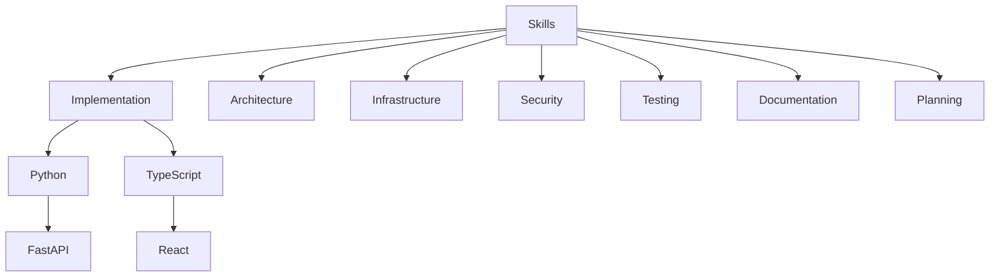
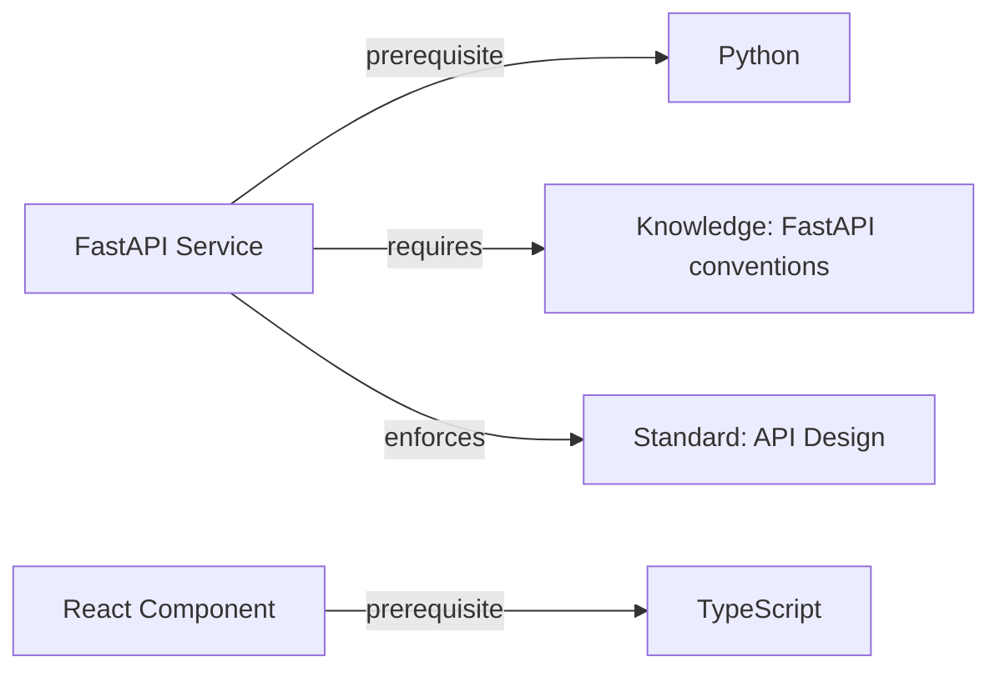
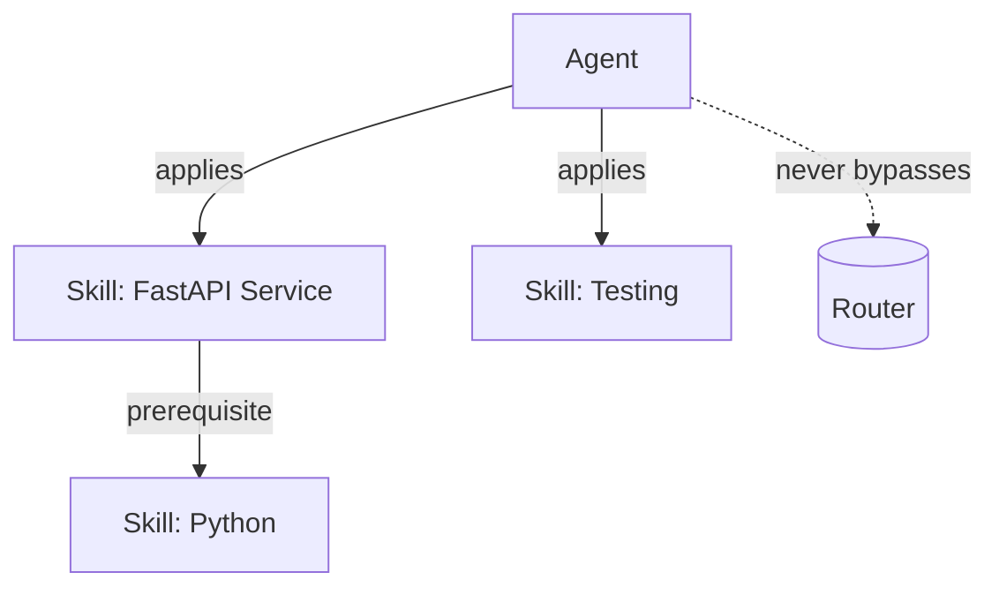
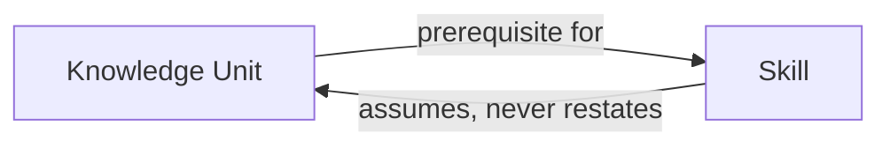

# Skills
## Phase 5: Skill System

> Continues from the approved [Knowledge System](../knowledge/README.md). Knowledge explains concepts; Skills explain execution. A Skill without the Knowledge it requires is incomplete by definition — see Dependencies below.

Status: Approved

Contract origin: [foundation/architecture.md#skills](../foundation/architecture.md#skills).

---

## Skill Contract

> **Frontmatter (machine half):** every skill unit also carries frontmatter validated against [schema/base.schema.json](../schema/base.schema.json). A Skill-specific extension schema is authored when this module gets its first real unit, per [schema/README.md](../schema/README.md).

| Field | Meaning |
|---|---|
| Purpose | The one execution capability this skill provides. |
| Scope | What kinds of task it applies to, and what it explicitly doesn't cover. |
| Prerequisites | Other Skills that must already apply (composition — see below). |
| Knowledge Required | `knowledge/` units this skill assumes as read. |
| Standards Enforced | `standards/` units this skill's output must satisfy. |
| Workflows Supported | `workflows/` this skill is typically invoked under. |
| Templates Used | `templates/` this skill fills in. |
| Examples | Links into `examples/` showing this skill applied correctly. |
| Limitations | What this skill does *not* handle — the explicit boundary that triggers Consultation/Delegation up at the Agent level. |

---

## Categories

```
skills/
├── implementation/   # language- and framework-level execution (Python, TypeScript, FastAPI, React)
├── architecture/       # structuring code/systems (module boundaries, dependency direction)
├── infrastructure/      # Docker, CI/CD, deployment mechanics
├── security/              # secure coding practice, scanning tool operation
├── testing/                 # test authoring, coverage strategy
├── documentation/            # writing units for Knowledge/Standards/etc. to the AIOS's own authoring discipline
└── planning/                   # task breakdown, estimation
```

## Skill Hierarchy



---

## Composition, Inheritance, Reuse, Extension

- **Inheritance** — a Skill may declare another Skill as a Prerequisite (e.g., "FastAPI service" requires "Python"). The child does not restate the parent's procedure; it references it and adds only what's specific to the child.
- **Composition** — an Agent applying a task may need several Skills at once (e.g., "Python" + "Testing" + "Docker" for a containerized service with tests). Composition happens at the Agent, not by merging Skills into a combined document — this keeps each Skill independently addressable.
- **Reuse** — before authoring a new Skill, check whether an existing Skill's Purpose already covers it with a different Scope; if so, widen the Scope instead of forking.
- **Extension** — a Skill that needs a variant for a new context (e.g., "Testing" needs a mobile-specific variant) gets a new child Skill with the original as Prerequisite, not a branch inside the original document.

## Skill Dependency Graph



## Agent → Skill Relationship



An Agent always resolves which Skills apply through the Router's address resolution, never by hardcoding a Skill reference — this is what lets Skills evolve without every consuming Agent's contract needing a matching edit.

## Knowledge → Skill Relationship



A Skill never re-explains a concept its Knowledge Required already covers — that would be duplication across modules, the exact failure mode Phase 0 names as "divergent truth."

---

## How Duplicate Skills Are Prevented

Same mechanism as Knowledge: a Review-time check (see [Review Framework](../review/README.md)) compares a proposed Skill's Purpose/Scope against the category index before approval. Two Skills with overlapping Scope is a Review-blocking finding, not a style suggestion.

## How Skills Evolve

A Skill's procedure changes when the underlying tool/framework/convention it describes changes. That change is versioned (patch = clarification, minor = new supported case added, major = procedure itself changes incompatibly) and any Skill or Agent declaring it as a Prerequisite is expected to still function — a major version bump on a widely-depended-on Skill is a signal for [Review](../review/README.md) to check dependents before approval, not after.

## Lifecycle

Follows [Architecture: per-unit lifecycle](../foundation/architecture.md#lifecycle-per-knowledge-unit-in-any-module): `Proposed → Draft → Review → Approved → Active → Deprecated → Archived`. A Skill additionally cannot leave `Draft` without at least one Example.

---

## Index

No skills exist yet.

| Category | Skills | Status |
|---|---|---|
| implementation | 0 | — |
| architecture | 0 | — |
| infrastructure | 0 | — |
| security | 0 | — |
| testing | 0 | — |
| documentation | 0 | — |
| planning | 0 | — |
