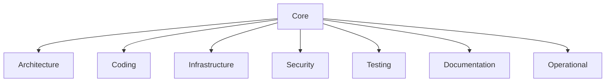
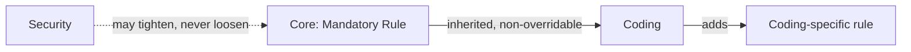
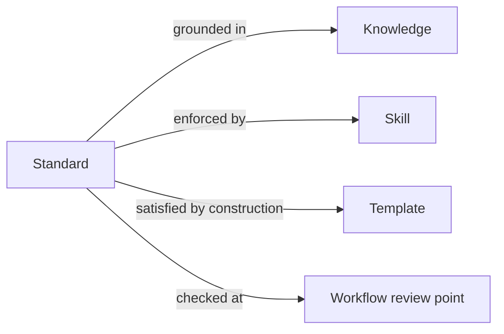
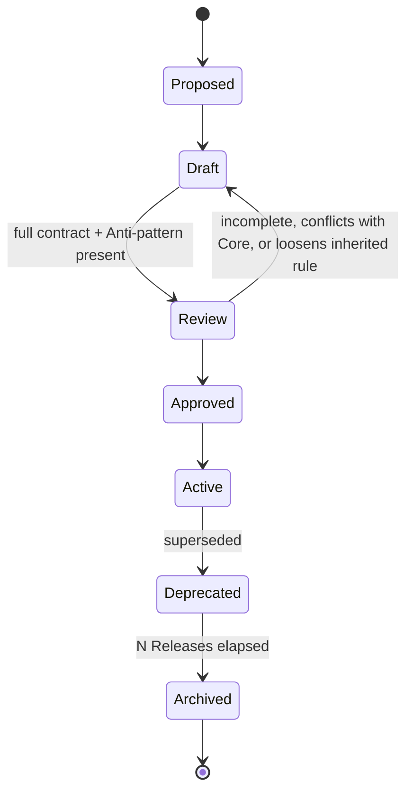

# Standards
## Phase 6: Standards Framework

> Continues from the approved AI Foundation. Standards are mandatory rules, not tutorials or implementation guides — they exist to be checked against, not read for understanding.

Status: Approved

Contract origin: [foundation/architecture.md#standards](../foundation/architecture.md#standards).

---

## Standard Contract

> **Frontmatter (machine half):** every standard unit also carries frontmatter validated against [schema/standard.schema.json](../schema/standard.schema.json) (base + Standard extension). The prose contract below is the human half; the schema is what Automation reads (indexing, Impact Analysis, enforcement). See [schema/README.md](../schema/README.md).

| Field | Meaning |
|---|---|
| Purpose | The one rule-cluster this standard enforces. |
| Scope | What it applies to (a language, a layer, all of Guardrail Hub). |
| Rule Definitions | The rules themselves, stated as checkable pass/fail conditions. |
| Mandatory Rules | Rules with no exception path — a violation always blocks. |
| Optional Recommendations | Rules that should be followed but don't block on their own. |
| Exceptions | Explicit, named cases where a Mandatory Rule doesn't apply, and why. |
| Related Skills | Skills that must enforce this standard when applied. |
| Related Knowledge | Knowledge units this standard's rules are grounded in. |
| Related Templates | Templates whose scaffolding already satisfies this standard by construction. |
| Related Workflows | Workflows where this standard is checked as a review point. |
| Examples | Passing cases. |
| Anti-patterns | Concrete failing cases — what the violation actually looks like, not just its name. |

A standard without at least one concrete Anti-pattern example is not `Active` — an AI enforcing a rule it can't recognize in the wild isn't enforcing anything.

---

## Categories & Hierarchy

```
standards/
├── core/            # apply everywhere, no domain exception (naming, git, versioning)
├── architecture/     # module boundaries, dependency direction, layering
├── coding/            # language-level style and correctness rules
├── infrastructure/     # Docker, CI/CD, environment config rules
├── security/             # the DevSecOps-critical category — least negotiable
├── testing/                # coverage expectations, test structure
├── documentation/           # what must be documented and how
└── operational/               # logging, observability, error-handling conventions
```

`core/` standards apply to every category below it; a category-specific standard may add rules but never override a `core/` Mandatory Rule — that's what "inheritance" means here (additive, never subtractive).



## Inheritance Model



A category may *tighten* a Core rule (e.g., Security requiring stricter input validation than Core's baseline) but may never loosen one. A proposed standard that loosens an inherited Mandatory Rule is rejected at Review, not merged with a caveat.

## Dependency Graph



---

## Conflict Resolution

Two standards can only conflict across categories (within a category, Review rejects the conflicting draft before it reaches `Active`). Cross-category conflicts resolve by specificity: the more scoped category wins for the case it explicitly covers (e.g., Security's rule for a specific auth pattern beats Coding's general rule), and anything not explicitly covered falls back to Core. An unresolvable conflict — neither is more specific — escalates to [Kernel/Recovery](../kernel/recovery/README.md) at task time and to [Review](../review/README.md) for a permanent fix.

## Deprecation

A deprecated standard is marked `Deprecated`, not deleted; its Mandatory Rules stop being enforced going forward but existing code that satisfied it isn't retroactively flagged. A replacement standard, if any, is named in the deprecated one's record.

## Review Lifecycle



---

## AI Enforcement

Each violation class maps to a specific check the [Kernel/Validation](../kernel/validation/README.md) gate runs, sourced from this framework:

| Violation | Detected by comparing... |
|---|---|
| Naming | Output identifiers against `core/` and category naming Rule Definitions. |
| Architecture | Proposed file/module placement against `foundation/architecture.md` module boundaries and `architecture/` standards. |
| Folder | Proposed paths against the declared folder-structure rules in `architecture/` or `core/`. |
| Security | Output against `security/` Mandatory Rules via [Guardrails](../guardrails/README.md). |
| Documentation | Whether a new/changed unit in any module satisfies `documentation/`'s required fields (this framework itself is checked against `documentation/` once one exists). |

Enforcement is a Validation-gate lookup, not free-form judgment — an AI flags a violation because a specific Rule Definition failed, and cites which one.

---

## Acceptance Criteria

Per [RFC-0001](../governance/rfcs/0001-acceptance-criteria.md), a Standard that has passed Review (`Approved`) must additionally meet these readiness checks before reaching `Active`:

- **A1** At least one concrete Anti-pattern is present (a rule an AI can't recognize in the wild isn't enforceable).
- **A2** `applies_to` globs resolve to at least one real path in the current repository — the Standard actually governs code that exists.
- **A3** Every `depends_on` and `enforced_by` reference resolves and is itself at least `Approved` (never depend on something not yet quality-approved).
- **A4** No open `NeedsRevalidation` flag against it from [Impact Analysis](../governance/README.md#impact-analysis).
- **A5** `aios validate` passes (correctness precondition).

## Index

Per-category unit lists are **generated** into each category's `INDEX.md` by `aios index` — that is the single source of truth, not a hand-maintained table here. Categories with units: [core/](core/INDEX.md), [architecture/](architecture/INDEX.md), [coding/](coding/INDEX.md), [operational/](operational/INDEX.md). Categories `infrastructure`, `security`, `testing`, `documentation` have no units yet (their `INDEX.md` is generated when they gain their first).
