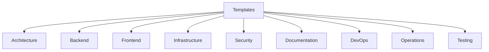
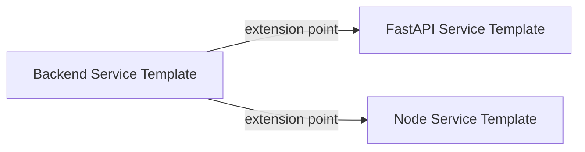
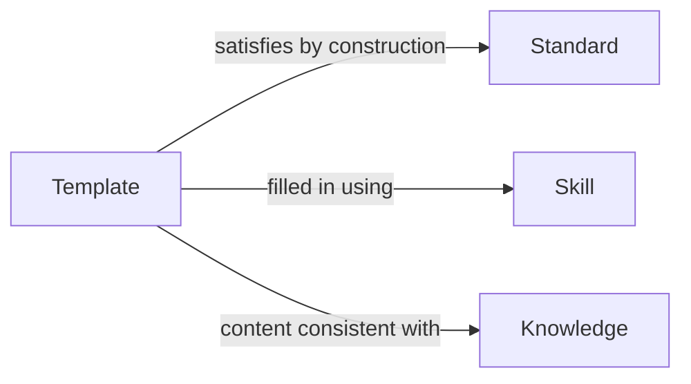
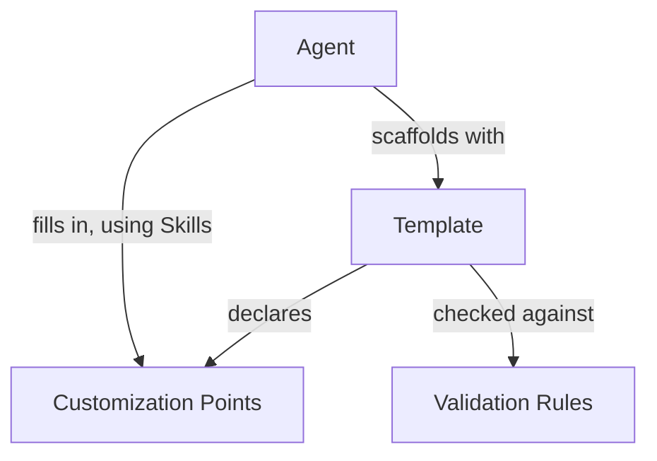

# Templates
## Phase 8: Template Framework

> Continues from the approved [Workflow Framework](../workflows/README.md). Templates reduce hallucination by constraining output *shape* — an AI filling in a template's declared Customization Points can't invent structure, only content within bounds.

Status: Approved

Contract origin: [foundation/architecture.md#templates](../foundation/architecture.md#templates).

---

## Template Contract

| Field | Meaning |
|---|---|
| Purpose | The artifact this template scaffolds. |
| Inputs | What the requester must supply. |
| Outputs | The scaffolded artifact's shape. |
| Customization Points | Exactly where content may vary — everything else is fixed structure. |
| Required Standards | Standards this template's fixed structure already satisfies by construction. |
| Required Skills | Skills needed to fill in the Customization Points. |
| Required Knowledge | Knowledge the fill-in content must be consistent with. |
| Validation Rules | Checks the filled-in artifact must pass before it's returned. |
| Extension Points | Where a category-specific variant may add structure without forking the whole template. |

---

## How Templates Reduce Hallucination

A template converts "generate an X" (unbounded) into "fill in these N declared Customization Points of a fixed X-shape" (bounded). The AI cannot introduce a field, section, or structural pattern the template didn't declare — if a task seems to need one, that's a signal the template itself needs an Extension Point added (through Review), not that the Agent should improvise around it this one time.

## Categories & Hierarchy

```
templates/
├── architecture/   # ADRs, module scaffolds
├── backend/          # service, API, repository scaffolds
├── frontend/           # dashboard component, screen scaffolds
├── infrastructure/       # Dockerfile, Helm chart, Kubernetes resources
├── security/               # scanner integration scaffold, threat-model doc
├── documentation/            # README, runbook scaffolds
├── devops/                     # GitHub Actions, Jenkins pipeline
├── operations/                    # runbook, incident postmortem
└── testing/                          # test suite scaffold
```



## Inheritance & Composition

A category-specific template (e.g., "FastAPI Service") extends a base template (e.g., "Backend Service") through its declared Extension Points — it does not copy the base's fixed structure and modify it, which would let the two silently drift. Composition works the same way Skills compose: a scaffold that needs multiple templates (e.g., a new scanner needs both a Backend service template and an Infrastructure Dockerfile template) invokes each independently rather than merging them into one mega-template.



## Template Dependencies



## Agent → Template Relationship



---

## Template Validation (before content is returned)

1. Every declared Customization Point is filled — none left as a placeholder.
2. Nothing outside a declared Customization Point was altered from the template's fixed structure.
3. The filled content passes the template's own Validation Rules.
4. The filled content passes [Kernel/Validation](../kernel/validation/README.md)'s standard six-check gate, same as any other output.

A template that fails step 1 or 2 is a template defect (its Customization Points don't cover a real need) and goes to [Review](../review/README.md), not a one-off exception in the Agent's output.

## Evolution & Obsolescence

A template version bump follows the same major/minor logic as other modules: adding an Extension Point is additive; removing or restructuring a Customization Point is breaking. An obsolete template is marked `Deprecated` with its replacement named — existing artifacts scaffolded from it are not retroactively invalidated, but new work is routed to the replacement.

## Lifecycle

Follows [Architecture: per-unit lifecycle](../foundation/architecture.md#lifecycle-per-knowledge-unit-in-any-module): `Proposed → Draft → Review → Approved → Active → Deprecated`.

---

## Index

No templates exist yet.

| Category | Templates | Status |
|---|---|---|
| architecture | 0 | — |
| backend | 0 | — |
| frontend | 0 | — |
| infrastructure | 0 | — |
| security | 0 | — |
| documentation | 0 | — |
| devops | 0 | — |
| operations | 0 | — |
| testing | 0 | — |
