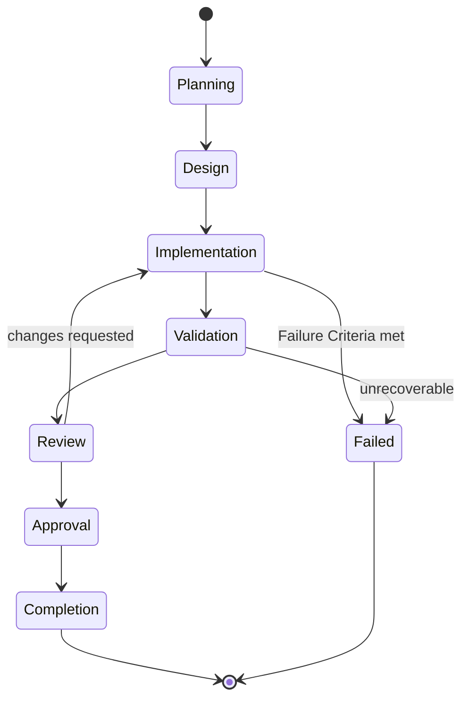
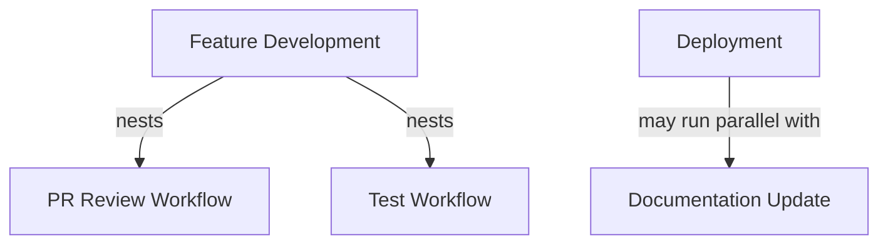
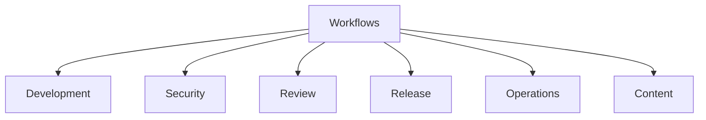
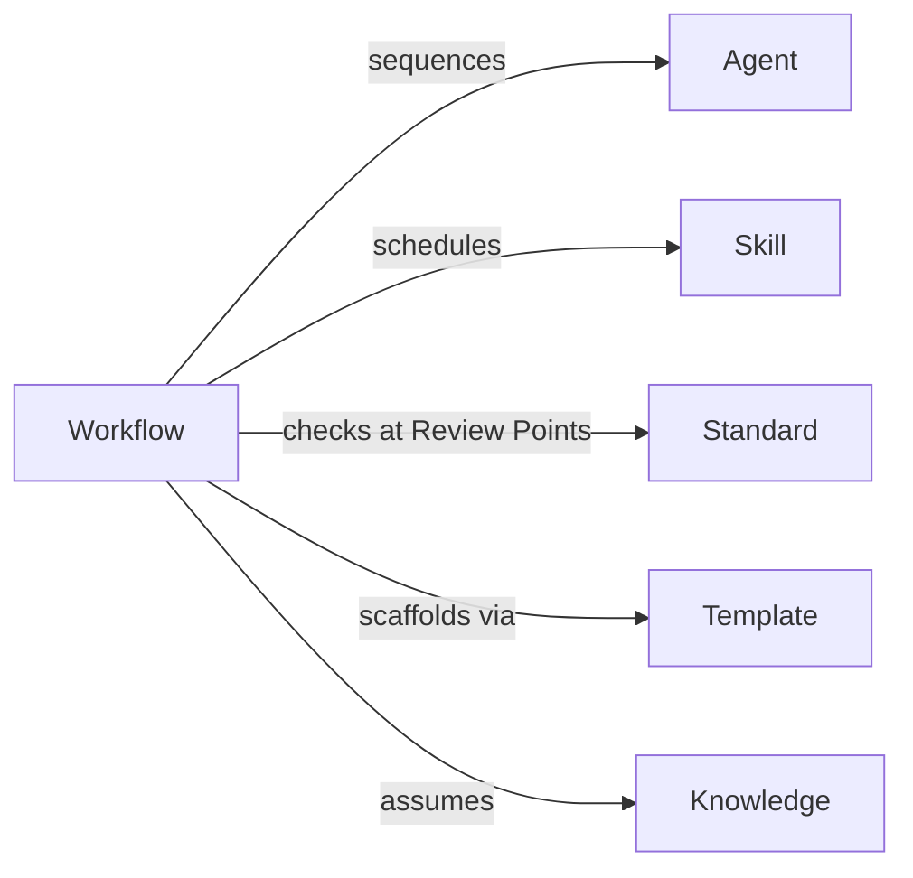

# Workflows
## Phase 7: Workflow Framework

> Continues from the approved [Standards Framework](../standards/README.md). A Workflow describes how work progresses — it is not an implementation guide, and it does not define the Agents/Knowledge/Skills/Standards/Templates it sequences, only which ones apply and in what order.

Status: Approved

Contract origin: [foundation/architecture.md#workflows](../foundation/architecture.md#workflows).

---

## Workflow Contract

| Field | Meaning |
|---|---|
| Purpose | The process this workflow governs. |
| Trigger | What starts it (a request type, an event, a schedule). |
| Inputs | What must be present to start. |
| Outputs | What exists when it completes. |
| Actors | Human roles involved, if any. |
| Capability Agents | Which Agents participate, and in what state order. |
| Knowledge Required | Knowledge units its Agents will need. |
| Skills Required | Skills its Agents will apply. |
| Standards Applied | Standards checked at its Review Points. |
| Templates Used | Templates scaffolded during it. |
| Success Criteria | Objective conditions for `Completion`. |
| Failure Criteria | Objective conditions that end it in `Failed` rather than looping forever. |
| Review Points | Which states require a [Review Framework](../review/README.md) pass before advancing. |

---

## Workflow State Machine



Not every workflow uses every state — a lightweight workflow (e.g., Documentation Update) may collapse Planning/Design into one step. What's fixed is the *order*: a state is never entered out of sequence, and `Review` always sits between `Validation` and `Approval`.

## Branching, Rollback, Retries, Parallelism, Nesting

- **Branching** — a workflow may fork at `Implementation` into parallel sub-paths (e.g., backend + frontend changes for one feature) that each carry their own Validation/Review and rejoin before Approval.
- **Rollback** — a `Failed` outcome after partial `Implementation` triggers the reverse of whatever that workflow's Outputs declared as committed so far; a workflow's contract must state what's safely revertible before it's allowed to reach `Active`.
- **Retries** — a `Validation` failure that Kernel/Recovery marked "fixable" re-enters `Implementation`, not `Planning` — retries resume, they don't restart.
- **Parallel workflows** — two independent workflows may run concurrently only if their declared Outputs don't overlap; overlapping Outputs must be sequenced or merged into one workflow.
- **Nested workflows** — a workflow may declare another workflow as a step (e.g., "Feature Development" nests "Code Review"); the nested workflow's own state machine runs to completion before the parent advances past that step.



---

## Categories & Hierarchy

Guardrail Hub's anticipated workflows, grouped by what they govern:

```
workflows/
├── development/    # Feature Development, Bug Fix, Dependency Upgrade, API Development, Scanner Development
├── security/         # Security Scan, Threat Modeling
├── review/             # Code Review, Pull Request Review, Architecture Review
├── release/              # Deployment, Release
├── operations/             # Incident Response
└── content/                  # Documentation Update
```



## Dependency Graph



---

## Collaboration, Reuse, Evolution

- **Collaboration** — a workflow doesn't call another Agent directly; it lists Capability Agents in order and Kernel/Routing dispatches each in turn, same as any other task dispatch.
- **Reuse** — a new workflow that mostly matches an existing one's states should nest the existing one as a step rather than restate its states.
- **Evolution** — adding a Review Point or tightening Success Criteria is additive (minor); removing a Review Point or changing state order is breaking (major) and requires a full [Review](../review/README.md) pass, since downstream workflows may nest this one.

## Workflow Lifecycle (as a unit)

Follows [Architecture: per-unit lifecycle](../foundation/architecture.md#lifecycle-per-knowledge-unit-in-any-module): `Proposed → Draft → Review → Approved → Active → Deprecated`. Distinct from the *state machine a workflow instance runs through* (Planning → … → Completion) shown above — one is the lifecycle of the workflow definition, the other is the lifecycle of a single execution of it.

---

## Index

No workflows are defined yet.

| Category | Workflows | Status |
|---|---|---|
| development | 0 | — |
| security | 0 | — |
| review | 0 | — |
| release | 0 | — |
| operations | 0 | — |
| content | 0 | — |
