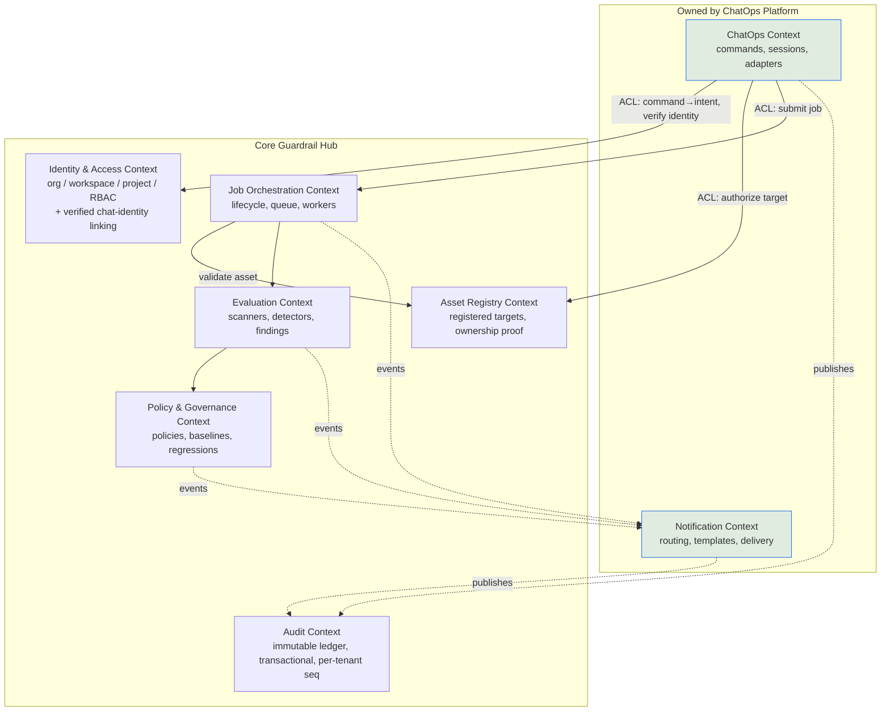

# 2. Bounded Contexts

> Design intent. These contexts describe the target decomposition; only fragments of the *Scanning* context exist in code today (the ZAP path).

A bounded context is a boundary within which a domain model and its language are internally consistent. The ChatOps platform touches several contexts but **owns only two** of them. Keeping the ownership line sharp is how we keep business logic out of the adapter.

## 2.1 Context map

`ACL` = Anti-Corruption Layer: the ChatOps context never imports core domain types directly. It speaks to the core through the Guardrail API using its own DTOs, so a change to an internal Evaluation model can never ripple into a Slack handler.

## 2.2 The contexts

| Context | Owner | Responsibility | Explicitly NOT responsible for |
|---|---|---|---|
| **ChatOps** | ChatOps Platform | Parse chat/CLI input, authenticate the actor, map to a domain intent, submit via the Guardrail API, render synchronous acknowledgements, hold conversation/session state (thread ↔ job correlation). | Deciding *how* a scan runs, what a policy means, or whether a finding is a regression. |
| **Notification** | ChatOps Platform | Subscribe to domain/integration events, resolve recipients + preferences, render templates, throttle/batch/retry, deliver to channels. | Producing the events. It never computes domain state; it reacts to it. |
| **Identity & Access** | Core | Org → Workspace → Project hierarchy, actors, roles, tokens, per-command authorization, **verified chat-identity linking (Installation → org scoping)**. | Trusting a chat identity that has not completed verified linking. |
| **Asset Registry** | Core | Registered scan targets per Project, proof-of-ownership/verification, derived egress allow-lists. | Running scans — it authorizes *what* may be targeted, not *how*. |
| **Job Orchestration** | Core | Job lifecycle, staging, queue position, worker assignment, cancellation, progress. | Interpreting findings. |
| **Evaluation** | Core | Security Scan, Prompt Evaluation, Benchmark, Hallucination / Prompt-Injection / Jailbreak / PII / Toxicity detection, Agent evaluation. | Delivering results to humans. |
| **Policy & Governance** | Core | Policy validation, baselines, regression detection (what turns a raw finding into "Prompt Injection Regression"). | — |
| **Audit** | Core (ledger) + all contexts (producers) | The immutable, append-only record of every action, written **transactionally with a per-tenant sequence** (not derived from the bus). | Mutation of any kind; being reconstructed from an at-least-once stream. |

## 2.3 Ubiquitous language (shared subset)

These terms mean exactly one thing across every context and every chat surface. Adapters must not redefine them.

- **Job** — one execution of one Tool against one target, owned by a Project.
- **Tool** — a capability the Evaluation Engine can run (e.g. `security_scan`, `pii_detection`, `jailbreak_detection`). Mirrors the existing `tools/<tool>/` convention.
- **Stage** — a named phase within a Job (e.g. `spider`, `active_scan`, `report`). Stages emit their own start/finish events.
- **Finding** — a single result produced by the Evaluation Engine.
- **Regression** — a Policy-context judgement that a finding is worse than an established baseline. **Only** the Policy context may declare one; ChatOps and Notification only *relay* it.
- **Actor** — an authenticated identity (human or service) resolved from a **verified** chat identity.
- **Asset** — a registered, ownership-verified target a Job may run against. Chat references an Asset, never a raw host.

## 2.4 Why ChatOps owns Notification but not Evaluation

Notification is pure adapter work: it turns events into messages. It has no domain decisions to make, so it lives with the other adapters and shares their ports. Evaluation is the opposite — it *is* the business logic — so it can never live in the adapter layer without violating the central constraint and the repo's `backend-layering` anti-pattern rule.

Continue to [02-domain-model.md »](02-domain-model.md)
