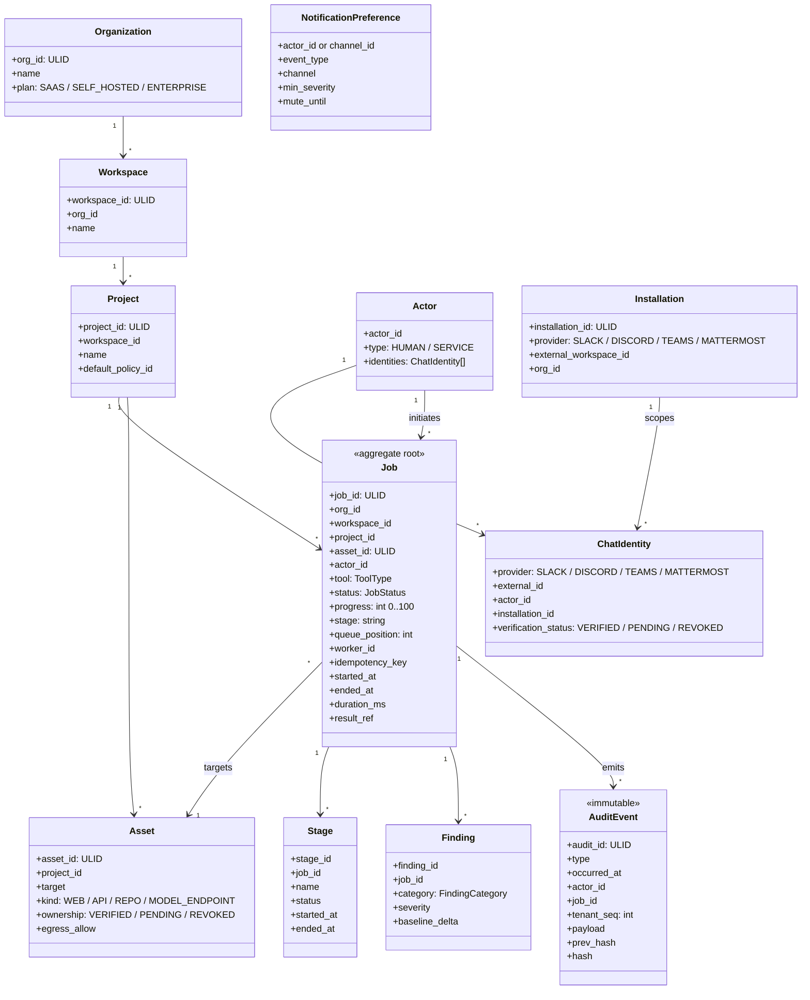
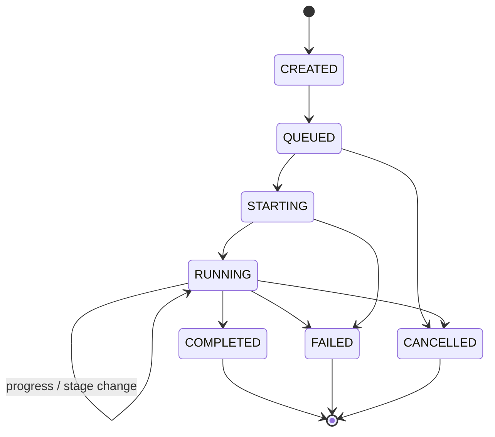

# 3. Domain Model

> Design intent. Field names follow the repo's `backend-naming` convention; the persistence shape follows [`persistence-dao`](../../.ai/standards/architecture/persistence-dao.md) (pluggable Postgres/DynamoDB, no ORM).

## 3.1 Aggregates and relationships



## 3.2 The Job model

The Job is the central aggregate the ChatOps platform tracks. Every field the brief names, plus the fields needed to make the model idempotent and multi-tenant:

| Field | Type | Notes |
|---|---|---|
| `job_id` | ULID | Time-sortable ID; also the correlation ID across events, logs, traces. |
| `org_id` / `workspace_id` / `project_id` | ULID | Full tenancy path. Every query is scoped by at least `org_id`. |
| `asset_id` | ULID | The **registered, ownership-verified** target this job runs against. A job cannot be created against an unregistered target (see [§3.6](#36-asset--identity-added-for-authorization)). |
| `actor_id` | ULID | The **verified** initiator, resolved from a `VERIFIED` `ChatIdentity`; unverified identities cannot launch jobs. |
| `tool` | enum | One of the Evaluation tools (§3.4). |
| `status` | enum | Lifecycle state (§3.3). |
| `progress` | int 0–100 | Coarse percent, updated by the worker. |
| `stage` | string | Current stage name (e.g. `active_scan`). |
| `queue_position` | int, nullable | Position while `QUEUED`; null once running. |
| `worker_id` | string, nullable | Worker/pod that owns execution. |
| `started_at` / `ended_at` | timestamptz | Set on transition into `RUNNING` / terminal. |
| `duration_ms` | int, nullable | Derived; persisted for cheap reporting. |
| `result_ref` | URI | Pointer to the report/findings artifact, **not** the payload itself. |
| `idempotency_key` | string | `hash(actor + project + tool + params + time-bucket)`; unique per project. |
| `origin` | enum | `SLACK` \| `DISCORD` \| `TEAMS` \| `CLI` \| `API` — where the command came from, for routing acknowledgements back. |
| `correlation` | json | `{provider, channel_id, thread_ts}` so a completion event can reply in the right thread. |
| `schema_version` | int | Enables forward-compatible event/record evolution. |

### 3.3 Job status state machine



Each transition is the source of exactly one domain event (see [event catalog](03-event-catalog.md)). The state machine is owned by the Job Orchestration context; ChatOps only reads it.

### 3.4 Tool taxonomy

```
security_scan · prompt_evaluation · policy_validation · benchmark
hallucination_detection · prompt_injection_detection · jailbreak_detection
pii_detection · toxicity_analysis · agent_evaluation
```

Each maps to a `services/tools/<tool>/` + `integrations/<tool>/` slice per the existing ZAP layout convention, so ChatOps never needs a per-tool code branch — it passes `tool` through as data.

## 3.5 The Audit model

Every action produces an **immutable** `AuditEvent`. Immutability is enforced two ways: the store is append-only (no `UPDATE`/`DELETE` grant on the table), and each row carries `prev_hash`/`hash` forming a per-tenant hash chain so tampering is detectable. This directly serves guardrails **G2** (don't weaken controls — audit logging is a control) and **G3/G5** (traceable, non-fabricated posture).

Canonical audit event types (the brief's list, made total):

```
JobCreated · JobQueued · JobStarted · StageStarted · StageFinished
JobProgressed · JobCompleted · JobFailed · JobCancelled · UserCancelledJob
NotificationSent · NotificationFailed · CommandExecuted · CommandRejected
SecurityAlertRaised · PolicyViolationRecorded
```

`AuditEvent` shape:

| Field | Purpose |
|---|---|
| `audit_id` | ULID, globally unique. |
| `type` | One of the above. |
| `occurred_at` | Event time (not ingest time). |
| `actor_id` | Who (or which service) caused it. |
| `org_id` / `job_id` | Tenancy + correlation. |
| `payload` | Type-specific, redacted of secrets/PII **before** persistence (G1). |
| `prev_hash` / `hash` | Hash chain for tamper-evidence. |

### Audit vs. domain events

They are related but distinct. A **domain event** drives behavior (a subscriber acts on it). An **audit event** is the durable proof the action happened.

**The audit ledger is written synchronously and transactionally by the service that owns the state transition — it is *not* derived from the asynchronous bus.** Each write takes the next per-tenant monotonic `tenant_seq` and computes `hash = H(prev_hash || tenant_seq || canonical(payload))` over that ordered sequence. This is the correctness fix for the review board's Critical finding that a hash chain cannot be built over an at-least-once, reordered, multi-producer stream: the chain is anchored to the ledger's own single-writer sequence, not to bus delivery order. The bus still carries `audit.*` events for *derived* consumers (notifications, metrics), but those are convenience projections, never the source of truth. See [database design §6.2](05-database-design.md#62-core-tables-postgres-form).

## 3.6 Asset & Identity (added for authorization)

Two small aggregates close the two Critical security holes the review board raised, without disturbing the Job aggregate.

**`Asset`** — a registered scan target owned by a Project. A Job references an `asset_id`, never a free-text target. `ownership` must be `VERIFIED` (via the web app's proof-of-control flow) before any Job may target it; `egress_allow` is derived from the asset and handed to the sandbox as defense-in-depth. This makes "scan an arbitrary host from chat" structurally impossible (closes the SSRF / attack-proxy finding).

**`Installation`** binds one external chat workspace (Slack/Teams/Discord/Mattermost) to exactly one `org_id`. A `ChatIdentity` carries a `verification_status` and is scoped by its `Installation`. Identity resolution succeeds only for a `VERIFIED` identity **within the installation's org**, so a user in a shared channel cannot spoof another org's actor and an unlinked user cannot act (closes the identity-spoofing finding). Linking is a one-time proof: a code issued in the authenticated web app is confirmed from chat.

Both are additive: existing Job fields are unchanged except the new `asset_id`, and both persist through the standard DAO on the same Postgres/DynamoDB providers.

Continue to [03-event-catalog.md »](03-event-catalog.md)
