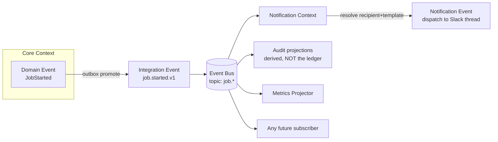
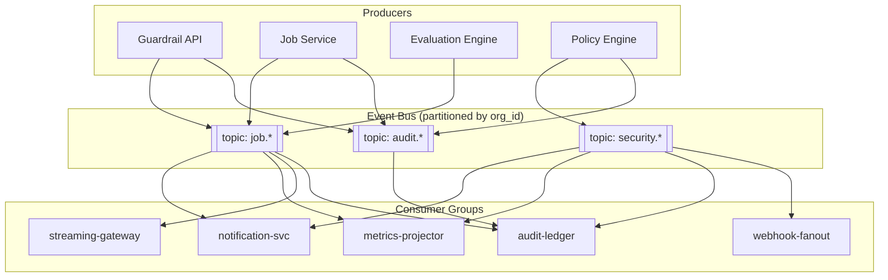
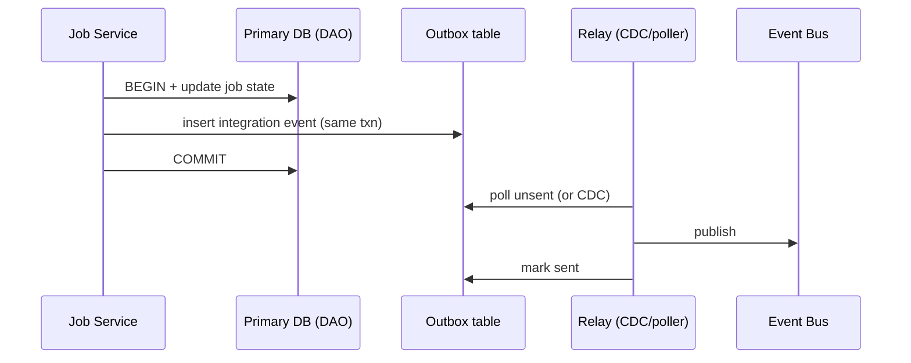

# 4. Event Catalog & Event Bus

> Design intent. No event bus exists in code today; this is the target Event-Driven Architecture the brief mandates.

## 4.1 Three kinds of event

The system distinguishes three event tiers. Confusing them is the most common way event-driven systems rot, so the boundary is explicit.

| Tier | Definition | Scope | Example | Contract stability |
|---|---|---|---|---|
| **Domain Event** | A fact that happened inside one bounded context, in that context's language. | Internal to the core. | `JobStarted`, `StageFinished`, `HallucinationRegressionDetected` | Owned by the context; may change with the context. |
| **Integration Event** | A domain event *promoted* to a stable, versioned, cross-context contract on the shared bus. | Cross-context, cross-service. | `job.started.v1`, `security.regression.detected.v1` | Versioned, backward-compatible; breaking change = new version. |
| **Notification Event** | A rendering-ready instruction derived by the Notification context from an integration event + recipient + template. | Notification context → channel adapters. | `notification.dispatch` (Slack, thread=…, template=job_completed) | Internal to Notification. |

Flow: **Domain Event → (promote) → Integration Event → (Notification context maps) → Notification Event → channel adapter.**



## 4.2 Canonical event envelope

Every integration event on the bus shares one envelope. Subscribers can route on the envelope without parsing the payload.

```json
{
  "event_id": "01J...ULID",
  "type": "job.completed.v1",
  "occurred_at": "2026-07-07T10:15:03Z",
  "org_id": "01J...",
  "workspace_id": "01J...",
  "project_id": "01J...",
  "job_id": "01J...",
  "actor_id": "01J...",
  "correlation": { "provider": "slack", "channel_id": "C123", "thread_ts": "169..." },
  "trace_id": "otel-trace-id",
  "schema_version": 1,
  "payload": { "...type-specific..." }
}
```

`trace_id` ties every event to an OpenTelemetry trace (see [observability](09-observability.md)). `correlation` is what lets a completion message land back in the exact Slack thread that launched the job.

## 4.3 Event catalog — Job lifecycle

| Integration event | Emitted by | Trigger | Key payload | Primary subscribers |
|---|---|---|---|---|
| `job.created.v1` | Guardrail API | Command accepted | tool, params-digest | Audit, Notification |
| `job.queued.v1` | Job Service | Enqueued | queue_position, eta_hint | Audit, Notification, Metrics |
| `job.started.v1` | Job Service | Worker picked up | worker_id | Audit, Notification, Metrics |
| `job.stage.started.v1` | Evaluation Engine | Stage begins | stage_name | Notification (progress), Metrics |
| `job.stage.finished.v1` | Evaluation Engine | Stage ends | stage_name, stage_duration | Notification, Metrics |
| `job.progressed.v1` | Evaluation Engine | Progress delta | progress, stage, eta | Streaming fan-out, Notification (throttled) |
| `job.completed.v1` | Job Service | Terminal success | result_ref, summary_counts | Audit, Notification, Metrics |
| `job.failed.v1` | Job Service | Terminal failure | error_class, retryable | Audit, Notification, Metrics, Alerting |
| `job.cancelled.v1` | Job Service | Cancel honored | cancelled_by | Audit, Notification |

## 4.4 Event catalog — AI Security alerts

These originate in the **Policy & Governance** context (they are *judgements*, not raw findings) and are the highest-priority notifications.

| Integration event | Trigger | Severity default | Payload highlights |
|---|---|---|---|
| `security.prompt_injection.regression.v1` | Injection resistance dropped vs. baseline | high | baseline_delta, sample_ids |
| `security.jailbreak.detected.v1` | Jailbreak succeeded in a run | critical | technique, transcript_ref |
| `security.pii.leakage.v1` | PII emitted where disallowed | critical | pii_types, redaction_status |
| `security.tool_abuse.v1` | Agent misused a tool / exceeded scope | high | tool, action |
| `security.policy.violation.v1` | Policy rule failed | high | policy_id, rule_id |
| `security.hallucination.regression.v1` | Groundedness dropped vs. baseline | high | metric, baseline_delta |
| `security.benchmark.regression.v1` | Benchmark score dropped vs. baseline | medium | benchmark, delta |

Every security-alert payload is **redacted before it leaves the Policy context** (transcripts and samples become references, not inline text) to honor **G1** (no secrets/PII in outputs) — a Slack alert must never itself become the leak.

## 4.4b Command admission events (added for authorization)

| Integration event | Emitted by | Trigger | Key payload | Primary subscribers |
|---|---|---|---|---|
| `command.rejected.v1` | Guardrail API | A command failed admission | `reason: unauthorized_target \| unverified_identity \| rbac_denied` | Audit, Notification (ephemeral reply) |

Emitted when a command is refused at the edge — an unregistered/unverified target (SSRF Critical), an unverified chat identity (identity Critical), or an RBAC denial. Always paired with an audit `CommandRejected` row, so a refusal is as traceable as an acceptance (G3).

> **Audit-ledger correctness note.** The durable audit ledger is **not** built from this bus. It is written transactionally by the owning service with a per-tenant monotonic sequence (see [domain §3.5](02-domain-model.md#audit-vs-domain-events) and [database §6.2](05-database-design.md#62-core-tables-postgres-form)). The `audit.*` topics carry only *derived* projections for notification/metrics; a dropped or reordered bus message can never corrupt the ledger or its hash chain. This closes the review board's Critical finding on hash-chaining an at-least-once stream.

## 4.5 The Event Bus

### Topology



- **Partition key = `org_id`** → guarantees per-tenant ordering, and lets a noisy tenant be isolated to its partitions.
- **Consumer groups** → each subscriber type scales independently and tracks its own offset. A slow webhook consumer never blocks notifications.
- **Recommended substrate:** Kafka or Redpanda for the durable log; NATS JetStream is an acceptable lighter-weight alternative for self-hosted deployments. (See [tech recommendations](13-extensions-tech-risks.md#recommended-technologies).)

### Reliable publishing — the Outbox pattern

A domain event and its database write must be atomic, or a crash between them silently drops a notification. The **transactional outbox** solves this:



Because the state change and the outbox row commit together, "job is RUNNING" and "`job.started.v1` will be published" are the same fact. The relay publishes at-least-once; subscribers dedupe on `event_id`.

## 4.6 How a new integration subscribes without touching the core

This is the extensibility guarantee the brief asks for. To add, say, **PagerDuty** for critical alerts:

1. Deploy a new consumer in the `security.*` group (or a fresh group) — **no producer changes**.
2. Register its recipient/preference rows.
3. Implement one `NotificationChannelPort` adapter.

The core keeps emitting the same integration events; the bus fans them out; the new subscriber reads at its own offset. Nothing in the API, Job Service, or Evaluation Engine is recompiled or redeployed. That is the definition of open-for-extension, closed-for-modification at the system level.

Continue to [04-api-design.md »](04-api-design.md)
