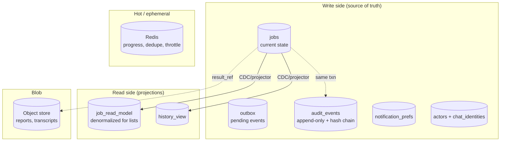

# 6. Database Design

> Design intent. Must obey [`persistence-dao`](../../.ai/standards/architecture/persistence-dao.md): all access goes through the hand-written DAO layer, backend selected by `DATABASE_PROVIDER` (Postgres **or** DynamoDB), **no ORM** ([`technology-stack.md`](../../.ai/intelligence/technology-stack.md)). Schemas below are shown in relational form; the DynamoDB single-table mapping follows in §6.5.

## 6.1 Store decomposition

Different data has different access shapes, so it lives in different stores — but all reached through DAOs.



## 6.2 Core tables (Postgres form)

**`jobs`** — one row per job, current state only (history is in audit + read model):

```
job_id           ULID  PK
org_id           ULID  NOT NULL     -- every index leads with org_id
workspace_id     ULID  NOT NULL
project_id       ULID  NOT NULL
actor_id         ULID  NOT NULL
tool             TEXT  NOT NULL
status           TEXT  NOT NULL
progress         INT   NOT NULL DEFAULT 0
stage            TEXT
queue_position   INT
worker_id        TEXT
idempotency_key  TEXT  NOT NULL
origin           TEXT  NOT NULL
correlation      JSONB
result_ref       TEXT
started_at       TIMESTAMPTZ
ended_at         TIMESTAMPTZ
duration_ms      INT
schema_version   INT   NOT NULL DEFAULT 1
created_at       TIMESTAMPTZ NOT NULL DEFAULT now()

UNIQUE (project_id, idempotency_key)          -- enforces idempotency in the DB
INDEX  (org_id, project_id, status)           -- /jobs, /status
INDEX  (org_id, project_id, created_at DESC)  -- /history pagination
```

**`audit_events`** — append-only, tamper-evident:

```
audit_id     ULID PK
tenant_seq   BIGINT NOT NULL     -- per-org monotonic; the hash chain is ordered by THIS, not the bus
type         TEXT NOT NULL
occurred_at  TIMESTAMPTZ NOT NULL
actor_id     ULID
org_id       ULID NOT NULL
job_id       ULID
payload      JSONB NOT NULL      -- pre-redacted (G1)
prev_hash    BYTEA
hash         BYTEA NOT NULL      -- H(prev_hash || tenant_seq || canonical(payload))
UNIQUE (org_id, tenant_seq)      -- single-writer per org => a total order the chain can rely on
INDEX (org_id, occurred_at)
-- Written in the SAME transaction as the state change it records (NOT consumed from the bus).
-- GRANTs: INSERT + SELECT only. No UPDATE/DELETE, enforcing immutability at the DB.
```

`tenant_seq` is allocated per org from a lightweight sequence row (or DB sequence) under the same transaction as the state change, giving each tenant a single-writer total order that the hash chain is computed over. This is the fix for the review board's Critical finding: the chain no longer depends on bus delivery order (which is at-least-once and reorderable). The per-org serialization this implies is bounded — it is per *tenant*, not global — and can be batched; if it ever becomes a hotspot for a whale org, the chain migrates to periodic Merkle anchoring without changing the table shape.

**`outbox`** — transactional publish buffer:

```
event_id     ULID PK
type         TEXT NOT NULL
payload      JSONB NOT NULL
created_at   TIMESTAMPTZ NOT NULL
published_at TIMESTAMPTZ            -- NULL = pending
INDEX (published_at) WHERE published_at IS NULL   -- partial index, cheap poll
```

**`notification_prefs`**, **`actors`**, **`chat_identities`** follow the domain model in [§3](02-domain-model.md). `chat_identities` has `UNIQUE (provider, external_id)` so a chat user resolves to exactly one Actor, plus `verification_status` and an `installation_id` FK; identity resolution rejects any row that is not `VERIFIED`.

**`assets`** — registered targets: `asset_id PK, org_id, project_id, target, kind, ownership (PENDING|VERIFIED|REVOKED), egress_allow JSONB`, with `UNIQUE (project_id, target)`. Job creation joins here and refuses any target whose `ownership != VERIFIED` (closes the SSRF/target Critical).

**`installations`** — `installation_id PK, provider, external_workspace_id, org_id`, with `UNIQUE (provider, external_workspace_id)`; binds one chat workspace to exactly one org so identities can never resolve across tenants (closes the identity-spoofing Critical).

## 6.3 CQRS read model

`/jobs`, `/status`, `/history` must be instant even for a project with millions of historical jobs. A projector consumes `job.*` events and maintains denormalized read tables (`job_read_model`, `history_view`) carrying the joined display fields (project name, actor handle, tool label, latest stage). Reads never touch the write store or perform joins at query time.

## 6.4 Partitioning & retention

- **`jobs`** and **`audit_events`** are **partitioned by `org_id` hash** (and sub-partitioned by month on `created_at`/`occurred_at`). This keeps a single tenant's data physically clustered and makes retention a partition-drop, not a mass delete.
- **Hot rows** (a running job's live `progress`) live in Redis and are written back to `jobs` only on stage/terminal transitions — otherwise a fast-progressing scan would hammer the primary DB.
- **Reports and transcripts** never live in the relational store; only a `result_ref` URI does. The blob store holds the payload, with lifecycle rules per plan tier.

## 6.5 DynamoDB single-table mapping

Because `DATABASE_PROVIDER=DYNAMODB` is a first-class backend, the same DAO interface maps onto a single-table design:

| Access pattern | PK | SK |
|---|---|---|
| Job by id | `ORG#<org>` | `JOB#<job_id>` |
| Jobs by project+status | `ORG#<org>#PROJ#<project>` | `STATUS#<status>#<job_id>` (GSI) |
| History by project+time | `ORG#<org>#PROJ#<project>` | `TS#<created_at>#<job_id>` (GSI) |
| Audit by org (ordered) | `ORG#<org>` | `AUDIT#<tenant_seq>` (monotonic, single-writer) |
| Asset by project | `ORG#<org>#PROJ#<project>` | `ASSET#<asset_id>` (+ GSI on `target` for admission lookup) |
| Installation by workspace | `PROVIDER#<p>` | `WS#<external_workspace_id>` (conditional put => one org) |
| Idempotency guard | `ORG#<org>#PROJ#<project>` | `IDEMP#<key>` (conditional put) |

DynamoDB's conditional-put on the `IDEMP#` item gives the same idempotency guarantee as the Postgres `UNIQUE` constraint. The DAO hides which mechanism is in play; callers see one `create_job_if_absent()` method.

## 6.6 Why this respects the existing DAO rule

The repo mandates raw-driver access through a hand-written DAO with no ORM, and forbids `dao/` importing from `services/`. Every store above is reached only via a DAO module (`dao/jobs_dao.py`, `dao/audit_dao.py`, `dao/outbox_dao.py`, …), each exposing provider-agnostic methods with a Postgres and a DynamoDB implementation selected at composition time. Services depend on the DAO interface, never on `psycopg2`/`boto3` directly — matching the one-directional dependency rule.

Continue to [06-queue-and-scalability.md »](06-queue-and-scalability.md)
