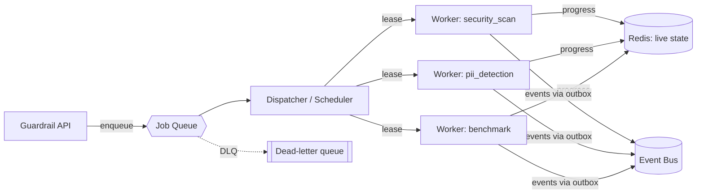
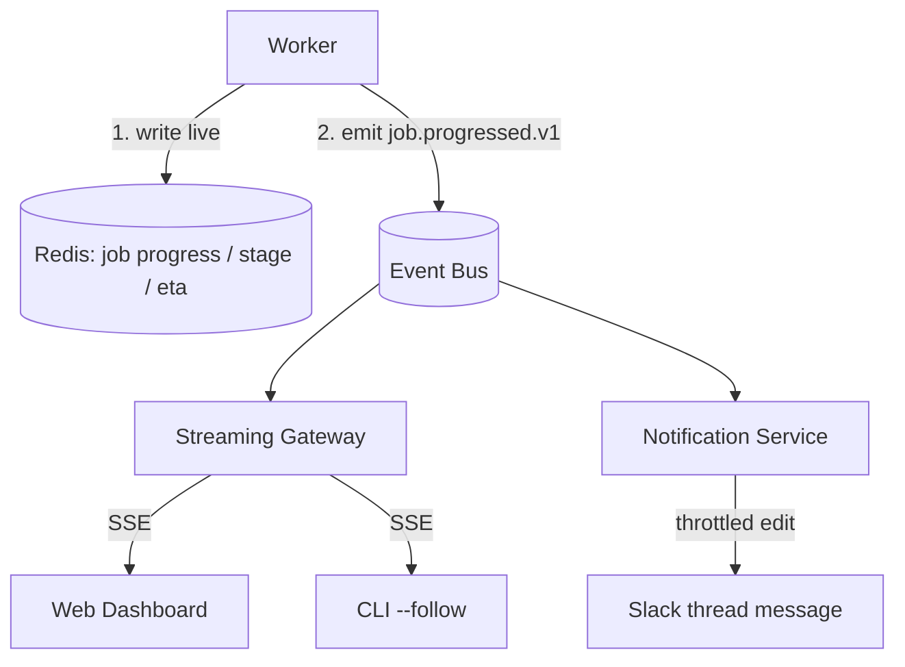
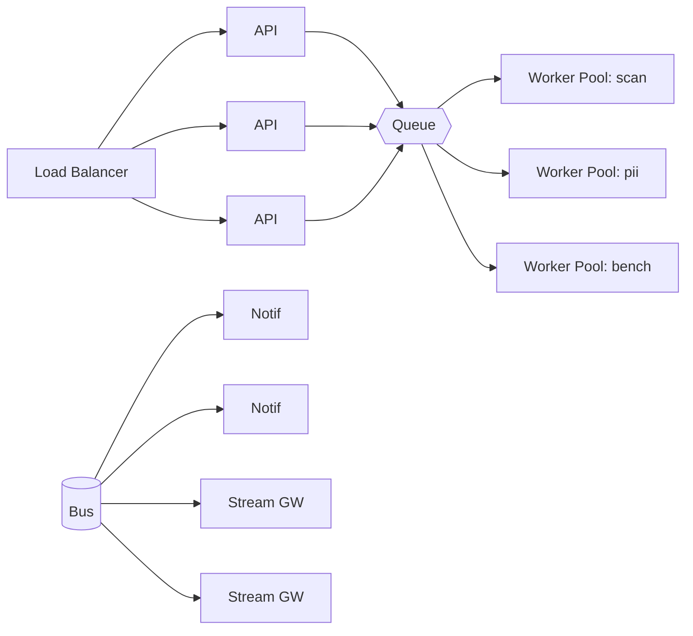

# 7. Queue Design · Progress Streaming · Scalability

> Design intent. Targets the brief's scale envelope: **100,000 organizations, millions of jobs, thousands of concurrent scans.** None of this queue/worker tier exists in code today.

## 7.1 Queue design

A Job is long-running (a security scan can take tens of minutes), so submission and execution must be decoupled by a durable queue.

### Queue topology

- **Per-tool queues** (`queue.security_scan`, `queue.pii_detection`, …) so a flood of cheap PII checks can't starve expensive benchmarks, and each tool scales its worker pool independently.
- **Per-org fair scheduling.** The dispatcher uses weighted fair queuing keyed on `org_id` so one tenant submitting 10,000 jobs cannot monopolize workers — critical at 100k orgs. Enterprise-plan orgs get reserved capacity lanes.
- **Priority lanes** within each tool queue: `interactive` (a human waiting in Slack) > `scheduled` (nightly regression) > `bulk` (backfill).
- **Visibility timeout + lease renewal.** A worker leases a job; if it dies, the lease expires and the job is redelivered. Workers renew the lease via heartbeat while progressing.
- **Dead-letter queue** for jobs that fail non-retryably or exceed max attempts; a DLQ entry raises an operational alert and is inspectable via `/jobs` with `status=DEAD`.

### Substrate options

| Option | Fit |
|---|---|
| Redis Streams + consumer groups | Simple, low-latency, good for self-hosted; the recommended default. |
| Kafka/Redpanda partitioned by `org_id` | When the event bus is already Kafka, reuse it for work distribution at the top end. |
| SQS + per-tool queues | Natural for the AWS/DynamoDB deployment profile. |

The queue is abstracted behind a `JobQueuePort`, so the substrate is a deployment choice, not an architecture change.

## 7.2 Workers

- **Stateless, single-tool processes.** A worker pulls one tool type, runs the corresponding `services/tools/<tool>/` + `integrations/<tool>/` slice (exactly the ZAP execution shape, generalized), streams progress, publishes lifecycle events through the outbox, writes `result_ref`, and exits the job.
- **Horizontally scaled** by a queue-depth-driven autoscaler (KEDA-style): scale the `security_scan` pool on `queue.security_scan` lag, independently of other pools.
- **Cancellation** is cooperative: `UserCancelledJob` sets a cancel flag in Redis; the worker checks it at stage boundaries and between long operations, then transitions to `CANCELLED`.
- **Isolation:** each scan runs in its own container/sandbox (the ZAP-in-Docker model today), so a hostile target or a crashing scanner can't take down the worker host.

## 7.3 Progress streaming

The brief requires that **the dashboard and Slack receive the same updates**. They do, because both are just subscribers to the one event stream — neither is a special case.

- **One source of truth:** the worker emits `job.progressed.v1` (progress %, current stage, ETA, worker status). Everything downstream reads that same event.
- **Dashboard / CLI** get near-real-time updates via the **Streaming Gateway** over SSE (WebSocket where duplex is needed). The gateway also serves the current snapshot from Redis on connect, so a late joiner sees state immediately.
- **Slack/Teams** get the *same* data, but the Notification Service **throttles** it — a chat surface can't take 200 edits, so it coalesces to "update the thread message at most once every N seconds, plus on every stage transition and terminal state." Different cadence, identical data, one producer.
- **ETA** is computed in the Evaluation context (stage weights × historical durations), not in any adapter — the adapter only displays it.

## 7.4 Scalability

### Scaling the envelope

| Dimension | Strategy |
|---|---|
| **100k organizations** | Tenancy in every key + `org_id` partitioning (DB, queue, bus). No global tables, no cross-tenant scans. Per-org fair scheduling and rate limits. |
| **Millions of jobs** | Write store holds only *current* state; history/lists come from CQRS read projections; old partitions are dropped, not queried. Blob payloads offloaded to object store. |
| **Thousands of concurrent scans** | Per-tool worker pools autoscaled on queue lag; sandboxed execution; visibility-timeout redelivery for resilience. |
| **Event throughput** | Bus partitioned by `org_id`; independent consumer groups; slow consumers (webhooks) isolated from fast ones (notifications). |

### Horizontal scaling of the services

Every tier is stateless and scales horizontally behind the queue/bus:

- **API / ChatOps / Notification / Streaming Gateway** are stateless replicas; session/correlation state lives in Redis, not in-process, so any replica can serve any request or event. This is what makes Slack's at-least-once retries and horizontal fan-out safe.
- **Back-pressure:** if worker pools saturate, the queue grows and the API keeps accepting (jobs just wait, `queue_position` reported to the user) rather than failing — graceful degradation instead of collapse.

Continue to [07-notification-architecture.md »](07-notification-architecture.md)
