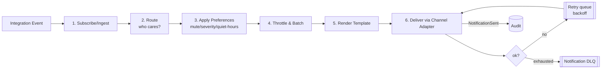
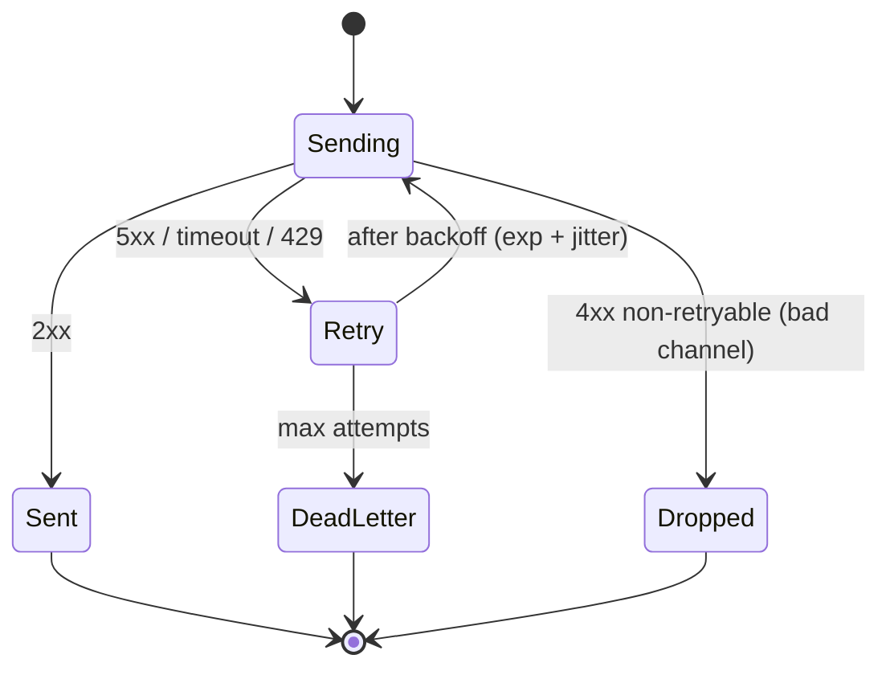

# 8. Notification Architecture

> Design intent. The Notification Service is a pure adapter context — it renders events into messages and never computes domain state.

## 8.1 Pipeline

Every outbound message flows through the same six stages. New channels plug in at the last stage; new event types plug in at the first.



## 8.2 Routing

Routing answers "for this event, which (recipient, channel) pairs should receive a message?" It is data-driven, evaluated in order:

1. **Subscription bindings** — a project/channel can bind an event class to a destination (e.g. project `web-api` → `security.*` → Slack channel `#sec-alerts`).
2. **Actor rules** — the job's initiator gets lifecycle updates in the thread they launched from (via `correlation`).
3. **Escalation rules** — `critical` security alerts additionally fan out to an on-call destination (PagerDuty/Teams) regardless of quiet hours.

Routing produces a set of candidate deliveries; preferences then filter it.

## 8.3 User & channel preferences

Stored in `notification_prefs`, resolved per delivery with a clear precedence (most specific wins):

```
channel-binding override  >  actor per-event pref  >  actor default  >  org policy default
```

Each preference row can set: which `event_type`s are enabled, a `min_severity` floor, a delivery channel, `quiet_hours`, and `mute_until`. Example: a developer mutes `job.progressed` but keeps `job.failed` and all `security.*`; the org policy forces `security.pii.leakage` to be undismissible.

## 8.4 Templates

- **Per (event_type × channel) templates.** `job_completed` renders as a Slack Block Kit card, a Teams Adaptive Card, a Discord embed, an HTML email, or a webhook JSON payload — same data, channel-native presentation.
- Templates are **declarative and versioned** (stored, not code), so adding a channel means adding template variants, not editing handlers.
- **Redaction is a template-time guarantee, not a hope:** templates reference `result_ref`/`transcript_ref`, never inline secret/PII content, upholding **G1**. A template that tried to inline a transcript would fail review.

## 8.5 Throttling

Chat surfaces rate-limit aggressively and users hate spam, so throttling is first-class:

- **Progress coalescing:** `job.progressed` events for one job collapse to at most one message edit per interval (e.g. 5s) plus guaranteed emits on stage change and terminal state. Implemented with a Redis per-job token bucket.
- **Per-destination global cap:** a busy `#sec-alerts` channel gets a ceiling (e.g. N msgs/min); overflow rolls into a batch (§8.6).
- **Dedupe:** identical (event_id → destination) is delivered once, guarded by a Redis set — safe against the bus's at-least-once redelivery.

## 8.6 Batching

- **Digest windows:** low-priority events (many `job.completed` from a nightly sweep) batch into a single rollup ("47 jobs completed, 3 findings") on a schedule or when a threshold is hit.
- **Severity bypass:** `critical`/`high` security alerts **never** batch — they deliver immediately and individually. Batching applies only to informational lifecycle noise.

## 8.7 Retry strategy



- **Exponential backoff with jitter**, honoring a provider's `Retry-After` on `429`.
- **Circuit breaker per channel:** if Slack is down, open the breaker, stop hammering it, and queue messages; drain when it recovers — one failing provider never degrades the others.
- **Idempotent delivery:** each delivery carries a dedupe key so a retry after an ambiguous timeout can't double-post.
- **Dead-letter + audit:** exhausted retries emit `NotificationFailed` to the audit ledger and land in a DLQ for inspection. A dropped notification is always a recorded fact, never a silent loss (supports **G3** — no false posture, including "you were told" claims).

## 8.8 Channel adapters (the outbound port)

Every channel implements one interface — `NotificationChannelPort`:

```
send(rendered_message, destination) -> DeliveryResult
supports(feature) -> bool   # threads? cards? edits? buttons?
```

`SlackAdapter`, `TeamsAdapter`, `DiscordAdapter`, `EmailAdapter` (SMTP/SES), `WebhookAdapter` (signed HTTP POST), `MattermostAdapter` (self-hosted). Adding one is one class + its templates + config — **no change** to routing, preferences, throttling, or the core. This is the extensibility the brief requires, realized concretely.

### 8.9 Channel classes (deployment-aware — added for air-gapped)

Channels split into two classes behind the *same* `NotificationChannelPort`:

- **Cloud channels** — Slack, Discord, Teams. Require outbound internet to a vendor SaaS.
- **Self-hostable channels** — Mattermost/Rocket.Chat/Matrix, internal SMTP email, internal webhooks. Run with **no** internet egress.

This is the fix for the review board's Critical finding that Slack/Teams/Discord cannot exist in an air-gapped deployment. The **air-gapped profile enables the self-hostable set and disables the cloud set purely by configuration** — no core change, because the port abstraction already makes channels swappable. Escalation follows the same rule: PagerDuty/Opsgenie in SaaS/enterprise, internal Alertmanager → webhook/email in air-gapped. See the [deployment channel matrix](11-deployment.md#112-deployment-profiles).

Continue to [08-chatops-architecture.md »](08-chatops-architecture.md)
