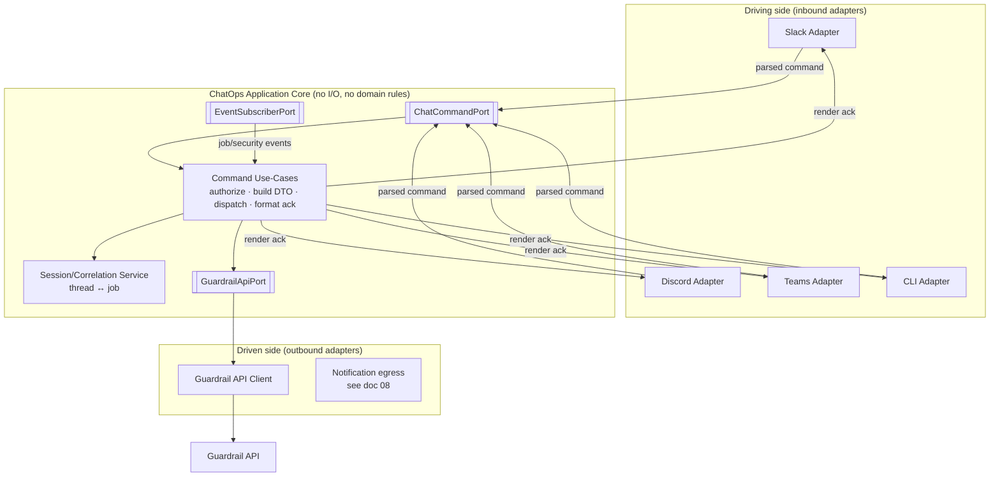
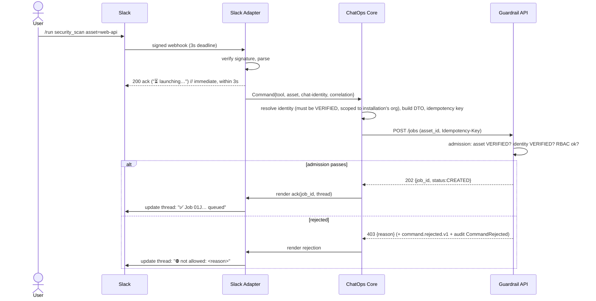

# 9. ChatOps Architecture (Hexagonal)

> Design intent. This is where the "bot has no business logic" constraint is made structural.

## 9.1 Ports & adapters view

The core in the middle depends **only** on ports (interfaces). It has no `import slack_sdk`, no `import psycopg2`, no knowledge of HTTP. That is testable in isolation and swappable at the edges — the definition of Hexagonal.

## 9.2 What each layer may and may not do

| Layer | May | May **not** |
|---|---|---|
| **Inbound adapter** (Slack/Discord/Teams/CLI) | Verify signature, parse text/interaction, extract command + args, resolve chat identity, format the reply for its surface. | Decide anything about jobs, policies, or findings. Branch on domain state. |
| **Application core** | Resolve and require a `VERIFIED` chat identity (scoped to its installation's org), delegate target + RBAC authorization to the core API at admission, validate the command *shape*, build the API DTO, manage thread↔job correlation, choose the ack/rejection template. | Run scans, interpret findings, compute regressions, decide target authorization itself, talk to a DB or a scanner directly. |
| **Outbound adapter** (API client) | Serialize the DTO, sign/auth, call the Guardrail API, translate transport errors. | Contain business rules. |

If a proposed change would put a domain `if` inside an adapter, it belongs in the core; if it would put domain logic in the ChatOps core, it belongs in Guardrail Hub proper. This mirrors the repo's existing anti-pattern rule against logic-in-routers ([`backend-layering`](../../.ai/standards/architecture/backend-layering.md)).

## 9.3 Command lifecycle (inbound)

Two acks by design: an **instant** transport ack (chat platforms demand a response in ~3s) and a **domain** ack once the API accepts. The slow path never blocks the fast one.

## 9.4 Session & correlation

Chat is stateful in the user's mind ("show me *that* job") but the core is stateless. The Session Service (backed by Redis) holds the minimal bridge:

- **Installation → org binding**, so every command from a workspace resolves only within that org's tenancy; cross-org identity resolution is impossible by construction.
- **Channel → default project** (set by `/project`), so `/run` needs no project arg.
- **Thread ↔ job_id** correlation, so a `job.completed.v1` event knows which thread to reply in, and `/status` with no arg resolves to the channel's most recent job.
- **Interaction tokens** (button clicks: "Cancel", "Retry", "View report") map back to a command use-case.

Because this state is in Redis, not in a process, any ChatOps replica handles any event — supporting the horizontal scaling in [doc 07](06-queue-and-scalability.md).

## 9.5 Outbound (event → chat) path

The reverse direction reuses the **Notification Service** ([doc 08](07-notification-architecture.md)) rather than duplicating delivery logic in ChatOps. ChatOps subscribes to events only for *interactive* concerns (updating the ack thread, resolving button interactions); broad notification routing/preferences/templating is the Notification context's job. The two share the outbound channel adapters.

## 9.6 Command design summary

Commands are **declarative specs**, not imperative handlers (handlers are out of scope per the brief). Each command declares: its name, arg schema, required RBAC permission, the API operation it maps to, and its ack template. A registry (`services/chatops/commands/registry.py`) turns that spec into a uniformly-validated, uniformly-authorized, uniformly-audited pipeline — so `/run`, `/status`, `/jobs`, `/history`, `/report`, `/project`, `/policy`, `/evaluation`, `/benchmark`, `/help` all share one execution path and differ only in data. Adding a command is adding a spec row.

Continue to [09-observability.md »](09-observability.md)
