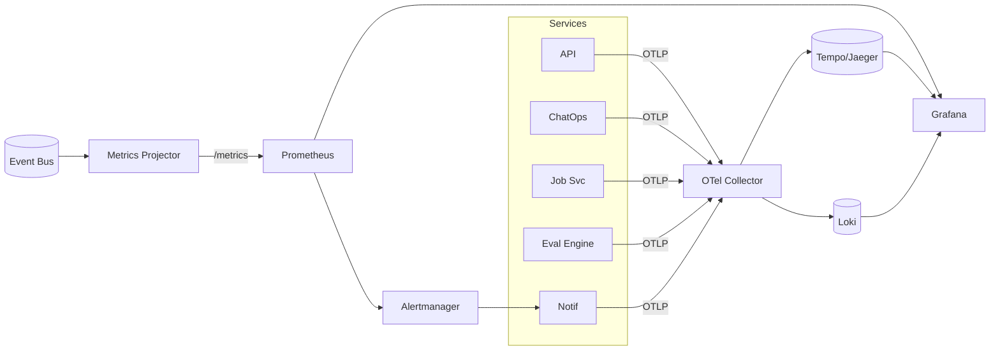

# Observability

> Design intent. The repo has no telemetry stack today; Prometheus/Grafana/OTel are named as future integrations. This is the target.

The platform treats Prometheus, Grafana, and OpenTelemetry the same way it treats Slack: as **subscribers/adapters**, not as special infrastructure baked into the core. Metrics come off the same event stream that feeds notifications, so observability data and user-facing data can never disagree.

## Three signals, one correlation id

`job_id` **is** the correlation id, and every event carries the OTel `trace_id`. A findings alert in Slack, the trace of the scan that produced it, and the log line where a stage failed all share these ids — one click pivots between them.

## Metrics (Prometheus)

Exposed by a **Metrics Projector** that consumes the event bus — so metrics are derived from the same integration events as everything else, not from ad-hoc counters sprinkled in code.

| Metric | Type | Use |
|---|---|---|
| `ghub_jobs_total{tool,status,org}` | counter | Throughput, success/fail ratio. |
| `ghub_job_duration_seconds{tool}` | histogram | SLOs, ETA model input. |
| `ghub_queue_depth{tool,priority}` | gauge | Autoscaling trigger. |
| `ghub_queue_wait_seconds{tool}` | histogram | Fairness / starvation detection. |
| `ghub_active_scans{tool}` | gauge | Concurrency vs. capacity. |
| `ghub_security_alerts_total{type,severity}` | counter | Alert volume, regression trends. |
| `ghub_notifications_total{channel,result}` | counter | Delivery health. |
| `ghub_notification_retries_total{channel}` | counter | Channel instability. |
| `ghub_command_total{command,outcome}` | counter | ChatOps usage & rejection rate. |
| `ghub_outbox_lag_seconds` | gauge | Event-publish freshness (data-integrity canary). |

## Traces (OpenTelemetry)

A single trace spans the whole flow: `slack.command` → `chatops.dispatch` → `api.create_job` → `queue.enqueue` → `worker.run(security_scan)` → `stage.spider` → `stage.active_scan` → `event.publish` → `notification.deliver`. Context propagates via the event envelope's `trace_id`, so the asynchronous worker span still joins the trace that the Slack command started — you can see, end to end, why a scan a user launched 20 minutes ago is slow.

## Logs

Structured JSON, always carrying `org_id`, `job_id`, `trace_id`, `actor_id`. Log **redaction is mandatory** — no secret or PII value is ever logged (guardrail **G1**; the repo already treats echoing a resolved secret into a log line as a G1 violation). Logs are correlation, not payload dumps.

## Alerts

Alertmanager rules feed back into the Notification Service (dogfooding the platform's own delivery): queue-wait SLO breach, worker-pool saturation, `outbox_lag` rising (events stuck → notifications silently delayed), notification channel breaker open, and any spike in `ghub_security_alerts_total{severity="critical"}`. Operational alerts route to on-call; product security alerts route to the owning team — different audiences, one delivery mechanism.

## Grafana

Dashboards per audience: an **Ops** board (queue depth, worker saturation, error budgets), a **Security posture** board (regression trends, alert volume by type — sourced only from real events, honoring **G3**), and a **Tenant** board filterable by `org_id` for support. The Grafana integration named in the brief is thus a read-only consumer of Prometheus, requiring nothing bespoke in the core.

Continue to [10-sequence-diagrams.md »](10-sequence-diagrams.md)
