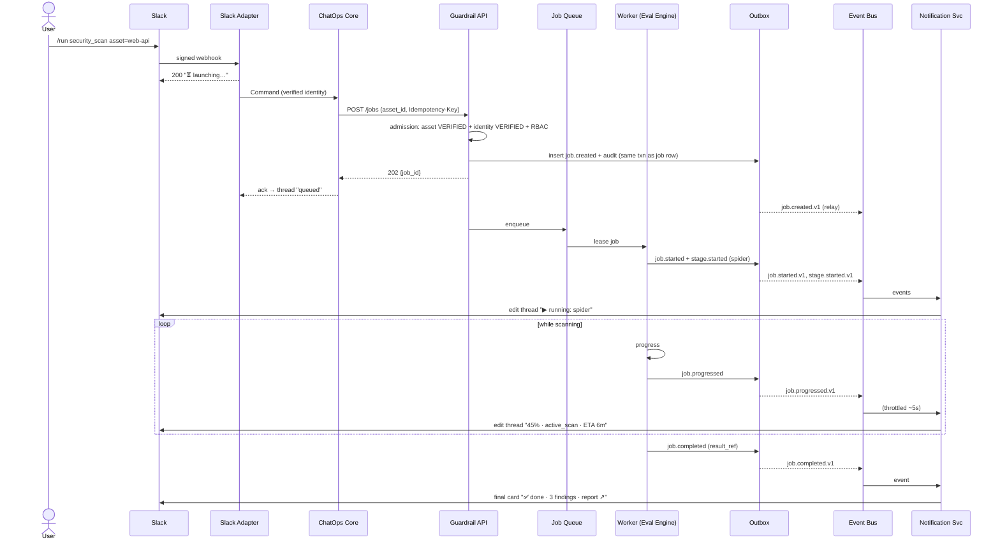
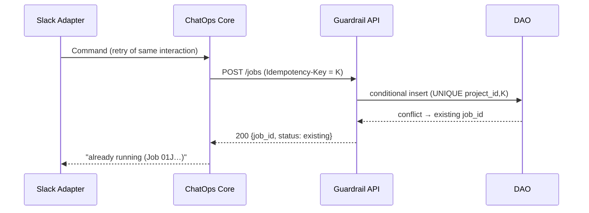
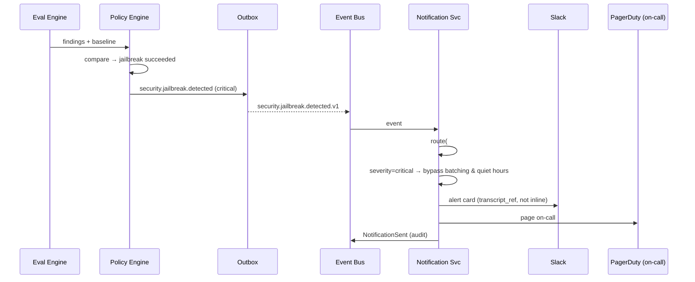
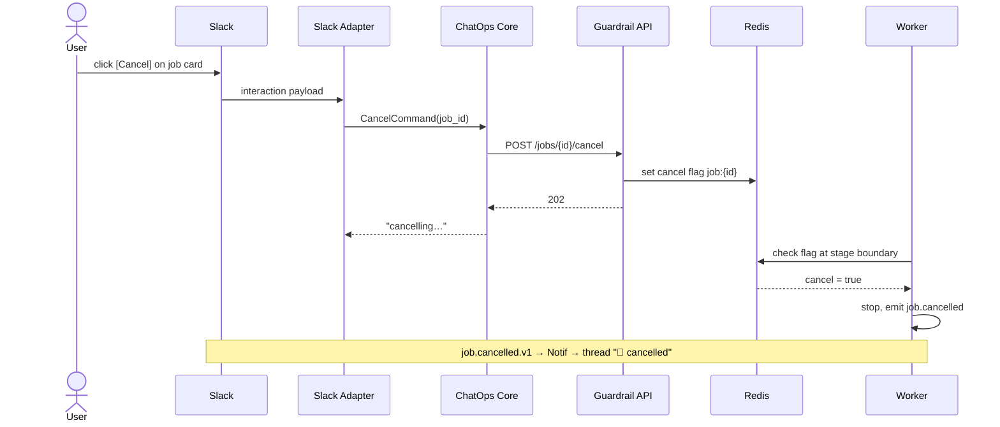
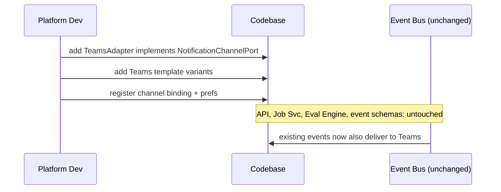
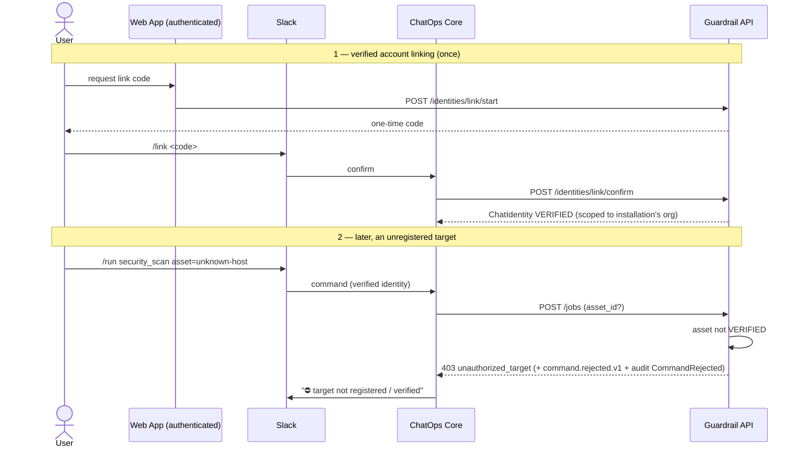

# 10. Sequence Diagrams

> Design intent. Illustrative flows for the target system.

## 10.1 End-to-end: `/run` a security scan, streamed to Slack

The canonical happy path — command in, long-running job, progress and completion out — showing why the request path and the event path are decoupled.

## 10.2 Idempotent double-submit (chat retry)

Why a double-tap or a Slack redelivery never launches two scans.

## 10.3 Security regression alert with escalation

A Policy-context judgement fanning out, with `critical` bypassing quiet hours.

## 10.4 Cancellation from chat

Cooperative cancel via a button interaction.

## 10.5 Adding a new channel (Teams) — no core change

Not a runtime flow, but the *change* flow the architecture optimizes for.

## 10.6 Verified account linking + rejected target (admission)

Closes the two identity/target Criticals. Part 1: one-time verified linking. Part 2: an unregistered target is refused at admission — an unverified identity would be refused the same way.

Continue to [11-deployment.md »](11-deployment.md)
