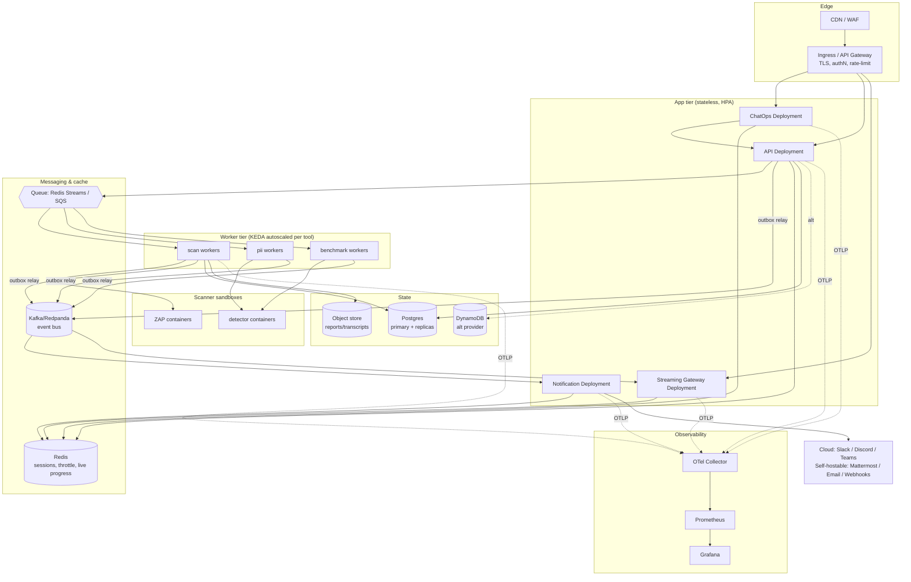

# 11. Deployment Architecture

> Design intent. Today only a local Docker Compose setup exists (one FastAPI container + ZAP + optional Postgres); there is no Kubernetes, no CI/CD ([`deployment-map.md`](../../.ai/intelligence/deployment-map.md), [`technology-stack.md`](../../.ai/intelligence/technology-stack.md)). This is the target topology and the path to it.

## 11.1 Target deployment (SaaS, Kubernetes)

## 11.2 Deployment profiles

The brief requires SaaS, Self-hosted, and Enterprise. One artifact set, three profiles via configuration — not three codebases.

| Concern | SaaS | Self-hosted | Enterprise |
|---|---|---|---|
| Orchestration | Managed K8s (EKS/GKE) | Docker Compose or small K8s (Helm chart) | Customer K8s, often air-gapped |
| Event bus | Managed Kafka | NATS JetStream or Redis Streams (lighter) | Customer's Kafka |
| DB provider | Postgres (managed) or DynamoDB | Postgres (`DATABASE_PROVIDER=POSTGRES`) | Either, customer-hosted |
| Tenancy | Full 100k-org multi-tenant | Usually single-org | Single-org, dedicated |
| Secrets | Cloud KMS/Secrets Manager | `.env` + sealed secrets | Customer vault (HashiCorp Vault) |
| Egress | Direct to Slack/Teams cloud | May require proxy allow-listing | Often restricted; webhooks/email favored |
| **Chat channels** | Cloud (Slack/Discord/Teams) + email/webhooks | Cloud if internet, else self-hosted | **Self-hostable only:** Mattermost/Rocket.Chat/Matrix + internal SMTP + webhooks. Cloud chat is unavailable air-gapped (no egress). |

The pluggable DAO (`DATABASE_PROVIDER`) and port-based adapters are exactly what make one codebase serve all three — the same property the current ZAP-only build already demonstrates for persistence.

> **Air-gapped channel strategy (review-board Critical).** Slack, Teams, and Discord are cloud services and cannot function without egress, so listing them for the air-gapped profile was incorrect. Air-gapped ships a **self-hostable** channel (Mattermost/Matrix) plus internal SMTP and webhooks. Because every channel implements one `NotificationChannelPort` ([notification §8.9](07-notification-architecture.md#89-channel-classes-deployment-aware--added-for-air-gapped)), this is a profile/configuration choice, not a code fork — the original "one artifact, many profiles" vision is preserved, just made honest about which channels each profile can actually run.

## 11.3 Scaling & resilience posture

- **Stateless app tier** → HPA on CPU + custom queue-lag metrics.
- **Worker tier** → KEDA scalers on per-tool queue depth; scale-to-zero for rarely-used tools.
- **Scanner sandboxes** → one container per scan (the ZAP model), resource-capped, network-egress-restricted to authorized targets (guardrail **G4** — no scanning unauthorized hosts).
- **Multi-AZ** for stateful stores; Kafka/Postgres with replicas; Redis in HA mode.
- **Zero-downtime deploys** → rolling updates; consumers are versioned so an old and new Notification replica can process the same `.v1` events during rollout.

## 11.4 Path from today to target (evolutionary, not big-bang)

1. **Now:** single FastAPI container + ZAP + Postgres (Compose). *Exists.*
2. **Introduce the spine:** add the outbox table + a Redis Streams queue + a worker process, still in Compose. Generalize the ZAP execution path into the worker/tool model.
3. **Add the bus + one adapter:** stand up NATS/Kafka, ship the Slack inbound+outbound adapter and Notification Service. First real ChatOps loop.
4. **Add contexts & channels:** Job/Policy contexts harden; Discord/Teams/Email/Webhook adapters register against existing ports.
5. **Scale-out:** move to K8s + Helm, per-tool worker pools, managed bus, observability stack. Add CI/CD (absent today).

Each step is shippable and reversible; nothing requires the whole target to exist first.

Continue to [12-folder-structure.md »](12-folder-structure.md)
