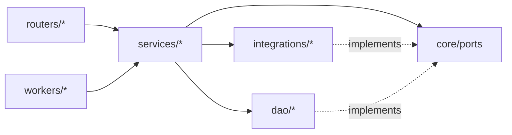

# 12. Folder Structure

> Design intent. Extends the **existing** `mcp-server/app/` layout and obeys [`backend-layering`](../../.ai/standards/architecture/backend-layering.md): organize by architectural role (R1), sub-partition by audience/tool (R2), a new tool follows the ZAP layout exactly (R3), dependency direction `routers → services → integrations|dao` (R4). The ChatOps platform is **not** a new top-level role — it slots into the established buckets.

## 12.1 Backend — inside the existing `mcp-server/app/`

```
mcp-server/app/
├── core/                          # shared base (existing)
│   ├── config.py                  # pydantic-settings; adds CHATOPS_*, BUS_*, QUEUE_*
│   ├── events/                    # NEW: event envelope, ports, publisher/subscriber
│   │   ├── envelope.py
│   │   ├── ports.py               # EventPublisherPort, EventSubscriberPort
│   │   └── catalog.py             # integration-event type registry (.v1)
│   └── ports/                     # NEW: hexagonal port interfaces
│       ├── chat_command_port.py
│       ├── notification_channel_port.py
│       ├── guardrail_api_port.py
│       └── job_queue_port.py
│
├── routers/
│   ├── mcp/                       # existing: owasp_zap_router.py, …
│   │   └── <tool>_router.py       # one per Evaluation tool (ZAP layout)
│   ├── public/
│   │   ├── chatops/               # NEW: inbound provider webhooks (thin)
│   │   │   ├── slack_router.py
│   │   │   ├── discord_router.py
│   │   │   └── teams_router.py
│   │   ├── jobs_router.py         # NEW: POST/GET jobs, cancel, retry
│   │   ├── assets_router.py       # NEW: register/verify assets; identity linking
│   │   ├── history_router.py      # existing, generalized
│   │   └── stream/
│   │       └── sse_router.py      # NEW: progress SSE
│   └── internal/
│       └── health_router.py
│
├── services/
│   ├── chatops/                   # NEW: application core (NO domain logic)
│   │   ├── commands/              # one declarative spec per command
│   │   │   ├── registry.py
│   │   │   ├── run.py  status.py  jobs.py  history.py  report.py
│   │   │   └── project.py policy.py evaluation.py benchmark.py help.py
│   │   ├── session_service.py     # thread↔job, channel↔project (Redis)
│   │   └── acl.py                 # chat identity → Actor (anti-corruption)
│   ├── notification/              # NEW: routing, prefs, throttle, batch, retry, render
│   │   ├── router.py  preferences.py  throttler.py  batcher.py
│   │   ├── retry.py  templates/
│   │   └── adapters/              # channel adapters (implement NotificationChannelPort)
│   │       ├── slack_adapter.py  discord_adapter.py  teams_adapter.py     # cloud channels
│   │       ├── mattermost_adapter.py                                       # self-hostable (air-gapped)
│   │       ├── email_adapter.py  webhook_adapter.py
│   ├── jobs/                      # NEW: Job orchestration (lifecycle, dispatch)
│   │   ├── job_service.py  dispatcher.py  cancellation.py
│   ├── assets/                    # NEW: asset registry + ownership verification (target admission)
│   │   ├── asset_service.py  ownership_verification.py
│   ├── identity/                  # NEW: verified chat-identity linking (installation scoping)
│   │   ├── linking_service.py
│   └── tools/                     # existing convention: services/tools/<tool>/
│       ├── owasp_zap/             # existing reference
│       ├── pii_detection/         # NEW tool slices, same shape
│       ├── jailbreak_detection/
│       └── ...                    # one per Evaluation tool
│
├── integrations/                  # driven adapters to external systems
│   ├── owasp_zap/                 # existing reference
│   ├── <tool>/                    # NEW per-tool clients (ZAP layout)
│   ├── bus/                       # NEW: kafka/nats/redis-streams publisher-subscriber
│   ├── queue/                     # NEW: redis-streams / sqs queue adapter
│   └── chat/                      # NEW: slack/discord/teams/mattermost SDK clients (egress)
│
├── dao/                           # existing: no ORM, provider-pluggable
│   ├── jobs_dao.py                # NEW
│   ├── audit_dao.py               # NEW (append-only + per-tenant seq, single-writer)
│   ├── outbox_dao.py              # NEW
│   ├── assets_dao.py  installations_dao.py   # NEW (target authz + identity scoping)
│   ├── prefs_dao.py  actors_dao.py# NEW
│   └── providers/                 # postgres/ + dynamodb/ impls (existing pattern)
│
├── schemas/
│   ├── tools/<tool>/              # existing convention
│   └── chatops/                   # NEW: command DTOs, event payloads, ack models
│
├── workers/                       # NEW: standalone worker entrypoints
│   ├── worker_main.py             # generic; runs one tool slice
│   └── projector_main.py          # CQRS read-model + metrics projector
│
├── constants/                     # existing: per-tool constants
└── helpers/                       # existing
```

## 12.2 What is deliberately *not* here

- **No `chatbot/` top-level role.** ChatOps is `services/chatops` + `routers/public/chatops` + `integrations/chat` — spread across existing roles, because a bot is not a new architectural layer. Inventing a new top-level folder would violate `backend-layering` (a new role is a Decision-level change).
- **No business logic under `routers/` or `services/chatops`.** Domain decisions live in `services/jobs`, `services/tools/*`, `services/assets` (target authorization), and the Policy context — never in the adapter path.
- **No `slack_sdk` import inside `services/`.** SDKs live only in `integrations/chat/`; services depend on ports.

## 12.3 Dependency direction (unchanged rule, wider graph)



Lower layers never import higher ones; adapters (`integrations`, `dao`) implement the ports the core defines. This is `backend-layering` R4 applied to the enlarged system verbatim — including the new `assets`/`identity` services and the `mattermost` adapter, which introduce no new architectural role.

Continue to [13-extensions-tech-risks.md »](13-extensions-tech-risks.md)
