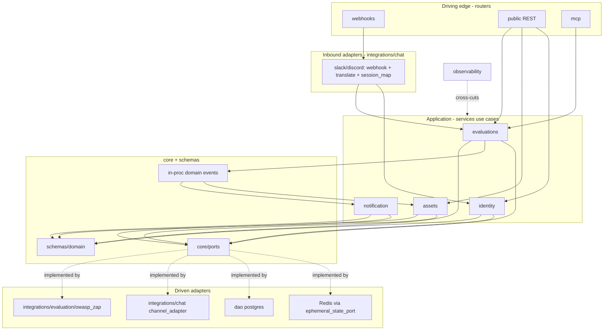

# MVP Folder-Structure & Ownership Refactor

> **Refactor only.** This changes *where code lives and who owns what* — not the architecture, features, behavior, or (except one router-file move with unchanged paths) the APIs. It refines the folder view in [MVP-SCOPE §2](MVP-SCOPE.md#2-folder-structure) to better express Hexagonal + DDD + Evolutionary Architecture. The North Star ([README](README.md) + docs 01–14) is unchanged. No new service, pattern, or technology is introduced. **No implementation code.**

> **Reconciliation note (2026-07-07):** Per approved direction, the **current `mcp-server/app/` code is the source of truth**. Where this spec diverges from the real codebase, [MVP-FOUNDATION-RECONCILIATION.md](MVP-FOUNDATION-RECONCILIATION.md) governs. Key corrections: config is the existing **`core/config/` mixin package** (not a `config.py`); persistence ports are the existing **`dao/base.py` ABC + factory** (not `core/ports/repository_ports.py`); the **DynamoDB provider is retained** (working code, not removed). No working module is moved or renamed as part of the MVP foundation.

Owner: Loi Phan · Date: 2026-07-07 · Stage: MVP / Foundation · Style: Modular Monolith

Infrastructure unchanged: PostgreSQL · Redis · in-process Domain Events · Notification Service · Prometheus · Grafana. Deferred (unchanged): Kafka, NATS, CQRS, Event Sourcing, Distributed Workers, Microservices, WORM audit, Enterprise Compliance, Multi-region, Air-gapped.

---

## 1. Revised folder tree

Single deployable (`mcp-server/app/`). Top-level roles are the existing backend-layering roles ([`backend-layering`](../../.ai/standards/architecture/backend-layering.md)) plus one user-requested `observability/` module — **no new architectural role**.

```
mcp-server/app/
├── core/                              # shared kernel — no SDKs, no SQL, no HTTP
│   ├── config/                        # EXISTING pydantic-settings mixin package (keep; extend via mixins) — NOT a single config.py
│   ├── events/                        # IN-PROCESS domain events (no broker)
│   │   ├── dispatcher.py              # in-memory pub/sub (EventPublisher/SubscriberPort impl)
│   │   └── catalog.py                 # domain/integration event types (.v1), used in-process
│   └── ports/                         # HEXAGONAL PORTS (interfaces = the contracts)
│       ├── notification_channel_port.py   # outbound: deliver a notification
│       ├── event_publisher_port.py        # outbound: publish a domain event
│       ├── scanner_port.py                # outbound: execute an evaluation (ZAP behind it)
│       ├── chat_gateway_port.py           # outbound: send to chat + session-map contract
│       ├── ephemeral_state_port.py        # outbound: sessions/idempotency/throttle/cancel (Redis)
│       └── repository_ports.py            # outbound: Jobs/Audit/Assets/Installations/Prefs/Actors
│
├── schemas/                           # domain model + DTOs (the ubiquitous language)
│   ├── domain/                        # Job, Evaluation, Asset, Actor, ChatIdentity, Installation, AuditEvent, enums
│   ├── evaluations/                   # evaluation request/result DTOs (generalized from tools/owasp_zap)
│   └── chatops/                       # application command DTOs, event payloads, ack models
│
├── services/                          # APPLICATION LAYER — use cases ONLY (no SDKs, no SQL, no HTTP)
│   ├── evaluations/                   # Evaluation domain (was "tools")
│   │   ├── evaluation_service.py      # use case: request + validate an evaluation (calls admission)
│   │   ├── execution_service.py       # job lifecycle + in-process execution (drives scanner_port)
│   │   └── report_service.py          # produce / authorize a report
│   ├── identity/                      # Identity domain (now owns authorization)
│   │   ├── acl.py                     # actor mapping + permission evaluation (moved from chatops)
│   │   └── linking_service.py         # chat-identity linking / verification
│   ├── assets/                        # Asset Registry domain
│   │   ├── asset_service.py
│   │   └── ownership_verification.py
│   └── notification/                  # Notification application service — DECIDES, does NOT deliver
│       ├── notification_service.py    # what happened · who receives · which notification type
│       └── preferences.py             # recipient + preference resolution
│
├── integrations/                      # INFRASTRUCTURE ADAPTERS (all vendor/tech specifics)
│   ├── chat/
│   │   ├── session_map.py             # (provider,channel,thread) <-> (project,job) via ephemeral_state_port
│   │   ├── slack/                     # ONE cohesive Slack integration (future-extractable unit)
│   │   │   ├── webhook_handler.py     # signature verify + parse (inbound)
│   │   │   ├── command_translator.py  # slash command -> application command DTO
│   │   │   ├── sdk_client.py          # Slack SDK egress
│   │   │   └── channel_adapter.py     # implements notification_channel_port (delivery + rendering)
│   │   └── discord/                   # optional; identical shape
│   └── evaluation/
│       └── owasp_zap/                 # ZAP client implements scanner_port (an IMPLEMENTATION DETAIL)
│
├── dao/                               # PERSISTENCE — PostgreSQL only (YAGNI); implements repository_ports
│   ├── jobs_dao.py  audit_dao.py  assets_dao.py
│   ├── installations_dao.py  prefs_dao.py  actors_dao.py
│   └── outbox_dao.py                  # optional at-least-once notification durability (table + in-proc relay)
│
├── observability/                     # cross-cutting (metrics implemented; others placeholders)
│   ├── metrics.py                     # IMPLEMENTED
│   ├── logging.py                     # placeholder (future)
│   ├── health.py                      # placeholder (future consolidation; readiness stub today)
│   └── tracing.py                     # placeholder (future)
│
├── routers/                           # HTTP EDGE — thin driving entrypoints
│   ├── webhooks/                      # third-party platform callbacks (was public/chatops)
│   │   ├── slack_router.py            # POST /webhooks/slack  -> integrations/chat/slack
│   │   └── discord_router.py          # optional
│   ├── public/                        # our REST API
│   │   ├── jobs_router.py
│   │   └── assets_router.py           # assets + identity-linking endpoints
│   ├── mcp/
│   │   └── evaluation_router.py       # run_security_scan / get_job_status (was owasp_zap_router)
│   └── internal/
│       ├── health_router.py
│       └── metrics_router.py
│
├── constants/
└── helpers/
```

**Removed from the filesystem** (recorded in roadmap/ADR instead): `workers/`, `routers/public/stream/`, any `projectors/`, and `dao/providers/dynamodb/`.

---

## 2. Responsibility table (every top-level module)

| Module | Owns (responsibility) | Must NOT contain | May depend on |
|---|---|---|---|
| **core/** | Config, in-process event dispatcher, and the **ports** (interfaces) that define every boundary. The stable center. | Any SDK, SQL, HTTP, or vendor name. | nothing (pure) |
| **schemas/** | The domain model + DTOs — the ubiquitous language (Job, Evaluation, Asset, Actor, ChatIdentity, AuditEvent). | Behavior that talks to infrastructure; Slack/ZAP/SQL types. | core |
| **services/** | **Application use cases** only: Evaluation, Identity, Assets, Notification-decisioning. Pure orchestration of the domain via ports. | Slack/Discord SDKs, ZAP client, SQL, HTTP, rendering. | core (ports/events), schemas |
| **integrations/** | All infrastructure adapters: chat (webhook, slash translation, session map, SDK egress, **delivery**), evaluation execution (ZAP). Implements outbound ports. | Business decisions / domain rules. | core (ports), schemas (DTOs) |
| **dao/** | PostgreSQL persistence implementing the repository ports. | Business logic; any non-Postgres provider (YAGNI). | core (ports), schemas |
| **observability/** | Cross-cutting metrics (impl), plus placeholders for logging/health/tracing. | Business logic. | core |
| **routers/** | Thin HTTP edge: `webhooks/` (3rd-party callbacks), `public/` (our REST), `mcp/` (tools), `internal/` (ops). Binds requests to adapters/use cases. | Business logic; vendor parsing (that lives in integrations/chat). | services, integrations |
| **constants/ · helpers/** | Shared constants and pure helpers. | Stateful or domain logic. | core |

Golden rule made structural: **`services/` and `schemas/` never import from `integrations/`, `dao/`, or any SDK.** They depend only on `core/ports`. Adapters implement those ports. That is Hexagonal, enforced by folder boundary.

---

## 3. Dependency flow diagram



Arrows only point **inward** to the domain/ports; every vendor adapter sits on the outside implementing a port. No arrow runs from `services` to `integrations`.

---

## 4. Folder migration summary

| Before (MVP-SCOPE §2) | After | Action | Rule |
|---|---|---|---|
| `services/chatops/session_service.py` | `integrations/chat/session_map.py` | Move | #1 (chat mapping is infra) |
| `services/chatops/commands/*` | `services/{evaluations,identity,assets}` use cases + `integrations/chat/slack/command_translator.py` | Split | #1 (translation→infra, use cases→services) |
| `services/chatops/acl.py` | `services/identity/acl.py` | Move | #4 |
| `services/tools/owasp_zap/` (app logic) | `services/evaluations/{evaluation,execution,report}_service.py` | Rename + generalize | #3 |
| `integrations/owasp_zap/` (client) | `integrations/evaluation/owasp_zap/` | Move | #3 (ZAP is impl detail) |
| `services/notification/adapters/{slack,discord}_adapter.py` | `integrations/chat/{slack,discord}/channel_adapter.py` | Move | #2 (delivery→integrations) |
| `services/notification/{templates,throttler,retry}` | rendering→adapters; policy stays in `notification_service.py`/`preferences.py`; throttle store via `ephemeral_state_port` | Split | #2 |
| `services/jobs/{job_service,runner,cancellation}` | `services/evaluations/execution_service.py` (+ cancel via `ephemeral_state_port`) | Merge | #3 (Job aggregate stays in `schemas/domain`) |
| `routers/public/chatops/{slack,discord}_router.py` | `routers/webhooks/{slack,discord}_router.py` | Move | #8 (paths unchanged) |
| `routers/mcp/owasp_zap_router.py` | `routers/mcp/evaluation_router.py` | Rename | #3 (tool names unchanged) |
| `observability/metrics.py` (only) | `observability/{metrics,logging,health,tracing}.py` | Expand | #5 |
| `dao/providers/{postgres,dynamodb}/` | `dao/*.py` (Postgres only) | Remove DynamoDB | #7 → ADR Evolution Points |
| `workers/`, `routers/public/stream/`, projector | *(deleted)* | Remove | #6 → roadmap/ADR |

**No path/API changed:** `/webhooks/slack`, `/webhooks/discord`, `/v1/...`, `/mcp` tools, `/metrics`, `/healthz` keep their existing URIs and tool names — only the files that serve them moved. (#8 was a file move, not an API change.)

---

## 5. Explanation of every structural change

**#1 Chat integrations → `integrations/`.** Slack and Discord are infrastructure, not domains. Webhook verification, slash-command translation, session mapping, and SDK calls now live in `integrations/chat/`; the application layer receives a channel-agnostic command DTO and never imports a chat SDK. This is the single biggest hexagonal correction: business logic no longer depends on Slack/Discord.

**#2 Notification decides, adapters deliver.** `notification_service.py` answers *what happened / who receives / which type* and publishes a notification intent through `notification_channel_port`. Channel-native rendering and delivery move into each chat integration's `channel_adapter.py`. Adding Email/Teams later is a new adapter implementing the same port — the Notification Service is untouched, exactly the target ownership chain requested.

**#3 "tools" → Evaluation domain.** The business domain is *Evaluation*; OWASP ZAP is one implementation. `services/evaluations/` (evaluation/execution/report) holds the tech-agnostic use cases behind `scanner_port`; ZAP is a driven adapter in `integrations/evaluation/owasp_zap/`. Future Semgrep/Trivy/Nuclei/CodeQL become **additional integrations** implementing the same port — not new business domains. The Job aggregate remains the tracked entity (in `schemas/domain`), managed by `execution_service`.

**#4 Identity owns authorization.** ACL moves from the (now-dissolved) chatops service into `services/identity/`, joining chat-identity linking and permission evaluation. Identity becomes the single owner of actor mapping, linking, and authZ — cohesive and independently reasoned.

**#5 Observability module.** A dedicated `observability/` module hosts `metrics.py` (implemented) with `logging.py`, `health.py`, `tracing.py` as thin placeholders for near-term evolution. This is preparation only — no new telemetry technology is added (still Prometheus/Grafana).

**#6 Deferred folders removed.** `workers/`, `stream/`, and `projectors/` were placeholders for deferred North Star components. Empty folders are noise and imply intent that doesn't exist yet; the deferral is already recorded in [EVOLUTION-PLAN](EVOLUTION-PLAN.md) and ADR-0004. Removed from the filesystem.

**#7 DAO providers → Postgres only (YAGNI).** Only PostgreSQL is used at MVP, so the DynamoDB provider folder is removed. The *seam* survives as `repository_ports` — a second provider is a future additive implementation, recorded in [ADR-0004 Evolution Points](../../.ai/decisions/0004-chatops-platform-architecture.md#evolution-points-mvp-scoping).

**#8 Router semantics.** Third-party callbacks move to `routers/webhooks/`, clearly distinct from our own `routers/public/` REST API, with `routers/mcp/` and `routers/internal/` unchanged. Improves readability of who-calls-what; URIs are identical.

**#9 Evolutionary preservation.** Each future extraction target is now a cohesive folder behind a port: a whole Slack integration (`integrations/chat/slack/`, inbound + outbound in one place), Discord likewise, the Notification Service (`services/notification/`), and the Evaluation Service (`services/evaluations/` + `scanner_port`). Extracting any of them into a separate process later means moving one folder and swapping the in-process port binding for a remote one — no restructuring, no domain rewrite.

---

## 6. Architecture confirmation

**Still a Modular Monolith.** One deployable process, one `docker compose up`. Domain events remain **in-process**; jobs still run **in-process**; no service was split out, no broker or queue technology added.

**Still (more strongly) Hexagonal.** The domain (`schemas/`) and application (`services/`) depend only on `core/ports`. Every vendor concern — Slack, Discord, ZAP, PostgreSQL, Redis — is a driven adapter implementing a port on the outside. Business logic now has **zero** dependency on any chat SDK or scanner, which was the primary goal.

**Still Evolutionary.** Boundaries are drawn exactly where future extraction will cut (Slack Integration, Discord Integration, Notification Service, Evaluation Service). Each is extractable behind an existing port without major restructuring, so the monolith can become services later with no redesign.

**No added complexity — net simpler.** No new architectural role (the only new folder, `observability/`, was explicitly requested and holds cross-cutting concerns, not a service). No new pattern. No new technology (still PostgreSQL, Redis, in-process events, Prometheus, Grafana). The filesystem got **smaller**: four placeholder/inactive trees removed (`workers/`, `stream/`, `projectors/`, `dao/providers/dynamodb/`). Product features, business behavior, and API URIs are unchanged.

*This refactor improves separation of concerns and future evolution while keeping the MVP simple. It does not alter the North Star.*
