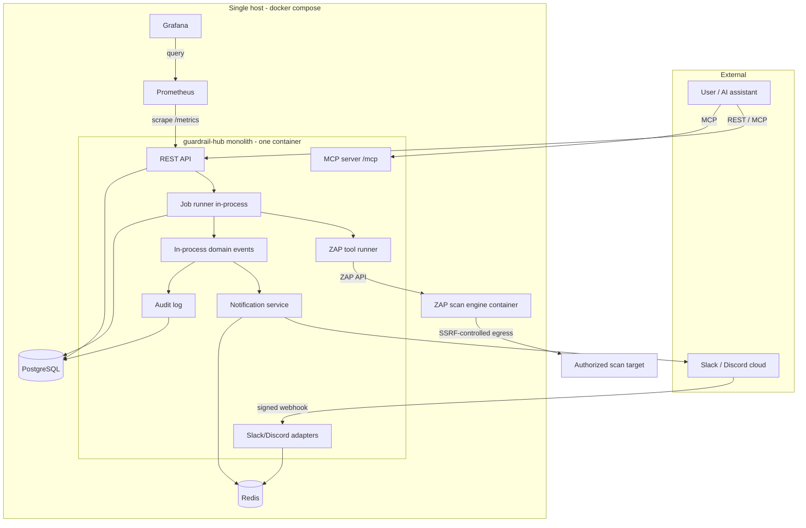
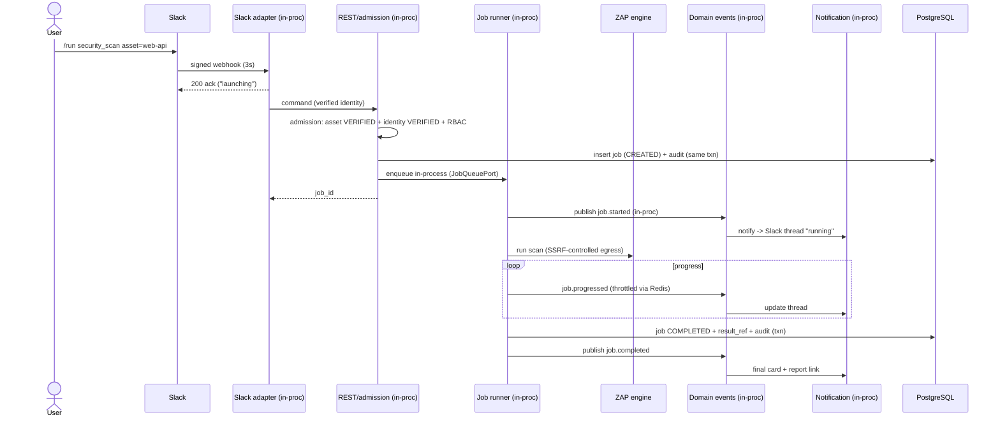
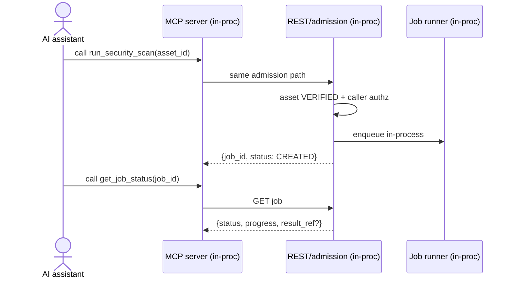
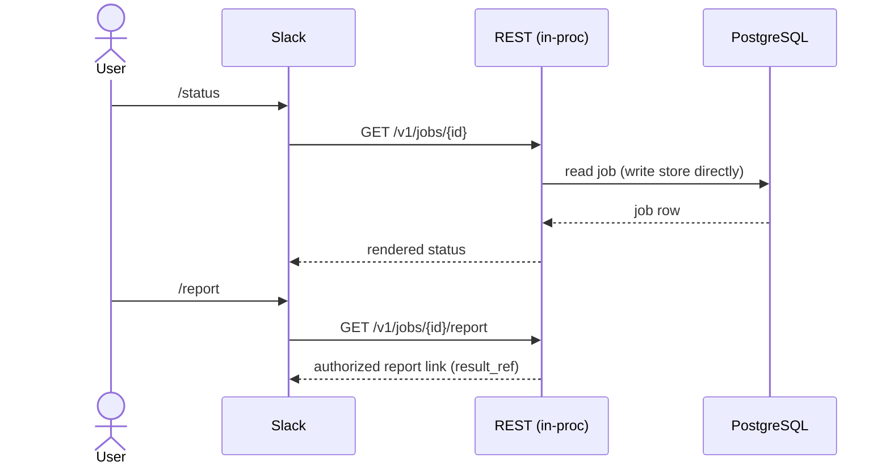

# Guardrail Hub — MVP Implementation Scope (Stage 1 · Foundation)

> Derived from [EVOLUTION-PLAN.md](EVOLUTION-PLAN.md) Stage 1, within the approved North Star. This defines the **first public release** only. It phases existing North Star components; it introduces no new service, context, or pattern. **No implementation code** is generated here.

Owner: Loi Phan · Date: 2026-07-07

## Shape of the MVP

**One deployable process — a modular monolith.** REST API, MCP server, chat adapters, in-process domain events, the job/evaluation runner, the notification service, and the audit log all live inside a single application (`mcp-server/app/`, the existing FastAPI app). Modules are separated by responsibility and talk through the North Star ports, so a later stage can extract workers or a broker **without redesign** — but at MVP nothing is distributed.

Concretely for the MVP:
- **Domain events are in-process** — an in-memory dispatcher implementing the existing `EventPublisher/SubscriberPort`. No Kafka, no NATS.
- **Jobs run in-process** — a background-task runner implementing `JobQueuePort` (DB/in-memory backed). No distributed workers, no external queue service.
- **Reads hit PostgreSQL directly** — no CQRS projections, no event sourcing.
- **One database** — PostgreSQL only (`DATABASE_PROVIDER=POSTGRES`); the DynamoDB provider stays dormant.
- The **ZAP container** is the scan *engine* the monolith calls over ZAP's API — a tool dependency, **not** a distributed worker of our app.

---

## 1. Component list

### In-process modules (inside the single monolith)

| Component | Role in MVP | Tech / port | Notes |
|---|---|---|---|
| **REST API** | Command + query surface (jobs, assets, identity, health, metrics) | FastAPI (existing app) | Synchronous admission; async job execution |
| **MCP Server** | Exposes scan tools to AI assistants | `fastapi-mcp` `/mcp` mount (existing) | MVP tools: `run_security_scan`, `get_job_status` |
| **Slack Adapter (inbound + outbound)** | Slash commands in; notifications out | `integrations/chat/slack` + `NotificationChannelPort` | Reference channel |
| **Discord Adapter** *(optional)* | Same, second channel | `integrations/chat/discord` | Optional; additive behind the same ports |
| **Internal Domain Events** | Decouple job lifecycle → notification/audit | In-process dispatcher (`core/events`) | In-memory; optional Postgres **outbox table** for at-least-once notification durability across restart (a table + in-process relay, **not** a broker) |
| **Job runner (Job Service)** | Job lifecycle + in-process execution + cancellation | `services/jobs` (`JobQueuePort`) | Background tasks; not a separate worker service |
| **Evaluation / tool runner** | Runs the ZAP scan slice | `services/tools/owasp_zap` + `integrations/owasp_zap` | The one built path, generalized |
| **Notification Service** | Route → template → deliver, with throttle/retry | `services/notification` | In-process; severity routing + progress throttling |
| **Audit Log** | Immutable, transactional, per-tenant hash chain | `services/audit` + `dao/audit_dao` | Tamper-evident (WORM/anchoring deferred to Stage 4) |
| **Security baseline** *(cross-cutting — see §1.1)* | SSRF egress control, target/asset authorization, verified identity, secret hygiene | admission in REST/MCP path + `services/assets`,`services/identity` | Modules/tables, **not** new services |

### Infrastructure (sidecars in one Docker Compose)

| Component | Role | Notes |
|---|---|---|
| **PostgreSQL** | System of record (jobs, audit, outbox, assets, installations, prefs, actors) | Only DB in MVP |
| **Redis** | Sessions, idempotency dedup, throttle buckets, live progress, cancel flag | Single instance (HA deferred to Stage 3) |
| **ZAP container** | The DAST scan engine the app drives | Exists today |
| **Prometheus** | Scrapes `/metrics` | Metrics derived from domain events + runtime |
| **Grafana** | Dashboards over Prometheus | Ops + job/notification views |

### 1.1 Security baseline (in-scope call-out)

Not in your named component list, but included as **cross-cutting controls (not new services)** because they are the approved **Tier-A / MVP** items in [SECURITY-PRIORITIZATION](SECURITY-PRIORITIZATION.md) and are non-negotiable for an internet-exposed scanner:

- **SSRF egress control** on the scan path (block RFC1918 / link-local / cloud-metadata `169.254.169.254`, no redirect-follow) — SEC-C1 Tier A.
- **Target authorization** — a job may only reference a registered, ownership-`VERIFIED` **Asset** (admission gate).
- **Verified chat identity** — a Slack/Discord user must complete one-time linking (`Installation`→org) before issuing commands.
- **Secret hygiene** — tokens encrypted at rest, none in source (guardrail G1). The *multi-tenant token store at scale* (SEC-C2) is deferred to Stage 2.

> These are implemented as admission logic + Postgres tables inside the monolith, consistent with "no new services." If you want them out of the MVP cut, say so explicitly — but the board's guidance is that C1 in particular is MVP-blocking.

### Explicitly excluded from the MVP build

Kafka · NATS · CQRS · Event Sourcing · Distributed Workers · Multi-region · Air-gapped · Enterprise Compliance (WORM/anchoring, FIPS/HSM, dual-control, data-classification, residency) · DynamoDB provider · Streaming Gateway (SSE) · per-tool worker pools/autoscaling · CQRS projectors.

---

## 2. Folder structure (modular monolith)

Extends the existing `mcp-server/app/` layout ([12-folder-structure](12-folder-structure.md)), **trimmed to MVP**. Deferred dirs are shown for continuity, marked `— DEFERRED`.

```
mcp-server/app/
├── core/
│   ├── config/                       # EXISTING pydantic-settings mixin package (keep) — see MVP-FOUNDATION-RECONCILIATION.md
│   ├── events/                       # IN-PROCESS domain events (no broker)
│   │   ├── dispatcher.py             # in-memory pub/sub implementing EventPublisher/SubscriberPort
│   │   └── catalog.py                # integration-event types (.v1), used in-process
│   └── ports/                        # hexagonal ports (unchanged from North Star)
│       ├── event_ports.py  job_queue_port.py
│       ├── notification_channel_port.py  guardrail_api_port.py
│
├── routers/
│   ├── mcp/
│   │   └── owasp_zap_router.py       # existing: run_security_scan, get_job_status over /mcp
│   ├── public/
│   │   ├── jobs_router.py            # create/get/list/cancel/report
│   │   ├── assets_router.py          # register/verify assets; identity linking
│   │   └── chatops/
│   │       ├── slack_router.py       # POST /webhooks/slack
│   │       └── discord_router.py     # optional
│   └── internal/
│       ├── health_router.py          # /healthz /readyz
│       └── metrics_router.py         # /metrics (Prometheus)
│
├── services/
│   ├── chatops/
│   │   ├── commands/                 # /run /status /jobs /report /help /link (declarative specs)
│   │   ├── session_service.py        # thread↔job, channel↔project (Redis)
│   │   └── acl.py                    # verified chat-identity → Actor
│   ├── jobs/
│   │   ├── job_service.py            # lifecycle + admission call
│   │   ├── runner.py                 # IN-PROCESS background execution (JobQueuePort impl)
│   │   └── cancellation.py           # cooperative cancel via Redis flag
│   ├── assets/
│   │   ├── asset_service.py  ownership_verification.py
│   ├── identity/
│   │   └── linking_service.py
│   ├── notification/
│   │   ├── router.py  templates/  throttler.py  retry.py
│   │   └── adapters/
│   │       ├── slack_adapter.py
│   │       └── discord_adapter.py    # optional
│   ├── audit/
│   │   └── audit_service.py          # transactional append + per-tenant hash chain
│   └── tools/
│       └── owasp_zap/                # the one evaluation slice (existing)
│
├── integrations/
│   ├── owasp_zap/                    # ZAP API client (existing)
│   └── chat/
│       ├── slack/                    # Slack SDK egress
│       └── discord/                  # optional
│
├── dao/                              # Postgres only in MVP
│   ├── jobs_dao.py  audit_dao.py  outbox_dao.py
│   ├── assets_dao.py  installations_dao.py
│   ├── prefs_dao.py  actors_dao.py
│   └── providers/
│       ├── postgres/                 # active
│       └── dynamodb/                 # — DEFERRED (present, dormant)
│
├── schemas/
│   ├── tools/owasp_zap/
│   └── chatops/                      # command DTOs, event payloads, ack models
│
├── observability/
│   └── metrics.py                    # counters/histograms exposed at /metrics
│
├── constants/   helpers/
│
├── workers/                          # — DEFERRED (Stage 3): jobs run in-process at MVP
├── routers/public/stream/            # — DEFERRED (Stage 2): SSE streaming gateway
└── (no projector_main.py)            # — DEFERRED: no CQRS in MVP
```

Deployment artifact: a single `docker-compose.yml` (app + postgres + redis + zap + prometheus + grafana).

---

## 3. Deployment diagram

One host, one Compose file. The monolith is a single container; everything else is a supporting service.



---

## 4. Sequence diagrams

All flows are **in-process** — events and job execution happen inside the one monolith; no broker, no worker service.

### 4.1 Launch a scan from Slack (happy path)



### 4.2 Launch a scan via MCP (AI assistant)



### 4.3 Query status / report (read path — no CQRS)



---

## 5. API surface

### REST (`/v1`) — command + query

| Method | Path | Purpose |
|---|---|---|
| POST | `/v1/projects/{pid}/jobs` | Create job (`asset_id`, `Idempotency-Key`) → `202 {job_id}`; `403` on failed admission |
| GET | `/v1/jobs/{id}` | Job state (status, progress, stage, result_ref) |
| GET | `/v1/projects/{pid}/jobs` | List jobs (simple `?status=&limit=&page=`) |
| POST | `/v1/jobs/{id}/cancel` | Cooperative cancel |
| GET | `/v1/jobs/{id}/report` | Authorized report link (`result_ref`) |
| GET | `/v1/projects/{pid}/assets` | List registered assets |
| POST | `/v1/projects/{pid}/assets` | Register asset (PENDING) |
| POST | `/v1/assets/{id}/verify` | Submit ownership proof → VERIFIED |
| POST | `/v1/identities/link/start` | Issue one-time link code (authenticated web app) |
| POST | `/v1/identities/link/confirm` | Confirm from chat → identity VERIFIED |

### Operational

| Method | Path | Purpose |
|---|---|---|
| GET | `/healthz` | Liveness |
| GET | `/readyz` | Readiness (PG + Redis + ZAP reachable) |
| GET | `/metrics` | Prometheus exposition |

### MCP tools (over the existing `/mcp` mount)

| Tool | Purpose |
|---|---|
| `run_security_scan(asset_id, params?)` | Launch a scan (same admission as REST) |
| `get_job_status(job_id)` | Poll job state |

### Inbound webhooks

| Method | Path | Purpose |
|---|---|---|
| POST | `/webhooks/slack` | Slash commands + interactions (signed) |
| POST | `/webhooks/discord` | Optional; signed |

### Slash commands (MVP subset)

`/run` · `/status` · `/jobs` · `/report` · `/link` · `/help`

> Deferred (not in MVP): SSE `/v1/jobs/{id}/stream`, `/history`, `/policy`, `/benchmark`, `/evaluation`, retry endpoint.

---

## 6. Acceptance criteria

Grouped and testable. "Done" = all criteria demonstrably pass.

### Functional
- **AC-F1** A user runs `/run security_scan asset=<verified>` in Slack and receives an acknowledgement within Slack's 3-second deadline, then progress updates, then a completion message with a report link in the same thread.
- **AC-F2** The same scan can be launched via the MCP `run_security_scan` tool and via `POST /v1/.../jobs`, all through one admission path and one job lifecycle.
- **AC-F3** `get_job_status` (MCP) and `GET /v1/jobs/{id}` return consistent status/progress read **directly from PostgreSQL** (no projection).
- **AC-F4** `/jobs`, `/status`, `/report`, `/cancel`, `/help`, `/link` behave per §5; `/cancel` transitions a running job to CANCELLED at the next stage boundary.
- **AC-F5** A completed scan produces a real ZAP report referenced by `result_ref`; `/report` returns an **authorized** link.

### Architecture (modular monolith + exclusions)
- **AC-A1** The system runs as **one application process** via a single `docker compose up` (app + postgres + redis + zap + prometheus + grafana).
- **AC-A2** Domain events are dispatched **in-process**; the codebase contains **no** Kafka/NATS client or broker dependency.
- **AC-A3** Jobs execute **in-process** (background tasks); there is **no** separate worker deployment and **no** external queue service.
- **AC-A4** Reads come from the write store; there is **no** CQRS projector and **no** event-sourced aggregate.
- **AC-A5** Only PostgreSQL is active (`DATABASE_PROVIDER=POSTGRES`); the DynamoDB provider is present but unused.
- **AC-A6** Modules communicate only through the North Star ports (`EventPublisher/SubscriberPort`, `JobQueuePort`, `NotificationChannelPort`), so future extraction needs no interface change.

### Data & audit
- **AC-D1** Every state transition writes an **audit row in the same transaction**; the per-tenant hash chain verifies (recompute matches stored `hash`).
- **AC-D2** Audit rows are append-only (no UPDATE/DELETE grant); a tamper attempt is detectable by chain verification.
- **AC-D3** A duplicate Slack delivery / double-tap (same idempotency key) does **not** create a second job.

### Redis-backed behavior
- **AC-R1** Session (thread↔job, channel↔project), idempotency dedup, progress throttling, and the cancel flag all function via Redis; restart of the app process does not orphan a completed job's audit trail.

### Observability
- **AC-O1** `/metrics` exposes job (`ghub_jobs_total`, `ghub_job_duration_seconds`) and notification (`ghub_notifications_total`) metrics; Prometheus scrapes them.
- **AC-O2** A Grafana dashboard shows job throughput/status and notification delivery from live data.

### Security baseline (Tier A)
- **AC-S1** A scan cannot be created against an unregistered or unverified target (`403 unauthorized_target`); an unverified chat identity cannot launch a job (`403 unverified_identity`).
- **AC-S2** The scan egress path **blocks** RFC1918, link-local, and `169.254.169.254`, and does not follow redirects to them (SSRF control demonstrated by a denied test target).
- **AC-S3** No secret/token appears in source or logs (guardrail G1); tokens are stored encrypted at rest.

### Exclusions honored
- **AC-X1** A repository/dependency audit confirms the absence of: Kafka, NATS, CQRS projections, event-sourcing framework, distributed workers, multi-region config, air-gapped packaging, and enterprise-compliance controls (WORM/anchoring, FIPS/HSM, dual-control, data-classification, residency).

---

## 7. What MVP deliberately defers (and to where)

| Deferred | Stage | Why safe to defer for first release |
|---|---|---|
| Kafka/NATS bus | 3 | In-process events suffice for one process at pilot volume |
| Distributed workers + queue service | 3 | In-process background execution handles pilot concurrency |
| CQRS / event sourcing | 2–3 | Write store serves reads at low volume |
| SSE streaming gateway | 2 | Polling `/status` is adequate UX for MVP |
| DynamoDB provider | 2+ | One DB reduces operational surface |
| Multi-region / residency / air-gapped | 4 | Single-region pilot; no regulated tenants yet |
| Enterprise compliance (WORM/anchor, FIPS, dual-control, classification) | 4 | Tamper-evident audit is sufficient pre-regulated |
| Multi-tenant token store at scale (SEC-C2) | 2 | Few installations at MVP; basic encrypted storage suffices |

*This scope phases the North Star; it does not alter it. Extraction of workers/broker/projections at later stages is a configuration + deployment change behind existing ports, not a redesign.*
