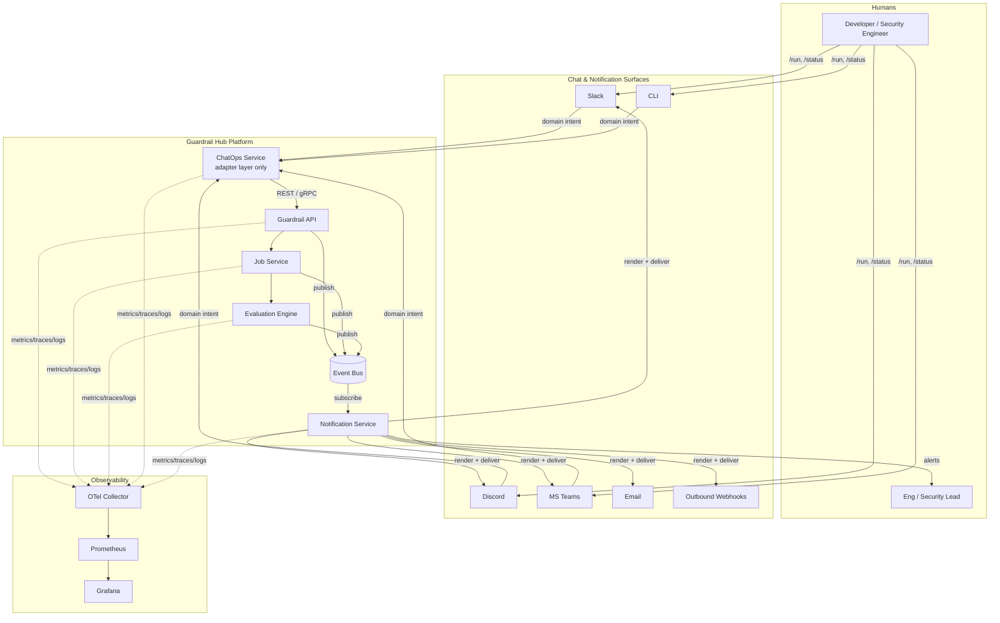
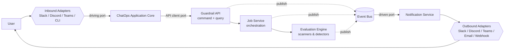

# Guardrail Hub — ChatOps Platform Architecture

> **Status: Design (not yet built).** This is a forward-looking architecture for a subsystem that does **not** exist in code today. Per [`.ai/intelligence/system-overview.md`](../../.ai/intelligence/system-overview.md), the only fully-built path in Guardrail Hub is the MCP server's OWASP ZAP integration; the Job Service, Evaluation Engine, Event Bus, and every integration named here are **targets**, not current code. This document set labels every claim as *design intent* rather than *implemented fact*, in keeping with guardrail **G5** (never present inference as declared fact) in [`.ai/guardrails/core.md`](../../.ai/guardrails/core.md).
>
> **Lane:** Product · **Domain:** Backend ([`.ai/agents/backend/ROUTER.md`](../../.ai/agents/backend/ROUTER.md)). The ChatOps Service is a backend subsystem and must obey the Backend layering standard ([`backend-layering`](../../.ai/standards/architecture/backend-layering.md)) and persistence standard ([`persistence-dao`](../../.ai/standards/architecture/persistence-dao.md)).

Owner: Loi Phan · Date: 2026-07-07 · Related decision: [ADR 0004](../../.ai/decisions/0004-chatops-platform-architecture.md)

---

## 1. What this is

The **ChatOps Platform** is an **adapter layer**. It lets humans drive Guardrail Hub — an AI Security / Validation / Governance / Evaluation platform — from Slack, Discord, Microsoft Teams, a CLI, email, and webhooks, and it pushes job lifecycle and AI-security events back out to those same surfaces.

The single most important constraint:

> **The bot contains no business logic. Business logic lives only inside Guardrail Hub.**

Chat surfaces translate a message into a domain intent, hand it to the Guardrail API, and translate domain events back into a message. Nothing about *how a scan runs*, *what a policy means*, or *whether a result is a regression* is ever decided in the adapter. This is enforced structurally by Hexagonal (Ports & Adapters) Architecture and by the repo's existing rule that "business logic placed directly in a `routers/` handler" is an anti-pattern ([`backend-layering` R4 / Anti-patterns](../../.ai/standards/architecture/backend-layering.md)).

## 2. Deliverables map

| # | Deliverable | Document |
|---|---|---|
| 1 | Overall Architecture | this file (§4–§6) |
| 2 | Bounded Contexts | [01-bounded-contexts.md](01-bounded-contexts.md) |
| 3 | Domain Model | [02-domain-model.md](02-domain-model.md) |
| 4 | Event Catalog | [03-event-catalog.md](03-event-catalog.md) |
| 5 | API Design | [04-api-design.md](04-api-design.md) |
| 6 | Database Design | [05-database-design.md](05-database-design.md) |
| 7 | Queue Design | [06-queue-and-scalability.md](06-queue-and-scalability.md) |
| — | Progress Streaming | [06-queue-and-scalability.md §Streaming](06-queue-and-scalability.md#progress-streaming) |
| — | Scalability | [06-queue-and-scalability.md §Scale](06-queue-and-scalability.md#scalability) |
| 8 | Notification Architecture | [07-notification-architecture.md](07-notification-architecture.md) |
| 9 | ChatOps Architecture | [08-chatops-architecture.md](08-chatops-architecture.md) |
| — | Observability | [09-observability.md](09-observability.md) |
| 10 | Sequence Diagrams | [10-sequence-diagrams.md](10-sequence-diagrams.md) |
| 11 | Deployment Diagram | [11-deployment.md](11-deployment.md) |
| 12 | Folder Structure | [12-folder-structure.md](12-folder-structure.md) |
| 13 | Future Extension Points | [13-extensions-tech-risks.md §Extensions](13-extensions-tech-risks.md#future-extension-points) |
| 14 | Recommended Technologies | [13-extensions-tech-risks.md §Tech](13-extensions-tech-risks.md#recommended-technologies) |
| 15 | Risks | [13-extensions-tech-risks.md §Risks](13-extensions-tech-risks.md#risks) |
| 16 | Trade-offs | [13-extensions-tech-risks.md §Trade-offs](13-extensions-tech-risks.md#trade-offs) |
| 17 | Best Practices | [13-extensions-tech-risks.md §Best-practices](13-extensions-tech-risks.md#best-practices) |
| — | Review board report | [REVIEW-BOARD.md](REVIEW-BOARD.md) |
| — | Critical remediations + change summary | [14-critical-remediations.md](14-critical-remediations.md) |

## 3. Design principles

1. **Adapters are dumb, the core is smart.** A chat adapter may parse, authenticate, format, and rate-limit. It may never branch on domain state. (Hexagonal.)
2. **Everything is an event.** Components never call each other's internals; they publish and subscribe to domain events. A new integration subscribes; it never patches the core. (Event-Driven.)
3. **Immutable audit for every action.** Every command and every state transition emits an append-only audit event (supports guardrail **G2/G3/G5** — controls, non-fabrication, traceability).
4. **One idempotent write path.** Chat is an at-least-once medium; every command carries an idempotency key so a double-tap never launches two scans.
5. **Multi-tenant by construction.** Every entity is scoped `organization → workspace → project`. Nothing global. Designed for 100k organizations.
6. **Reuse the existing spine.** The platform extends the current FastAPI + pluggable-DAO (Postgres/DynamoDB) foundation ([`technology-stack.md`](../../.ai/intelligence/technology-stack.md)) rather than inventing a parallel one.
7. **Authorize *what* and *who*, in the core.** A job may only target a registered, ownership-verified **Asset**, and may only be launched by a **VERIFIED** chat identity scoped to its installation's org. Admission is enforced in the Guardrail API, never in an adapter — closing SSRF/attack-proxy and identity-spoofing.
8. **Channels are deployment-aware.** Cloud chat (Slack/Teams/Discord) needs egress; air-gapped runs self-hostable channels (Mattermost/email/webhooks) behind the same `NotificationChannelPort`.

## 4. C4 Level 1 — System context



## 5. C4 Level 2 — The mandated flow, as containers

The brief mandates this pipeline:

```
User → Slack/Discord/CLI/Teams → ChatOps Service → Guardrail API → Job Service → Evaluation Engine → Event Bus
```

Rendered with the ports/adapters boundary made explicit:



Note the two arrows into the Event Bus and out to the Notification Service: **inbound command flow and outbound event flow are decoupled**. The ChatOps Service issues a command and returns immediately; every subsequent update reaches the user through the Bus → Notification path, never through a blocked request. This is what lets a 45-minute security scan report progress into a Slack thread without holding an HTTP connection open.

## 6. Why Hexagonal here specifically

Guardrail Hub already enforces one-directional layering (`routers → services → integrations|dao`) and a per-tool folder convention. Hexagonal is the natural generalization for a subsystem whose entire reason to exist is *talking to many external systems*:

- **Ports** are technology-agnostic interfaces the core owns: `ChatCommandPort` (inbound), `NotificationChannelPort`, `GuardrailApiPort`, `EventPublisherPort`, `JobQueryPort` (outbound).
- **Adapters** are the swappable implementations: `SlackAdapter`, `DiscordAdapter`, `TeamsAdapter`, `EmailAdapter`, `WebhookAdapter`, each implementing a port.
- Adding Microsoft Teams = adding one inbound adapter + one outbound adapter that satisfy existing ports. **Zero core changes.** That property is the whole point, and it is what makes "future integrations: Slack, Discord, Teams, Email, Webhooks, Grafana, Prometheus" a configuration exercise rather than a re-architecture.

Continue to [01-bounded-contexts.md »](01-bounded-contexts.md)
