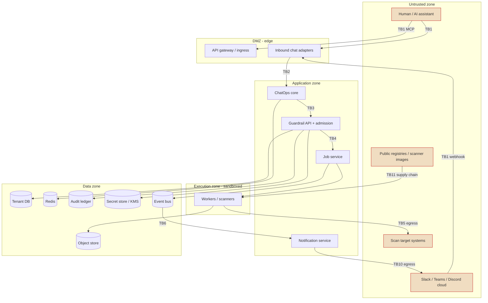

# ChatOps Platform — Security Architecture Review (STRIDE)

Board: Security Architecture Review Board · Date: 2026-07-07 · Subject: [architecture/chatops/](README.md) **as remediated** ([14-critical-remediations.md](14-critical-remediations.md))
Assurance target: **financial institutions and government** — the design is judged against FedRAMP High / DoD IL4–IL5, NIST SP 800-53 Rev5 (AC/AU/SC/SI/IA/CM families), PCI-DSS 4.0, FFIEC, SOC 2, FIPS 140-3 crypto, **SEC 17a-4 / CFTC WORM** for audit records, and zero-trust (NIST SP 800-207).

> This is a design-stage threat model. Nothing here is built; findings are against the *intended* architecture. Per guardrail G5, "planned control" ≠ "implemented control" — an unbuilt mitigation does not reduce residual risk. For a fin/gov Authority-to-Operate (ATO), a control that exists only on paper counts as **absent**.

Scope is restricted, as instructed, to: Authentication, Authorization, Multi-tenancy, Audit Integrity, SSRF, Prompt Injection, Secret Management, Supply Chain, Event Security, Notification Security, Air-gapped deployment. Functional/scalability concerns from the prior board are out of scope except where they are also security risks.

---

## 1. Trust zones & boundaries

Zero-trust posture: **nothing inside the platform trusts anything else by default.** Every arrow crossing a zone is a boundary that must authenticate, authorize, and be observable.

| TB | Boundary | Why it is dangerous | Current control (post-remediation) | Verdict |
|---|---|---|---|---|
| **TB1** | Untrusted user / chat cloud → edge | All hostile input enters here; the chat cloud itself is third-party infra holding our tokens and receiving our alerts | HMAC signature, verified identity linking | Partial — replay/clock-skew, provider-side compromise unaddressed |
| **TB2** | Adapter → ChatOps core | A compromised adapter could forge commands | Ports; adapter is "dumb" | Unspecified authN between processes |
| **TB3** | ChatOps core → Guardrail API | Lateral movement, command forgery | Bearer token (planned) | **No mTLS / SPIFFE specified** |
| **TB4** | API admission → Job/queue | The authorization chokepoint | asset VERIFIED + identity VERIFIED + RBAC | RBAC model undefined; no dual-control |
| **TB5** | Worker → scan target | The scanner *intentionally* attacks a target; SSRF is a feature here | Asset ownership + egress allow-list | **TOCTOU / DNS-rebind gap** |
| **TB6** | Producers → bus → consumers | Cross-tenant leakage, poisoned events | Envelope, org partitioning, outbox | No per-event authz / topic isolation / encryption |
| **TB7** | Services → data stores | Cross-tenant data access | org_id scoping in DAO | Logical-only isolation; Redis shared |
| **TB8** | Audit writer → ledger | Tamper of the record of record | Transactional per-tenant hash chain | **No WORM / external anchor / SoD** |
| **TB9** | Services → secret store/KMS | Mass token/key compromise | "Vault/KMS" named | Multi-tenant token store undesigned |
| **TB10** | Notification → external channels | Exfiltration of findings/PII to third-party cloud | Source redaction, throttle | No egress DLP / data-classification policy |
| **TB11** | Build/CI/registries → runtime | Malicious dependency or scanner image runs with our creds | None specified | **Supply chain unaddressed** |
| **TB12** | MCP tool gateway → AI assistant | Indirect prompt injection drives tool calls | None specified | **Prompt-injection unaddressed** |

---

## 2. STRIDE threat model

Consolidated by boundary. Each row: threat → affected focus area(s) → existing control → residual risk ID (see §4).

### TB1 — Untrusted → edge (Auth, Notification, Air-gap)

| STRIDE | Threat | Existing | Residual |
|---|---|---|---|
| **S**poofing | Forged webhook; replayed signed request; compromised Slack account of a verified user; workspace-admin impersonation | HMAC sig, verified linking | SEC-H1 (replay/skew), SEC-H2 (account compromise/SCIM) |
| **T**ampering | Mutated command payload in transit | TLS | — (if TLS enforced) |
| **R**epudiation | User denies issuing `/run` | Audit CommandExecuted | Depends on TB8 integrity → SEC-C3 |
| **I**nfo disclosure | Slack cloud logs/retains our command + alert content (gov data classification breach) | — | SEC-C4 |
| **D**oS | Command flood, webhook flood | Rate limit (planned) | SEC-H8 |
| **E**oP | Unverified user acts; cross-org via shared channel | Installation scoping + VERIFIED identity (C2) | Mitigated for the named vector; residual: token theft |

### TB3/TB4 — Core → API → Job (Auth, Authz, Multi-tenancy)

| STRIDE | Threat | Existing | Residual |
|---|---|---|---|
| **S** | Service impersonation, forged internal call | Bearer token (planned) | SEC-C-svc (no mTLS/SPIFFE) → SEC-H3 |
| **T** | Tampered `asset_id`/`org_id` to cross tenants | admission + org scoping | SEC-H5 (RBAC/tenant-claim binding undefined) |
| **R** | Privileged action without attributable actor | Audit | SEC-C3 dependency |
| **I** | Over-broad query returns other tenants' jobs | org_id in DAO | SEC-H4 (logical isolation only) |
| **D** | Job-creation flood exhausts workers/cost | fair scheduling (planned) | SEC-H8 |
| **E** | Missing dual-control on high-impact scans; no break-glass audit | RBAC (undefined) | SEC-H6 |

### TB5 — Worker → target (SSRF)

| STRIDE | Threat | Existing | Residual |
|---|---|---|---|
| **S** | Target DNS spoof / rebinding after verification | egress allow-list | **SEC-C1** (TOCTOU: ownership verified once, resolves to internal IP at scan time; redirect to 169.254.169.254 / RFC1918) |
| **T** | Scanner tampered to hit unauthorized host | sandbox | SEC-H7 (sandbox escape → creds) |
| **I** | Active scan reaches internal metadata/services | asset egress | SEC-C1 |
| **E** | Sandbox escape → worker holds bus/DB creds | container isolation (planned) | SEC-H7 |

### TB6/TB7 — Bus & stores (Event Security, Multi-tenancy, Audit)

| STRIDE | Threat | Existing | Residual |
|---|---|---|---|
| **S** | Rogue producer publishes forged integration event | — | SEC-H9 (no event signing / producer authZ) |
| **T** | Consumer bug/poisoned event mutates wrong tenant | envelope, partition | SEC-H9 |
| **I** | Bus payloads carry findings/PII unencrypted at rest; a broad consumer reads all tenants | — | SEC-H10 (no per-topic isolation/encryption) |
| **D** | Poison-message loops; consumer-lag starvation | queue DLQ | SEC-M-lag |
| **E** | Redis key collision / no per-tenant namespace; cancel-flag abuse to stop another tenant's job | — | SEC-H4, SEC-M-cancel |

### TB8 — Audit ledger (Audit Integrity)

| STRIDE | Threat | Existing | Residual |
|---|---|---|---|
| **T** | Privileged DBA rewrites rows and **recomputes** the hash chain (chain is self-referential; no independent anchor) | per-tenant hash chain | **SEC-C3** |
| **R** | Retroactive deletion/edit undetectable without external notarization; no WORM (SEC 17a-4) | INSERT/SELECT grants only | **SEC-C3** |
| **I** | Audit payloads contain unredacted secrets/PII | pre-redaction (asserted) | SEC-M-redact |

### TB9 — Secrets (Secret Management)

| STRIDE | Threat | Existing | Residual |
|---|---|---|---|
| **I** | 100k per-installation bot tokens + JWT signing keys + webhook secrets at rest; weak/at-rest exposure = mass takeover | "Vault/KMS" named only | **SEC-C2** |
| **S** | Stolen signing key forges tokens/events | — | SEC-C2 |
| **E** | No rotation/revocation → stale creds persist | — | SEC-C2 |

### TB10 — Notification egress (Notification Security)

| STRIDE | Threat | Existing | Residual |
|---|---|---|---|
| **I** | Critical finding / PII posted to a public or cross-classification channel; sent to third-party cloud in a gov tenant | source redaction, severity routing | SEC-C4, SEC-M-dlp |
| **T** | Injected content in a rendered alert targets a downstream reader/LLM | — | SEC-M-inj (links to TB12) |
| **D** | Notification storm as a channel-ban / cover-noise attack | throttle/batch | SEC-H8 |

### TB11 — Supply chain (Supply Chain, Air-gap)

| STRIDE | Threat | Existing | Residual |
|---|---|---|---|
| **T** | Compromised Python dep / scanner image (ZAP, Semgrep, Trivy…) runs in worker with egress + creds (SolarWinds-class) | none | **SEC-C5** |
| **S** | Typosquat / dependency confusion at build | none | SEC-C5 |
| **I** | No SBOM / provenance → undetected implant | none | SEC-C5 |
| **T** | Air-gapped offline updates imported without signature verification | none | SEC-H11 |

### TB12 — MCP / AI tool surface (Prompt Injection)

| STRIDE | Threat | Existing | Residual |
|---|---|---|---|
| **E** | Indirect prompt injection: an AI assistant reading a malicious scan report/transcript is steered to invoke scan tools (launch/cancel jobs, exfil) via the MCP gateway | none | **SEC-C6** |
| **S** | Injected model output impersonates a system instruction to a downstream LLM (notification summaries, if any LLM-in-loop) | none | SEC-C6 |
| **T** | Poisoned evaluation input manipulates a Policy "regression" verdict (false posture) | none | SEC-H12 |

---

## 3. Findings by focus area (residual, post-remediation)

**Authentication.** Verified chat-identity linking + Installation→org scoping (C2) is a real, correct improvement. Gaps: no service-to-service authN (mTLS/SPIFFE) on TB2/TB3; JWT signing-key lifecycle, rotation, and revocation undefined; no MFA/step-up for high-impact commands; no SCIM/de-provisioning sync (a terminated employee's linked identity stays valid); provider-account compromise unmitigated.

**Authorization.** Admission (asset+identity+RBAC) is the right chokepoint. But the RBAC model itself is undefined (roles, least-privilege matrix, resource scoping), there is **no dual-control / four-eyes** for destructive or production-target scans (FFIEC/SoD expectation), no break-glass with heightened audit, and `/cancel` authorization is unspecified (a user cancelling another's job).

**Multi-tenancy.** `org_id` scoping is pervasive and Installation binding closes cross-org identity. But isolation is **logical only** — shared DB, shared Redis (no per-tenant namespace/authz), shared bus topics, shared worker pool. Fin/gov IL4+ typically require stronger isolation (dedicated data plane or cryptographic per-tenant separation) and **data residency/sovereignty** (region pinning), which the tenancy key (org_id hash) does not model.

**Audit Integrity.** Transactional per-tenant `tenant_seq` hash chain (C3) fixed the "chain over an at-least-once stream" defect — good. It does **not** defend against a privileged insider: the chain is self-referential, so a DBA can edit and recompute it. Fin/gov require **WORM storage (SEC 17a-4), external notarization/anchoring, and segregation of duties** between the audit writer and DB admins. None specified.

**SSRF.** Asset registry + ownership verification (C1) blocks the naive "scan anything" vector. The residual is **TOCTOU**: ownership is verified once, but at scan time DNS can resolve to an internal IP (DNS rebinding), or the scanner can follow a redirect to `169.254.169.254`/RFC1918. The scanner is *designed* to send hostile traffic, so this boundary needs re-resolution + IP pinning + private-range denylist + no-follow-redirect + per-scan network policy — not just a one-time name check.

**Prompt Injection.** Effectively unaddressed, and this is an AI-security product exposing scan tools over MCP. Indirect injection through scanned artifacts/transcripts/model outputs can drive tool invocation, manipulate evaluation verdicts (false "secure" posture — a G3 concern), or target downstream LLMs via rendered notifications. Needs tool-call allow-listing + human-in-the-loop for state-changing MCP tools, content provenance/quarantine, and treating all evaluated content as untrusted.

**Secret Management.** The platform *creates* a large secret-at-rest problem (≈100k per-installation chat tokens + JWT/webhook keys) and never designs the store: envelope encryption, per-tenant keys, HSM/FIPS 140-3 KMS, rotation, revocation, and — for air-gapped — an offline secret backend. This is a mass-compromise blast radius.

**Supply Chain.** Unaddressed. Workers pull third-party scanner images and Python deps that execute with network egress and store credentials. No pinned digests, SBOM, signature/provenance (SLSA), dependency-confusion defense, or signed offline-update channel for air-gapped. For fin/gov this alone blocks ATO.

**Event Security.** Envelope + org partitioning aid ordering/tenancy but there is no producer authorization, no event signing/integrity, no per-topic tenant isolation, and no encryption of finding/PII payloads at rest on the bus. A single over-scoped consumer or rogue producer crosses tenants.

**Notification Security.** Throttle/batch/severity routing and source-redaction are present. Missing: egress DLP, data-classification-aware channel policy (never send `critical` PII to a broad/public or cross-classification channel), and the governance reality that posting findings to **third-party cloud chat** may itself breach data classification for a regulated tenant.

**Air-gapped.** Channel classing (C4) correctly makes cloud chat optional. Remaining air-gapped gaps: offline secret backend (no cloud KMS), trusted time source (audit timestamps, cert validity), signed offline dependency/scanner update provenance, and offline license/entitlement checks.

---

## 4. Risk register

Severity uses fin/gov impact. **Status** reflects the *remediated* design. "Open" = no implemented or specified control.

### 🔴 Critical (block ATO)

| ID | Focus | Risk | STRIDE | Status |
|---|---|---|---|---|
| **SEC-C1** | SSRF | TOCTOU / DNS-rebinding / redirect bypass of the asset egress control at scan time reaches internal services & cloud metadata | S/I | Open (C1 covers admission only) |
| **SEC-C2** | Secret Mgmt | Multi-tenant token/key store (≈100k secrets) undesigned; no envelope-encryption/HSM/rotation → mass takeover | I/S/E | Open |
| **SEC-C3** | Audit Integrity | Self-referential hash chain defeatable by privileged insider; no WORM/external anchor/SoD (SEC 17a-4) | T/R | Open (C3 fixed ordering, not insider) |
| **SEC-C4** | Notification / Multi-tenancy | Findings/PII egress to third-party cloud chat breaches gov data classification / data residency | I | Open (air-gap only avoids it by removing cloud chat) |
| **SEC-C5** | Supply Chain | Compromised dependency/scanner image executes in worker with egress + creds; no SBOM/pinning/signing/provenance | T/S/I | Open |
| **SEC-C6** | Prompt Injection | Indirect injection via MCP tool surface drives unauthorized tool calls / false posture | E/S | Open |

### 🟠 High

| ID | Focus | Risk | Status |
|---|---|---|---|
| **SEC-H1** | Auth | Webhook replay / clock-skew (no nonce + timestamp window) | Open |
| **SEC-H2** | Auth | Provider-account compromise & no SCIM de-provisioning of linked identities | Open |
| **SEC-H3** | Auth | No service-to-service mTLS/SPIFFE on TB2/TB3 (lateral movement, forged internal calls) | Open |
| **SEC-H4** | Multi-tenancy | Logical-only isolation; shared Redis without per-tenant namespace/authz | Open |
| **SEC-H5** | Authz | RBAC model + tenant-claim-to-request binding undefined | Open |
| **SEC-H6** | Authz | No dual-control/break-glass for destructive or production-target scans (FFIEC SoD) | Open |
| **SEC-H7** | SSRF/Exec | Worker sandbox escape → holds bus/DB creds (blast radius) | Open |
| **SEC-H8** | DoS | Per-tenant job/notification flood; unbounded SSE fan-out; cost-exhaustion | Open |
| **SEC-H9** | Event Security | No producer authZ / event signing; poisoned or forged events | Open |
| **SEC-H10** | Event Security | Bus finding/PII payloads unencrypted at rest; over-scoped consumer crosses tenants | Open |
| **SEC-H11** | Air-gap/Supply Chain | Offline updates imported without signed provenance; no trusted time source | Open |
| **SEC-H12** | Prompt Injection | Poisoned evaluation input manipulates Policy "regression" verdict (false posture, G3) | Open |
| **SEC-H13** | Data residency | Tenancy key has no region dimension; sovereignty unmet for gov | Open |

### 🟡 Medium

| ID | Focus | Risk | Status |
|---|---|---|---|
| **SEC-M-dlp** | Notification | No egress DLP / data-classification channel policy (defense-in-depth beyond source redaction) | Open |
| **SEC-M-redact** | Audit/Notif | Redaction is single-layer & asserted, not enforced/validated; trace/log param redaction unspecified | Open |
| **SEC-M-cancel** | Authz/Event | `/cancel` and cancel-flag (Redis) authorization unspecified → stop another's job | Open |
| **SEC-M-idem** | Auth/Replay | Derived idempotency key (time-bucketed) is replay-adjacent; use client-supplied provider id | Open |
| **SEC-M-btn** | Auth | Interaction-token (button) replay / one-time-use unspecified | Open |
| **SEC-M-lag** | Event/DoS | Poison-message loops & consumer-lag starvation; no bus DLQ defined | Open |
| **SEC-M-err** | Info disclosure | problem+json / stack detail leakage; verbose errors to chat | Open |
| **SEC-M-report** | Authz/Multi-tenancy | `/report` link authorization, signed/expiring, per-requester scope unspecified | Open |

### 🟢 Low

| ID | Focus | Risk | Status |
|---|---|---|---|
| **SEC-L-ulid** | Info disclosure | ULID embeds timestamps (minor enumeration/timing leak) | Open |
| **SEC-L-card** | Observability | Per-`org` metric labels can leak tenant existence/volume | Open |
| **SEC-L-ver** | Info disclosure | Version/banner disclosure on ingress | Open |
| **SEC-L-dedupe** | Audit/Metrics | At-least-once over-counting in derived projections (integrity of derived, non-authoritative data) | Open |

---

## 5. Security score (re-scored for the fin/gov bar)

Scored as **ATO readiness for financial/government**, where any open Critical caps the ceiling. A separate commercial-SaaS view is shown for context.

| Focus area | Weight | Score /10 | Note |
|---|---:|---:|---|
| Authentication | 10 | 5 | Verified linking good; svc-to-svc, key lifecycle, MFA, SCIM gaps |
| Authorization | 10 | 5 | Right chokepoint; RBAC/dual-control/break-glass undefined |
| Multi-tenancy | 10 | 5 | Pervasive scoping; logical-only isolation, no residency |
| Audit Integrity | 12 | 4 | Ordering fixed; insider/WORM/anchor unmet (SEC-C3) |
| SSRF | 10 | 4 | Admission fixed; TOCTOU/rebind open (SEC-C1) |
| Prompt Injection | 10 | 2 | MCP tool surface essentially undefended (SEC-C6) |
| Secret Management | 12 | 3 | Mass token store undesigned (SEC-C2) |
| Supply Chain | 10 | 2 | No SBOM/pinning/signing/provenance (SEC-C5) |
| Event Security | 6 | 4 | Envelope/partition only; no authZ/signing/encryption |
| Notification Security | 6 | 4 | Redaction/throttle; no DLP; cloud-egress classification (SEC-C4) |
| Air-gapped | 4 | 5 | Channel fix good; offline secrets/updates/time open |
| **Weighted total** | **100** | | **≈ 39 / 100** |

**Security posture score: 39 / 100 for the financial/government (FedRAMP High / IL4+) bar.**
Context: against a *commercial SaaS* baseline (where cloud chat, logical isolation, and self-anchored audit are acceptable and supply-chain/prompt-injection are "roadmap"), the same design scores ≈ **60 / 100** — the remediations meaningfully improved it. The gap between 60 and 39 is precisely the high-assurance delta.

Movement since the general board: SSRF and identity moved from "hole" to "partial," which is real progress — but six Criticals specific to regulated environments remain, and none are yet designed.

---

## 6. Verdict

### ❌ REJECT — NOT AUTHORIZED TO OPERATE in a financial or government environment (as designed).

This is not a rejection of the architecture's direction — the hexagonal/event-driven frame and the C1–C4 remediations are sound and moving the right way. It is a statement that **six Critical, regulated-environment security requirements are unmet**, and in fin/gov any single open Critical blocks an ATO.

**Mandatory gates before re-review (each maps to a Critical):**

1. **SEC-C1** — Scan-time SSRF defense: per-scan re-resolution + IP pinning, RFC1918/link-local/metadata denylist, no-follow-redirect, egress network policy enforced at the sandbox boundary (not just admission).
2. **SEC-C2** — Designed secret store: FIPS 140-3 HSM/KMS, envelope encryption, per-tenant keys, rotation + revocation, offline backend for air-gap.
3. **SEC-C3** — Tamper-*proof* (not just tamper-evident) audit: WORM storage, external anchoring/notarization, segregation of duties, retention meeting SEC 17a-4.
4. **SEC-C4** — Data-classification-aware notification governance: regulated tenants may not egress findings/PII to third-party cloud chat; enforce channel classification and residency.
5. **SEC-C5** — Supply-chain assurance: SBOM, pinned digests, signature/provenance (SLSA) for deps and scanner images, dependency-confusion defense, signed offline update channel.
6. **SEC-C6** — Prompt-injection controls on the MCP/LLM surface: state-changing tools require human-in-the-loop, tool-call allow-listing, untrusted-content quarantine, provenance.

**Also required for GA (Highs):** service mTLS/SPIFFE, RBAC + dual-control/break-glass, stronger tenant isolation + data residency, event signing + payload encryption, webhook anti-replay, sandbox-escape containment, SCIM de-provisioning, DoS/cost quotas.

**Re-review** after the six Criticals are *designed and specified* (not merely acknowledged). Target ATO-readiness score to clear a conditional High-baseline: **≥ 75 / 100**, with zero open Criticals.

---

## 7. Board sign-off

| Reviewer | Position |
|---|---|
| AppSec | **Reject** — SEC-C1/C6 (SSRF TOCTOU, prompt injection) are exploitable as designed. |
| Crypto/KeyMgmt | **Reject** — SEC-C2/C3 (secret store, WORM audit) unmet for FIPS/17a-4. |
| Supply Chain / SSDF | **Reject** — SEC-C5; no SBOM/provenance is an automatic fail. |
| GRC / Data Governance | **Reject** — SEC-C4 + residency (SEC-H13) breach classification/sovereignty. |
| Chair (Security Architecture) | **Reject, not authorized to operate.** Sound trajectory; six regulated-environment Criticals must be designed before re-review. |

Related: [REVIEW-BOARD.md](REVIEW-BOARD.md) · [14-critical-remediations.md](14-critical-remediations.md) · [ADR 0004 (Proposed)](../../.ai/decisions/0004-chatops-platform-architecture.md)
