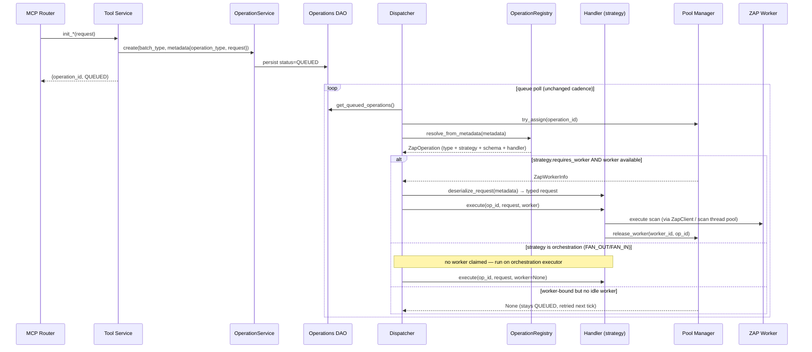
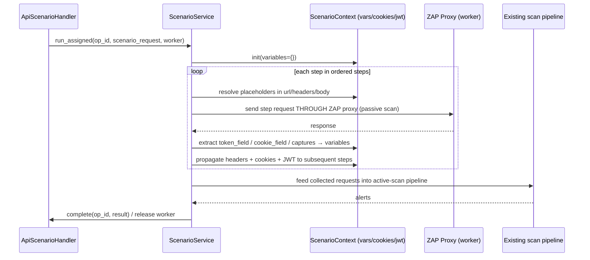
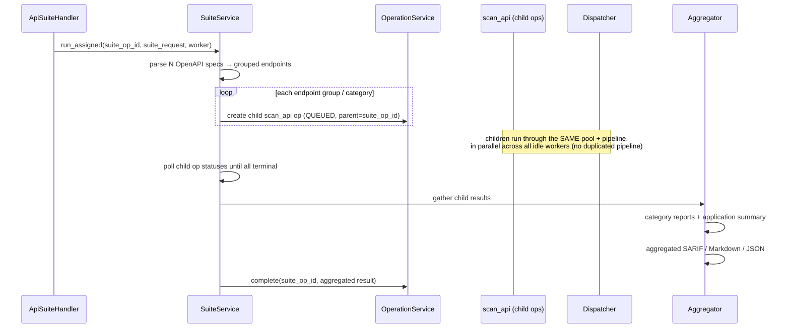

# ZAP Generic Execution Architecture — Design Proposal

## Status

**Proposal — for review.** This document describes a target architecture and a
migration path. No code has been changed yet. It supersedes nothing until
approved; on approval it becomes the basis for a Decision record under
`.ai/decisions/` and the implementation lands in `mcp-server/`.

> **Revision 2 (post-review).** Updated to incorporate eight architectural
> decisions from design review: (1) a strongly-typed `ZapOperationType` enum as
> the registry key — never raw strings; (2) `ZapWorkerService` stays untouched;
> (3) `scan_api_suite` is an orchestrator that must **never occupy a worker**
> while its children run; (4) `OperationType` (WHAT) and `ExecutionStrategy`
> (HOW) are kept as separate, independent dimensions; (5) the registry entry
> (`ZapOperation`) owns request schema + metadata serialization + metadata
> deserialization + handler, so the Dispatcher never names a concrete request
> model; (6) the two web tools remain placeholders only; (7) existing
> `ZapApiScanService` is wrapped, never rewritten; (8) legacy operations with no
> operation type default to `API_SCAN`. See §3–§4 and §7.4.

Scope decided with the requester:

- **Deliverable now:** this design doc (abstractions, class responsibilities,
  sequence diagrams, dependency graph, migration plan). Code follows after
  approval. **Step 1** (generic execution package, `ZapOperationType`,
  `ZapOperationRegistry`, handler interfaces, `ApiScanHandler` wrapper,
  Dispatcher refactor, DI updates) is implemented — see
  [`STEP1-REVIEW.md`](STEP1-REVIEW.md). **Phase 2** (`scan_api_scenario` +
  `scan_api_suite`) is implemented on top of the frozen generic layer with no
  changes to it — see [`PHASE2.md`](PHASE2.md).
- **Phase 2 depth (when built):** production-ready foundations for
  `scan_api_scenario` and `scan_api_suite` — ordered replay + variable /
  header / cookie / JWT propagation for scenario; multi-OpenAPI + grouping +
  parallel orchestration + aggregated reports for suite. Advanced features
  (loops/branching/retries/data-driven for scenario; incremental scans,
  historical comparison, dashboards, scheduling for suite) are explicitly
  deferred.
- `scan_web_application` and `scan_interactive_session` are **design inputs
  only** — the abstraction must accommodate them, but they are not implemented.

---

## 1. Problem statement

The ZAP subsystem was built around a single tool, `scan_api`, and the
background **Dispatcher** is hard-wired to that tool's service,
`ZapApiScanService`. Three concrete couplings exist today
(`mcp-server/app/services/tools/owasp_zap/worker/dispatcher.py`):

| # | Coupling | Line | Why it blocks new tools |
|---|---|---|---|
| 1 | `from ... api_scanner import ZapApiScanService` | import | Dispatcher names one concrete tool |
| 2 | `ZapApiScanService.request_from_metadata(operation.metadata)` | `_dispatch_queued_operations` | Only `scan_api` metadata can be reconstructed |
| 3 | `self._scan_service.run_assigned_scan(op_id, request, worker)` | `_dispatch_queued_operations` | Only `scan_api` execution can be launched |

A fourth coupling lives in the composition root
(`app/bootstrap.py::build_zap_dispatcher`), which constructs the dispatcher
with a `ZapApiScanService` instance.

Consequence: every new ZAP tool (`scan_api_scenario`, `scan_api_suite`, and the
two future web tools) would force edits to the Dispatcher and its wiring — a
direct violation of the Open/Closed Principle and the reason this redesign
exists.

Everything *else* in the pool is already tool-agnostic and must not change:
the **Worker Registry**, **Scheduler**, **Pool Manager**, **Operations
queue** (`status = QUEUED` rows), **heartbeat sweep**, **failure handling**,
and the **OperationService** lifecycle/event pipeline. This design deliberately
touches only the seam between "dispatch a generic operation" and "execute this
specific tool."

---

## 2. Design goals & principles

| Goal | Principle | How this design meets it |
|---|---|---|
| Dispatcher must not know which tool runs | **Dependency Inversion** | Dispatcher depends on a `ZapOperationHandler` abstraction + a registry, never on a concrete service |
| Add a tool without editing Dispatcher/Worker | **Open/Closed** | New tool = new handler + one registration line; no changes to dispatch/worker code |
| Each tool owns its own request/metadata/execution | **Single Responsibility** | The handler is the single home for a tool's schema, (de)serialization, and execution |
| Swap execution behaviour per operation type | **Strategy** | Handlers are interchangeable strategies keyed by operation type |
| Preserve every existing behaviour | Least-change | Registry + handlers wrap existing code; `ZapApiScanService` becomes the body of one handler, unchanged in behaviour |

Non-goal (unchanged from the worker-pool doc): this is still an in-process,
single-server dispatcher. Distributed scheduling remains out of scope.

---

## 3. Target architecture

### 3.1 Two independent dimensions: OperationType vs ExecutionStrategy

The requirements name two concepts that must **not** be merged (review
decisions 1 and 4):

| Dimension | Question it answers | Type | Examples | Who reads it |
|---|---|---|---|---|
| **`ZapOperationType`** | *WHAT* is being executed | `str` Enum | `API_SCAN`, `API_SCENARIO`, `API_SUITE`, `WEB_APPLICATION`, `INTERACTIVE_SESSION` | the **registry** (key) |
| **`ExecutionStrategy`** | *HOW* the work runs | `str` Enum | `SEQUENTIAL`, `PARALLEL`, `BATCH`, `FAN_OUT`, `FAN_IN` | the **Dispatcher** (routing) + handler (internal) |

They are orthogonal: two different operation types can share one strategy
(`API_SCAN` and `API_SCENARIO` are both `SEQUENTIAL` — one scan bound to one
worker), and one operation type could in principle change strategy without
changing what it *is*. Keeping them separate is what lets the Dispatcher make a
single generic routing decision — *"does this strategy bind a worker?"* —
without ever learning a tool's identity.

```python
# app/services/tools/owasp_zap/execution/operation_type.py
class ZapOperationType(str, Enum):
    """Strongly-typed identity of a ZAP tool. The registry key — never a raw
    string. Persisted in metadata["operation_type"] so the Dispatcher can
    resolve the right operation across restarts."""
    API_SCAN = "api_scan"
    API_SCENARIO = "api_scenario"
    API_SUITE = "api_suite"
    WEB_APPLICATION = "web_application"          # placeholder — not implemented
    INTERACTIVE_SESSION = "interactive_session"  # placeholder — not implemented


# app/services/tools/owasp_zap/execution/execution_strategy.py
class ExecutionStrategy(str, Enum):
    """How an operation is executed. Independent of ZapOperationType.

    ``requires_worker`` is the ONLY thing the Dispatcher reads off a strategy —
    a generic capability, not a tool name. Worker-bound strategies claim a ZAP
    worker from the pool; orchestration strategies (fan-out/fan-in) run without
    ever occupying a worker (review decision 3)."""
    SEQUENTIAL = "sequential"   # one worker, ordered work (api_scan, api_scenario)
    PARALLEL = "parallel"       # one worker, parallelised internally (reserved)
    BATCH = "batch"             # reserved
    FAN_OUT = "fan_out"         # orchestrator: spawns child ops, no worker (api_suite)
    FAN_IN = "fan_in"           # orchestrator: aggregates child results, no worker

    @property
    def requires_worker(self) -> bool:
        # Orchestration strategies never hold a pool worker; everything else does.
        return self not in (ExecutionStrategy.FAN_OUT, ExecutionStrategy.FAN_IN)
```

### 3.2 The registry entry owns everything tool-specific (`ZapOperation`)

Per review decision 5, a registered operation owns **four** things, not just an
execution handler: its request schema, metadata serialization, metadata
deserialization, and the handler. The Dispatcher therefore never imports or
names a concrete request model — it asks the registry entry to deserialize.

```
Operation (queue row)
   ↓  registry.resolve_from_metadata(metadata) → ZapOperation
   ↓  operation.deserialize_request(metadata)  → typed request
   ↓  operation.handler / operation.execution_strategy
   ↓  Execute
```

```python
# app/services/tools/owasp_zap/execution/handler.py  (English comments only)

from typing import Any, Optional, Protocol
from pydantic import BaseModel
from app.schemas.tools.owasp_zap.worker import ZapWorkerInfo


class ZapOperationHandler(Protocol):
    """Strategy that actually executes one operation type.

    ``worker`` is ``None`` for orchestration strategies (fan-out/fan-in) and a
    bound ``ZapWorkerInfo`` for worker-bound strategies. The handler does NO
    scheduling — for worker-bound work it runs the scan and releases the worker
    (exactly as ``run_assigned_scan`` does today); for orchestration it spawns
    and later aggregates child operations without ever touching the pool."""

    def execute(
        self,
        operation_id: str,
        request: Any,
        worker: Optional[ZapWorkerInfo],
    ) -> None: ...


@dataclass(frozen=True)
class ZapOperation:
    """One fully-described, registrable ZAP tool.

    Bundles the four responsibilities a tool owns. The registry stores these by
    ``operation_type``; the Dispatcher only ever touches this façade, never a
    concrete request class."""

    operation_type: ZapOperationType
    execution_strategy: ExecutionStrategy
    request_model: type[BaseModel]          # the schema
    handler: ZapOperationHandler            # the execution

    def serialize_request(self, request: BaseModel) -> dict:
        """WHAT goes into metadata["request"] at submit time."""
        return request.model_dump(mode="json", by_alias=True)

    def deserialize_request(self, metadata: dict) -> BaseModel:
        """Rebuild the typed request from a persisted queue row. Raises on
        malformed/legacy metadata — the Dispatcher marks such an operation
        FAILED and releases any worker (unchanged behaviour)."""
        return self.request_model.model_validate(metadata["request"])
```

Notes:

- The Dispatcher calls exactly three things on a resolved `ZapOperation`:
  `deserialize_request(...)`, `execution_strategy.requires_worker`, and
  `handler.execute(...)`. None of them expose a tool name or a concrete model.
- `serialize_request` gives each tool's submit path (`init_api_scan`, etc.) one
  place to shape `metadata["request"]`, and each stamps
  `metadata["operation_type"] = <enum>.value` alongside it.

### 3.3 The registry

```python
# app/services/tools/owasp_zap/execution/registry.py  (English comments only)

# Missing operation_type on a legacy queue row → treat as API_SCAN so nothing
# persisted before this refactor becomes invalid (review decision 8).
_DEFAULT_OPERATION_TYPE = ZapOperationType.API_SCAN


class ZapOperationRegistry:
    """Maps an operation type to the ZapOperation that describes and runs it.

    Process-wide, populated once at startup from the composition root. The
    Dispatcher holds a reference to this registry and nothing else
    tool-specific."""

    def __init__(self) -> None:
        self._operations: dict[ZapOperationType, ZapOperation] = {}

    def register(self, operation: ZapOperation) -> None:
        # Reject a duplicate type — fail fast at boot, never silently overwrite.
        if operation.operation_type in self._operations:
            raise ValueError(f"Duplicate handler for {operation.operation_type}")
        self._operations[operation.operation_type] = operation

    def get(self, operation_type: ZapOperationType) -> ZapOperation:
        # Raise UnknownOperationTypeError if absent — the Dispatcher fails the
        # operation loudly rather than stranding a worker.
        ...

    def resolve_from_metadata(self, metadata: dict) -> ZapOperation:
        # Read metadata["operation_type"], default to API_SCAN when absent
        # (legacy rows), coerce to the enum, and look it up.
        raw = (metadata or {}).get("operation_type")
        op_type = _DEFAULT_OPERATION_TYPE if raw is None else ZapOperationType(raw)
        return self.get(op_type)
```

Registration is centralised in the composition root (`bootstrap.py`) so that
**adding a tool is one line there and zero lines in the Dispatcher**:

```python
def build_zap_operation_registry(*, operation_service) -> ZapOperationRegistry:
    registry = ZapOperationRegistry()
    registry.register(build_api_scan_operation(operation_service))       # Step 1
    # registry.register(build_api_scenario_operation(operation_service)) # Phase 2
    # registry.register(build_api_suite_operation(operation_service))    # Phase 2
    # Future: registry.register(build_web_application_operation(...))
    # Future: registry.register(build_interactive_session_operation(...))
    return registry
```

### 3.4 The refactored Dispatcher (strategy-aware, tool-agnostic)

The two loops, logging, health summary, heartbeat sweep, queue semantics,
retry/failure handling are **preserved**. The change is localized to
`_dispatch_queued_operations`, which now (a) resolves the `ZapOperation` from
the registry, and (b) routes on the generic
`execution_strategy.requires_worker` flag — worker-bound work claims a pool
worker as before; orchestration work runs on a small orchestration executor and
**never touches the pool** (review decision 3):

```python
# AFTER — fully generic. No tool names, no concrete request models.
operation = self._registry.resolve_from_metadata(op.metadata)   # ZapOperation

if operation.execution_strategy.requires_worker:
    worker = self._pool_manager.try_assign(op.operation_id)
    if worker is None:
        continue                       # no idle worker — stays QUEUED, retried
    try:
        request = operation.deserialize_request(op.metadata)
    except Exception as exc:           # malformed/legacy metadata OR unknown type
        self._pool_manager.release_worker(worker.worker_id, op.operation_id)
        self._operation_service.fail(op.operation_id, ...)
        continue
    operation.handler.execute(op.operation_id, request, worker)
else:
    # Orchestration (fan-out/fan-in): no worker is claimed. Run once, off the
    # queue, on a bounded orchestration executor.
    request = operation.deserialize_request(op.metadata)
    self._orchestration_executor.submit(
        operation.handler.execute, op.operation_id, request, None
    )
```

Constructor change: the `scan_service: ZapApiScanService` parameter becomes
`registry: ZapOperationRegistry` (plus an injected orchestration executor). The
malformed-metadata `try/except` — fail the operation, release the worker — is
unchanged in spirit and now also covers `UnknownOperationTypeError`.

> **Why the orchestration branch exists in Step 1 even though only `API_SCAN`
> (worker-bound) is registered:** so that registering `API_SUITE` later is
> *purely* a `bootstrap.py` line and needs **zero** Dispatcher edits (Open/
> Closed, review decisions 3 and 5). To keep this from being untested dead code,
> Step 1 ships a unit test that drives a fake `FAN_OUT` operation through the
> Dispatcher and asserts no worker was assigned.

The Dispatcher's imports lose `ZapApiScanService` entirely — coupling #1, #2,
#3 and the `bootstrap` coupling all dissolve. It gains only the registry and
error types.

### 3.5 WorkerService — verdict: no refactor required

`ZapWorkerService`
(`app/services/tools/owasp_zap/worker/worker_service.py`) is already generic.
It manages registration, heartbeat, listing, draining, removal, and orphaned-
operation failure — none of which mention `scan_api` or any tool. It operates
on `worker_id`/`operation_id` only. **It needs no change.** The requirement
"workers must become generic ZAP workers capable of executing any registered
operation" is satisfied at the Dispatcher/handler seam, not in `WorkerService`:
a worker is just a ZAP proxy endpoint; *what* runs against it is decided by the
handler the Dispatcher resolves. The thread-pool executor that actually runs
scan bodies lives inside each handler/service, not in `WorkerService`, so
generic execution is achieved without touching worker lifecycle at all.

(If, during implementation, we want a single shared executor instead of one per
service, that is an internal optimisation of the handlers — still no
`WorkerService` change. Flagged as an open question in §8.)

---

## 4. Class responsibilities (after)

| Concern | Owned by | File (new = ✚) |
|---|---|---|
| Identify *what* an operation is | `ZapOperationType` enum | ✚ `execution/operation_type.py` |
| Describe *how* work runs (+ `requires_worker`) | `ExecutionStrategy` enum | ✚ `execution/execution_strategy.py` |
| Bundle schema + (de)serialize + handler per tool | `ZapOperation` + `ZapOperationHandler` | ✚ `execution/handler.py` |
| Type → `ZapOperation` lookup, legacy default | `ZapOperationRegistry` | ✚ `execution/registry.py` |
| Poll queue, assign, dispatch generically, sweep | `OwaspZapDispatcher` | `worker/dispatcher.py` (edited) |
| Register all handlers at boot | composition root | `bootstrap.py` (edited) |
| `scan_api`: schema, metadata (de)serialize, execute | `ApiScanHandler` wrapping `ZapApiScanService` | ✚ `handlers/api_scan_handler.py` + existing `api_scanner.py` |
| `scan_api_scenario`: schema, metadata, ordered replay + propagation, execute | `ApiScenarioHandler` + `ZapApiScenarioService` | ✚ `handlers/api_scenario_handler.py` + `scan_api_scenario.py` (rewritten) |
| `scan_api_suite`: schema, metadata, orchestrate N `scan_api`, aggregate | `ApiSuiteHandler` + `ZapApiSuiteService` | ✚ `handlers/api_suite_handler.py` + `scan_api_suite.py` (new) |
| Worker registration/heartbeat/removal | `ZapWorkerService` | `worker/worker_service.py` (unchanged) |
| Pick idle worker / assign / client cache | Pool Manager + Registry + Scheduler | `integrations/owasp_zap/*` (unchanged) |
| Operation lifecycle + events | `OperationService` | `services/operations/operation_service.py` (unchanged) |

Proposed package layout (new `execution/` + `handlers/` under the existing ZAP
tools tree):

```
app/services/tools/owasp_zap/
├── execution/
│   ├── operation_type.py     # ZapOperationType enum (WHAT)
│   ├── execution_strategy.py # ExecutionStrategy enum (HOW) + requires_worker
│   ├── handler.py            # ZapOperationHandler Protocol + ZapOperation + errors
│   └── registry.py           # ZapOperationRegistry (+ legacy API_SCAN default)
├── handlers/
│   ├── api_scan_handler.py       # wraps ZapApiScanService (behaviour unchanged)
│   ├── api_scenario_handler.py   # wraps ZapApiScenarioService
│   └── api_suite_handler.py      # wraps ZapApiSuiteService
├── api_scanner.py            # unchanged body; loses the Dispatcher's direct import
├── scan_api_scenario.py      # rewritten to real service (see §6)
├── scan_api_suite.py         # new service (see §7)
└── worker/
    ├── dispatcher.py         # edited: registry instead of scan_service
    └── worker_service.py     # unchanged
```

---

## 5. Sequence diagrams

### 5.1 Generic dispatch (any tool) — the new hot path



The Dispatcher's box now contains **zero tool names**. Compare with today,
where the two `H` interactions were direct `ZapApiScanService` calls.

### 5.2 `scan_api_scenario` execution (inside the handler)



### 5.3 `scan_api_suite` orchestration (fan-out over the worker pool)



Key point for the "must NOT duplicate the pipeline" rule: the suite service
**emits child `scan_api` operations** and lets the existing Dispatcher + Pool +
`ApiScanHandler` run them. It only adds fan-out (spec parsing + child creation)
and fan-in (aggregation). Parallelism is free — children are ordinary queued
operations picked up by any idle worker.

---

## 6. Tool 1 — `scan_api_scenario` (foundation scope)

**Purpose:** replay an ordered sequence of API requests (a business workflow)
through the ZAP proxy, carrying state forward, then scan the collected traffic.

**Included now:** ordered execution, request dependency resolution, variable
extraction, header/cookie/JWT propagation, context generation, replay, and
feeding collected requests into the **existing** scan pipeline.
**Deferred:** loops, branching, conditional execution, retries, data-driven
testing.

### 6.1 Request schema (new `ZapApiScenarioScanRequest`)

The existing `ZapApiTarget` (`common.py`) already models one step's worth of
propagation primitives — `token`, `token_type` (incl. `JWT`),
`token_header_name`, `token_prefix`, `cookie`, plus **`token_field` /
`cookie_field`** (dotted response paths for extraction). The scenario schema
reuses it per step:

```python
class ScenarioStep(ZapApiTarget):
    name: str                       # step id, referenced by later steps
    captures: dict[str, str] = {}   # var_name -> dotted response path
    depends_on: list[str] = []      # step names that must run first

class ZapApiScenarioScanRequest(BaseModel):
    report_group: str
    scan_mode: ZapScanMode = ZapScanMode.FULL
    steps: list[ScenarioStep]       # authored order = default execution order
    scan_targets: Optional[list[str]] = None  # which steps' URLs to actively scan
```

`captures` generalises the single `token_field`/`cookie_field` already on
`ZapApiTarget`: any response value can become a variable, referenced in later
steps via `${var}` placeholders in url/headers/body.

### 6.2 Execution model

1. **Order** — topological sort of `depends_on`, tie-broken by authored order;
   default (no deps) is authored order. Cycle → fail the operation.
2. **ScenarioContext** — a per-run mutable bag of `variables`, accumulated
   `cookies`, and the current auth token. Placeholder resolution
   (`${login.access_token}`) runs against it before each step is sent.
3. **Send through proxy** — each step is dispatched with the existing
   `ZapApiScanHelpers.send_through_proxy` so ZAP passively records it (identical
   mechanism to `scan_api` today).
4. **Extract** — after each response, `captures` + `token_field`/`cookie_field`
   pull values into the context (dotted-path getter).
5. **Propagate** — JWT/bearer token and cookies flow to subsequent steps
   automatically via the context; explicit per-step overrides still win.
6. **Scan** — after replay, the collected requests seed the **existing** active-
   scan pipeline (`scan_targets`, or all steps by default) — reusing
   `create_context` / `run_active_scan` / `save_reports` from `api_scanner.py`.
   No new scan engine.

### 6.3 Metadata & handler

`init_run_api_scenario_scan` persists `metadata["operation_type"] =
API_SCENARIO` and `metadata["request"] = request.model_dump(...)`. The existing
stub already does most of the create/queue plumbing; it will be corrected (its
broken `ZapApiScenarioScanRequest` import and the never-defined
`run_assigned_scan`/`update_status` calls) and wrapped by `ApiScenarioHandler`,
whose `request_from_metadata` validates the request back and whose
`run_assigned` runs the replay-then-scan above and releases the worker in a
`finally`, matching `api_scanner.py`'s worker discipline.

`batch_type` for scenario operations: **`BatchType.BATCH_SCAN`**, which
`bootstrap.OPERATION_TITLES` already labels "Scenario Security Scan" — so
notifications render correctly with no wiring change.

---

## 7. Tool 2 — `scan_api_suite` (foundation scope)

**Purpose:** scan several API groups/services as one logical application.

**Included now:** multiple OpenAPI specs, endpoint grouping by category,
parallel orchestration over the worker pool, category reports + application
summary, aggregated SARIF / Markdown / JSON.
**Deferred:** incremental scans, historical comparison, dashboards, scheduling,
portfolio management.

### 7.1 The orchestration rule

> `scan_api_suite` MUST orchestrate multiple `scan_api` executions and MUST NOT
> duplicate the existing scan pipeline.

The suite service is a **fan-out / fan-in orchestrator**:

- **Fan-out:** parse each OpenAPI spec, expand endpoints, group them by
  category (one category = one spec/service by default), and for each resulting
  endpoint create a **child `scan_api` operation** (`QUEUED`, tagged
  `metadata["parent_operation_id"] = <suite id>`). These children are ordinary
  queued rows — the existing Dispatcher + Pool + `ApiScanHandler` execute them,
  in **parallel across all idle workers**, with zero new scan code.
- **Fan-in:** the suite operation polls its children until every one is terminal
  (COMPLETED/FAILED), then aggregates.

### 7.2 Request schema (new `ZapApiSuiteScanRequest`)

```python
class ApiCategory(BaseModel):
    name: str                       # "Authentication", "Users", ...
    openapi_spec: str               # inline spec, URL, or S3 ref
    base_url: Optional[str] = None
    defaults: Optional[ZapApiTarget] = None  # shared auth/headers for the group

class ZapApiSuiteScanRequest(BaseModel):
    report_group: str
    application_name: str
    scan_mode: ZapScanMode = ZapScanMode.FULL
    categories: list[ApiCategory]
    max_parallelism: Optional[int] = None   # advisory; real cap = idle workers
```

### 7.3 Aggregation

A `SuiteAggregator` collects child `ZapScanResult`s and produces:

- **Category report** — findings rolled up per `ApiCategory`.
- **Application summary** — severity totals across all categories.
- **Aggregated SARIF** — merged `runs[]`, deduped rules, per-result
  `partialFingerprints` to keep endpoints distinct.
- **Aggregated Markdown / JSON** — human + machine roll-ups, written next to the
  existing per-scan reports under `public/report/owasp-zap/`.

Child scans keep their own individual reports (already produced by
`ZapApiScanHelpers.save_reports`); the aggregator only adds the roll-up layer.

### 7.4 The orchestrator never occupies a worker (decided)

Review decision 3 settles this: **the suite operation must not hold a ZAP
worker while its children run — workers only ever execute real `scan_api`
operations.** The suite is registered with `ExecutionStrategy.FAN_OUT`, whose
`requires_worker` is `False`. Consequently the Dispatcher runs the suite
handler on the bounded **orchestration executor** (§3.4) and **never calls
`try_assign` for it**. The handler's `execute(op_id, request, worker=None)`:

1. parses the OpenAPI specs and creates the child `scan_api` operations
   (`QUEUED`, `parent_operation_id` set, `operation_type = API_SCAN`);
2. polls child statuses until all are terminal — a cheap DB read loop that ties
   up one orchestration-executor thread, **not** a pool worker;
3. aggregates and completes the suite operation.

So at any instant, every ZAP worker in the pool is running an actual scan; the
only thing "occupied" by the suite is one lightweight orchestration thread doing
DB polling and report merging. This is the property the requirement demands, and
it falls straight out of the `requires_worker` routing rather than any
suite-specific Dispatcher code.

---

## 8. Backward compatibility & migration

**`scan_api` keeps working unchanged.** `ZapApiScanService`'s body is not
modified; it is wrapped by `ApiScanHandler`. Existing `QUEUED` rows written
before this change have **no `operation_type` in metadata** — the registry's
`resolve_from_metadata` therefore **defaults a missing/absent type to
`API_SCAN`**, so in-flight and pre-existing operations resume exactly as before.
New `scan_api` submissions stamp `operation_type = API_SCAN` explicitly.

Migration is incremental and each step is independently shippable:

1. Add `execution/` (enum, handler Protocol, registry) — no behaviour change.
2. Add `ApiScanHandler` wrapping `ZapApiScanService`; register it; switch the
   Dispatcher to the registry; stamp `operation_type` on submit. `scan_api`
   behaviour identical; tests should pass unchanged.
3. Build `ApiScenarioHandler` + rewritten scenario service; register; wire the
   router endpoint from stub to real.
4. Build `ApiSuiteHandler` + suite service + aggregator; register; wire router.

Steps 3–4 add rows to the registry and the router only — **the Dispatcher and
WorkerService are never touched again**, which is the whole point.

### Decisions locked in review

1. **Suite worker occupancy** — DECIDED (decision 3): the suite is `FAN_OUT`,
   `requires_worker=False`; it never claims a pool worker. Orchestration runs on
   the orchestration executor.
2. **OperationType vs ExecutionStrategy** — DECIDED (decision 4): kept as two
   independent enums; never merged.
3. **`ZapOperationType` vs `BatchType`** — kept separate: `operation_type`
   routes execution (registry key), `batch_type` drives notification titles.
   Both are stamped at submit time.
4. **Legacy default** — DECIDED (decision 8): missing `operation_type` →
   `API_SCAN`, so no persisted queue row becomes invalid.

### Remaining open question (non-blocking for Step 1)

- **Shared vs per-service executor** — keep one `ThreadPoolExecutor` per service
  (as today) or hoist a single shared executor into the execution package? Step 1
  keeps the existing per-service scan executor untouched and adds only a small,
  separate **orchestration executor** for non-worker strategies. Consolidation
  can come later without touching the Dispatcher.

---

## 9. Updated dependency graph

**Before (coupled):**

```
                 ┌─────────────────────┐
                 │  OwaspZapDispatcher  │
                 └──────────┬──────────┘
                            │ imports + calls (static + instance)
                            ▼
                 ┌─────────────────────┐
                 │  ZapApiScanService   │   ◄── only one tool can ever be dispatched
                 └─────────────────────┘
```

**After (inverted):**

```
                 ┌─────────────────────┐
                 │  OwaspZapDispatcher  │
                 └──────────┬──────────┘
                            │ depends on abstraction only
                            ▼
                 ┌─────────────────────┐
                 │ ZapOperationRegistry │
                 └──────────┬──────────┘
                            │ ZapOperationHandler (Protocol)
              ┌─────────────┼──────────────┬───────────────┐
              ▼             ▼              ▼               ▼
     ┌──────────────┐ ┌──────────────┐ ┌────────────┐ ┌───────────────────┐
     │ApiScanHandler│ │ApiScenario   │ │ApiSuite    │ │(future) Web /     │
     │              │ │Handler       │ │Handler     │ │Interactive Handler│
     └──────┬───────┘ └──────┬───────┘ └─────┬──────┘ └───────────────────┘
            ▼                ▼               ▼
   ZapApiScanService  ScenarioService   SuiteService ──(creates child ops)──┐
            │                │               │                              │
            └────────────────┴───────────────┴──────► Pool Manager ◄────────┘
                                                        Worker Registry
                                                        Scheduler
                                                        OperationService (lifecycle+events)
```

The Dispatcher now has exactly one outgoing tool-related dependency — the
registry abstraction — and gains new tools by data (a registration line), not
by code changes. `WorkerService`, Pool Manager, Registry, Scheduler,
OperationService, and the Operations queue are untouched.

---

## 10. What this buys us

- **Open/Closed:** `scan_web_application` and `scan_interactive_session` become
  a new handler + one registration line each. Their unresolved design questions
  (Playwright vs Selenium; WebSocket vs CDP) live entirely inside their future
  handlers and never leak into the Dispatcher.
- **Single Responsibility:** every tool owns its schema, metadata, and
  execution in one place.
- **Dependency Inversion:** the Dispatcher depends on an abstraction it defines
  the shape of, not on any concrete tool.
- **Preserved behaviour:** queueing, scheduling, heartbeat, retries, failure
  handling, and logging are all outside the changed seam and remain exactly as
  hardened in Decision 0005.
```
