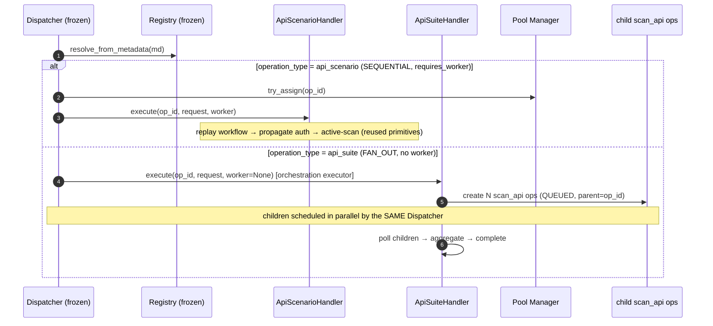

# Phase 2 — scan_api_scenario & scan_api_suite

## Status

**Implemented and verified.** Both operations are built entirely on the approved
generic execution layer. **No change was made to the frozen foundation** —
Dispatcher, WorkerService, `ZapOperationRegistry`, `ZapOperationHandler`,
`ZapOperationType`, `ExecutionStrategy`, `ApiScanHandler`, and the `execution/`
package are untouched. Companions: [`DESIGN.md`](DESIGN.md),
[`STEP1-REVIEW.md`](STEP1-REVIEW.md).

Verification: 42 ZAP-tool tests pass; full suite 150 passed (the 2 failures are a
pre-existing notification-renderer wording test that imports none of this code);
`python .ai/tools/aios.py check` → PASS; pylint 9.7/10.

---

## 1. What was added (and what was NOT touched)

New files:

```
app/schemas/tools/owasp_zap/
├── scan_api_scenario.py          # ScenarioStep, ZapApiScenarioScanRequest
└── scan_api_suite.py             # ScanAuthDefaults, ApiCategory, ZapApiSuiteScanRequest

app/services/tools/owasp_zap/
├── scan_api_scenario.py          # ZapApiScenarioService (rewritten from stub)
├── scan_api_suite.py             # ZapApiSuiteService (rewritten from empty stub)
├── scenario/
│   ├── __init__.py
│   └── context.py                # PURE: ordering, placeholders, var/cookie/JWT propagation
├── suite/
│   ├── __init__.py
│   ├── openapi.py                # PURE: OpenAPI → endpoints
│   ├── aggregator.py             # PURE: child results → application/category summaries
│   ├── reporter.py               # Markdown / JSON / SARIF rendering + save
│   └── orchestrator.py           # SuiteOrchestrator: fan-out / fan-in (injectable deps)
└── handlers/
    ├── api_scenario_handler.py   # ApiScenarioHandler + build_api_scenario_operation
    └── api_suite_handler.py      # ApiSuiteHandler + build_api_suite_operation
```

Minimal, additive edits to existing (non-frozen) files:

| File | Change | Backward-compatible? |
|---|---|---|
| `handlers/__init__.py` | export the two new `build_*` factories | yes |
| `bootstrap.py` | register the two operations; add SUITE_SCAN notification title | yes |
| `api_scanner.py` | `init_api_scan` gains optional `parent_operation_id` (metadata only when set) | yes — plain scan_api submission byte-identical |
| `constants/batch.py` | add `SUITE_SCAN` member (+ to `ALL_SCAN_TYPES`) | yes — additive |
| `routers/mcp/owasp_zap_router.py` | wire the two submit endpoints; future two stay "in development" | yes |

**Untouched (frozen):** `worker/dispatcher.py`, `worker/worker_service.py`, all of
`execution/`, `handlers/api_scan_handler.py`. Verified by grep: the Dispatcher
contains zero references to "scenario"/"suite".

---

## 2. Success criterion — met

> Adding a future operation should only require: a request model, a handler, and
> registration. No Dispatcher / WorkerService / generic-layer changes.

That is exactly what Phase 2 did. Each tool = a request schema + a service + a
handler adapter + a `build_*_operation` factory + **one** `registry.register(...)`
line in `bootstrap.py`. The generic layer proved sufficient with no
modification, which is the whole validation of the Step 1 architecture.

---

## 3. Tool 1 — scan_api_scenario

**Strategy:** `SEQUENTIAL` (worker-bound). An authenticated workflow is one
coherent session, so it runs on a single assigned worker via
`execute(op_id, request, worker)` — identical Dispatcher path to `scan_api`.

**Pipeline (inside the handler/service, on the assigned worker):**

1. **Order** — `resolve_execution_order` topologically sorts steps by
   `depends_on`, falling back to authored order; cycles/unknown deps fail the op.
2. **Replay** — each step is resolved (`${var}` placeholders substituted, context
   auth applied) and sent through the ZAP proxy so ZAP records it. The response
   feeds `ScenarioContext.capture`:
   - `extract: {var: dotted.path}` → variables (available to later steps),
   - `token_field` → current **JWT/bearer** token, propagated forward,
   - `cookie_field` + `Set-Cookie` → accumulated **cookies**, propagated forward.
3. **Context generation** — after replay, a ZAP context is scoped to the target
   origins and auth replacer rules are installed from the accumulated token/cookie
   (reusing `ZapApiScanHelpers.setup_auth_replacers`).
4. **Scan** — each scan-target step (`scan: true`, or all steps by default) is
   active-scanned with `ZapClient.run_active_scan` / `wait_for_active_scan`;
   alerts are deduped, reports saved (`save_reports`), and the operation completed
   with a standard `ZapScanResult`.
5. **Failure reporting** — a failed step raises `ScenarioStepError(step_name, …)`;
   the operation is failed with a message naming the offending step.

**Reuse, not duplication.** All scanning is done by the existing `ZapClient` +
`ZapApiScanHelpers` primitives (headers, body serialization, auth replacers,
active scan, alert conversion, report saving, TLS check, summary). The scenario
adds only the workflow replay + context propagation in front — it does not copy
any scan_api scanning logic. The one scenario-specific piece is `_send_step`,
which sends a request through the proxy **and returns the response** (the
fire-and-forget `send_through_proxy` can't, because scenarios must read responses
to extract variables).

**Replay support.** The full ordered request lives in `metadata["request"]`, so
the operation *is* a deterministic, re-runnable definition — resubmitting or
re-dispatching replays the exact workflow (survives restarts, since the row is
the queue entry).

**Deferred (per scope):** loops, conditional/parallel branches, retries,
data-driven execution, scripting.

---

## 4. Tool 2 — scan_api_suite

**Strategy:** `FAN_OUT` (orchestration). The generic Dispatcher runs it on its
orchestration executor with `worker=None` and **never assigns it a ZAP worker** —
so workers only ever execute the child `scan_api` scans.

**Orchestration (fan-out → schedule → fan-in), all in `SuiteOrchestrator`:**

1. **Plan** — each category's OpenAPI spec (inline dict, or JSON/YAML string) is
   expanded into endpoints (`openapi.extract_endpoints`), applying the category's
   `base_url`, optional method filter, and shared `defaults` (token/cookie/headers).
2. **Fan-out** — one child `scan_api` operation is created per endpoint by
   **reusing `ZapApiScanService.init_api_scan`** (tagged with
   `parent_operation_id`). No scan submission logic is duplicated.
3. **Parallel scheduling** — children are ordinary `QUEUED` rows; the existing
   Dispatcher + Pool run them in parallel across all idle workers. The suite adds
   no scheduling of its own.
4. **Fan-in** — the orchestrator polls child statuses (a cheap DB read loop on
   one orchestration thread — never a worker) until all are terminal.
5. **Aggregate** — `aggregator.aggregate_application_report` rolls child
   `ZapScanResult`s up into an **application summary**, **category summaries**, and
   **per-category endpoint reports**; `SuiteReporter` renders **Markdown**,
   **JSON**, and **SARIF 2.1.0** (aggregating existing child findings, not a new
   finding model) and saves them. The suite operation completes with the report.

**Worker occupancy invariant (satisfied):** at any instant every ZAP worker runs
an actual `scan_api`; the suite holds only one lightweight orchestration thread
doing DB polling + report merging.

**Testability by design.** `SuiteOrchestrator` takes injected collaborators
(`scan_submitter`, `operation_getter`, `reporter`, `sleep`), so fan-out/fan-in and
aggregation are unit-tested with fakes — no ZAP, DB, or worker pool required.

**Deferred (per scope):** incremental scans, historical comparison, dashboards,
scheduling, portfolio management.

---

## 5. Execution flow (both tools, on the frozen Dispatcher)



---

## 6. Backward compatibility

- Existing `scan_api` submissions are unchanged (`parent_operation_id` defaults to
  `None`; metadata shape identical).
- Legacy queued rows without `operation_type` still resolve to `API_SCAN`.
- Scenario operations use `batch_type = BATCH_SCAN` ("Scenario Security Scan",
  already mapped); suite uses the new `SUITE_SCAN` ("Application Security Scan").

---

## 7. Future tools remain ready, not built

`ZapOperationType.WEB_APPLICATION` and `INTERACTIVE_SESSION` exist as enum
members but are **not registered** and have **no implementation** (their service
files remain empty). No browser automation, Playwright, Selenium, or WebSocket
code was added. When their architecture is settled, each becomes: a request
model + a handler + one `registry.register(...)` line — no Dispatcher,
WorkerService, or generic-layer change, exactly as Phase 2 demonstrated.

---

## 8. Test coverage

| Area | Test file | Cases |
|---|---|---|
| Scenario ordering / placeholders / var-cookie-JWT propagation | `scenario/test_scenario_context.py` | 11 |
| OpenAPI expansion (dict/JSON/YAML, base_url, method filter) | `suite/test_suite_openapi.py` | 5 |
| Suite fan-out/fan-in + parallel child creation + failure counting | `suite/test_suite_orchestrator.py` | 3 |
| Aggregation + Markdown/JSON/SARIF rendering | `suite/test_suite_reporting.py` | 6 |
| Both operations register, resolve, and round-trip metadata | `test_phase2_registration.py` | 5 |
| (Step 1) generic dispatch routing incl. FAN_OUT no-worker | `test_dispatcher_generic_dispatch.py` | 3 |

All pure logic (ordering, placeholder resolution, extraction, OpenAPI parsing,
aggregation, reporting, orchestration) is unit-tested without ZAP; the
ZAP-dependent scan bodies are integration paths guarded by `importorskip`.
