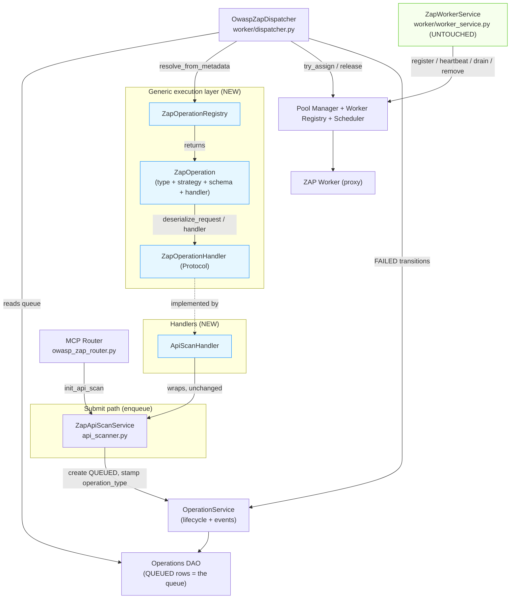

# Step 1 Review — Generic ZAP Execution Layer

## Status

**Implemented and verified — for architecture review before Phase 2.**
This document reviews the generic execution foundation exactly as it now exists
in `mcp-server/`. Everything below is grounded in the shipped code, not a
proposal. Companion: [`DESIGN.md`](DESIGN.md).

Files delivered in Step 1:

```
app/services/tools/owasp_zap/
├── execution/
│   ├── __init__.py              # package exports
│   ├── operation_type.py        # ZapOperationType         (WHAT)
│   ├── execution_strategy.py    # ExecutionStrategy        (HOW) + requires_worker
│   ├── handler.py               # ZapOperationHandler + ZapOperation
│   └── registry.py              # ZapOperationRegistry + UnknownOperationTypeError
├── handlers/
│   ├── __init__.py
│   └── api_scan_handler.py      # ApiScanHandler + build_api_scan_operation
├── api_scanner.py               # UNCHANGED behaviour; +operation_type in metadata
└── worker/
    ├── dispatcher.py            # refactored: generic, registry-driven
    └── worker_service.py        # UNTOUCHED
```

Tests: `tests/services/tools/owasp_zap/test_operation_registry.py` (12) and
`test_dispatcher_generic_dispatch.py` (3) — 15 passing. Full suite 123 passing
(the 2 failures are a pre-existing notification-renderer wording test unrelated
to this layer). `python .ai/tools/aios.py check` → PASS.

---

## 1. Dependency graph after the refactor

Arrows are "depends on / calls". The Dispatcher's only tool-related edge is to
the **registry abstraction**.



**Key reading:** the Dispatcher points at `ZapOperationRegistry` and the Pool
Manager — never at `ZapApiScanService` or any concrete request model. The only
things that touch the concrete `ZapApiScanService` are (a) the **submit**
endpoint in the router and (b) the **`ApiScanHandler` wrapper** — both by
design. `ZapWorkerService` is not on the execution path at all; it manages
worker lifecycle against the *worker* registry.

### Before → after (the seam that changed)

| | Before | After |
|---|---|---|
| Dispatcher import | `from …api_scanner import ZapApiScanService` | `from …execution.registry import ZapOperationRegistry` |
| Rebuild request | `ZapApiScanService.request_from_metadata(md)` | `zap_operation.deserialize_request(md)` |
| Execute | `self._scan_service.run_assigned_scan(…)` | `zap_operation.handler.execute(…)` |
| Routing decision | (implicit — only one tool) | `zap_operation.execution_strategy.requires_worker` |
| Constructor dep | `scan_service: ZapApiScanService` | `registry: ZapOperationRegistry` |

---

## 2. Complete execution flow per tool

### 2.1 `scan_api` (implemented, worker-bound `SEQUENTIAL`)

1. **Submit** — Router `POST /zap/scan_api` → `ZapApiScanService.init_api_scan`
   persists a `QUEUED` operation. Metadata carries
   `operation_type = "api_scan"` and the serialized request.
2. **Poll** — Dispatcher queue loop reads `QUEUED` rows (oldest first).
3. **Resolve** — `registry.resolve_from_metadata(md)` → the `api_scan`
   `ZapOperation` (strategy `SEQUENTIAL`, `requires_worker = True`).
4. **Assign** — `requires_worker` is true → `pool_manager.try_assign(op_id)`.
   No idle worker ⇒ stays `QUEUED`, retried next tick.
5. **Deserialize** — `zap_operation.deserialize_request(md)` → `ZapApiScanRequest`
   (byte-identical to the legacy `request_from_metadata`).
6. **Execute** — `handler.execute(op_id, request, worker)` →
   `ApiScanHandler` → `ZapApiScanService.run_assigned_scan(...)` → the existing
   QUICK/FULL worker function on the scan thread pool.
7. **Report** — the scan worker (unchanged) drives ZAP, saves reports via
   `ZapApiScanHelpers.save_reports`, calls `OperationService.complete(...)` with
   the result + findings, and releases the worker in `finally`.

*Behaviour is identical to before the refactor — only step 3 (resolve) is new.*

### 2.2 `scan_api_scenario` (Phase 2 — foundation designed, worker-bound `SEQUENTIAL`)

1. **Submit** — Router → `ScenarioService.init_*` persists `QUEUED` with
   `operation_type = "api_scenario"` and the ordered-steps request.
2–4. **Poll / Resolve / Assign** — identical to `scan_api`; `SEQUENTIAL`,
   `requires_worker = True`, so it claims **one** worker (a scenario is one
   coherent authenticated session, so it must run on a single worker).
5. **Deserialize** — → `ZapApiScenarioScanRequest`.
6. **Execute** — `ApiScenarioHandler.execute(op_id, request, worker)`:
   ordered replay of steps through the ZAP proxy, carrying a `ScenarioContext`
   (variable extraction + header/cookie/JWT propagation, dependency order), then
   feeds the collected requests into the **existing** active-scan pipeline.
7. **Report** — same `save_reports` + `OperationService.complete` path.

*Note the Dispatcher path is byte-for-byte the same as `scan_api`; only the
handler body differs. That is the point of the abstraction.*

### 2.3 `scan_api_suite` (Phase 2 — orchestrator, `FAN_OUT`, **no worker**)

1. **Submit** — Router → `SuiteService.init_*` persists `QUEUED` with
   `operation_type = "api_suite"` and the multi-OpenAPI request.
2. **Poll / Resolve** — Dispatcher resolves the `api_suite` `ZapOperation`
   (strategy `FAN_OUT`, `requires_worker = False`).
3. **Route to orchestration** — because `requires_worker` is false, the
   Dispatcher **never calls `try_assign`**. It marks the suite op `RUNNING`
   (so the next poll won't re-dispatch it) and submits the handler to the
   bounded **orchestration executor**, `worker = None`.
4. **Fan-out** — `ApiSuiteHandler.execute(op_id, request, None)` parses the
   specs, groups endpoints by category, and creates **child `scan_api`
   operations** (`QUEUED`, `parent_operation_id = suite op`).
5. **Children run** — the same Dispatcher + Pool + `ApiScanHandler` execute the
   children **in parallel across all idle workers** — the existing pipeline,
   not a duplicate.
6. **Fan-in** — the suite handler polls child statuses (a cheap DB loop on one
   orchestration thread — **never a worker**) until all terminal, then
   aggregates: category reports, application summary, aggregated SARIF /
   Markdown / JSON.
7. **Report** — `OperationService.complete(suite_op, aggregated result)`.

At every instant, **workers only ever run real `scan_api` operations**; the
suite occupies one lightweight orchestration thread doing DB polling + merging.

---

## 3. Sequence diagram (Request → Reporting)

```mermaid
sequenceDiagram
    autonumber
    participant Client as Request (MCP tool call)
    participant Disp as Dispatcher
    participant Reg as ZapOperationRegistry
    participant ZOp as ZapOperation
    participant H as Handler
    participant Pool as Pool Manager
    participant W as ZAP Worker
    participant OpSvc as OperationService (Reporting)

    Note over Client,OpSvc: Submit persists a QUEUED row (operation_type + request in metadata)

    Disp->>Reg: resolve_from_metadata(metadata)
    Reg->>ZOp: lookup by ZapOperationType
    Reg-->>Disp: ZapOperation (type, strategy, schema, handler)

    alt strategy.requires_worker  (scan_api / scan_api_scenario)
        Disp->>Pool: try_assign(operation_id)
        alt worker available
            Pool-->>Disp: ZapWorkerInfo
            Disp->>ZOp: deserialize_request(metadata)
            ZOp-->>Disp: typed request
            Disp->>H: execute(op_id, request, worker)
            H->>W: run scan via ZapClient (scan thread pool)
            W-->>H: alerts / raw results
            H->>OpSvc: report_progress(...) then complete(result, findings)
            H->>Pool: release_worker(worker_id, op_id)
        else no idle worker
            Pool-->>Disp: None  (stays QUEUED, retried next tick)
        end
    else orchestration strategy  (scan_api_suite: FAN_OUT / FAN_IN)
        Note over Disp,H: no worker is claimed
        Disp->>OpSvc: start(op_id)  (leaves QUEUED set; no double-dispatch)
        Disp->>H: execute(op_id, request, worker=None)  [orchestration executor]
        H->>OpSvc: create child scan_api ops (QUEUED)
        Note over H,W: children run through THIS same diagram, in parallel
        H->>OpSvc: complete(aggregated report) after fan-in
    end
```

The `requires_worker` branch is the single point where worker-bound scans and
worker-less orchestration diverge — and it is a generic property, never a tool
name.

---

## 4. Responsibilities of each new Step 1 class

| Class / unit | File | Single responsibility | Depends on | Explicitly does NOT |
|---|---|---|---|---|
| `ZapOperationType` | `execution/operation_type.py` | Strongly-typed identity of a tool (WHAT); the registry key and the value persisted in metadata | nothing (leaf enum) | know how work runs, or reference any service |
| `ExecutionStrategy` | `execution/execution_strategy.py` | Classify HOW work runs; expose `requires_worker` — the only flag the Dispatcher reads | nothing (leaf enum) | know which tool it is |
| `ZapOperationHandler` (Protocol) | `execution/handler.py` | The execution contract: `execute(op_id, request, worker\|None)` | `ZapWorkerInfo` type only | schedule, poll, or assign workers |
| `ZapOperation` (dataclass) | `execution/handler.py` | Bundle a tool's **four** owned concerns: schema, serialize, deserialize, handler | `ZapOperationType`, `ExecutionStrategy`, `BaseModel` | run anything itself; it is a descriptor |
| `ZapOperationRegistry` | `execution/registry.py` | Map `ZapOperationType → ZapOperation`; resolve from metadata; default legacy rows to `API_SCAN` | handler/type modules | import any concrete tool |
| `UnknownOperationTypeError` | `execution/registry.py` | Signal "no handler for this type" so the Dispatcher fails the op without stranding a worker | — | — |
| `ApiScanHandler` | `handlers/api_scan_handler.py` | Adapt the existing `ZapApiScanService` to `ZapOperationHandler.execute` | `ZapApiScanService` | reimplement any scan logic (pure delegation) |
| `build_api_scan_operation(...)` | `handlers/api_scan_handler.py` | Factory: assemble the `scan_api` `ZapOperation` for registration | the above | know about the Dispatcher |

Changed (not new):

- `OwaspZapDispatcher` — now depends on `ZapOperationRegistry` + an orchestration
  `Executor`; routes on `requires_worker`. Loops, heartbeat sweep, queue
  semantics, retry/failure handling, logging **unchanged**.
- `ZapApiScanService.init_api_scan` — one additive line stamping
  `operation_type` in metadata. Scan bodies **unchanged**.
- `ZapWorkerService` — **untouched**.

---

## 5. Registration mechanism

One registry, populated once at startup in the composition root. **Adding a tool
is one line here and zero lines in the Dispatcher or WorkerService.**

`app/bootstrap.py`:

```python
def build_zap_operation_registry(*, operation_service):
    registry = ZapOperationRegistry()
    registry.register(build_api_scan_operation(operation_service))          # Step 1
    # registry.register(build_api_scenario_operation(operation_service))    # Phase 2
    # registry.register(build_api_suite_operation(operation_service))       # Phase 2
    # registry.register(build_web_application_operation(operation_service)) # Future
    # registry.register(build_interactive_session_operation(operation_service))
    return registry


def build_zap_dispatcher(*, dao, operation_service, config=None):
    ...
    registry = build_zap_operation_registry(operation_service=operation_service)
    return OwaspZapDispatcher(
        operation_dao=dao,
        operation_service=operation_service,
        pool_manager=pool_manager,
        registry=registry,          # ← the only tool-related dependency
        ...
    )
```

Each `build_*_operation` factory returns a fully-described `ZapOperation`:

```python
def build_api_scan_operation(operation_service) -> ZapOperation:
    scan_service = ZapApiScanService(operation_service=operation_service)
    return ZapOperation(
        operation_type=ZapOperationType.API_SCAN,
        execution_strategy=ExecutionStrategy.SEQUENTIAL,
        request_model=ZapApiScanRequest,
        handler=ApiScanHandler(scan_service),
    )
```

Startup calls `build_zap_dispatcher` (see `app/core/startup.py`), so the
registry is assembled and injected before the dispatcher threads start. Nothing
else needs to know a tool exists.

---

## 6. Worked example — adding a future tool with zero Dispatcher/Worker changes

Below is the *complete* set of changes to add each hypothetical tool. In both
cases the diff to `dispatcher.py` and `worker_service.py` is **empty**.

### 6.1 `scan_web_application` (worker-bound — one browser+ZAP session per worker)

Add **one enum member is already present** (`ZapOperationType.WEB_APPLICATION`),
then add new files and one registration line:

```python
# app/schemas/tools/owasp_zap/scan_web_application.py   (NEW — request schema)
class ZapWebApplicationScanRequest(BaseModel):
    report_group: str
    start_url: str
    scan_mode: ZapScanMode = ZapScanMode.FULL
    browser_engine: Literal["playwright", "selenium"] = "playwright"  # design TBD
    max_crawl_depth: int = 5

# app/services/tools/owasp_zap/scan_web_application.py   (NEW — execution service)
class ZapWebApplicationService:
    def run_assigned(self, operation_id, request, worker) -> None:
        # drive browser crawl → route traffic through the worker's ZAP proxy →
        # existing active-scan pipeline → OperationService.complete(...)
        ...

# app/services/tools/owasp_zap/handlers/web_application_handler.py   (NEW)
class WebApplicationHandler:
    def __init__(self, service): self._service = service
    def execute(self, operation_id, request, worker):
        self._service.run_assigned(operation_id, request, worker)

def build_web_application_operation(operation_service) -> ZapOperation:
    return ZapOperation(
        operation_type=ZapOperationType.WEB_APPLICATION,
        execution_strategy=ExecutionStrategy.SEQUENTIAL,   # worker-bound
        request_model=ZapWebApplicationScanRequest,
        handler=WebApplicationHandler(ZapWebApplicationService(operation_service)),
    )
```

```diff
# app/bootstrap.py — the ONLY edit to existing code
  registry.register(build_api_scan_operation(operation_service))
+ registry.register(build_web_application_operation(operation_service))
```

```diff
# app/services/tools/owasp_zap/worker/dispatcher.py
  (no changes)
# app/services/tools/owasp_zap/worker/worker_service.py
  (no changes)
```

Because the strategy is `SEQUENTIAL` (`requires_worker = True`), the Dispatcher
already assigns a worker and calls `handler.execute` — no new routing code. The
open browser-automation questions (Playwright vs Selenium vs hybrid, CDP, remote
browser) live entirely inside `ZapWebApplicationService` and its request schema.

### 6.2 `scan_interactive_session` (worker-bound — a live session pinned to one worker)

Same shape; `ZapOperationType.INTERACTIVE_SESSION` already exists:

```python
# NEW: schemas/…/scan_interactive_session.py  (request schema; e.g. session TTL,
#      interaction transport: cdp | websocket | remote — design TBD)
# NEW: services/…/scan_interactive_session.py (ZapInteractiveSessionService)
# NEW: handlers/interactive_session_handler.py

def build_interactive_session_operation(operation_service) -> ZapOperation:
    return ZapOperation(
        operation_type=ZapOperationType.INTERACTIVE_SESSION,
        execution_strategy=ExecutionStrategy.SEQUENTIAL,   # a live session holds one worker
        request_model=ZapInteractiveSessionScanRequest,
        handler=InteractiveSessionHandler(
            ZapInteractiveSessionService(operation_service)
        ),
    )
```

```diff
# app/bootstrap.py
+ registry.register(build_interactive_session_operation(operation_service))
```

Dispatcher and WorkerService diffs are again **empty**. If a future tool were
instead an *orchestrator*, it would simply declare `ExecutionStrategy.FAN_OUT`
and the Dispatcher's existing orchestration branch would run it without a
worker — still no Dispatcher edit.

**Checklist to add any ZAP tool** (proves the Open/Closed property):

1. Reuse or add a `ZapOperationType` member. ✅ both placeholders already exist
2. Add a request schema (Pydantic model). — new file
3. Add an execution service (or reuse one). — new file
4. Add a handler adapting it to `execute(...)`. — new file
5. Add a `build_*_operation(...)` factory choosing the strategy. — new file
6. Add **one** `registry.register(...)` line in `bootstrap.py`. — 1 line
7. Wire the router submit endpoint (already stubbed for both web tools).
8. Dispatcher / WorkerService / Pool / Scheduler / queue: **no change**.

---

## 7. Decoupling verification (evidence)

Ran against the shipped code:

**(a) No concrete scan dependency in the Dispatcher.** The only two textual
matches for `ZapApiScanService` in `dispatcher.py` are *comments* (a thread-model
note and a comment explaining the registry replaced the old dependency) — there
is no import and no call:

```
$ grep -nE "ZapApiScanService|api_scanner|scan_api_scenario|scan_api_suite|\
ScenarioService|SuiteService|ZapApiScanRequest|run_assigned_scan" \
    app/services/tools/owasp_zap/worker/dispatcher.py
26: ...``api_scanner.py``) rather than asyncio tasks...      # comment
70: # The generic registry replaces the former direct ZapApiScanService  # comment
```

**(b) The Dispatcher imports only generic units:**

```
from app.integrations.owasp_zap.pool import OwaspZapPoolManager      # type only
from app.schemas.internal.operation import OperationRecord
from app.schemas.tools.owasp_zap.worker import ZapWorkerLifecycleState
from app.services.operations.operation_service import OperationService
from app.services.tools.owasp_zap.execution.handler import ZapOperation
from app.services.tools.owasp_zap.execution.registry import ZapOperationRegistry
```

No concrete tool, no concrete request model.

**(c) `ZapWorkerService` has no tool-specific references.** Its only "registry"
is the **worker** registry (`OwaspZapWorkerRegistry`), not the operation
registry; it never mentions any scan tool. Untouched by Step 1.

**(d) Whole-repo, who references the concrete `ZapApiScanService`?** Exactly two
legitimate sites — the **submit** endpoint and the **handler wrapper**:

```
app/routers/mcp/owasp_zap_router.py   → init_api_scan (enqueue)   ✅ submit side
app/services/tools/owasp_zap/handlers/api_scan_handler.py → wraps  ✅ adapter
```

The Dispatcher appears in neither list.

**Conclusion:** the Dispatcher depends only on the generic
`ZapOperationRegistry` / `ZapOperation` abstractions. There are **no remaining
references where the Dispatcher depends on a concrete scan implementation**, and
adding future tools requires **no Dispatcher or WorkerService modification**.

---

## Recommendation

The generic layer meets all eight review decisions and the Open/Closed goal.
On approval, proceed to Phase 2: implement `build_api_scenario_operation` and
`build_api_suite_operation` (+ their services/handlers/schemas) and register
them with the two commented lines in `build_zap_operation_registry` — no changes
to the Dispatcher or WorkerService.
