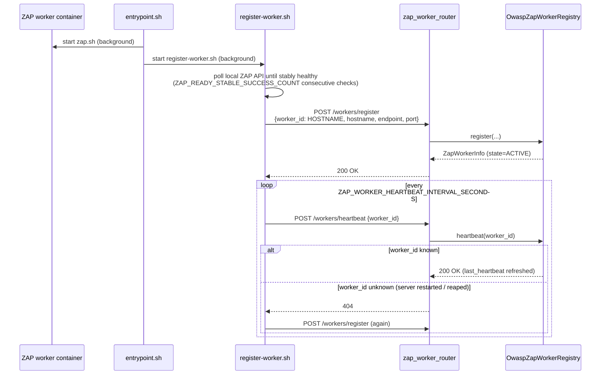
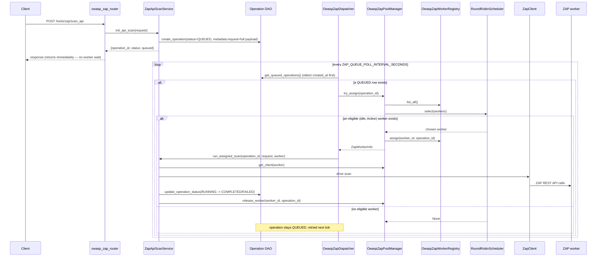
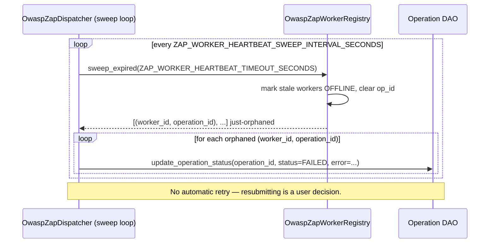
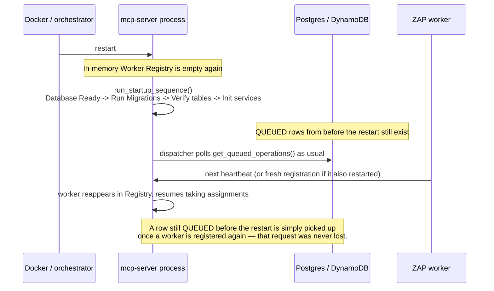

# Sequence Diagrams

## Worker registration + heartbeat

## Scan request -> persisted queue -> dispatch -> execution

## Heartbeat timeout -> worker offline -> operation failed

## Server restart (why a QUEUED request is never lost)

**Known gap:** this covers `QUEUED` rows, not a row that was `RUNNING` at the exact moment the *mcp-server process itself* crashed (as opposed to the worker crashing, which the heartbeat-timeout sweep above does catch). In that specific case the in-memory Registry — including which worker held that `op_id` — is gone, the worker re-registers as freshly idle, and the operation is left `RUNNING` with nothing pointing at it, because the Dispatcher only re-polls `QUEUED` rows. It is not silently retried or duplicated, but it also isn't automatically marked `FAILED` — it would need to be surfaced and resolved manually (e.g. via `/tools/history/*`) until a "reconcile stale RUNNING rows on startup" step is added. This is a deliberate scope boundary for this refactor, not an oversight: closing it fully means deciding what "stale" means for a `RUNNING` row across a restart, which is a policy question, not just a mechanical one.
